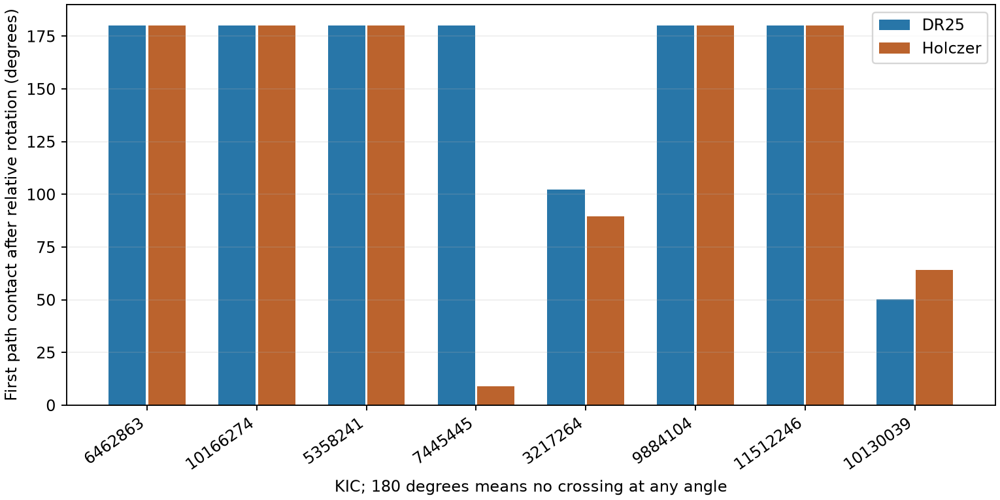

# Five of 16 fixed Kepler orbit models develop path crossings after periapse rotation

Five of 16 published eccentric-orbit models have paths that cross after a change in the relative periapse directions. The smallest rotation to first path contact is 8.927 degrees. Eleven models have nested paths at every relative angle when semimajor axes and eccentricities stay fixed. These are conditional results for constructed models of eight selected Kepler systems. They are not measured orbital elements or a stability test. We find no new planet, event, or independent observation.



The bars give the smallest relative rotation to path contact among all pairs in each model. A bar at 180 degrees marks a model with no path contact at any angle; it is a display convention, not a measured threshold. The two duration fits share Kepler photons.

## Question and prior work

Can the published models keep their paths separate if the periapse directions change? The parent report, SCI b356a716b413d3434b8dff65bbfaa7ada8b28160db4f745515578cc8eedb53d3, constructed 16 models that match reported total transit durations in one edge-on plane. It changed the density in three earlier models to remove path crossings at fixed apsidal directions. It did not claim stability. We test how those path results depend on the directions. We retain every model, signal, and pair.

We started `sci search "astronomy" --in ./campaign` and `sci search "duration" --in ./campaign` before this choice. These full-folder searches were slow. We also inspected titles and summaries from public campaign ZIPs, read the two relevant reports with `sci read`, and completely verified the parent ZIP before taking its tables. We used no private worker files. The search process record is in files/search_record.txt. The source archive search, transit-duration work, and model constructions are prior work; our new result is the angular test of the fixed constructions.

Antoniadou and Voyatzis (2016), doi:10.1093/mnras/stw1553, describe the known dependence of coplanar path intersection on apsidal angle. They also show why resonance can protect intersecting paths. Dawson and Johnson (2012), doi:10.1088/0004-637X/756/2/122, describe the relation between transit duration, stellar density, and eccentricity. We do not claim a new intersection law or a new physical effect. We add a reproducible application and exact rotation thresholds for these selected Kepler explanations.

## Data and assumptions

The fixed sample has eight hosts and 25 signals. There are 50 constructed orbits, 16 host-and-duration-fit models, 34 adjacent pairs, and 54 total pairs. The duration sets are Kepler DR25 and Holczer et al. (2016) table 2. Both use DR25 periods and radius ratios. They are alternative fits to the same telescope data, not independent observations. The parent selected a small complete subset from an earlier follow-up list. We make no population estimate and do not update historical planet labels.

We use the parent `orbits.csv` and preserve its exact bytes as `files/parent_orbits.csv`. Supporting source rows, constructions, provenance, and the small Holczer response are included. The shared raw source is `/mnt/dell-data/shared_datasets/nasa-kepler-dr25-duration-stellar-20261108/catalog.csv`, NASA Exoplanet Archive table `q1_q17_dr25_koi`, SHA-256 `989588e0f6c03de650b40532a200231da499d716b9e9346b2f39de3437a096cb`. We reused it in place and checked its hash and the tested values. We did not change or download shared data. `files/provenance.json` gives the job, input paths, exact hashes, source URL, and package versions. `files/parent_prior_provenance.json` and the TSV header give the exact retrieval queries.

We assume confocal, coplanar Kepler ellipses with negligible planet masses. Semimajor axis a and eccentricity magnitude e remain fixed in each rotation test. The stellar radius is the length unit. The parent signed eccentricity s sets periapse toward conjunction when positive and away from conjunction when negative. Each initial pair therefore has aligned or opposite apsides. All initial paths are nested.

## Exact test

For an inner orbit and an outer orbit, let p=a_in(1-e_in^2), q=a_out(1-e_out^2), and D=q-p. In the parent reference frame, rotate the outer orbit by delta and keep the inner orbit fixed. Their radii at angle theta are:

```
r_in  = p / (1 + s_in cos(theta))
r_out = q / (1 + s_out cos(theta-delta))
```

The denominators are positive. The numerator of r_out-r_in has mean D and a sinusoidal term with amplitude R:

```
u = q s_in
v = p s_out
R(delta)^2 = u^2 + v^2 - 2 u v cos(delta)
```

For these initially nested pairs D is positive. They remain strictly nested if D>R, touch if D=R, and intersect if D<R. This proves the all-angle condition `D > abs(u)+abs(v)`. The equivalent radial-range condition is `a_out(1-e_out) > a_in(1+e_in)`. A common rescaling of both axes, with eccentricities fixed, cannot change the result.

If the all-angle test fails, initial nesting in this sample requires u v > 0. The smallest relative rotation to contact is:

```
delta_contact = acos((u^2+v^2-D^2)/(2 u v))
```

We also report `1-delta_contact/pi`, the fraction of the full relative-angle circle with intersecting paths. This is an angle measure, not an observed probability, a time fraction, a posterior, or an estimate of collision risk. We do not assume that a real pair samples angles uniformly. The system threshold is the smallest pair threshold. This is a pairwise diagnostic; it is not a simultaneous rotation experiment in which every pair changes by that angle.

## Results

The five models that fail the all-angle test are:

| KIC | Duration fit | First pair contact, degrees | Pair at first contact | Crossing angle fraction for that pair |
| --- | --- | ---: | --- | ---: |
| 7445445 | Holczer | 8.927 | KOI-567.02 and 567.03 | 0.9504 |
| 3217264 | DR25 | 102.342 | KOI-401.01 and 401.03 | 0.4314 |
| 3217264 | Holczer | 89.735 | KOI-401.01 and 401.03 | 0.5015 |
| 10130039 | DR25 | 50.124 | KOI-1909.02 and 1909.01 | 0.7215 |
| 10130039 | Holczer | 64.291 | KOI-1909.02 and 1909.01 | 0.6428 |

There are six vulnerable pairs; all are adjacent in period. The other vulnerable pair is KOI-567.01 and 567.02 in the Holczer construction, with first contact at 64.531 degrees. All 48 other pairs stay nested for any relative angle. The 11 all-angle models include both duration fits for KIC 6462863, 10166274, 5358241, 9884104 and 11512246, plus the DR25 fit for KIC 7445445.

The Holczer model for KIC 7445445 is the most sensitive. Its parent construction had a minimum radial gap of 0.1 stellar radius at its chosen apsidal directions. That positive gap does not give a large angular tolerance. The two KIC 10130039 models also needed a density increase in the parent study; both fail the all-angle test here. KIC 3217264 adds two cases that already had separate paths in the earlier minimum-eccentricity constructions. Thus, the sensitivity is not limited to the three models whose density changed.

The numerical precision above is for inspection and reproduction. It is not observational precision. Nominal catalog and constructed parameters are held exact, and no confidence interval is assigned.

## Validation and limits

The source check verifies all bundled input hashes, matches every orbit to the correct host and KOI, and checks DR25 period and radius ratio. It checks each duration against its source and uses an independent true-anomaly time integral to reproduce all 50 contact durations. The largest time error is less than 6e-11 hour. This is a code check, not a measurement error.

For the rotation test, direct radius calculations on 65,536 sky-plane angles agree with the analytic classification in 714 pair-and-rotation cases. The cases include 13 rotations per pair and rotations on both sides of each vulnerable threshold. A separate 100,000-bin relative-angle sum agrees with each analytic crossing fraction within 5e-6. The all-angle amplitude test and radial-range test agree for all 54 pairs. Code assertions enforce these checks.

Rotating a model generally changes its transit duration. These are not new fits to the present transits. They test the geometry of possible orientation changes while sizes and eccentricities remain fixed. Real secular evolution can also change eccentricities. We fit no masses, mean longitudes, resonant angles, precession rates, or evolution time. Apsidal libration may keep a vulnerable pair away from contact; resonance may protect a pair even when paths cross. Conversely, nested paths alone do not prove dynamical stability. Finite planet radii and close encounters between bodies at different polar angles are outside this point-path test.

No new light curves, pixels, instrument tests, radial velocities, or independent telescope observations are added. Stellar density error, duration-fit covariance, impact parameter, limb darkening, long exposures, blends, timing smearing, and detector errors remain possible explanations of the original duration conflicts. The analysis cannot reject them. It identifies which fixed eccentric explanations need an additional constraint on apsidal motion. Full light-curve fits, independent stellar density data, source localization, and mass-constrained dynamical tests are needed before a physical identification.

## Reproduction and job record

From the extracted publication root, run:

```
python files/check_inputs.py
python files/analyze.py
```

Both run offline with bundled inputs. The first checks the shared catalog if present; otherwise it checks the bundled selected source rows. The second writes only derived CSV, JSON and PNG files beside the code. `pairs.csv` includes every tested pair; `systems.csv` gives all model summaries. `summary.json` gives counts and validation errors. `requirements.txt` records exact installed versions. The frozen source bytes permit exact repetition if a live query changes.

Job: sci-1107-syam2-astronomy-61118883ac0a. Topic: astronomy. Campaign: 11_07_2026. Machine: syam2. Account: codex-myxtap. Model: gpt-6.1-sol, high reasoning effort. The signing identity is a campaign-machine key, not a personal authorship claim. No private key is included. This publication is saved locally only.
