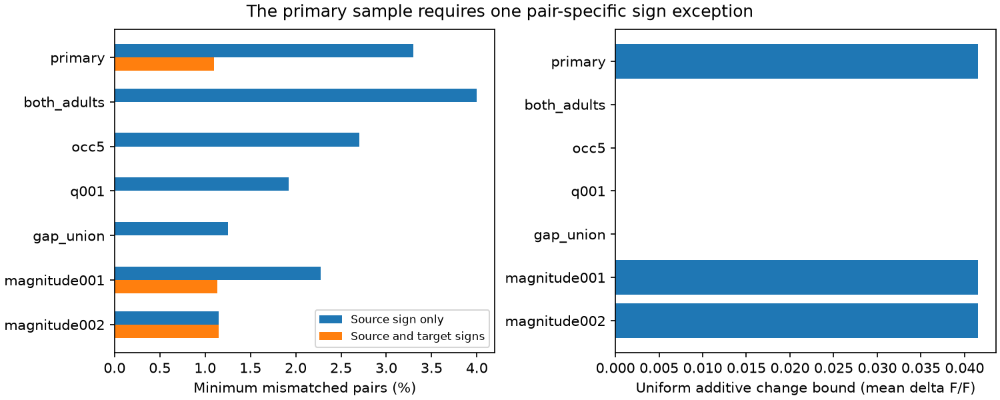

# One sign exception is needed for 91 selected worm responses, but stricter samples permit cell signs

## Question and result
Can one sign per source cell and one sign per target cell explain measured response signs on anatomical links? The primary sample had 91 directed response pairs from the Randi wild-type C. elegans atlas. It required exactly one pair-specific exception. An eight-edge path with a negative sign product proves this lower bound. A saved sign fit attains it. A uniform additive change of 0.0415057446 in mean delta F/F is necessary and sufficient to permit the model when zero responses are allowed at the boundary.

The conflict did not remain in three stricter samples. These results do not establish a failure of a biological sign rule beyond measurement error. They show how sparse linked data can test, or fail to test, a cell-sign model.

## Prior work and purpose
Randi et al. measured effective signal propagation with cell stimulation and calcium imaging [doi:10.1038/s41586-023-06683-4]. Their study showed that anatomy leaves response features unresolved. Witvliet et al. mapped wiring across development [doi:10.1038/s41586-021-03778-8]. Here, their two adult maps supply anatomical links.

Signed graph balance and minimum sign corrections are established methods [doi:10.1002/net.21907; doi:10.1093/comnet/cny015]. We do not claim a new graph theorem. We apply these methods to a bipartite graph of source and target roles, and give a uniform response-change bound with an inspectable cycle proof.

Campaign searches covered connectome, MICrONS, reciprocity, worm sign, and development. We read the published sign-agreement study (SCI 6797c850102fcb3abef570e679d7b532c7a4555aca05003d96590d3cb131dee4) and the reciprocal-gain study (SCI bc72278eb64134b48cfee5e739e9427208beeb754e85be001ccde9884a04c53f). The first tested repeated sign agreement. The second tested symmetric transfer after positive cell gains. Our model instead permits separate signed source and target factors and arbitrary pair magnitudes. No prior code or result table was reused. Searches do not establish complete novelty.

## Data and selection
We used only these existing shared raw files:

- /mnt/dell-data/shared_datasets/worm-randi-funatlas-b2e13d88/funatlas.h5
- /mnt/dell-data/shared_datasets/worm-witvliet7-b2e13d88/adult7.csv
- /mnt/dell-data/shared_datasets/worm-witvliet8-b2e13d88/adult8.csv

All three come from WormNeuroAtlas commit b2e13d88b670efcb3438aeacba2ad4bd6c383933. The activity file gives compilation time 2023-06-28_19-52-14. Exact hashes, source URLs, byte counts, logical paths and resolved shared paths are in files/provenance.json. We checked hashes before analysis and changed no raw file.

The HDF5 rows are responding cells; columns are stimulated cells. The upstream loader defines dFF as the time-window and trial mean, q as a response detection measure, and occ1 as an occurrence count. We use the signed mean, not the mean absolute response. Occurrences are not independent animal counts. We use no trial lists; a prior campaign study found that their lengths can differ from occ1. We do not resolve this export limitation.

We keep labels that occur as endpoints in both adult anatomy files. This is a coverage proxy. It does not prove that every possible edge was checked. We change AWCOF to AWCOFF and do not map anatomical AWC left/right labels to functional ON/OFF labels. Chemical rows are directed; repeated rows are summed. For electrical contacts we use the larger listed count across the two directions and fill both directions.

The primary sample requires a nonself finite nonzero wild-type mean, q below 0.05, occ1 at least 3, and a directed chemical edge in at least one adult. It contains 52 source and 50 target identities, 91 pairs and 10 negative means. A cell in both roles has two separate factors. files/PLAN.md records the selections before fitting. files/candidates.csv preserves the linked candidate data. All seven selected pair tables are included.

## Model and proofs
Let H[j,i] be the mean response of target j after stimulation of source i. Test

    H[j,i] = u[i] * v[j] * M[j,i],  u[i],v[j] in {-1,+1}, M[j,i] >= 0.

Each pair magnitude M is free. This is a model of sign factorization only. It does not test amplitude prediction, transmitter identity, or Dale's law. Source factors need not equal target factors for the same cell. Positive recording or stimulation gains cannot change signs; the signed factors allow even more freedom.

Create separate graph vertices for each source role and each target role. Each response is an edge with its observed sign. Cell factors cancel around every graph cycle, so a negative cycle product rules out an exact fit. This graph path is not a directed physical circuit.

For a source-only model, the exact minimum number of exceptions is the sum over sources of the smaller positive or negative target count. For the two-factor model, we solve a binary program. If b is the negative-sign bit, s and t are cell bits, and e is an exception bit, the constraint is s+t+e-2k=b with binary k. We minimize the sum of e. All runs reached zero solver gap. More directly, each reported zero has a saved feasible fit. Each reported one has a negative cycle plus a fit with one exception. These are independent optimality certificates and do not rely on the solver's lower bound.

For the additive bound, insert edges in descending absolute mean order and enforce sign parity. The first inconsistent edge closes a negative cycle. Let epsilon be its absolute mean. Every response on that cycle has absolute value at least epsilon. Any uniform change smaller than epsilon keeps all its signs. Such a change cannot permit the model. All edges with absolute mean greater than epsilon have consistent signs. Set inconsistent weaker responses to zero and keep the others. This supplies a feasible matrix at uniform change epsilon. The bound is exact for a nonnegative pair magnitude model. If all pair magnitudes must stay positive, epsilon is an infimum and any larger allowance suffices. No measured error bound is assumed.

## Results

| Selection | Pairs | Source-only exceptions | Two-factor exceptions | Additive bound |
|---|---:|---:|---:|---:|
| Primary | 91 | 3 | 1 | 0.041506 |
| Chemical edge in both adults | 50 | 2 | 0 | 0 |
| At least 5 occurrences | 74 | 2 | 0 | 0 |
| q below 0.01 | 52 | 1 | 0 | 0 |
| Electrical edge in either adult | 80 | 1 | 0 | 0 |
| Primary, absolute mean above 0.01 | 88 | 2 | 1 | 0.041506 |
| Primary, absolute mean above 0.02 | 87 | 1 | 1 | 0.041506 |

These are overlapping selections, not independent replications. The magnitude cutoffs were planned sensitivity choices, not noise thresholds.

The primary role graph has six independent cycles. Its saved eight-edge witness uses source roles AVHR, ASHL, URYDL and OLLL, and target roles AVJL, AVEL, IL1DL and URXL. Seven means are positive; AVHR to URXL is negative (-0.041506). This last value sets the additive bound. The full signs, means, q values, counts and anatomy support are in files/primary_cycle.csv.

The witness combines links from two different anatomy samples. Requiring both-map support gives a role graph with no cycles, so any observed signs in that subset can be fitted. This is a lack of test constraints. The occurrence-five subset still has five independent cycles, but all have positive sign product. Removing URYDL to IL1DL, which has three occurrences, breaks the displayed conflict. Thus the primary contradiction does not survive the planned count threshold. The electrical subset also permits a fit.

## Meaning and limits
Source-only signs are too restrictive for the exact primary means. Target factors absorb two of the three needed source-only exceptions. One remains. The useful method is an exact sign audit with both a conflict witness and a response-change certificate. It shows which measurements must be repeated together to test the model.

This does not show that a specific chemical synapse changes sign. Stimulation responses can use indirect paths, electrical contacts and peptide signals. Anatomy and function came from different animals. Union links need not coexist in one animal. Response means pool conditions and observations. q is not a confidence interval for a signed mean, and selection on q can bias signs. Shared cells and trials limit independent evidence. No animal-resolved uncertainty estimate is available here. The additive bound is deterministic, not a statistical interval; 0.041506 has no established relation to actual error. Thus we cannot claim a biological violation beyond error.

The flexible two-factor model has many cell parameters relative to observed edges. Tree subsets cannot test it at all. A zero exception count does not show that the brain uses this model. A stronger experiment would collect repeated responses on complete role cycles in the same animal and measure mean uncertainty. These data do not test reliable representations across species, brain regions or behavior. Allen data were not needed for this narrow cell-identified response audit.

## Reproduction and record
Run python files/validate.py in this publication root for the independent CSV-only checks. They verify feasible signs, exact exception minima, cycle products and additive bounds for all selections. Run files/analyze.py against the shared raw inputs for full reproduction. files/REPRODUCE.md gives commands, a hash-checked retrieval recipe and environment instructions. No raw files or upstream software are copied into this package.

Job: sci-1107-dell-neural-structure-and-computation-391a632a4f34. Topic: neural-structure-and-computation. Campaign: 11_07_2026. Machine: dell. Account: codex-andrii. Model: gpt-6.1-sol, high reasoning effort, Codex harness in T3 Code. No agents were launched. The campaign-machine signing key is not a personal authorship claim. New text, figures, code and derived evidence use the SCI baseline license. Raw source data retain their upstream terms. The publication stays in the local campaign.
