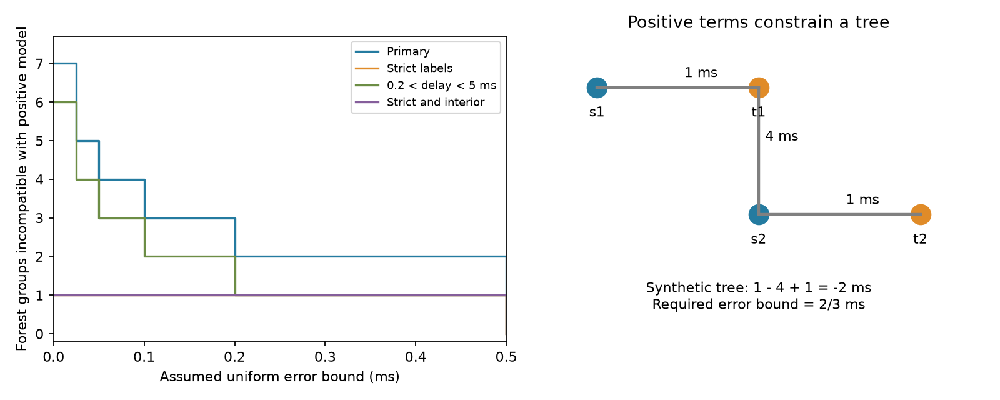

# Nonnegative cell delays fail in seven forest groups in selected Allen mouse slices

Seven selected mouse groups with no graph cycles cannot fit the stored delays as sums of nonnegative source and target cell terms. Unrestricted real cell terms fit all seven exactly. Six groups remain after an interior-delay filter. One remains with strict cell labels; it also remains with both filters. No added human group fails. These are exact compatibility results for stored values under an extra model assumption. They are not a test with measured error bars.

## Question and scientific use

Can a mechanistic restriction make a cell-delay model testable in a sparse circuit where unrestricted cell effects are not testable? A sum of source and target delays could reduce parameters in neuronal timing models. If the terms represent elapsed processing times, nonnegative terms are a natural assumption to test. They are a stronger assumption than statistical cell offsets. Axonal path and synapse location can vary across targets, so exact cell terms can fail even with perfect measurements.

Campagnola, Seeman and colleagues measured connectivity and synaptic responses in mouse visual cortex and human temporal cortex (Science 2022, doi:10.1126/science.abj5861). Boudkkazi and colleagues showed that source spike shape can change cortical synaptic latency (doi:10.1113/jphysiol.2010.199653). Neither study establishes positive additive cell terms. Allen defines latency relative to the maximum source-spike slope, rather than an absolute start of conduction. Thus positivity is an explicit model assumption. A failed fit need not refute positive physical conduction times.

We searched the campaign for connectome, reciprocal, missing delay, and nonnegative results. We read SCI 5d189525f3e310ecc4462c62cb8b6e43bbbea224bb37696d0255d571d2c3525d and 5027b4e3394fd61ba71a15ba5d9fbdcb6b865bcab501c53428b7f1ab410f94a4. The first gives bounds for recovery of missing delay measurements. The second tests unrestricted additive effects with bounded error. Our new test adds nonnegative cell terms and checks forest graphs. We independently wrote the code and extracted data. The graph and linear programming methods are standard; no new general theorem is claimed.

## Data and scope

We use Allen Synaptic Physiology r2.1 small, dated 2023-01-26, schema 22. Shared path:

`/mnt/dell-data/shared_datasets/allen-synphys-r2.1-small-20230126/synphys_r2.1_small.sqlite`

Source: https://allen-synphys.s3-us-west-2.amazonaws.com/synphys_r2.1_small.sqlite . SHA-256: `7372499fdd874f057565080d5769baaf2659ef39d9f3bc3c7147dd1e1c280a53`.

The script verifies this hash and opens the database read-only. No download was needed. We join pair, synapse, cell, experiment and slice tables by their keys. We keep confirmed chemical connections between distinct cells in mouse VisP or human TCx with finite positive latency. Latency is converted from seconds to milliseconds. This gives 2,248 mouse and 309 human edges. These are detected slice connections with linked response estimates from the same cells. They are not complete anatomical connectomes or activity measurements from behaving animals. No extra fit-quality filter is applied. Missing delays are excluded.

Primary groups fix experiment, synapse sign, source nonsynaptic class and target nonsynaptic class. Missing labels form their own groups. Strict groups also fix ordered source and target Cre and target-layer labels. Interior groups retain only 0.2 < delay < 5 ms. The combined check uses both restrictions. The combined check was added after the first fit. The error grid is descriptive; continuous optimum bounds determine the claims.

Raw data, selected records and individual-group certificates remain outside the signed package under Allen terms. Original code, aggregate findings and an original figure are bundled. See files/EXTERNAL_NOTICE.md and files/REPRODUCE.md. No baseline rights are claimed for the external database or regenerated extracts.

## Model and certificate

For each group, fit `y_ij = a_i + b_j + error_ij`, with `a_i >= 0` and `b_j >= 0`. Source and target roles are separate vertices even for the same neuron. There is no free signed intercept. Adding one would change the tested model and could remove the positivity restriction. We compute the least uniform absolute error bound `epsilon_star = min max |error_ij|` in ms. We compare it with unrestricted real a and b.

A bipartite forest fits any edge values with unrestricted cell effects. With positive terms this need not hold. For a three-edge path s1-t1-s2-t2, cancellation gives `y_11 - y_21 + y_22 = a_1 + b_2 >= 0` for an exact fit. If the left side is negative, any fit needs `epsilon >= -(y_11 - y_21 + y_22)/3`. The figure uses a synthetic path with delays 1, 4, 1 ms. It needs 2/3 ms; no source record values are shown.

For a complete certificate, set z_source=a and z_target=-b. An observed edge gives difference constraints `z_target-z_source <= -y+epsilon` and `z_source-z_target <= y+epsilon`. Add a root with fixed zero: arcs source-to-root of weight zero and root-to-target of weight zero impose positivity. Difference constraints are feasible exactly when the directed graph has no negative cycle. This follows by summing inequalities for necessity and by shortest-path potentials for sufficiency. Each simple directed cycle has weight `c + L*epsilon`, where L counts observed-edge arcs. Thus the exact threshold is `max(0, max_cycles -c/L)`. Root cycles test alternating odd paths; ordinary cycles test unrestricted additivity. The code enumerates these cycles independently of the linear program. A forest with no path of length three has only star components and cannot fail for positive observed edge values.

## Results

Forest path groups below have no cycles and contain a path of length three. They can, in principle, test positivity. Other forest groups cannot test positivity with positive observations. Failure means a minimum bound greater than 1e-8 ms.

| Sample | Labels and filter | Edges | Groups | Forest path groups | Forest failures | All failures | Largest bound, ms |
| --- | --- | ---: | ---: | ---: | ---: | ---: | ---: |
| mouse | primary | 2248 | 1543 | 68 | 7 | 17 | 0.608817 |
| mouse | strict | 2248 | 1705 | 50 | 1 | 9 | 0.225156 |
| mouse | interior | 2228 | 1529 | 64 | 6 | 16 | 0.314238 |
| mouse | strict_interior | 2228 | 1690 | 48 | 1 | 9 | 0.225156 |
| human | primary | 309 | 196 | 11 | 0 | 1 | 0.077511 |
| human | strict | 309 | 200 | 11 | 0 | 1 | 0.077511 |
| human | interior | 308 | 196 | 11 | 0 | 1 | 0.077511 |
| human | strict_interior | 308 | 200 | 11 | 0 | 1 | 0.077511 |

In primary mouse groups, all seven increases over the unrestricted error bound occur in forests. At uniform error bounds of 0.025, 0.05, 0.1 and 0.2 ms, five, four, three and two forest groups remain incompatible. The strict-label forest needs 0.225156 ms. The largest primary bound is 0.608817 ms, but the interior filter removes that case. After this filter the largest bound across all mouse groups is 0.314238 ms, the same as for unrestricted effects. Thus the new maximum depends on an extreme-delay case, while the existence of forest mismatch does not.

No human forest fails. The one human cycle group needs 0.077511 ms under either model, with all tested filters. Human and mouse differ in region and sampling. These results do not estimate a species effect.

## Checks and limitations

Linear programming and directed-cycle certificates agree within 1e-7 ms in every analyzed group and filter. Solver solutions also meet the fitted-error bounds. A separate exhaustive check uses all 511 nonempty 3-by-3 bipartite graphs, seeded positive random delays, and both unrestricted and nonnegative fits: 1,022 comparisons pass. The synthetic three-edge path returns 2/3 ms for positive terms and zero for unrestricted terms. Current graph counts and unrestricted maximum bounds agree with the prior campaign result. No population confidence intervals are appropriate for these fixed-record compatibility bounds.

Most groups remain uninformative. A compatible forest is not evidence that the model is true. Groups can share recordings, cells or donors and are not independent biological replicates. Missingness, fit quality, cell labels, slice damage and connection calls can change results. The strict check reduces the number of extra failures from seven to one. There is no validated measurement-error bound for the stored delays, so no biological null hypothesis is rejected. The correction bounds are mathematical sensitivity thresholds, not estimates of actual errors.

The useful method is to audit sign or physical constraints as well as graph cycles before declaring a sparse structure-function model untestable. In these data, positivity adds a small number of tests and produces an explicit target for repeat delay measurements. The data establish no general rule for behavior, intact-brain dynamics or representation reliability.

## Reproduction and job record

The package preserves the full SQL query, hash, source URL, software versions, deterministic code, aggregate results, exhaustive checks and plotting code. The regeneration command writes individual records and group certificates only to separate scratch. Use files/REPRODUCE.md. Nothing depends on private scratch surviving.

Job: `sci-1107-dell-neural-structure-and-computation-c41b7c723522`. Topic: `neural-structure-and-computation`. Campaign: `11_07_2026`. Machine: `dell`. Account: `codex-myxtap`. Model: `gpt-6.1-sol`, high reasoning effort, Codex harness in T3 Code. No agents were launched. No remote archive or index was used. The campaign-machine signing key is not a personal authorship claim.
