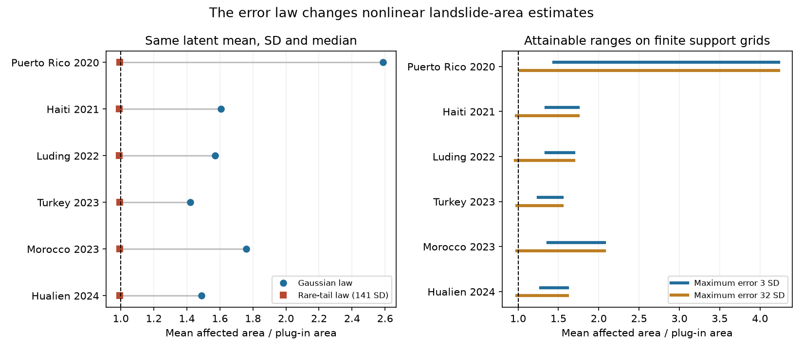

# Input error laws with the same moments reverse Gaussian area changes in six USGS landslide maps

A prior audit of six archived USGS landslide maps found that Gaussian input error raised calculated mean affected area by factors of 1.42 to 2.59. We reproduce those values. We then show that the same latent input means and variances permit a decrease in every case. The result remains when zero must also be a median of input error. The direction of the change is therefore not identified by these moments alone.

This is a test of model assumptions. It is not a test against observed landslides. The prior audit stated its Gaussian assumption. Our result does not refute its conditional calculation or its separate findings on invalid beta moments.

## Question and contribution

USGS ground-failure maps use a nonlinear conversion from a logistic model to affected area. The earlier campaign audit, SCI 3f7348871c77bf837b223a19d7c637d41aafeb00b8d1e5a0078da01ab40f43b4, recovered a latent location and error scale from released coverage and SD grids. It added Gaussian error and computed exact conditional means. That work left the choice of error law open.

We ask what its two recovered input moments can establish without that law. We give an explicit proof, construct map-wide examples, and provide a finite-support tool that saves the error laws that produce each result. One standardized marginal law is used across all cells in each map. We do not select a separate law for each cell. This restriction still permits sign reversal.

The general failure of moments to determine nonlinear expectations is known. Moment optimization is established; see Bertsimas and Popescu (2005), doi:10.1137/S1052623401399903. Our contribution is the constructive test on these released grids, the case-wide error-law witnesses, and the separation of support and symmetry assumptions. Targeted searches and campaign searches did not identify this test for these maps. This is not proof of priority.

## Data and model

We use the same six earliest usable UPDATE products as the prior audit. These are selected cases, not a random sample. Versions range from 1.92 hours to about one year after the earthquake. They do not form a first-issued sample. We reuse six exact HDF5 files in the shared store. Each full-file size and hash is checked. The exact paths, URLs, hashes and version fields are in files/inputs.json and files/results/used_inputs.json. No new raw download was needed.

We keep cells with finite coverage C and SD s, C at least 0.002, s positive and C below the model maximum. There are 920,485 selected cells. Cell areas use spherical latitude bands and the north-to-south row order from the earlier audit. Masks and other predictors stay fixed. These sums are not operational alert statistics.

The published transform is:

    p = logistic(x)
    g(x) = exp(-7.592 + 5.237 p - 3.042 p^2 + 4.035 p^3).

We recover x=g^-1(C) and t=s/g'(x), then calculate the mean of g(x+tZ). This treats x and t as latent mean and SD. That interpretation is itself an assumption from the first-order model. Released grids do not measure the latent moments or identify an error law. The coverage model is from Nowicki Jessee et al. (2018), doi:10.1029/2017JF004494. The product uncertainty method is described by Allstadt et al. (2022), doi:10.1177/87552930211032685. Zhan et al. (2023), doi:10.1016/j.enggeo.2023.107271, study forward uncertainty propagation in logistic hazard models.

## Results

All ratios below divide the new mean area by the plug-in sum of C times cell area.

| Case | Cells | Gaussian law | Same mean, SD and median | Grid range, maximum error 3 SD |
| --- | ---: | ---: | ---: | ---: |
| Puerto Rico 2020 | 3,413 | 2.5865 | 0.9943 | 1.4406 to 4.2337 |
| Haiti 2021 | 59,918 | 1.6067 | 0.9921 | 1.3444 to 1.7443 |
| Luding 2022 | 104,999 | 1.5719 | 0.9917 | 1.3488 to 1.6885 |
| Turkey 2023 | 574,551 | 1.4206 | 0.9938 | 1.2483 to 1.5449 |
| Morocco 2023 | 61,415 | 1.7601 | 0.9925 | 1.3682 to 2.0700 |
| Hualien 2024 | 116,189 | 1.4901 | 0.9933 | 1.2823 to 1.6115 |

The reversal law in the fourth column has standardized error values about -0.01414, 0 and +141.4143. Their probabilities are 0.49995, 0.5 and 0.00005. Its mean is zero, its variance is one, and zero is a median. These are deliberately extreme tail examples. They establish a limit on inference from moments; we do not suggest that these tails describe the input errors in nature.

A simpler two-point law gives ratios of 0.9885 to 0.9939 across the six cases. It has values about -0.01000 and +99.9950, with probabilities 0.9999 and 0.0001. It keeps the mean and variance but changes the median. Both sets are in files/results/results.csv.

The bounded tests give a useful counterweight to the sign result. On the tested grids with maximum absolute error of 3 SD, all attainable ranges lie above one. With a maximum error of 32 SD, the grid minimum falls below one in five cases but remains 1.0267 in Puerto Rico. With symmetry imposed, the grid minima stay above one in all six cases, even at 32 SD. Thus tested central or symmetric alternatives retain an increase. The sign-reversal proof depends on allowing rare large errors and asymmetry.

These grid ranges are inner ranges: their endpoints are achieved by saved probability laws. They are not certified bounds over every law on a continuous interval. They cannot establish that every law bounded by 3 SD raises the mean. Likewise, the Gaussian law has unbounded support and is not a member of the bounded tests.

## Why the sign is not identified

For a bounded differentiable g with g'(x)>0, choose a zero-mean, unit-variance two-point Z with probabilities 1-p and p at -sqrt(p/(1-p)) and +sqrt((1-p)/p). As p tends to zero:

    E[g(x+tZ)] - g(x) = -t g'(x) sqrt(p) + o(sqrt(p)).

The rare atom has only O(p) effect because g is bounded. The common small negative displacement has a negative effect of order sqrt(p). Reflection gives a positive leading effect. The same argument applies to the finite weighted sum of all cells, whose derivative is positive. Adding a half-probability atom at zero and scaling the other atoms by sqrt(2) also preserves a zero median. Full details are in files/PROOF.md.

The proof gives a general identification limit. It does not claim that the change is large in the negative direction. In these concrete witnesses it is less than about 1.2%, while the Gaussian increase is much larger.

## Tool and checks

The tool computes H(z), the normalized sum of g(x+t z) times area. It then solves a probability-weight linear program with mass, mean and second-moment constraints. It also solves a symmetric version. Grids include steps of 0.025 within 3 SD, 0.25 out to 10 SD, and integer nodes out to 32 SD. All support values are saved in aggregate_curves.csv. All 96 extremum witnesses are saved in witnesses.csv.

Every saved witness passes an independent moment check; the largest residual is 3.97e-12. Direct evaluation on all selected cells agrees with each linear-program objective to better than 1e-8 in area ratio. The Gaussian sums match the earlier reported values to their printed precision. In 15 reference problems, 128-node Gaussian quadrature agrees with adaptive integration within 3.0e-13 in coverage. The checks use no cell-count significance tests. These are deterministic model comparisons, so we do not attach sampling confidence intervals.

## Limits and practical use

The two output fields alone cannot select a unique forward input law. An operational change needs evidence about tails, skew, dependence between input components, and model error. More quantiles or a justified input distribution would help. A Gaussian propagation result should retain that condition in its label. It should not be used as an empirically validated area correction.

The test uses only six selected maps and fixed masks. It does not include uncertain slope masks, PGA filters, model coefficients or inventory error. The recovered t may combine different sources and first-order approximations. We do not establish the production executable or the true latent moments. We calculate expectations, not total-area variances or alert probabilities. No observed landslide inventory is scored. Prior support-bound failures are unaffected by this study.

## Reproduction and provenance

Python 3.12 with NumPy, SciPy, pandas, h5py and matplotlib is required. Use an unsigned working copy to regenerate results. From the extracted bundle:

    export OPENBLAS_NUM_THREADS=1 OMP_NUM_THREADS=1 MKL_NUM_THREADS=1
    python files/retrieve.py /absolute/local/external-scratch
    python files/analyze.py --scratch /absolute/local/external-scratch --out files/results
    python files/checks.py
    python files/figures.py

The retrieval step reuses exact shared data when present. Otherwise it fetches the six files to external scratch, verifies hashes and stops if bytes changed. It does not write raw files into the signed draft. Analysis uses one numerical thread and takes about a minute on the study machine. Original code, aggregate evidence and provenance are bundled. Raw rasters and cell-level derivative databases are excluded. See files/EXTERNAL_DATA_NOTICE.md.

Campaign 11_07_2026. Job sci-1107-dell-earth-and-ocean-sciences-7b8c25f24104. Topic earth-and-ocean-sciences. Machine dell. Account codex-olen. Model gpt-6.1-sol, high reasoning effort, T3 Code through the Codex harness. Study date 2026-11-11. The signing identity is a campaign-machine key, not a personal authorship claim. No agents were launched. The analysis plan was written before these calculations but was not independently registered.
