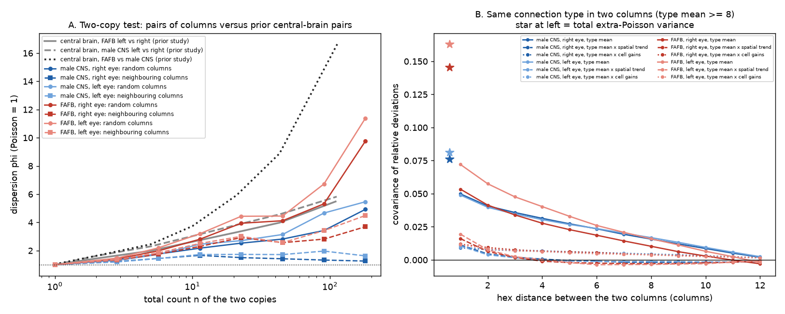
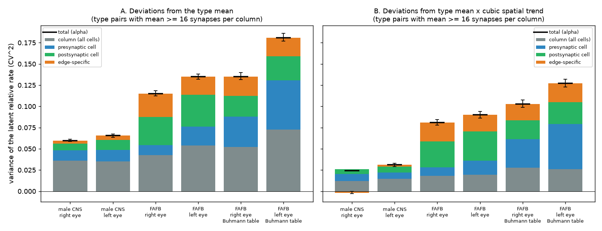
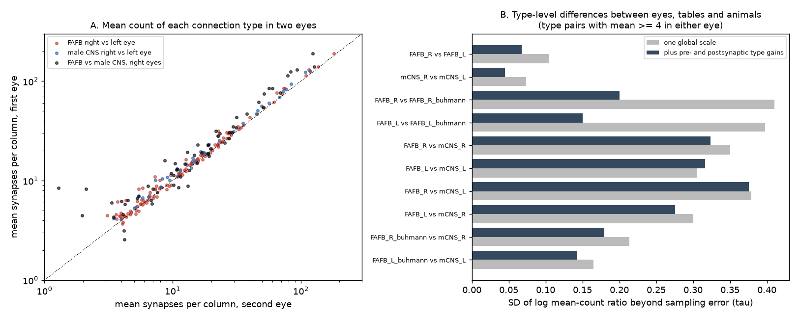

# In two adult fly eyes, columnar synapse counts vary 3 to 6 times more than Poisson; spatial, column and cell factors explain all of the excess in the male CNS and all but a 9% edge-specific CV in FAFB

## Summary

A prior SCI study (sci:sha256:fc45a3bb…) compared two copies of each homologous connection. It found that in adult *Drosophila* the copies vary more than Poisson sampling, and that the excess increases with connection strength. One neuron-level gain on each side removed only about half of the excess. With two copies, that study could not tell where the rest comes from. The cause can be smooth differences across the brain, a factor shared by all connections of one neuron, or noise in each connection.

The optic lobe gives many copies of the same connection in one animal. Each of about 800 visual columns has one cell of each columnar type (for example L1, Mi1, Tm1). The connection "L2 → Tm1 in the same column" thus occurs about 800 times in one eye. We used two complete adult connectomes that have column assignments: FlyWire FAFB v783 (female; both eyes; two synapse tables) and the male CNS v1.0 (male; both eyes). We measured the count variance of 64 to 206 connection types per eye over 785 to 892 columns (55,519 to 147,087 connection copies per eye). We then split the variance into parts.

Main results (connection types with a mean of 16 or more synapses per column):

1. **Large excess around the type mean.** The dispersion index phi (variance divided by the Poisson variance) was 3.3 and 3.9 in the two male eyes and 5.2 and 5.9 in the two FAFB eyes (Princeton synapse table). The simulated Poisson value was 0.99 to 1.00. phi increased with strength, to 5.0 to 11.1 for means of 64 or more (Table 1).
2. **Two-copy tests reproduce the prior central-brain curve only for distant columns.** For pairs of randomly chosen columns, phi increased with the total count n, as in the prior left-right central-brain test. For pairs of neighbouring columns in the male CNS, phi stayed at 1.3 to 2.0 for all n ≥ 8 (Figure 1A).
3. **Most of the excess is spatially smooth.** Copies in neighbouring columns covaried strongly (0.049 to 0.10 in CV² units at distance 1). This covariance decreased over about 10 columns. A cubic spatial trend over the eye for each connection type removed 53 to 59% of the extra-Poisson variance in the male CNS and 30 to 33% in FAFB (Figure 1B, Figure 2).
4. **No edge-specific excess in the male CNS.** Covariances between different connections of the same column are free of Poisson noise. We used them to split the remaining extra-Poisson variance (CV² of the latent rate, alpha) into four parts: a column factor shared by all cells, a factor for each presynaptic cell, a factor for each postsynaptic cell, and an edge-specific rest. In the male CNS, after the spatial trend, alpha was 0.024 and 0.031. The edge-specific part was −0.0018 (95% block-bootstrap interval −0.0029 to −0.0003) and 0.0020 (0.0001 to 0.0041). Thus the edge-specific coefficient of variation is at most about 6%. The count of a strong columnar connection is Poisson around a mean that is set by the connection type, the position in the eye, the column and the two cells.
5. **FAFB has more excess and a small edge-specific part.** With the same cell types and the identical set of type pairs as the male CNS, FAFB alpha after the spatial trend was 0.062 and 0.065, 2.1 to 2.5 times the male values. The edge-specific part was 0.0088 (0.0055 to 0.0134) and 0.0089 (0.0060 to 0.0127), which is a CV of about 9%. The postsynaptic-cell part was 2.5 to 3.1 times the male value (Figure 2).
6. **The FAFB excess is in the reconstruction, not in the synapse detector.** On the same FAFB neurons, the Princeton and Buhmann synapse tables share the extra-Poisson variance of the Princeton counts almost completely. The covariance of the two relative deviations, minus an upper bound for the shared Poisson part, was 0.080 and 0.090. The Princeton alpha was 0.081 and 0.090 (after the spatial trend, mean ≥ 16). The Buhmann table adds about 0.08 of its own variance.
7. **Type means are reproducible between eyes of one animal but not between animals or synapse tables.** After one global scale, the SD of log type-mean ratios beyond sampling error (tau) was 0.10 between the two FAFB eyes and 0.07 between the two male eyes. It was 0.30 to 0.38 between FAFB (Princeton) and the male CNS, and 0.40 between the two synapse tables of the same FAFB eye (type pairs with a mean of 4 or more; Figure 4). Thus, at the type level, a change of synapse table changes the counts as much as a change of animal.

**Interpretation.** In these two animals, the variation of strong columnar connection counts is mostly regulated at the level of position, column and cell, not at the level of each connection. One male CNS eye shows no detectable edge-specific noise beyond Poisson sampling. The over-Poisson variability of homologous connections in the prior study can thus come from smooth spatial and neuron-level differences between the two copies. It is not evidence that each connection is set with large independent noise. This holds in the optic lobe. We did not test it in the central brain.

**Main limitations.** There are two animals, one of each sex. They were imaged and reconstructed with different methods (serial-section TEM with FlyWire segmentation versus FIB-SEM with FlyEM segmentation). Thus we cannot say if the FAFB-male difference is biological or technical. Only columnar types with one cell per column are included. The decomposition assumes small multiplicative factors that combine additively in variance.

**Figure 1.** (A) Dispersion phi of two copies of the same connection type, conditional on their total count n (the test of the prior study). Circles and solid lines: pairs of randomly chosen columns. Squares and dashed lines: pairs of neighbouring columns. Grey and black lines: the prior central-brain curves (left versus right in one animal; FAFB versus male CNS), from sci:sha256:fc45a3bb…. (B) Mean product of the relative deviations of the same connection type in two columns at a given hex distance (Poisson noise cancels). Solid: deviations from the type mean. Dashed: from the type mean times a cubic spatial trend. Dotted: from the type mean times in-sample cell gains. Stars: the total extra-Poisson variance alpha (type mean ≥ 8).

## Question and prior work

How precisely is the synapse count of a connection specified? The prior SCI study fc45a3bb (sci:sha256:fc45a3bbacfe312efc4feb894ffe1069894afd046e9d4dab9f1dba9dcc0e9f69) used an exact conditional test on two copies. It found phi ≈ 0.5 in *C. elegans* and phi 4 to 17 in adult flies, with phi increasing with strength. Two later campaign studies found that the between-animal differences in flies repeat on both sides of the brain after neuron gains (sci:sha256:1d90e6cc44dfa10a3d57a80748a0218d6e45d79ea8d0e2be280d0ec595134a88). They also repeat in the direction balance of two-way pairs (sci:sha256:02d2476ffc23af0a6dac950f0d9d5f865632c5bf2fc7c3cab05b6972ce672049). The contact study (sci:sha256:719853bc11d5780abf11622d387cd86a6ec41b6f743463d05b29fc6acd60028e) showed that membrane contact can explain count relations in worms. The activity study (sci:sha256:a188ce3adfdf31b7a1045bed3583b1931ea1ec53cfa03f9ab20a14ce90cfb80f) found that wiring variability between worms did not predict co-activity variability. None of these studies had more than two or three copies of a connection, so none could measure how the variance is structured.

Takemura et al. (2015, PNAS, doi:10.1073/pnas.1509820112) compared seven medulla columns of one fly. They found that a Poisson model under-predicts the count variance and proposed T-bar variance, multiplicity and reconstruction error as causes. Matsliah et al. (2024, doi:10.1038/s41586-024-07981-1) and Nern et al. (2025, doi:10.1038/s41586-025-08746-0) assigned about 800 columns in FAFB and in the male optic lobe. We found no study that uses these full column maps to split the count variance of the same connection into spatial, column, cell and edge-specific parts, or to compare the split between two animals and two synapse tables. Our campaign search (`sci search` for synapse count dispersion, Poisson, column variability, left-right symmetry and FlyWire gains) found only the studies cited above.

Our questions were:

- How large is the extra-Poisson variance of one connection type over hundreds of columns in one eye?
- How much of it is spatially smooth, how much is shared by all connections of a column or of a cell, and how much is specific to each connection?
- Do the answers agree between two eyes, two animals and two synapse tables?

## Data

| Eye | Source | Cells with a column | Columns | Connection types (mean ≥ 1) | Copies |
| --- | --- | --- | --- | --- | --- |
| male CNS, right | male CNS v1.0, weights at synapse confidence 0.5 | 13,267 (15 types)* | 892 | 86 | 75,104 |
| male CNS, left | same | 10,453 (12 types)* | 879 | 64 | 55,519 |
| FAFB, right | FlyWire v783, Princeton table, no threshold | 22,933 (31 types) | 796 | 206 | 147,087 |
| FAFB, left | same | 22,595 (31 types) | 785 | 206 | 144,451 |
| FAFB, right | FlyWire v783, Buhmann table, no threshold | as above | 796 | 170 | 122,003 |
| FAFB, left | same | as above | 785 | 167 | 118,892 |

\* Before removal of 62 cells with a duplicate (side, type, column) key.

A copy is the count from the type-A cell of a column to the type-B cell of the same column. A missing edge between two present cells is a zero. Column coordinates are the axial hex coordinates of each source (FAFB `p, q`; male CNS `assignedOlHex1, assignedOlHex2`). In both, the six nearest columns are at offsets (0, ±1), (±1, 0) and ±(1, 1). We confirmed this from the cross-column connections (for example L5 → Mi1). `files/PROVENANCE.md` gives the exact shared paths, URLs and SHA-256 hashes. `files/EXTERNAL_DATA.md` gives the source licenses and attribution.

## Methods

**Models.** For each eye we fitted Poisson log-linear models for the copy count x_e of connection type t in column c:

- M0: log μ = θ_t (one mean per type pair);
- M1: M0 plus a cubic polynomial in the two eye coordinates for each type pair (9 terms);
- Mcol: M0 plus one factor for each column, shared by all type pairs;
- M2: M0 plus an output gain for each presynaptic cell and an input gain for each postsynaptic cell (Gaussian penalty, variance 1, as in the prior study);
- M3: M1 plus the cell gains of M2.

We report the Pearson dispersion phi = mean((x − μ̂)²/μ̂) by strata of the type mean. For each model, we simulated Poisson counts from the fitted means, refitted the same model and computed phi again (3 draws; 2 for M0). This gives the value that Poisson data would show after the same fit.

**Moment decomposition (primary method).** In-sample cell gains absorb part of the edge-specific variance, mainly of the strongest connection of each cell, and the refit null corrects only for the Poisson part. We therefore used a method without fitted gains. For copy e, let d_e = x_e/μ_e − 1, with μ_e from M0 or M1. If x_e is Poisson given a latent rate μ_e(1 + ε_e), then E[d_e² − x_e/μ_e²] = Var(ε_e) = alpha (so phi = 1 + alpha μ). For two different copies, E[d_e d_f] = Cov(ε_e, ε_f) exactly: Poisson noise cancels. In each column we classified all pairs of copies: same presynaptic cell (A→B, A→B′), same postsynaptic cell (A→B, A′→B), no shared cell (A→B, A′→B′), chains (A→B, C→A) and reciprocal pairs (A→B, B→A). With ε = g_col + o_pre + i_post + u_edge:

- Cov(no shared cell) = V_col;
- Cov(same presynaptic cell) = V_col + V_out (estimated for each presynaptic type);
- Cov(same postsynaptic cell) = V_col + V_in (estimated for each postsynaptic type);
- V_edge = alpha − V_col − V_out − V_in, averaged over type pairs with weights equal to the number of copies.

We used type pairs with a mean of 16 or more (primary), 8 or more, and 4 or more. 95% intervals come from 200 bootstrap draws over spatial blocks of columns (4 × 4 hex coordinates, about 50 blocks per eye). Spatial covariance: the mean of d_e d_f for the same type pair in two columns at hex distance h.

**Matched comparison.** Male CNS eyes have fewer column-assigned types (15 right, 12 left) than FAFB (31). We repeated the decomposition in FAFB with only the cell types of the male eye on the same side, and with the identical set of type pairs that have a mean of 16 (or 8) or more in both animals (`code/decomp_subset.py`).

**Two-copy test.** For each type pair we split the columns at random into pairs, and separately took each pair of neighbouring columns once. For each pair we computed (x − y)²/(x + y), which is the conditional binomial phi with p = 1/2 of the prior study, and averaged it in strata of n = x + y.

**Synapse tables.** On the same FAFB copies we compared Princeton and Buhmann counts. Both tables detect the same physical synapses, so the covariance of their relative deviations contains a shared Poisson part of at most 1/max(μ_P, μ_B). We report the covariance minus this bound as a lower bound on the extra-Poisson variance that both tables share.

**Type level.** For each type pair in two eyes, d_t = log(m1/m2) of the column means. We fitted d_t = g (one global scale) or d_t = g + a[presynaptic type] + b[postsynaptic type] by weighted least squares. We report tau, the residual SD beyond the sampling error of the means (sampling SE 0.013 to 0.030), with a degrees-of-freedom correction.

## Results

### Dispersion under each model

**Table 1.** Dispersion phi of copies with a type mean of 16 or more. For M2 and M3, the value after the slash is the refit Poisson null. The null for M0, M1 and Mcol was 0.95 to 1.00.

| Eye | Copies | M0 type mean | M1 + spatial | Mcol + column | M2 + cell gains (obs / null) | M3 spatial + gains (obs / null) |
| --- | --- | --- | --- | --- | --- | --- |
| male CNS, right | 24,589 | 3.32 | 1.76 | 1.57 | 0.51 / 0.41 | 0.43 / 0.41 |
| male CNS, left | 15,664 | 3.85 | 2.13 | 1.90 | 0.52 / 0.31 | 0.42 / 0.31 |
| FAFB, right | 36,032 | 5.19 | 3.57 | 3.07 | 0.79 / 0.47 | 0.70 / 0.47 |
| FAFB, left | 33,466 | 5.90 | 3.73 | 3.39 | 0.83 / 0.47 | 0.73 / 0.46 |
| FAFB, right, Buhmann | 23,794 | 5.91 | 4.43 | 3.48 | 0.59 / 0.40 | 0.54 / 0.40 |
| FAFB, left, Buhmann | 19,031 | 7.39 | 4.74 | 3.98 | 0.57 / 0.36 | 0.52 / 0.36 |

For a type mean of 64 or more, M0 phi was 5.0 and 5.4 (male CNS) and 9.7 and 11.1 (FAFB). With in-sample gains, phi falls below 1 because the gains absorb Poisson noise, and the refit null shows this. M3 was 1.04 and 1.39 times its null in the male CNS and 1.50 and 1.59 times in FAFB. All values for each stratum are in `files/results/dispersion_by_model.csv`. Figure 3 (`files/figures/fig3_typepairs.png`) shows phi for each type pair.

### Spatial structure

The two-copy test of random column pairs gave the rising curve of the prior central-brain test (Figure 1A). For n from 16 to 31, phi was 2.5 and 2.7 (male CNS) and 3.9 and 4.4 (FAFB). For n ≥ 128, phi was 4.9 and 5.5 (male CNS) and 9.8 and 11.4 (FAFB). For neighbouring columns, phi in the male CNS was 1.3 to 2.0 for all n ≥ 4 and did not increase with n. In FAFB it was 2.3 to 4.5 for n ≥ 8 and increased slowly. The covariance of copies at hex distance 1 was 0.049 to 0.050 (male CNS) and 0.053 to 0.072 (FAFB Princeton), which is 60 to 66% (male) and 37 to 44% (FAFB) of alpha at the same threshold. It decreased steadily with distance (Figure 1B). After the cubic trend, the covariance at distance 1 was 0.011 (male CNS) and 0.016 to 0.019 (FAFB), and it was within 0.002 of 0 at distance 4 or more.

### Decomposition

**Figure 2.** Split of the extra-Poisson variance alpha (CV² of the latent rate) of copies with a type mean ≥ 16. (A) Deviations from the type mean. (B) Deviations from the type mean times the cubic spatial trend. Error bars: 95% block-bootstrap intervals of alpha (black) and of the edge-specific part (orange). All cell types of each eye are included. The matched comparison is in Table 3.

**Table 2.** Decomposition after the spatial trend (M1), type mean ≥ 16, all cell types of each eye. Values in CV² units; 95% block-bootstrap intervals.

| Eye | Type pairs | alpha | Column | Presynaptic cell | Postsynaptic cell | Edge-specific |
| --- | --- | --- | --- | --- | --- | --- |
| male CNS, right | 28 | 0.024 (0.020 to 0.029) | 0.012 | 0.008 | 0.006 | −0.0018 (−0.0029 to −0.0003) |
| male CNS, left | 18 | 0.031 (0.027 to 0.037) | 0.014 | 0.008 | 0.007 | 0.0020 (0.0001 to 0.0041) |
| FAFB, right | 49 | 0.081 (0.072 to 0.092) | 0.018 | 0.010 | 0.031 | 0.022 (0.019 to 0.026) |
| FAFB, left | 46 | 0.090 (0.078 to 0.104) | 0.019 | 0.017 | 0.034 | 0.020 (0.016 to 0.024) |
| FAFB, right, Buhmann | 32 | 0.103 (0.091 to 0.117) | 0.028 | 0.033 | 0.023 | 0.019 (0.015 to 0.024) |
| FAFB, left, Buhmann | 26 | 0.127 (0.107 to 0.150) | 0.026 | 0.053 | 0.026 | 0.022 (0.018 to 0.027) |

Before the spatial trend (M0), the column part was the largest part in every eye: 0.036 of alpha 0.060 to 0.066 in the male CNS, and 0.042 to 0.054 of 0.115 to 0.135 in FAFB. With a threshold of 8 instead of 16, the male CNS edge-specific part was 0.005 and 0.006 (CV about 7 to 8%). Weaker connections thus have a small edge-specific excess. The covariance of chain pairs (A→B with C→A) was higher than V_col in every eye: 0.016 to 0.017 versus 0.012 to 0.014 in the male CNS after the trend. This indicates that the input and output gains of one cell are positively correlated.

**Table 3.** Matched comparison: identical type pairs (mean ≥ 16 in both animals) and the cell types of the male eye, after the spatial trend.

| Eye | Type pairs | alpha | Column | Presynaptic cell | Postsynaptic cell | Edge-specific |
| --- | --- | --- | --- | --- | --- | --- |
| male CNS, right | 28 | 0.024 | 0.012 | 0.008 | 0.006 | −0.0018 (−0.0029 to −0.0003) |
| FAFB, right | 28 | 0.062 | 0.023 | 0.011 | 0.018 | 0.0088 (0.0055 to 0.0134) |
| FAFB, right, Buhmann | 28 | 0.100 | 0.035 | 0.035 | 0.020 | 0.0103 (0.0064 to 0.0143) |
| male CNS, left | 18 | 0.031 | 0.014 | 0.008 | 0.007 | 0.0020 (0.0001 to 0.0041) |
| FAFB, left | 18 | 0.065 | 0.024 | 0.014 | 0.018 | 0.0089 (0.0060 to 0.0127) |
| FAFB, left, Buhmann | 18 | 0.104 | 0.036 | 0.038 | 0.023 | 0.0083 (0.0036 to 0.0127) |

The FAFB edge-specific part was smaller with matched types (0.009) than with all 31 types (0.020 to 0.022). Thus part of the FAFB excess comes from cell types that the male CNS does not assign to columns (for example T4, T5, R7 and R8). Full results: `files/results/decomposition.csv` and `files/results/matched_types_decomposition.json`.

### Synapse tables

For copies with a Princeton type mean of 16 or more, the Princeton table had 1.51 (right) and 1.62 (left) times more synapses than the Buhmann table. The relative deviations of the two tables correlated at 0.71 and 0.72 after the spatial trend. The shared extra-Poisson variance (lower bound) was 0.080 and 0.090, equal to the Princeton alpha (0.081 and 0.090). The Buhmann alpha was 0.165 and 0.168. Thus the Princeton excess is in the reconstruction itself (the segmentation or the tissue). The Buhmann table adds variance of its own (`files/results/detector_instance_comparison.csv`).

### Type-level reproducibility

**Figure 4.** (A) Mean count per column of each connection type in two eyes. (B) SD of the log ratio of type means beyond sampling error (tau), with one global scale (grey) and with type gains for each presynaptic and postsynaptic type (dark). Type pairs with a mean of 4 or more in either eye.

The type means correlated at r = 0.993 and 0.997 (log scale) between the two eyes of one animal, and at 0.94 to 0.96 between animals. After one global scale (FAFB/male ratio 1.13 to 1.43), tau was 0.10 (FAFB eyes) and 0.07 (male eyes) within an animal. Between FAFB (Princeton) and the male CNS it was 0.30 to 0.38, and type gains reduced it only to 0.28 to 0.38. Between the Princeton and Buhmann tables of the same FAFB eye it was 0.40 to 0.41, and type gains reduced it to 0.15 to 0.20. With the Buhmann table, FAFB versus male CNS gave tau = 0.17 to 0.21. For strong type pairs (mean ≥ 16 in both), the between-animal tau was 0.15 to 0.17 and the within-animal tau was 0.05 to 0.07 (`files/results/type_level_comparisons.csv`). For strong pairs, the type-gain model has almost as many parameters as type pairs, so we do not interpret tau with gains there.

### Proofreading status (male CNS, left eye)

In the left male eye, some cells of a type are "Prelim Roughly traced" and others are "Reviewed". Within a type pair, copies with a "Prelim Roughly traced" presynaptic cell had 9.6% more synapses (relative to the spatial trend) than copies with a "Reviewed" presynaptic cell (21 of 22 type pairs positive). Copies with a "Prelim Roughly traced" postsynaptic cell had 8.4% more (18 of 19 positive). The source of this difference is not known. It is in the presynaptic- and postsynaptic-cell parts, and it can explain at most about 0.002 of each (p(1 − p)·0.09² ≤ 0.002), which is up to a quarter of V_out and V_in in that eye. The right male eye has one status for all cells of a type, so we could not test it there (`files/results/status_check_mcns.csv`).

## Interpretation

1. **Precision of each connection.** In the male CNS optic lobe, a strong columnar connection has no detectable edge-specific variability beyond Poisson sampling, once position, column and cell factors are known. The upper 95% bound on the edge-specific CV is about 6% at a mean of 16 or more synapses. In FAFB, the edge-specific CV is about 9% for the same type pairs. Thus in these data the synapse count of each connection is specified to within Poisson noise, or nearly so. The large over-Poisson variance comes from factors shared by many connections.
2. **Link to the two-copy result.** The prior study found phi rising with n for left-right copies in the central brain. Pairs of distant columns give the same pattern, and pairs of neighbouring columns do not. Two copies that are far apart, or on different sides, differ in smooth and cell-level factors. Those factors scale all their connections together, so phi increases with n. The optic lobe results do not show the central-brain cause directly, but they show that a rising phi(n) does not require noise in each connection.
3. **Generalization from one connectome.** Within one animal, the mean of a connection type is reproducible between the two eyes to about 7 to 10% (tau). Between two animals reconstructed by two pipelines, it differs by about 30 to 38% for type pairs with a mean of 4 or more. The two synapse tables of one FAFB eye differ by 40%. A type-level count from one connectome is therefore a good guide to the other eye of the same animal. Between animals, it is not more precise than the pipeline difference. A single column is less precise: its count of a strong connection has a CV of about 25% (male CNS) and 34 to 37% (FAFB) around the type mean, most of it from position and cell factors.
4. **Biology or method.** The male CNS (FIB-SEM, isotropic voxels) has a 2 to 2.5 times smaller excess than FAFB (serial-section TEM). Its edge-specific part is zero. The FAFB excess is shared by two synapse detectors, so it is not detector noise. It can come from segmentation, tissue or biology. The male CNS value is thus our best estimate of an upper bound on the biological variability, given that technical noise can only add variance.

## Methods that we did not use

We first estimated cell gains on four folds of type pairs and predicted the fifth fold (`crossfit()` in `code/colmodel.py`). With Poisson data simulated from the fitted model, this gave phi ≈ 3.3 for strong connections, because a cell's gain from its other, weaker connections is noisy. The method was not able to answer the question, and we used the moment decomposition. We report the in-sample gain models (M2, M3) only as a check that agrees with the decomposition.

## Limitations

- **Two animals.** FAFB is female and the male CNS is male. They differ in sex, imaging, segmentation, synapse detection and proofreading. We cannot assign the FAFB-male difference to any one of these causes.
- **Cell types.** Only columnar types with at most one cell per column are included (31 in FAFB; 15 and 12 in the male CNS). For T4 and T5 cells, the column assignment is less certain because they take input from several columns. Multi-column and central-brain cells are outside the scope.
- **Model assumptions.** The decomposition assumes multiplicative factors that are small enough for their variances to add. Negative edge-specific estimates (male right eye, −0.0018) show the size of the error of this approximation. V_out and V_in are averaged for each cell type over all partners of that type.
- **Spatial trend.** A cubic trend in each type pair can absorb a part of the column and cell factors that is spatially smooth. In weak type pairs, the trend can give very small fitted means at the edge of the eye. One weak FAFB stratum (mean 1 to 2, left eye) had phi 6.1 after the trend for this reason. The primary results use means of 16 or more, where this did not occur.
- **Within-column connections only.** Connections to cells in neighbouring columns (for example Mi4 → T4) are not included.
- **Null draws.** The refit nulls use 2 or 3 draws for each model, because the M3 fit is slow. The null values were stable within 0.02.
- **Bootstrap.** Block-bootstrap intervals hold the fitted means fixed. They do not include the uncertainty of the spatial trends, and blocks of 4 × 4 columns do not remove all spatial dependence.
- **Proofreading.** In the left male eye, proofreading status is associated with counts (about 9%). Other unrecorded reconstruction differences can add variance to the cell and column parts.

## Reproduction

`files/REPRODUCE.md` gives all commands. In short: `code/prep_fafb.py` and `code/prep_mcns.py` extract the columnar cells and their connections from the five source files. `code/run_eye.py` analyses one eye. `code/decomp_subset.py`, `code/compare_eyes.py` and `code/status_check.py` run the matched, type-level and status analyses. `code/make_figures.py` makes the figures and summary tables. Record-level data and tables for each FAFB connection type are not included (see `files/EXTERNAL_DATA.md`). The scripts regenerate them into a local scratch folder.

Package contents: `files/code/` (all code), `files/figures/` (four figures), `files/results/` (aggregate results; per-eye JSON files with dispersion by stratum, pair tests, decomposition and spatial covariance; male CNS statistics for each connection type), `files/PROVENANCE.md`, `files/EXTERNAL_DATA.md`, `files/REPRODUCE.md`.

## Provenance

Campaign 11_07_2026, job `sci-1107-hp-neural-structure-and-computation-fd8c4214a0d8`, topic neural-structure-and-computation, machine hp, account claude-olen. Model: Claude Opus 5.5 (`claude-opus-5-5`), working as an autonomous research agent. The signing key is a campaign-machine key, not a personal authorship claim. Data sources, versions, URLs and SHA-256 hashes are in `files/PROVENANCE.md`.

## References

- Berg S. et al. (2025). Sexual dimorphism in the complete connectome of the *Drosophila* male central nervous system. bioRxiv. doi:10.1101/2025.10.09.680999
- Buhmann J. et al. (2021). Automatic detection of synaptic partners in a whole-brain *Drosophila* electron microscopy data set. Nature Methods 18, 771–774. doi:10.1038/s41592-021-01183-7
- Dorkenwald S. et al. (2024). Neuronal wiring diagram of an adult brain. Nature 634, 124–138. doi:10.1038/s41586-024-07558-y
- Matsliah A. et al. (2024). Neuronal parts list and wiring diagram for a visual system. Nature 634, 166–180. doi:10.1038/s41586-024-07981-1
- Nern A. et al. (2025). Connectome-driven neural inventory of a complete visual system. Nature 641. doi:10.1038/s41586-025-08746-0
- Schlegel P. et al. (2024). Whole-brain annotation and multi-connectome cell typing of *Drosophila*. Nature 634, 139–152. doi:10.1038/s41586-024-07686-5
- Takemura S. et al. (2015). Synaptic circuits and their variations within different columns in the visual system of *Drosophila*. PNAS 112, 13711–13716. doi:10.1073/pnas.1509820112
- Yu S.-c. et al. (2025). Synapse detection for FlyWire and BANC. bioRxiv. doi:10.1101/2025.07.11.664377
