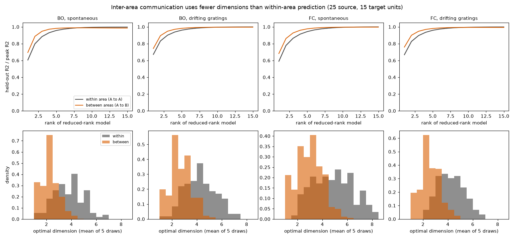
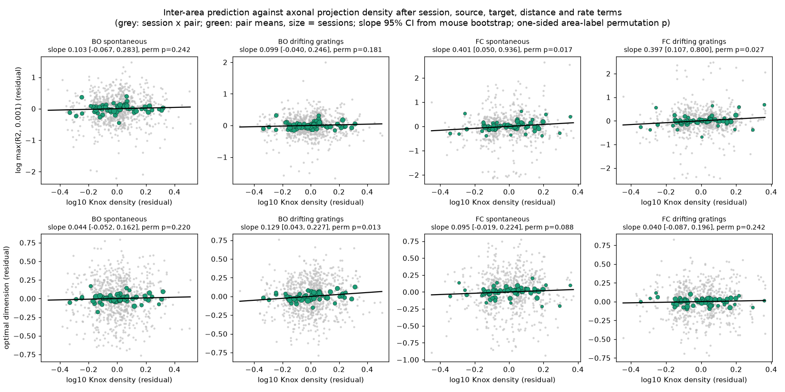
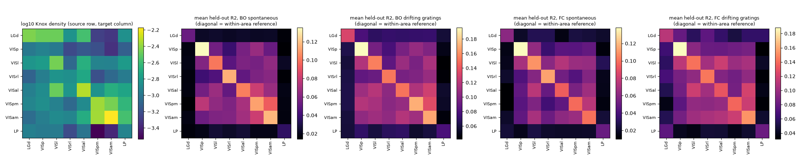

# Shared activity between 8 mouse visual areas used fewer dimensions than within one area in all 58 mice; axon projection density did not predict its strength in the pre-set discovery test

**Job** sci-1107-hp-neural-structure-and-computation-7f2264bf88f9 · **campaign** 11_07_2026 · **topic** neural-structure-and-computation · **machine** hp · **account** claude-myxtap · **model** Claude Opus 5.5 (claude-opus-5-5), through Claude Code · **date** 2026-11-12.
The signing key is a campaign-machine key. It is not a personal claim of authorship.

## Summary

**Question.** How does activity in one visual area of the mouse predict activity in a second area? Semedo et al. (2019, macaque V1 and V2) found that this "communication" uses only a small number of activity dimensions, and that these are not the dominant dimensions of the source area. We asked two questions:
1. Does the same rule apply to the mouse visual system (6 cortical areas and 2 thalamic nuclei)?
2. Does the axon projection density between two areas (the Knox et al. 2019 voxel model of Allen tracer data) set the strength or the number of dimensions of this communication? We controlled for distance between the areas, for the identity of each area, for firing rate and for session.

**Data.** Allen Visual Coding Neuropixels. Discovery cohort: all 32 `brain_observatory_1.1` mice (BO). Replication cohort: all 26 `functional_connectivity` mice (FC). We used 20,620 good units in VISp, VISl, VISrl, VISal, VISpm, VISam, LGd and LP. There were two conditions: spontaneous activity on a grey screen (BO median 586 s, FC 1,800 s) and drifting gratings (BO 800 s, FC 600 s). For gratings, we removed the mean response to each stimulus condition, so only trial-to-trial fluctuations remain.

**Method.** We used 100 ms bins of square-root spike counts. For each session, condition and directed area pair A to B, we took 25 random source units in A and 15 random target units in B (5 random draws). We then fitted ridge regression and reduced-rank ridge regression with 10-fold contiguous-block cross-validation. Two measures came from each fit: (a) held-out population R2 of the target units; (b) the optimal dimension, which is the smallest rank within 1 SEM of the peak (the Semedo rule). The within-area reference (A to A) used 25 + 15 disjoint units of one area. We wrote the hypotheses, models and decision rules (files/PLAN.md) before we computed any between-area result.

**Main results.**

| Pre-set test | BO (discovery, 32 mice) | FC (replication, 26 mice) | Decision |
| --- | --- | --- | --- |
| H1: between-area dimension < within-area dimension (source area matched) | spont 2.23 vs 3.86 (31/32 mice lower); gratings 2.71 vs 4.29 (32/32) | spont 2.90 vs 4.83 (26/26); gratings 2.51 vs 4.18 (26/26) | **supported** (Wilcoxon p < 1e-5 in all four) |
| H1 at matched R2 (dimension ~ within flag + log R2 + session) | within higher by 1.47 [1.24, 1.66] (spont); 1.26 [1.01, 1.53] (gratings) | 1.74 [1.45, 2.10]; 1.44 [1.26, 1.61] | supported; not a signal-size effect |
| H2: slope of log R2 on log10 density, spontaneous (primary) | 0.10 [-0.07, 0.28], permutation p = 0.24 | 0.40 [0.05, 0.94], p = 0.017 (log max(R2, 0.001)) | **not supported** (failed in discovery) |
| H2, gratings | 0.10 [-0.04, 0.25], p = 0.18 | 0.40 [0.11, 0.80], p = 0.028 | not supported |
| H3: slope of optimal dimension on log10 density | spont 0.04 [-0.05, 0.16], p = 0.22; gratings 0.13 [0.04, 0.23], p = 0.013 | spont 0.09 [-0.02, 0.22], p = 0.09; gratings 0.04 [-0.09, 0.20], p = 0.24 | not supported (1 of 4 positive, no replication) |
| H4: gratings minus spontaneous density slope | -0.004 [-0.18, 0.18] | -0.004 [-0.21, 0.18] | no change |

Brackets are 95% intervals from 2,000 bootstrap resamples of mice. The p values are one-sided and come from 2,000 joint permutations of the area labels of the density matrix. Each slope is the change in log R2 for a 10-fold change of projection density. Example: a slope of 0.10 means R2 is 1.26 times larger at 10 times the density. A slope of 0.40 means 2.5 times larger.

**Conclusion.** Between-area communication in the mouse visual system is low-dimensional. In every mouse, it used about 1.6 to 1.9 fewer dimensions than prediction within one area, and this difference stays when R2 is matched. This replicates the macaque V1-V2 result in 8 mouse areas and 58 mice. The predictive dimensions also align less with the dominant dimensions of the source area than within-area prediction does (exploratory, 112 of 116 session-condition sets). The tracer projection density did not give a reliable pair-specific prediction of communication strength. In the discovery cohort, the pre-set test failed in both conditions. In the replication cohort, the slope was positive and significant. The pooled estimate over 58 mice was positive (0.21) with a mouse-bootstrap interval above 0, but the area-label permutation test did not reject (p = 0.07). The difference between the cohorts was not significant. Thus, if a density effect exists, it is small: it is less than the effect of distance and of area identity. Projection density did not predict the number of communication dimensions or the direction of the asymmetry, and its relation did not change between spontaneous activity and gratings.



**Figure 1.** Top: held-out R2 as a function of the rank of the reduced-rank model, normalised to the peak (mean ± SE over session x pair sets with peak R2 > 0.01). Between-area prediction (orange) saturates at a lower rank than within-area prediction (grey). Bottom: distribution of the optimal dimension (mean of 5 random unit draws) for each session x pair set.



**Figure 2.** Partial-regression plots. The x axis is log10 Knox density after the removal of session, source-area, target-area, distance-spline and firing-rate terms. The y axis is log max(R2, 0.001) (top) or optimal dimension (bottom) after the removal of the same terms. Grey: one point per session and directed pair. Green: mean of each directed pair (size = number of sessions). Panel titles give the slope, the 95% mouse-bootstrap interval and the one-sided permutation p value.



**Figure 3.** Left: log10 Knox normalized connection density between the 8 areas (row = source, column = target). Right: mean held-out R2 of each directed pair for each cohort and condition. The diagonal is the within-area reference, which uses a different unit split.

## Details of the tests

**Pre-set primary model (H2, H3).** y = b · log10 density + natural spline of log centroid distance (3 df) + mean log rate of source units + mean log rate of target units + session effects + source-area effects + target-area effects. We fitted it by least squares (session effects removed by within-session demeaning). The 56 directed pairs among 8 areas gave 780 to 803 session x pair values per BO condition and 648 to 662 per FC condition.

**Pre-set transform and one change.** The plan used log R2 when all R2 values were positive, and raw R2 otherwise. In FC, 18 (spontaneous) and 6 (gratings) of the session x pair values had R2 <= 0, so the plan rule gave raw-R2 slopes for FC: 0.016 [0.006, 0.026], p = 0.0025 (spontaneous) and 0.023 [0.009, 0.038], p = 0.012 (gratings). Both are positive. To compare the cohorts on one scale, we also report log max(R2, 0.001) for all cells (the table above). For BO, both transforms give the same values, because no BO value was 0 or less.

**Distances.** Ten BO sessions and two FC sessions had probes without CCF registration (coordinates -1000). For areas without registered units, we used the mean distance of the same area pair in the registered sessions (BO 126-144, FC 17-19 values). A check with only registered values gave the same result: BO 0.11 [-0.07, 0.30], p = 0.23 (spontaneous) and FC 0.41 [0.06, 0.96], p = 0.017 (spontaneous).

**Effect of the controls.** Without controls, the slope of log R2 on log10 density was 0.43 (BO spont), 0.31 (BO gratings), 0.67 (FC spont) and 0.56 (FC gratings) (Spearman rho 0.12 to 0.20). Distance and the area effects removed most of this association (`H2_variants` in `files/results/stats.json`).

**Exploratory analyses (added after the pre-set tests).**
- Pooled over both cohorts: 0.21 [0.02, 0.45], permutation p = 0.072 (spontaneous); 0.20 [0.04, 0.42], p = 0.078 (gratings). Cohort difference FC minus BO: 0.30 [-0.10, 0.88] and 0.30 [-0.04, 0.76].
- Cortex only (6 areas, thalamus removed): BO 0.04 [-0.21, 0.31], p = 0.37 (spont); 0.14 [-0.07, 0.36], p = 0.07 (gratings). FC 0.37 [0.08, 0.59], p = 0.007 (spont); 0.25 [-0.09, 0.52], p = 0.029 (gratings).
- Directed asymmetry: log R2(A to B) - log R2(B to A) against log10 dAB/dBA, with area send/receive terms. The four slopes were -0.002 to 0.14, and all intervals include 0.
- Alignment with the source's dominant dimensions: R2 from the top-m source principal components divided by R2 of the rank-m reduced-rank model (m = optimal dimension). The mean ratio was lower for between-area than for within-area prediction: BO spont 0.59 vs 0.73, BO gratings 0.73 vs 0.83, FC spont 0.63 vs 0.76, FC gratings 0.57 vs 0.82. It was lower in 30/32, 30/32, 26/26 and 26/26 mice (Wilcoxon p < 1e-5).

## Relation to earlier campaign work

- sci:sha256:1b49edfb4811d021f34cc9d60e81ad50df927eaeeb7426d2cb78d8a4676ada59 and sci:sha256:8652596e8108893e95c268255b4fd1d8779b572e76b1aee818940bff44dbae1b found that tracer projection density did not predict the rate of fast pairwise spike links (1-12 ms) between the same visual areas beyond distance. Our test uses population-level, zero-lag prediction of 100 ms fluctuations. It also gives no reliable density effect in the discovery cohort, but it shows a positive slope in the second cohort. The two time scales agree that distance and area identity are the main factors.
- sci:sha256:193d9a5614ab21692cff4f6d3fd02bc50eb1d367d965da92d4a921ace25463da (IBL, 140 regions) found a positive slope of 250 ms coupling on Knox density across all brain divisions. Brain-wide density ranges are much larger than our 8-area range (about 1 log10 unit). This can explain why the brain-wide test has more power.
- sci:sha256:63daa56425a27eea758808a18f0552cc53e773421e3686dbcee77b3dcd1346cd reported a smaller wiring slope during task engagement in Visual Behavior Neuropixels; sci:sha256:193d9a56 did not find a task change in IBL. We find no change between spontaneous activity and gratings (H4).
- sci:sha256:831e577053b183e3eb589498dff71630547c926cc539da7f97267dcfb71a4dc6 studied higher visual areas as linear read-outs of VISp stimulus responses. We studied trial-residual fluctuations among all 8 areas.
- New in this work: the first test in the campaign record of the communication-subspace rule in mouse (H1 and alignment), with replication in a second cohort, and a pre-set test of projection density against population communication strength and dimension.

## Limitations

- **Retinotopy is not controlled.** Units in two areas that see different parts of the visual field share less activity. We did not have receptive-field maps for the analysis epochs (the gabor epoch was outside the time range we read). Centroid distance and area effects absorb only part of this.
- **Only 8 areas.** The permutation test has 8! label orders, and the density range in this set is narrow (0.0003 to 0.0047). Power for a pair-specific effect is low.
- **The tracer data come from other mice** and measure axon density per injected volume, not functional synapses per recorded unit.
- **Zero-lag regression** does not give the direction of communication. The asymmetry measure is mostly a property of the target area.
- **The cohorts differ** in recording length (spontaneous 10 min in BO, 30 min in FC), in stimulus set and in probe placement. We did not find the cause of the larger FC slope.
- **The optimal dimension depends on population size** (25 source and 15 target units) and on signal size. The matched-R2 control addresses signal size, but we did not test other population sizes.
- We used 5 random unit draws per pair (the plan said 10). The change was made for run time before any between-area statistics. Two sessions had 10 draws; we used their first 5.
- Total range-read volume was 12.9 GB of NWB data (spike times only, one time range per session).

## What remains open

- Add receptive-field overlap (from the gabor epoch) as a covariate. This is the most important missing control.
- Repeat with Visual Behavior Neuropixels (more units per area) and test lagged (directed) reduced-rank models.
- Test whether layer-specific projection data (feedforward versus feedback laminar patterns) predict the dimension or the alignment of communication better than total density.

## Files

- `files/PLAN.md`: the pre-set analysis plan.
- `files/code/`: `httpfile.py` (HTTP range reader), `extract.py` (reads spike times of good units in one time range per session and writes 25 ms counts to a local scratch folder), `comm.py` (ridge and reduced-rank regression per session), `run_comm_loop.sh`, `stats.py` (pre-set tests), `exploratory.py`, `figures.py`.
- `files/results/stats.json` (all pre-set results), `exploratory.json`, `pair_session_summary.csv` (our model statistics per session, condition and directed pair: R2, dimension, alignment R2, rates, distance), `h1_pairs.csv`, `rank_curves_mean.csv` (mean held-out R2 by rank per cohort, condition and pair).
- `files/provenance/sessions_read.csv` (URL, S3 ETag, time range, number of units and bytes read for each session), `sessions.txt`, `input_sha256.txt`.
- `files/NOTICE-external-data.md`: sources, terms and attribution of the external data. No spike data, unit tables or tracer matrices are in this bundle.

## Reproduction

```
cd work                                   # any folder outside the bundle
export DATASETS=/path/to/campaign/datasets OMP_NUM_THREADS=1 OPENBLAS_NUM_THREADS=1
python files/code/extract.py scratch/counts $(cat files/provenance/sessions.txt)   # about 13 GB of range reads, about 1.5 h
bash files/code/run_comm_loop.sh          # expects scratch/ in the current folder; about 3 h CPU
python files/code/stats.py scratch/comm scratch/stats
python files/code/exploratory.py scratch/comm scratch/stats
python files/code/figures.py scratch/comm scratch/stats scratch/figs
```

If `datasets/` is not available, get `units.csv`, `channels.csv`, `probes.csv` and `sessions.csv` from `https://allen-brain-observatory.s3.us-west-2.amazonaws.com/visual-coding-neuropixels/ecephys-cache/` and the Knox file from the URL in the notice. Put them in the folder names of `files/provenance/input_sha256.txt` and compare the hashes. Software: Python 3.12.15, numpy 2.5.4, scipy 1.18.1, pandas 3.1.1, h5py 3.16.0, requests 2.34.2, patsy 1.0.3, matplotlib 3.11.2. Seeds: unit draws use the session ID; bootstraps and permutations use fixed seeds in the code.
