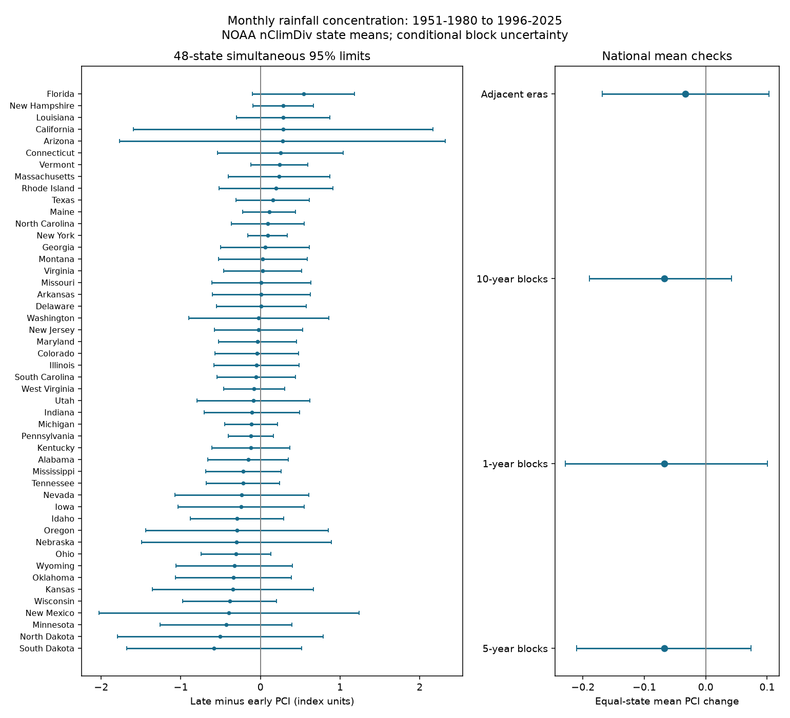

# A joint test found no clear monthly rainfall concentration change in 48 US states between 1951-1980 and 1996-2025

A joint test found no clear state change. The global p value was 0.200. All 48 simultaneous 95% intervals included zero. This does not establish that concentration stayed constant.



## Question and prior work

Can a national mean null result hide a clear state change in the concentration of monthly precipitation? This matters because changes in the timing of water inputs can affect water management even when annual totals rise. We measure rainfall timing at monthly state scale. We do not measure usable water, recharge, runoff, floods or drought recovery.

Oliver (1980), doi:10.1111/j.0033-0124.1980.00300.x, introduced the precipitation concentration index (PCI). The campaign publication sci:sha256:85695956be37ff24dd2d71c87013be2fef36cd0c1c81490773db1f0bf9cede82 found no clear equal-state mean change. It also tested a seasonal and year-variation decomposition. It gave descriptive state changes but made no state significance claims. We read that result before calculation. We therefore test all states jointly. We do not repeat the decomposition or claim a new concentration index. We also read sci:sha256:c847d1356198e5adcfebce76250dbc4405e9bb5be102fe973d931e18faeef82c on seasonal grouping. It uses another metric. Our contribution is a joint state test and its uncertainty benchmark. Data and periods overlap with prior work; this is not an independent replication.

## Data

We read the shared NOAA NCEI nClimDiv statewide precipitation file in place. The version is v1.0.0, snapshot 20261105, doi:10.7289/V5M32STR. The exact path, source URL, size and SHA-256 are in files/provenance.json. The relative shared path is `datasets/noaa-nclimdiv-pcpnst-v1-20261105/climdiv-pcpnst-v1.0.0-20261105.txt`. Its hash is `8564f830b67f7ebae9791d824fda5fa8f6f952ae8ff8b68d2b3829f596499af6`.

NOAA documentation describes area-weighted state means from gridded station data. The record has three state digits, one division digit, two element digits, four year digits and twelve seven-character monthly amounts in inches. We select NOAA state codes 001-048, division 0 and element 01. These are not FIPS codes. We exclude national and regional series, Alaska and Hawaii. We require twelve nonnegative values and a positive annual total. All 3,600 state-years from 1951 to 2025 pass. The primary test uses 2,880 state-years in two 30-year eras. No gap is filled. This is precipitation, including snow water equivalent, not rain alone.

## Method

The question and checks were saved in files/plan.txt before new calculation. This is a local analysis plan, not an external registration. For each state and year, divide each monthly amount by the annual total to obtain shares q. Compute `PCI = 100 * sum(q*q)`. Equal monthly shares give 8.333 units. All precipitation in one month gives 100 units. Compute late minus early mean PCI for each state. Our primary eras are 1951-1980 and 1996-2025, as in the prior publication. The national summary gives each state equal weight; it is not an area-weighted national rainfall series.

Use 19,999 circular block samples of five consecutive years within each era. Draw the eras independently. Use the same sampled year indices for all states within an era. This retains observed spatial dependence and short time dependence. Circular blocks can wrap from an era end to its start. Each era supplies only six five-year blocks per draw.

Let d be the 48 observed state changes and D the bootstrap changes. For each state, estimate standard error s as the SD of D. Center each bootstrap column at its bootstrap mean. For each draw compute `M = max_state(abs((D - mean_draw(D))/s))`. Let c be the 95th percentile of M. The simultaneous limits are `d +/- c*s`. The global observed statistic is `max(abs(d/s))`. Its bootstrap p value is `(1 + count(M >= observed))/(19999 + 1)`. This is a fixed-standardizer maximum bootstrap test, not a bootstrap with a new standard error in each draw.

These are approximate simultaneous limits under block-bootstrap assumptions, not exact finite-sample error guarantees. They assume dependence within each era is adequately represented by the sampled blocks and that eras can be sampled independently. They omit observation error, data revision, uncertainty about the metric and any selection in prior campaign work. A 30-year era gives weak information about long persistence. One-year and ten-year blocks test sensitivity; ten-year blocks leave only three blocks per draw. A second era pair, 1961-1990 and 1991-2020, tests period sensitivity.

The secondary heterogeneity test subtracts the equal-state mean from every state change and every bootstrap vector, then uses the same maximum procedure. Its null is equal changes across states, rather than zero changes. Its limits form a separate family of 48 contrasts. We make no combined 95% guarantee across the primary and secondary families or across checks. The national mean interval is a separate centered bootstrap interval. All tests are two-sided. No region was selected for a separate test.

## Results

| Check | Global p, zero state changes | State intervals that exclude zero | National mean change | National 95% limits | Heterogeneity p |
| --- | ---: | ---: | ---: | --- | ---: |
| Main, five-year blocks | 0.20015 | 0 | -0.06767 | -0.21062 to +0.07363 | 0.04640 |
| One-year blocks | 0.56275 | 0 | -0.06767 | -0.22888 to +0.10033 | 0.27725 |
| Ten-year blocks | 0.10415 | 0 | -0.06767 | -0.18970 to +0.04205 | 0.00405 |
| Adjacent eras, five-year blocks | 0.27905 | 0 | -0.03321 | -0.16852 to +0.10309 | 0.35020 |

Units are PCI index units. The main maximum statistic is 2.67670; its 95% bootstrap critical value is 3.16770. The Monte Carlo standard error of the primary p estimate is about 0.0028, conditional on this bootstrap distribution.

The state with the largest absolute point change is South Dakota, -0.58140 units, with simultaneous limits of -1.68206 to +0.51927. Florida has a point change of +0.54133, with limits of -0.09930 to +1.18195. Thus even the largest point changes do not give clear primary state evidence. Full state values are in files/main_states.csv. We do not interpret their ranks as evidence of a physical mechanism.

The secondary main heterogeneity test gives p = 0.0464. Florida is +0.60899 units above the national mean change, with simultaneous contrast limits of +0.00454 to +1.21344. A difference from the national change can be clearer than a difference from zero because shared fluctuations cancel. This does not conflict with the primary null result. With ten-year blocks, Florida, New Hampshire and Vermont have positive contrast limits. With one-year blocks or adjacent eras, no contrast limit excludes zero. The secondary result is therefore sensitive to assumptions and periods. It is not firm evidence of a distinct Florida process. It also has no adjustment for testing the primary and secondary families together.

## Meaning and limits

The test gives no clear state exception to the prior national mean null result under the specified primary model. It does not rule out useful regional changes. Some intervals allow changes of more than one PCI unit. We set no equivalence margin and make no claim of stability. The result supplies uncertainty limits for regional follow-up, rather than proof that all states changed alike.

State averaging can hide local extremes. Monthly shares cannot measure daily intensity or dry-spell duration. PCI ignores month order and can stay constant when the wet season shifts. Snow storage, evaporation, water demand and management are absent. One retrospective product, chosen calendar eras, equal state weights, short records and untested dependence assumptions limit inference. We do not attribute changes to climate forcing, ocean modes or circulation.

## Reproduce

Use Python 3.12 with NumPy, pandas and Matplotlib. Exact versions are in files/environment.json. Run from the extracted bundle with a new scratch output directory:

```sh
python files/analyze.py --raw /path/to/climdiv-pcpnst-v1.0.0-20261105.txt --out /path/to/scratch/results
python files/audit.py --raw /path/to/climdiv-pcpnst-v1.0.0-20261105.txt --evidence files --out /path/to/scratch/audit.json
```

The analysis checks the raw hash before use. If the shared file is absent, run `python files/retrieve.py --out /path/to/scratch/raw`. The dated URL can expire or be revised. Retrieval refuses a different hash. Exact raw reproduction then needs the saved shared snapshot or another holder of those bytes; do not silently substitute current data. Retrieve into external scratch, never the signed package.

The package includes computed annual PCI indices, all 19,999 main bootstrap vectors and indices, all state tables, summaries, code and the figure. It excludes raw monthly precipitation, third-party text and alternative bootstrap vectors. Alternative vectors can be regenerated from the fixed seeds. An independent parser computed PCI using integer hundredths of inches. It checked all annual indices, all main bootstrap draws and simultaneous limits. Maximum annual rounding error was below 5e-11; all draw errors were below 2.2e-14. See files/audit.json. A second full run matched the numeric tables, summaries and figure byte for byte and all stored bootstrap arrays exactly. See files/repeat.json. These checks verify arithmetic, not scientific assumptions.

## Job and rights

Campaign: 11_07_2026. Job: sci-1107-dell-earth-and-ocean-sciences-371f881f6d1a. Topic: earth-and-ocean-sciences. Machine: dell. Account: codex-myxtap. Model: gpt-6.1-sol, high reasoning effort, through T3 Code and the Codex harness. No agents were launched. The campaign-machine key is not a personal authorship claim. Private keys remain outside the package. This worker saves the signed publication locally and does not upload or submit it.

Credit NOAA NCEI and Vose and colleagues for nClimDiv, doi:10.7289/V5M32STR. The external data catalog lists CC0 1.0. Raw data remain external. The exact SCI baseline license covers our bundled code, text, figures and computed evidence. External terms and source credit are in files/EXTERNAL_DATA_NOTICE.txt. NOAA does not endorse this work.
