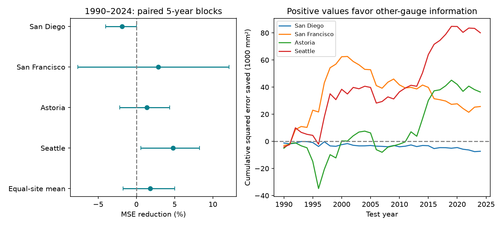

# Other gauges gave no clear mean sea-level prediction gain beyond local history at four West Coast sites in 1990-2024

We tested whether prior-month levels at three other gauges improve monthly mean sea-level predictions beyond three months of local history. We used a fixed PSMSL Revised Local Reference snapshot for San Diego, San Francisco, Astoria and Seattle. Each test year used coefficients fit to earlier years from 1960 onward. There were 1,601 site-month predictions in 1990-2024. The equal-site mean squared error reduction was 1.79%. Its conditional 95% five-year block interval was -1.73% to 5.01%. Thus the primary test gives no clear mean gain. Seattle had a 4.80% point gain, but its interval included zero under quadratic trend and rolling training checks. When 1997, 1998, 2015 and 2016 were removed from scoring, mean gain was -0.01%. This check does not identify an ENSO cause. The result gives a small, reproducible spatial prediction benchmark. It does not measure flood risk or test a real-time data service. Four selected gauges, revised data, missing months and conditional uncertainty limit inference. The package includes exact source members and hashes, code, predictions, a separate numerical audit, and a figure.



## Question and prior evidence

Can the prior-month sea level at other coastal gauges improve a prediction after the model uses three months of local levels? Monthly background sea level can affect the level on which tides and storms act. A low-cost gauge-only benchmark can help assess the extra information in more complex prediction systems.

[Frederikse et al. (2022)](https://doi.org/10.1029/2021JC018137) use damped persistence as a reference for monthly sea-level prediction at Charleston. [Long et al. (2021)](https://doi.org/10.1029/2020JC017060) test seasonal sea-level prediction in a multi-model system. [A 2025 West Coast study](https://doi.org/10.1038/s41612-025-01182-x) connects large-scale and coastal variability. We could read the Frederikse article and indexed text for the other two studies. Full retrieval of the 2025 article failed. These papers support the question; our test does not reproduce their methods or scores.

Before choosing this question, we searched the campaign for earthquakes, ocean conditions, sea level and Honolulu. We read [the prior seasonal ENSO reconstruction test](sci:sha256:0460352ad34be446523ddb917bef72e032195bbcc7e7088a5dff10cb75c3d5a4). That test uses concurrent ENSO at San Francisco and Seattle. Our test adds lagged levels from other gauges after a local memory reference. The source observations overlap prior campaign studies. This is a new benchmark on reused observations, not an independent confirmation. Search does not prove novelty. We saved files/protocol.txt before the first model fits. The question and checks were selected in this session, not registered externally.

## Data

We reused ./datasets/psmsl-rlr-monthly-20261019/rlr_monthly.zip without changing it. The exact resolved shared path, source URL, size, archive SHA-256 and every used member SHA-256 are in files/provenance.json. Archive SHA-256: b22f65f5fcbc5021809f1d4eef279269f5e78a08bdc8d28aabd22adfe4dcf57e. The shared name is a snapshot label, not a formal PSMSL release number. The hash defines this version. No new raw data were downloaded.

[PSMSL documentation](https://psmsl.org/data/obtaining/notes.php) defines monthly values as calendar-month means in millimetres, with missing-day and attention fields. We use the [Revised Local Reference data](https://psmsl.org/data/obtaining/rlr.php), which apply local datum history. Values refer to each local land frame. They are not absolute ocean heights and cannot be directly compared across sites. We subtract 7000 mm for numerical scale only; fitted intercepts absorb the local datum.

The four gauges were selected for long records and a spread along the US West Coast. PSMSL IDs are 158 (San Diego), 10 (San Francisco), 265 (Astoria) and 127 (Seattle). All have overall station flag N in the saved file list. We retain 1960-2024 monthly values above -99999, attention field equal to zero, and no more than five missing days. Thus we exclude interpolated values marked 99. We do not fill gaps. Before lag requirements, accepted counts are 752, 761, 776 and 776 out of 780 months per site. The strict zero-missing-day check gives the same accepted rows. The archive has later data, but 2025 is outside the fixed test scope. Full source members, including rejected rows and site notes, are in files/raw.

The saved site notes identify ENSO-like high levels in the early 1980s in California and a major Columbia River outflow effect at Astoria. These are source notes, not causes inferred here. No inverse barometer, land-motion or river-flow correction is applied. Gaps can depend on the conditions of interest. For example, San Francisco lacks January-July 2024 values. Restricting all models to matched support prevents a model-specific scoring advantage, but does not remove missing-data bias.

## Method

For a target month t, the reference design has 12 target-month indicators, linear time (t minus January 1990, divided by 600 months), and the local level at t-1, t-2 and t-3. It has 16 coefficients. The spatial design adds each of the three other gauge levels at t-1, for 19 coefficients. Month intercepts absorb the fixed predictor seasonal cycles as well as target seasonal means. No full-record de-seasoning is used. Both models use ordinary least squares, with no tuning or coefficient constraints.

Each target site's row must have its target, all three own lags and all other gauges at lag one. Both models use exactly these rows. Calendar gaps remain gaps. For each year from 1990 through 2024, we fit on available rows in 1960 through the previous year. The coefficients remain fixed during the test year. Prior months within that test year can supply predictors, as they would become known in sequence. All fits have full column rank and at least 200 training rows. This is a retrospective one-month information test: actual historical data release delays and revisions are not recreated.

At site s, gain is 100 times (1 minus spatial squared-error sum divided by reference squared-error sum). The primary score is the equal average of four site gains. It is not a ratio of pooled errors. The primary interval resamples 35 test years with 9,999 circular moving-block draws of five years. All site losses and both models use the same draw, which preserves shared timing and within-year dependence. Each draw recomputes the ratios. The interval uses the 2.5 and 97.5 percentiles. Seed is 86867 plus block length. The exact primary indices are saved. Years with no scored rows contribute zero sums, not zero-valued observations.

These intervals condition on fitted predictions. They do not refit models or cover source revision, site selection or model choice. They assume that the observed time blocks give useful examples of dependence. Site intervals are pointwise; they have no multiple-test adjustment.

## Results

| Site | Test months | Local RMSE (mm) | Spatial RMSE (mm) | MSE reduction (%) | Conditional 95% interval (%) |
|---|---:|---:|---:|---:|---|
| San Diego | 398 | 31.28 | 31.57 | -1.88 | -4.04 to 0.03 |
| San Francisco | 398 | 47.34 | 46.65 | 2.88 | -7.66 to 12.11 |
| Astoria | 404 | 81.00 | 80.44 | 1.37 | -2.18 to 4.33 |
| Seattle | 401 | 64.51 | 62.95 | 4.80 | 0.59 to 8.25 |
| Equal-site mean | 1601 | -- | -- | 1.79 | -1.73 to 5.01 |

The primary mean interval includes zero. This does not prove no spatial information. Seattle has a positive nominal site interval, but that result does not persist across all model checks. Error changes are small compared with the total monthly prediction error.

## Checks fixed before fitting

| Check | Mean MSE reduction (%) | Conditional 95% interval (%) |
|---|---:|---|
| primary, 3-year blocks | 1.79 | -1.65 to 4.92 |
| primary, 5-year blocks | 1.79 | -1.73 to 5.01 |
| primary, 7-year blocks | 1.79 | -1.76 to 5.01 |
| AR1, 5-year blocks | 2.75 | -0.70 to 6.00 |
| quadratic, 5-year blocks | 1.66 | -2.25 to 5.19 |
| rolling30, 5-year blocks | 1.95 | -2.60 to 5.97 |
| strict, 5-year blocks | 1.79 | -1.73 to 5.01 |
| exclude_enso_years, 5-year blocks | -0.01 | -2.73 to 2.53 |

AR1 uses one own lag in both models, with the same complete lag-three row support as the primary test. Quadratic adds squared time to both models. Rolling30 trains on the previous 30 calendar years. Strict requires zero missing days. Exclude_enso_years removes 1997, 1998, 2015 and 2016 only from scoring and retains the original training histories. The exclusion years were chosen as well-known strong El Nino periods, not from the computed errors; the score also includes all months in those years.

All mean intervals include zero. The mean point gain falls from 1.79% to -0.01% under the selected-year exclusion. Thus a broad mean prediction benefit does not extend clearly beyond those four years in this test. The cumulative plot also shows that gains do not accrue at a steady rate. These are descriptive checks. They do not prove ENSO caused the gains, identify a coastwise signal, or show a change in the physical system. The exclusion also changes sample size and weather conditions. Under quadratic and rolling training checks, Seattle's nominal interval includes zero.

## Interpretation and limits

Shared winds, pressure and ocean circulation can produce common sea-level variation. Lagged other-gauge levels might summarize this forcing. The primary result does not establish a reliable added mean benefit beyond local memory for these four gauges. The selected-year check is consistent with a benefit concentrated in unusual conditions, but it does not test that mechanism. Pressure, wind and ENSO indices would be needed to separate the candidate explanations. More local lags, regularization, different lead times and dynamical forecasts could change the result.

There are only four selected harbor gauges and 35 test years. The sites are not independent samples of a coast. Historical source updates, local land motion, uncorrected pressure and river effects, incomplete rows and chosen trend forms limit inference. This is not an operational forecast trial, a flood forecast, an extreme-water study, a measure of damage, or a general test of all spatial prediction methods. The null result is useful as a matched-support baseline with inspectable errors.

## Reproduction and numerical checks

After SCI verification and extraction, run from the bundle root in a writable directory:

```sh
OPENBLAS_NUM_THREADS=1 python files/analyze.py --out /absolute/new/output
python files/audit.py
```

The analysis reads only included raw files and needs no network or shared data. It writes predictions.csv, summary.csv, quality.csv, block_indices.npy, checks.json and result.png. Use files/requirements.txt in a private environment if needed. The thread setting is an efficiency choice for these small matrix fits. Allow a few minutes on a similar host. Compare numeric CSVs and block indices with files/outputs. The audit checks the packaged outputs in files/outputs. It verifies exported member hashes, unique predictions, source targets and lag availability, primary gains and the primary interval without importing the analysis code.

To rebuild the exact source extract from the shared archive, run:

```sh
python files/export.py /absolute/shared/path/rlr_monthly.zip /absolute/new/raw
```

It also writes provenance.json in the raw directory's parent. Check the archive hash first against files/provenance.json. For a new download, use the campaign helper with a new dataset name and the recorded source URL. A live response can differ from this snapshot. The package includes the exact members, so an offline numerical repeat does not depend on live data access. The archive need not be duplicated.

An alternate QR solver checked every fitted prediction. Its maximum difference was 2.35e-11 mm. A separate audit checks the stored evidence; this is an internal check by the same worker, not external peer review. A second complete run is recorded in files/outputs/repeat_check.json. No sibling private workspace or unpublished result was used.

## Campaign record and rights

Job: sci-1107-dell-earth-and-ocean-sciences-d8dd7a868e67. Topic: earth-and-ocean-sciences. Campaign: 11_07_2026. Machine: dell. Account: codex-andrii. Model: gpt-6.1-sol, high reasoning effort, through Codex in T3 Code. No agents were launched. Work ran directly in the assigned isolated worktree. The campaign-machine signature protects integrity; it is not a claim of personal authorship. Private keys are outside the package. The signed ZIP is saved locally only.

The SCI baseline license applies to original text, figures, derived evidence and code. PSMSL source data retain source attribution and applicable source terms. The included members are attributed scientific inputs, not a claim of exclusive rights. Cited papers are not included.
