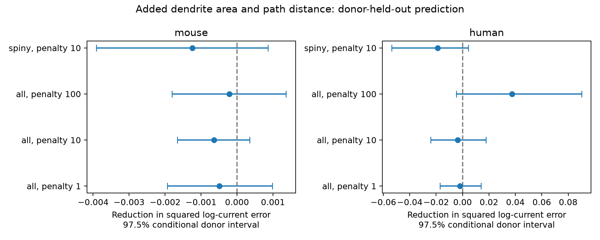

# Dendrite geometry gave no clear threshold-current prediction gain in selected Allen mouse and human cells

## Result

mouse: 509 cells from 372 donors; error changed from 0.11652 to 0.11716. The reduction was -0.55%, with an absolute error reduction of -0.00064 and a 97.5% interval of -0.00166 to 0.00036. human: 158 cells from 35 donors; error changed from 0.14585 to 0.14946. The reduction was -2.48%, with an absolute error reduction of -0.00362 and a 97.5% interval of -0.02421 to 0.01767.



| Species | Subset | Penalty | Cells | Donors | Base error | Geometry error | Error reduction | 97.5% interval | Relative reduction |
|---|---|---:|---:|---:|---:|---:|---:|---|---:|
| mouse | all | 1 | 509 | 372 | 0.12143 | 0.12192 | -0.00049 | -0.00194, 0.00098 | -0.41% |
| mouse | all | 10 | 509 | 372 | 0.11652 | 0.11716 | -0.00064 | -0.00166, 0.00036 | -0.55% |
| mouse | all | 100 | 509 | 372 | 0.12800 | 0.12821 | -0.00021 | -0.00181, 0.00136 | -0.17% |
| mouse | spiny | 10 | 234 | 173 | 0.10647 | 0.10771 | -0.00124 | -0.00391, 0.00086 | -1.17% |
| human | all | 1 | 158 | 35 | 0.15317 | 0.15520 | -0.00203 | -0.01702, 0.01386 | -1.33% |
| human | all | 10 | 158 | 35 | 0.14585 | 0.14946 | -0.00362 | -0.02421, 0.01767 | -2.48% |
| human | all | 100 | 158 | 35 | 0.24706 | 0.20973 | 0.03733 | -0.00474, 0.09011 | 15.11% |
| human | spiny | 10 | 111 | 31 | 0.16600 | 0.18497 | -0.01897 | -0.05358, 0.00434 | -11.43% |

The primary test gives no clear gain in either species. All sensitivity intervals also contain zero. The human estimate changes direction at penalty 100, which shows model dependence. These results do not show that dendrites have no role in excitability.

Errors are squared natural-log current errors. Positive reduction favors geometry. The primary tests use all eligible cells and penalty 10. The other rows are sensitivity tests, not independent replication. A range that contains zero is not evidence of equal performance. Separate species tests do not establish a species difference or test transfer between species.

## Question and prior work

Does measured dendrite geometry add information about the current needed for spike initiation, after electrical properties and cell labels are known? A compact passive cell gives a reference current of 1000*(threshold voltage minus resting voltage)/input resistance, in pA when voltage is mV and resistance is MOhm. A dendrite tree adds cable load and spatial voltage gradients. Its area and path distance may contain information that the somatic resistance does not contain. These are reasons for a test, not proof of a mechanism. The model has separate log voltage-gap and log resistance terms. It does not fix their slopes to the passive formula.

The Allen Cell Types Database measures morphology and electrical properties in the same cells. Gouwens et al. (2019, doi:10.1038/s41593-019-0417-0) studied their joint cell classes. Berg et al. (2021, doi:10.1038/s41586-021-03813-8) provides human cell-type context. The present analysis uses the older API cache, not a new Patch-seq dataset. We searched the campaign for connectivity, dendritic morphology, sag, and rheobase before choosing the test. We read the published area/response-time, apical-area/sag, and rheobase/connection-direction reports cited in sci.json. The first two use the same raw cache; this is a new endpoint and geometry test, not a new cell cohort. The third uses a different dataset. No prior code or result tables were reused. We also searched public source documentation and source-study records. This was not a systematic review, and we make no first-discovery claim.

## Data and structure-function link

The reference cache is /mnt/dell-data/shared_datasets/allen_cell_types/v2026-10-28. It was made on 2026-10-28 from the Allen Cell Types API, which has no fixed version label. Specimen IDs join the electrical feature table to each reconstructed neuron. Donor IDs are source donor__id values, not inferred name groups. The package gives the exact absolute path, byte count, and SHA-256 of each input in files/provenance.json. Only the two source JSON tables, source README, and 667 SWC files were read. No raw activity trace or connectome edge was used. The 2,333 specimen records provide the sampling frame. files/selection.csv lists all reconstructed cells and eligibility. We require positive finite current, input resistance, membrane time, voltage gap, area, and mean path distance, and a finite resting voltage. We do not impute a missing electrical feature. Thus the scope excludes cells with zero or negative threshold current.

Threshold current is threshold_i_long_square in pA, and voltage threshold is threshold_v_long_square in mV. The Allen feature mapping takes both from the first spike in the rheobase sweep. Rest is vrest; resistance is ri in MOhm, not the separate QC resistance; time is tau in ms. These are source summaries. We did not refit traces or inspect discrete current-step resolution. Since voltage threshold comes from the outcome sweep, the test is retrospective and conditional. It must not be presented as a method to predict threshold current before recording. No infinite-duration rheobase is measured here.

For each SWC segment whose endpoints are both dendritic types 3 or 4, length is the Euclidean distance L in micrometres. Area is lateral frustum area pi*(r0+r1)*sqrt(L^2+(r1-r0)^2). Axon, soma, end caps, spine area, and soma-to-dendrite segments are excluded. Path distance is the length along the parent chain to the root. We average segment midpoint path distance with segment area as weight. Geometry features are natural logs of total area and mean path distance. This is a geometric descriptor; it is not an electrical distance estimate. The code rejects cycles. Parent segments absent from the SWC end the path. No tissue-shrinkage correction is applied.

## Model, validation, and uncertainty

We fit mouse and human models separately. Outcome is log current. Base continuous terms are log resistance, log voltage gap, log membrane time, and resting voltage. Base labels are dendrite class, layer, parent region, sex, and reconstruction type. Mouse models also use Cre line. The added model has two further terms: log area and log mean path distance. This tests the two terms together; it does not assign a gain to either one alone.

For each of seeds 20261108, 20261109, and 20261110, we permute sorted donor IDs and split them into five folds. Each cell is tested once per split. Training weights give each donor equal total weight and are normalized to the training cell count. Continuous terms use training-set weighted means and variances. Training labels define one-hot columns with the first level dropped. Unseen labels have zero columns. Ridge regression uses an unpenalized intercept and penalty 10 on the summed weighted squared error. We fixed that value before score calculation. Penalties 1 and 100 and spiny-only cells are sensitivity tests. We did not select a penalty from test outcomes.

We average each cell's three squared errors, then average cells within donor, then average donors. Saved mean predictions can have smaller squared error than the saved mean squared errors. files/predictions.csv preserves both. We resample the fixed donor error differences 10,000 times with seed 877. Interval endpoints are the 1.25 and 98.75 percentiles. This is a nominal two-species Bonferroni rule only if component intervals have their intended coverage. It accounts for donor sampling of fixed scores. It does not include uncertainty from model refitting, overlapping training folds, question selection, or missing data. Sensitivity intervals do not adjust for all sensitivity comparisons.

## Limits and scientific use

A prediction gain does not prove that dendrites cause a current change. Active conductances, unmeasured cell identity, recording conditions, tissue damage, and radius error can affect both features. Labels give incomplete cell-type control. Shrinkage can let added geometry capture information already present in the base variables. An error increase can reflect redundant predictors or limited sample size rather than no biological relation. Cut arbors and missing spines differ from intact membrane area. Human clinical tissue and selected mouse lines do not form random species samples. This study does not test intact-brain dynamics, synaptic computation, behavior, or representation reliability. It does not link unmatched datasets by assumed homology. Its useful output is an inspectable test of structural information after electrical controls. A separate cohort with complete arbors and direct conductance measurements is needed for a mechanism test.

## Reproduce and inspect

Use Python 3.12 and files/requirements.txt in a private environment. Exact run versions are in files/environment.json. From the bundle root:

```sh
sh files/reproduce.sh /mnt/dell-data/shared_datasets/allen_cell_types/v2026-10-28 reproduced
python3 files/check_evidence.py files
```

The first command rebuilds features, held-out errors, intervals, and the figure. Its output must be outside the shared dataset store. The second inspects saved evidence without raw data. It recomputes donor scores, every bootstrap draw, interval endpoints, counts, cell uniqueness, and the bound for averaged errors. files/validation.json records this check. A separate source check rebuilds geometry by a topological traversal and verifies source hashes, electrical features, and donor identity for one cell per species and dendrite class. Run `python3 files/check_raw.py files /mnt/dell-data/shared_datasets/allen_cell_types/v2026-10-28`; its record is files/raw_validation.json. It does not validate the biological measurements or fully refit the models.

If the reference cache is absent, request specimens from https://api.brain-map.org/api/v2/data/query.json?criteria=model::ApiCellTypesSpecimenDetail,rma::options[num_rows$eqall] and electrical rows from the same API with model::EphysFeature. For each specimen with nrwkf__id, retrieve https://api.brain-map.org/api/v2/well_known_file_download/ID and save as swc/SPECIMEN.swc. Preserve JSON response wrappers. Compare files to files/provenance.json before analysis. The API is mutable, so exact recovery can fail. Use a local scratch folder, or the campaign-dataset helper for a new immutable import. Do not write into an existing shared dataset. Raw source tables and reconstructions are not duplicated here.

## Job and rights

Job: sci-1107-syam2-neural-structure-and-computation-55bc74340d53. Topic: neural-structure-and-computation. Campaign: 11_07_2026. Machine: syam2. Account: codex-myxtap. Model: gpt-6.1-sol, high reasoning effort, Codex harness in T3 Code. No child agents were used. The campaign-machine signature is not a personal authorship claim. This bundle is saved locally only.

Credit the Allen Institute for Brain Science (2015), Allen Cell Types Database, and the source investigators. Source data retain the Allen Institute Terms of Use at https://alleninstitute.org/legal/terms-of-use. The SCI baseline license applies to new text, code, figures, and derived analysis material to the extent permitted by source terms; it does not replace source rights. No private key is included.
