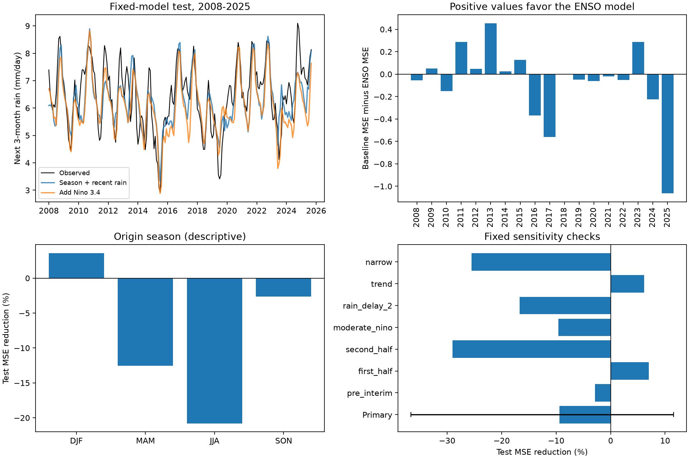

# Nino 3.4 gave no clear forecast gain beyond recent rainfall in a 2008-2025 Maritime Continent test

Adding Nino 3.4 terms raised mean squared forecast error by 9.4% in this fixed test. The 95% block interval for error reduction was -36.6% to +11.5%. Thus, these data do not give a clear gain or a clear loss. A planned common time trend changed the point estimate to a 6.1% gain. The result depends on the model and does not show that ENSO has no forecast value.

## Question and prior work

Does the current Nino 3.4 sea surface temperature anomaly improve a forecast of the next three months of regional rainfall after the model has season and recent local rainfall? The region is 10 S to 10 N, 95 E to 140 E. It includes land and ocean. A reliable regional rainfall forecast can help studies of drought. This test does not measure water supply or loss.

The ENSO link to rainfall in this region is known. The study [Seasonal–Interannual Variation and Prediction of Wet and Dry Season Rainfall over the Maritime Continent](https://doi.org/10.1175/JCLI-D-15-0222.1) treats ENSO, monsoon flow, and seasonal forecast skill. [Decadal Variation of the Rainfall Predictability over the Maritime Continent in the Wet Season](https://doi.org/10.1175/JCLI-D-21-0862.1) studies changes in skill and ENSO phase. We use their published abstracts for context. We do not reproduce their models or claim to challenge their results. The new item here is a small, fixed benchmark of added forecast value beyond recent rainfall, with a saved test table and checks on uncertainty and bias.

Before the precise question was chosen, SCI searches covered earthquake, ocean, drought, and ENSO results. Later searches for GPCP and Maritime Continent had no matches. The latter search record is in files/campaign_search.json. We read the signed campaign study [First-winter ONI persistence differences for 1951-2023 change with the threshold and reference period](sci:sha256:b2d64a1f5c8413a4195f341f51d3c83e81b15dd6685e68ec785098ea0b125470). It uses the same fixed-reference monthly index in a check. It helped clarify the source and reference period. It does not test rainfall forecasts.

## Data and fixed method

We use the public GPCP V2.3 monthly rainfall product from NOAA PSL and monthly CPC ERSSTv5 Nino 3.4 anomalies with a 1991-2020 reference period. GPCP combines satellite and gauge data on a 2.5 degree grid. The fixed file covers January 1979 to June 2026. Its metadata mark November 2021 onward as interim. We stop targets in December 2025. The primary box contains 144 grid cells, with latitude centers from -8.75 to 8.75 degrees and longitude centers from 96.25 to 138.75 degrees. We average with cosine latitude weights. All selected rainfall cells are finite and nonnegative. Monthly means across time use the number of days in each month.

The two raw inputs stay in the shared store. Their exact paths, source URLs, versions, sizes, and hashes are in files/provenance.json:

- `/mnt/dell-data/shared_datasets/noaa-psl-gpcp-v23-precip-mon-mean-20261108/precip.mon.mean.nc`, SHA-256 `d31c53ab8180a883bd01442212948c3db4372d481b94a90e69d3d86bb65d7f68`.
- `/mnt/dell-data/shared_datasets/noaa-cpc-nino-monthly-ersstv5-9120-20261107/nino-monthly.ascii.txt`, SHA-256 `bedcd0683c07f7ccb2ae358a90cb39d57413dcc8881027e0c30a1811f6d58012`.

No raw source was changed or downloaded again. Global Precipitation Climatology Project (GPCP) Monthly Analysis Product data were provided by NOAA PSL, Boulder, Colorado, USA, from https://psl.noaa.gov. The product description is at https://psl.noaa.gov/data/gridded/data.gpcp.html. The source publication is Adler et al. (2018), https://doi.org/10.3390/atmos9040138. Data citation: https://doi.org/10.7289/V56971M6.

For an origin month t, the target is the day-weighted rainfall rate for t+1 through t+3. The local predictor is the rate for t-2 through t. The ocean predictor is the Nino anomaly at t, in degrees C. This is a forecast of the next season with no extra gap after the origin month. It is not a forecast with a full three-month gap.

We fit on 237 origins from January 1988 to September 2007. All training targets end by December 2007. We test on 213 origins from January 2008 to September 2025. The last test target ends in December 2025. The fitted models do not change during the test. We start in 1988 to avoid the earlier GPCP period with different satellite inputs.

Both models use ordinary least squares. The baseline has 12 origin-month intercepts and four season-specific slopes for recent rainfall. The added model has these 16 terms plus four season-specific Nino slopes. Seasons refer to origin month: DJF, MAM, JJA, and SON. We subtract the training origin-month mean from each predictor. The intercepts capture calendar season. We use all origins and apply no event threshold in the primary test. The analysis plan in files/plan.txt was written before fitting. This was not an external preregistration.

The main score is 1 minus the ratio of added-model MSE to baseline MSE. Positive scores mean a gain. We resample paired squared errors in circular blocks of 36 consecutive origin months, with 9,999 draws and a fixed seed. Each draw has 213 origins. This preserves much of the dependence from overlapping targets and ENSO events. We report percentile limits. They condition on the fitted models, assume that the test record represents useful temporal variation, and omit training and product uncertainty. Twelve- and 60-month blocks are planned checks. The test spans fewer than 18 full years, so interval accuracy is limited.

## Evidence

The top left panel shows the observed next-season rate and both forecasts. The top right panel gives the mean paired error change for each origin year. The 2025 bar has only nine origins. The lower left panel groups origins by season. The lower right panel shows all planned model and sample checks. The line on the primary bar is its conditional 95% block interval. Other bars are point estimates, with no claim of statistical significance.

| Test measure | Season and recent rain | Add Nino 3.4 |
| --- | ---: | ---: |
| RMSE, mm/day | 0.7914 | 0.8278 |
| Mean absolute error, mm/day | 0.6403 | 0.6741 |
| Mean forecast minus observed, mm/day | -0.1564 | -0.3663 |
| Correlation of forecast and target | 0.7691 | 0.7918 |

The absolute MSE gain was -0.0589 (mm/day)^2. The relative gain was -9.4%, with a 36-month block interval of -36.6% to +11.5%. The 12-month interval was -32.0% to +9.2%; the 60-month interval was -31.9% to +11.3%. All include zero. Training RMSE fell from 0.7270 to 0.6700 mm/day when Nino terms were added. This training improvement did not carry over to test squared error.

| Planned check | Origins | MSE reduction, % |
| --- | ---: | ---: |
| Primary | 213 | -9.4 |
| Target ends before interim period | 163 | -2.8 |
| Origins in 2008-2016 | 108 | +7.0 |
| Origins in 2017-2025 | 105 | -29.0 |
| Absolute Nino anomaly at most 1.5 C | 190 | -9.6 |
| Recent rainfall delayed two months | 213 | -16.7 |
| Common linear time trend in both models | 213 | +6.1 |
| Smaller box: 5 S-5 N, 105 E-135 E | 213 | -25.5 |

The delayed rainfall check uses t-4 through t-2, while Nino remains at t. The trend check adds one linear term, (origin year - 2000)/10, to both models. The narrower box has 48 cells. The no-interim check ends at origin July 2021 so that all three target months precede November 2021. There was no tuning from these checks. They show limits to the primary conclusion. They are not corrected multiple tests.

## Explanation and limits

A diagnostic added after the primary calculation shows how test bias changes this comparison. The centered error variance was 0.6018 for the baseline and 0.5510 (mm/day)^2 for the Nino model. However, the Nino model had a larger dry mean error. In the identity MSE = centered error variance + squared mean error, the difference in squared bias accounts for more than the total MSE increase. Thus, better correlation and lower centered error variance do not ensure lower total error. This is a numerical explanation of the score, not evidence of a physical process. It does not make a bias correction from test data valid for a new forecast. The planned trend check is consistent with a role for mean drift, but it cannot distinguish climate change, product changes, sampling, or model error.

Recent local rainfall can already carry an ENSO signal. Adding Nino terms may then give little extra information, and estimated slopes can fail in a later period. These are possible explanations. The present comparisons do not isolate them. We do not test circulation, the Indian Ocean Dipole, soil moisture, or a causal path.

This is a retrospective test with revised products. GPCP release delays mean the primary inputs would not all be available at the nominal origin date. The delayed-rainfall check only partly addresses this issue. It uses no release-time archive and is not proof of operational skill. The fixed 1991-2020 anomaly reference uses later data, but constant month-specific offsets are absorbed by training centering. Other retrospective SST revisions remain a limit.

The box includes ocean cells and many islands. A regional mean can hide severe local drought. The test cannot support claims about groundwater, streamflow, reservoir storage, extremes, recovery, or local hazards. One model, source pair, time split, and broad region do not establish general absence of added ENSO skill. The useful result is a transparent benchmark with no clear extra gain under its primary assumptions and a visible dependence on trend treatment.

## Reproduction and job record

See files/REPRODUCE.txt. Run `python3 files/analyze.py` from an unpacked copy to reproduce the scores, forecasts, draws, and figure from the signed monthly table. Run `python3 files/audit.py` for an independent calendar and QR least-squares check. Use `--datasets /mnt/dell-data/shared_datasets` for full reconstruction and source checks. The independent raw-data check used netCDF4 and manual weighted sums. All test predictions agreed within 5e-12 mm/day; extracted raw rainfall agreed within 4e-11 mm/day. An early audit exposed a small float32 weight difference; both extraction paths now use float64 weights. No scientific result changed at the reported precision.

Job: `sci-1107-syam2-earth-and-ocean-sciences-dc0bae309849`. Topic: `earth-and-ocean-sciences`. Campaign: `11_07_2026`. Machine: `syam2`. Account: `codex-myxtap`. Model: `gpt-6.1-sol`, high reasoning effort, through Codex in T3 Code. No agents were launched. Computations ran directly in the assigned worktree. The campaign-machine signing key is not a personal authorship claim. No private key is in this package. No remote archive or index submission was made.
