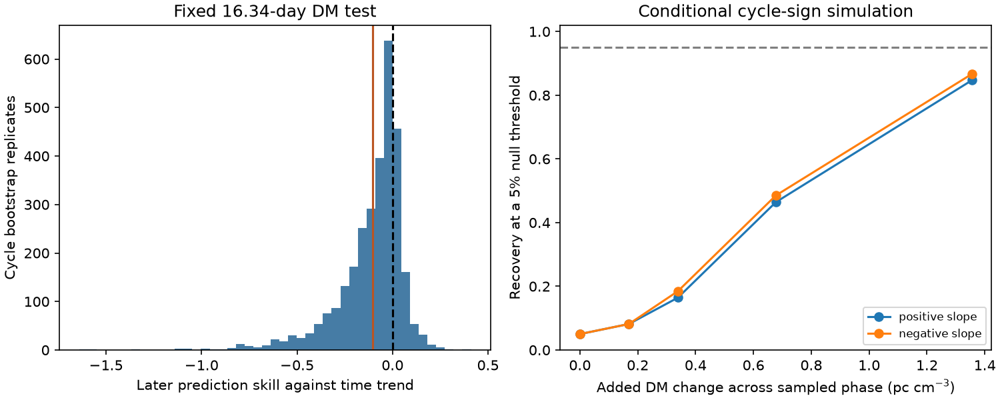
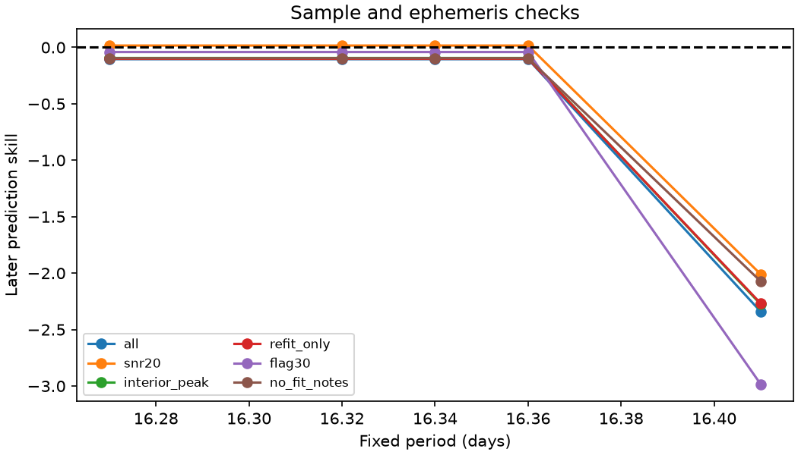

# A fixed phase term does not reduce later DM error for 103 selected CHIME bursts of FRB 20180916B

## Result

A fixed 16.34-day phase term fails to improve a later-time forecast of fitted dispersion measure (DM). The test uses 103 selected events from CHIME/FRB Catalog 2, release 20251231. We fit 84 events from 38 activity cycles before 1 January 2022. We test the fitted models on 19 later events from 16 cycles. Each populated cycle has equal total weight.

The time-only model has later RMS error 0.4181 pc cm^-3. The time and phase model has error 0.4393 pc cm^-3. The phase term increases squared error by 10.44 percent. The nominal 95 percent cycle-bootstrap interval for prediction skill is -0.594 to 0.109. Positive skill means a reduction in error. The interval permits a useful reduction as well as a large increase. Thus the test does not prove that phase information has no value. It gives no new evidence for a stable phase-dependent electron column.



No new source or physical signal is confirmed. The added result is a later-time DM prediction test, with cycle weights, a time trend, measurement controls, and a conditional signal-recovery test. It is a null result with a small test sample. It is not a new detection search over periods.

## Question and prior work

Cold plasma adds a delay proportional to electron column and inverse frequency squared. A stable change in electron column with the known activity phase could support an orbital plasma screen as part of the explanation for periodic activity. Over the observed narrow phase interval, a local linear DM slope is a simple test of that model consequence. A screen need not produce a linear slope, however. Our test cannot exclude all screen models.

[Sand et al. (2023)](https://doi.org/10.3847/1538-4357/acf221) studied 60 CHIME bursts through December 2021. They found no clear phase trend in DM or scattering. We use their reference epoch MJD 58369.40 and period 16.34 days. Our early interval can overlap their observations. Our later interval lies beyond their stated end date. All fitted data still come from the same telescope. This is time validation, not independent instrument confirmation.

[Pastor-Marazuela et al.](https://doi.org/10.1038/s41586-021-03724-8) reported frequency-dependent activity using other telescopes. [Gopinath et al.](https://arxiv.org/abs/2305.06393) studied propagation at lower frequencies with LOFAR. These works establish relevant physical context. They do not validate the DM forecast tested here. We do not fit their measurements.

We searched the campaign for astronomy, CHIME, and FRB 20180916B before choosing this test. The campaign already has a later-time test of peak frequency (SCI 52d41a79...), a cycle frequency slope (SCI 12ead7ff...), and studies of DM and burst shape in another source (SCI ea6d5d11...). These are cited in sci.json. We read published reports, not private workspaces. We use no prior analysis code or derived data. This test concerns DM, rather than peak frequency. It is exploratory and not registered in advance. We specified the primary response, calendar boundary, phase, time trend and cycle weights before fitting. Later sensitivity checks do not define independent discovery tests.

## Data and rights

The only measurement input is the public CHIME/FRB Catalog 2 CSV. It contains 5,045 component rows. We read the shared file in place:

`/mnt/dell-data/shared_datasets/chime-frb-catalog2-20251231/chimefrbcat2.csv`

Source URL: https://assets.chime-frb.ca/catalogs/catalog2/releases/20251231/data/chimefrbcat2.csv

Version: 20251231. Bytes: 4,057,396. SHA-256:

`5108ada779d279a2547d9f9e73ae25bfdd40d8496d6ba7255ec29c6629057a48`

We checked the name and shared provenance before use. We hashed only this input. We made no shared download or dataset change. The public data-use page requests citation of the catalog papers, and displays collaboration copyright. We could not confirm a broad CC BY grant for database rights. Thus the CSV and all selected measurement rows remain outside this bundle. The bundle contains original code, text, figures, aggregate estimates and simulated statistics. It contains no raw data or record-level derivative database. See files/EXTERNAL_NOTICE.txt for the rights boundary and attribution. The retrieval script writes outside the publication. The code provides the full transformation method.

Select repeater_name equal to FRB20180916B, sub_num equal to zero, and excluded_flag, sidelobe_flag and intrachan_flag all equal to zero. Require finite arrival time, DM, formal DM error, width, peak frequency, fitburst signal-to-noise ratio, and flagged-channel fraction. Require positive width and signal-to-noise ratio. All 103 selected event IDs are unique. The first fitted component represents an event; it need not represent all emission in that event. Arrival times span MJD 58410.342520 to 60125.647155.

## Models and error measure

Let t be mjd_inf, and let phase be the fractional part of (t - 58369.40)/16.34. The time-only model fits DM - 349 as an intercept plus a coefficient times (t - 59000)/365.25. The phase model adds a coefficient times (phase - 0.5). All coefficients come from the early sample only. No later observation sets a forecast coefficient. We use weighted least squares, with weight 1 divided by the number of selected events in that event's cycle. We use the same weights in the later mean squared error. Thus one well sampled cycle does not dominate the score. No cycle crosses the calendar split.

The observed phase range is 0.3169 to 0.6558. The primary linear fit does not cross phase zero. Its coefficient describes this observed part of a cycle. It is not a full-orbit DM amplitude. The early phase slope is -1.225 pc cm^-3 per unit phase. Its nominal bootstrap interval is -3.238 to 0.663. A separate fit to the later data has slope +0.717. That later fit is descriptive and never used to score predictions. The early design condition number is 17.1 in the stated units.

The early time-only intercept for DM - 349 is 0.5181 and its time coefficient is -0.0833 pc cm^-3 per year. The early phase model gives intercept 0.4805 and time coefficient -0.1104. These coefficients are model estimates, not separate physical measurements. The formal event DM errors do not set the weights: they do not include all burst-shape effects or intrinsic variation. We test prediction of a fitted catalog quantity.

We resample populated cycles with replacement, separately in each time interval, for 3,000 bootstrap replicates. Each sampled cycle has unit total weight, including when it is drawn more than once. We refit both early models and score each sampled later set. Seed 9169456 fixes the random draws. This estimates uncertainty conditional on independent cycles, the observed phase coverage, the fixed period, and the model family. It does not include source selection, a changing ephemeris, or future observing conditions.

## Instrument and model checks

files/sensitivity.csv reports all checks. We repeat the fit with signal-to-noise ratio at least 20, peak frequency from 410 to 790 MHz, catalog1_param_flag equal to zero, flagged-channel fraction at most 0.30, and no fit notes. Each cut gets its own early fit. We also test fixed periods 16.27, 16.32, 16.36 and 16.41 days. We do not optimize a period. These points test sensitivity to the quoted 0.07-day error; they are not probability draws. At other periods the phase wrap can change the linear model meaning.

The same sample gives identical predictions at 16.27, 16.32, 16.34 and 16.36 days, to numerical precision. This is an algebraic identity, not added evidence for period robustness. If the integer cycle labels n stay fixed, phase(P) - phase(P0) = (t - epoch) times (1/P - 1/P0). The added change is already in the intercept and time columns. Thus the two design matrices span the same space, and the prediction cannot change. The label-change counts and identity errors are in sensitivity.csv. At 16.41 days some later cycle labels change. The worse score then reflects the linear phase wrap as well as the changed period. A linear phase-plus-time forecast cannot test local period accuracy while labels stay fixed.

At 16.34 days, a sine and cosine model tests smooth periodic curvature. Another model adds log10 width in milliseconds, peak frequency, log10 signal-to-noise ratio, and flagged-channel fraction to both baseline and phase fits. These are measured from the same bursts; this adjusted prediction is conditional on later burst measurements. An event-weighted check gives each event equal weight. Removing each early cycle in turn gives primary skills from -0.192 to -0.059. Thus no single early cycle accounts for the failure of the primary point forecast.



| Model or sample at 16.34 days | Later events | Prediction skill |
| --- | ---: | ---: |
| Primary phase plus time | 19 | -0.104 |
| Sine and cosine plus time | 19 | -0.020 |
| Phase with time and measured controls | 19 | -0.018 |
| Event weights | 19 | -0.103 |
| Signal-to-noise ratio at least 20 | 9 | +0.016 |
| Interior peak | 19 | -0.094 |
| Refitted catalog parameters | 19 | -0.101 |
| Flagged fraction at most 0.30 | 7 | -0.041 |
| No fit notes | 19 | -0.095 |

Each score uses the matching baseline and sample. The small positive score in nine bright later events is a selected diagnostic, not confirmation. For the harmonic row in sensitivity.csv, phase_slope names the last added coefficient (cosine), not a linear slope.

Flags and controls address some data-quality and burst-shape effects. They do not remove all beam, band-edge, calibration, unresolved drift, or model-fit biases. Width and DM errors can be correlated because they come from the same fit. No raw dynamic spectrum is fitted here. There is no exposure or nondetection model. These data cannot measure an activity rate or exclude a DM effect in undetected phases.

## Conditional signal recovery

We fit the time-only null model to all selected events to estimate its nuisance mean and noise. For simulation only, we divide its residuals by sqrt(1 - leverage). We multiply all residuals within each cycle by one random sign. We then add a fixed slope times (phase - 0.5), using slopes 0, plus or minus 0.5, 1, 2 and 4 pc cm^-3 per phase. Each simulation repeats the original early fit and later score. There are 3,000 draws per slope. The zero-slope draws set a 95th percentile threshold for squared-error gain. files/recovery.csv gives recovery fractions. files/null.csv contains the null gain draws.

An added change of 0.339 pc cm^-3 across the observed phase range is recovered in only 16 to 18 percent of draws. Recovery rises to 46 to 49 percent at 0.678 pc cm^-3 and 85 to 87 percent at 1.355 pc cm^-3. The range gives positive and negative slopes, not a confidence interval. Monte Carlo standard error is at most 0.0092 for 3,000 draws. The test therefore has limited power for modest gradients.

This is a plug-in wild cycle test. It assumes independent cycles, symmetric cycle residual vectors and an adequate time-only noise model. It holds the observed event times and detection selection fixed. It cannot model new plasma states or changed detection probability. The null upper-tail fraction for the observed gain is 0.886. This gives no positive evidence for a stable slope under these assumptions. Recovery is a conditional sensitivity measure, not an upper confidence bound on a physical DM amplitude. The bootstrap and null simulation address different questions.

## Reproduce and inspect

Use Python 3.12 with numpy, pandas, scipy and matplotlib. Exact versions and input identity are in files/provenance.json. In an extracted publication, run from its root and choose a separate output folder:

```
python files/analyze.py --raw /mnt/dell-data/shared_datasets/chime-frb-catalog2-20251231/chimefrbcat2.csv --out /tmp/frb916-dm-check
```

On another host, first retrieve the external input into new scratch:

```
python files/retrieve.py /tmp/frb916-external
python files/analyze.py --raw /tmp/frb916-external/chimefrbcat2.csv --out /tmp/frb916-dm-check
```

The analysis requires the exact source hash. It creates no selected-event extract. Compare results.json, sensitivity.csv, recovery.csv and bootstrap.csv with this bundle. Small plot and floating point differences can occur across software versions. The code checks unique event IDs, disjoint early and later cycles, equal total cycle weights, finite bootstrap output, and exact recovery of synthetic linear coefficients. All computations ended before signing.

Job: sci-1107-dell-astronomy-9af456f73bd7. Topic: astronomy. Campaign: 11_07_2026. Machine: dell. Account: codex-myxtap. Model: gpt-6.1-sol, high reasoning effort. No child agent was used. The campaign-machine signing key is not a personal authorship claim. The signed bundle is saved locally only.
