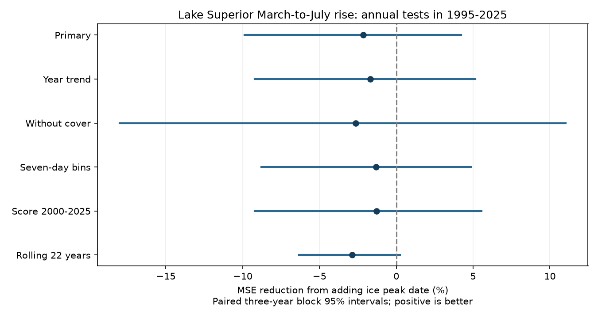

# Ice peak date gave no clear added Superior level-rise prediction gain in 1995-2025

The date of maximum ice cover gave no clear added prediction value for the March-to-July water-level rise on Lake Superior. We tested 31 years from 1995 to 2025. Each fit used only earlier years, starting in 1973. The comparison model used the March water level, the change from the prior September to March, and maximum winter ice cover. Adding peak date raised mean squared error by 2.14%. The conditional 95% interval for error reduction was -9.89% to +4.21%. This result does not prove that ice timing has no effect.



Positive values show lower prediction error. Each line gives a conditional 95% interval from paired three-year blocks. All six intervals include zero. The checks use the same source record and are not independent tests.

## Question and prior work

Can peak ice date add information about the later seasonal water-level rise after control for lake level, recent level change and peak ice amount? A useful signal could help a simple seasonal planning model. A date can represent conditions that maximum cover alone misses. However, snow storage, air temperature, lake heat storage and precipitation can affect both ice and water levels. Outflow regulation also affects levels. We test added information, not a physical cause.

Spence et al. (2013, doi:10.1175/JHM-D-12-0170.1) used direct evaporation measurements and model experiments to show that spring and autumn weather matter for Superior evaporation. Low ice cover alone need not raise annual evaporation. Their work motivates control for ice amount and caution about a simple date mechanism. We read the publisher abstract. It does not establish that the date of one ice maximum should predict a four-month level change.

Yang et al. (2020, doi:10.1038/s41597-020-00603-1) describe the ice data history. Early charts were less frequent than recent charts. Recorded peak dates can therefore differ in precision. The source history was also reviewed in campaign publication 8e0d6b9, which tests the Superior-minus-Erie ice peak date trend. Campaign publication 50ed441 tests other-lake information in water-level forecasts. We read both publications. We reuse their public source snapshots in place, but no code or derived records. Our new target is the added value of ice peak timing for a seasonal level rise after ice-amount and level-history controls. This is a small benchmark extension. It is not a claim of first use of ice in lake prediction.

Before selecting the question, we searched the campaign for earthquake and ocean terms, ENSO persistence, warm water volume, and lake ice and water-level terms. The search found many related studies. It cannot establish research priority. See files/LITERATURE.md for the inspected sources.

## Data and rights

The ice source is the NOAA Great Lakes Environmental Research Laboratory annual maximum ice cover table with dates. Its fixed snapshot has 54 winters, 1973-2026. We use Superior cover and peak date in 53 winters, 1973-2025. The peak ranges from January 16 to April 2 on a fixed non-leap calendar. There are no missing used fields. The code checks the repeated years, row widths, complete year sequence, cover range and source hashes. It does not use other lake fields.

The water source is the Coordinating Committee on Great Lakes Basic Hydraulic and Hydrologic Data release v2025, doi:10.5281/zenodo.21908489. ECCC and USACE compute and coordinate the monthly lake-wide means from CHS and NOAA gauge observations. Units are meters relative to IGLD 1985. The file contains 1,296 months from 1918 to 2025. We use March and July values in 1973-2025 and September values in 1972-2024. We do not fill gaps. The Zenodo API lists CC BY 4.0 for the release.

Exact shared source paths and hashes:

| Source path | SHA-256 |
| --- | --- |
| `/mnt/dell-data/shared_datasets/noaa-glerl-ice-annual-max-dates-20261109/dates_AMIC.txt` | `6ba43954faea0a478b7b6633737d228390ec343c33088e47bf9cd602f6df67d8` |
| `/mnt/dell-data/shared_datasets/glcc-superior-monthly-v2025/levels.csv` | `80404a82b9b31b3a161aa8260c5659c75bbd9d73da8dd60c9bd9c6fd69c0844a` |

These are the shared SSD compatibility paths. We used the existing files and made no new shared download. files/provenance.json records exact URLs, paths, sizes and hashes. The ice table is mutable and has no numbered release; its hash defines the snapshot. Future bytes at that URL may differ.

GLERL permits copying public information and requests credit. Underlying ice charts come from the Canadian Ice Service and the U.S. National Ice Center. We retain that attribution. We keep both raw sources and all annual joined records and forecasts external to this publication. The publication contains our code, text, aggregate statistics, statistic draws and aggregate figure. It contains no source chart, article text or derivative record database. The separate external-data notice identifies source terms. The exact SCI baseline license applies to our bundled materials.

## Method

The plan was written before scores were computed. A range check stopped the first run because the 2011 ice peak was on April 2. No score had been computed. We then set the assumed issue to the end of April. All other planned choices stayed fixed. This test assumes the final peak fields and March mean level are known then. It does not check actual reporting dates. The March-to-July target includes some change before the assumed issue. This is a retrospective seasonal-rise estimate, not a fully prospective four-month forecast.

Let L(y,m) be monthly mean level. The target R(y) is L(y,July)-L(y,March). The prior change F(y) is L(y,March)-L(y-1,September). C(y) is maximum winter ice cover in percent. D(y) is recorded peak date on a fixed non-leap calendar, with January 1 = 1, March 1 = 60, and February 29 = 59.5.

The comparison model is:

R(y) = a + b*L(y,March) + c*F(y) + d*C(y) + error.

The added model includes e*D(y). Both use ordinary least squares with an intercept. Training starts in 1973. At each test year y, only years less than y enter either fit. There are 22 training years at the first test and 52 at the last. Code centers and scales predictors within each training fit. This changes numerical conditioning, not the fitted model. All designs have full rank. We chose one lake, target and primary scoring period before computing scores. No hyperparameter was fit on the scored years.

The primary statistic is 100*(1-MSE_added/MSE_comparison). Positive means lower error. We form 20,000 circular moving-block resamples of the paired annual squared errors, using three-year blocks, cut to 31 years, and seed 11759. The 2.5% and 97.5% statistic quantiles give the reported interval. Fits stay fixed during these draws. The interval assumes these short blocks represent relevant error dependence. It omits source error, revisions, model selection and uncertainty in the fitted forecasts. It is not an equivalence bound.

Planned checks add a linear year term to both models, remove ice cover from both models, map dates to seven-day bins, score only 2000-2025, or use the most recent 22 training years. Other checks use one-year and five-year blocks. These are descriptive checks without multiple-test correction. Seven-day bins reduce precision but cannot repair missing chart peaks. The historical mean rise from the training years is a simple reference.

## Results

| Test | Years scored | Comparison RMSE, m | Added-date RMSE, m | MSE reduction, % | Conditional 95% interval, % |
| --- | ---: | ---: | ---: | ---: | --- |
| Primary | 31 | 0.10299 | 0.10409 | -2.14 | -9.89 to +4.21 |
| Add year trend | 31 | 0.10838 | 0.10930 | -1.71 | -9.21 to +5.14 |
| Remove cover control | 31 | 0.09817 | 0.09947 | -2.66 | -18.01 to +11.03 |
| Seven-day date bins | 31 | 0.10299 | 0.10367 | -1.32 | -8.79 to +4.86 |
| Score 2000-2025 | 26 | 0.10345 | 0.10412 | -1.30 | -9.23 to +5.54 |
| Rolling 22-year training | 31 | 0.09983 | 0.10126 | -2.88 | -6.34 to +0.23 |

The primary RMSE increase was 0.00110 m, about 1.1 mm. The historical mean-rise reference had RMSE 0.11171 m. The comparison model had lower point error than that reference. We did not test an interval for that comparison. Removing cover lowered point error further, but this check does not establish the best model. Adding date gave a negative point gain in all planned model checks.

For the primary scores, one-year blocks gave an interval of -11.73% to +4.28%. Five-year blocks gave -9.18% to +3.97%. Neither excludes zero. The rolling check has a narrow upper limit near zero; it does not override the primary test or prove harm. Thirty-one scored years give few independent multi-year blocks.

An audit used a separate date and level parser, raw predictor units, the SciPy gelsy solver and a scalar block loop. It agreed with the primary RMSE values, gain and interval to within 1e-8. See files/audit.json. A separate run retrieved both public sources into local external scratch, passed both exact hash checks, and reproduced every aggregate result exactly. The audit also passed on the retrieved files. The chart was inspected and decoded. This verifies arithmetic and implementation agreement, not the source measurements or a physical model.

## Interpretation and limits

One linear peak-date term did not give clear added value under this comparison and period. The data still allow a modest gain or a larger loss. This finding does not reject effects from ice duration, breakup date, daily ice area, lake heat storage or changing weather. A single maximum can be a poor measure of season length. When cover is small, peak timing may have a different meaning from the timing of extensive cover.

Precipitation, snow storage, air temperature, evaporation and regulated outflow are absent from these models. Those processes can mask or explain a relation. We did not estimate water balance, attribute a cause, test flood risk, or compare the official USACE forecast. Final coordinated levels and final ice summaries may differ from records available at a real issue date. The assumed April issue is only a retrospective convention. The evaluation is chronological but was designed after these years occurred. Later test years are used in later fits, as they would be in an expanding update.

Changes in ice chart frequency, interpolation, resolution and unknown tie rules limit date comparability. The daily-chart period is too short for our planned 22-year minimum training test on that era alone. The result concerns one lake, one level-rise target and one simple model family. Error dependence may last longer than five years. No interval includes research-design uncertainty. Related campaign studies share sources, so their evidence is not independent of this test.

## Reproduce and inspect

Verify the ZIP, then extract it to a new directory. Python 3.12, NumPy, SciPy and Matplotlib are required. Exact run versions are in files/environment.json. From the extracted root, run:

```sh
python files/analyze.py --data-root /mnt/dell-data/shared_datasets --out ../reproduced_superior
python files/audit.py --data-root /mnt/dell-data/shared_datasets --results files/results.json
```

Without the shared data, omit `--data-root` and set `--scratch ../external_sources`. The analysis retrieves both sources there, checks their exact hashes, and stops if either source changed. It never writes retrieved records into the signed package. If the ice URL has changed, the exact shared snapshot is required. The bundle cannot restore an unavailable external snapshot. The audit requires a data root with the two relative paths listed in provenance.json.

The output folder contains annual inputs and all model forecasts marked `external`, aggregate results, the statistic draws and the figure. These external annual files are for local inspection and are not licensed by this publication. The bundled files are sufficient to regenerate the analysis when the stated external sources are available. No private scratch, signing key or account credential is needed. Output and download paths inside the publication are refused.

## Run identity

Campaign: 11_07_2026. Job: sci-1107-dell-earth-and-ocean-sciences-0117b5b69d1f. Topic: earth-and-ocean-sciences. Machine: dell. Account: codex-andrii. Model: gpt-6.1-sol, high reasoning effort, through T3 Code and the Codex harness. Date: 2026-11-09. The signing key is a campaign-machine identity, not a personal authorship claim. No agents were launched. No upload or index submission was made by this run.
