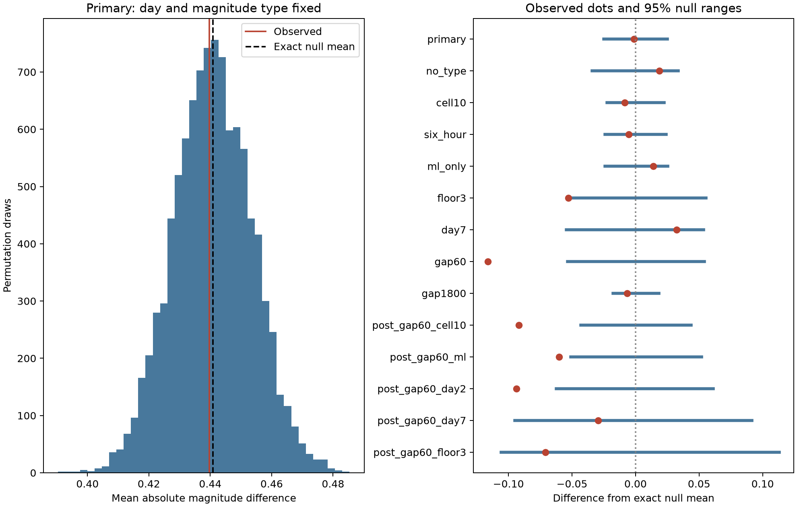

# A day-and-type shuffle leaves no clear 10-minute magnitude similarity in Ridgecrest on days 1 to 30

## Question and main result

Do consecutive earthquakes close in time have similar magnitudes after the daily magnitude distribution and magnitude type are held fixed? This is a test of a catalog model. It can help check the magnitude independence assumption used in earthquake models.

In the primary sample, 363 consecutive pairs have positive time gaps of at most 10 minutes. Their mean absolute magnitude difference is 0.4397. A shuffle within days and magnitude types gives an exact mean of 0.4409. Its central 95% reference range is 0.4161 to 0.4658. The lower-tail Monte Carlo p value is 0.4704 from 9,999 draws. Thus, this statistic gives no clear departure toward magnitude similarity under the tested model. It does not show that magnitudes are independent or that any physical effect is zero.

The planned 1-minute check has 98 pairs. Its observed mean is 0.3415, against an exact null mean of 0.4577 and a central 95% null range of 0.4043 to 0.5117. None of 4,999 draws is as low as the observed value, giving p = 0.0002. This is the minimum p value at this draw count, not a precise estimate of a smaller tail probability. A conservative correction across the eight planned checks gives 8 times this p value, or 0.0016. The primary result is still null. The checks share data and are not independent replications.



Blue bars show central 95% null reference ranges centered on each exact null mean. Red dots show observations. These are conditional model ranges, not uncertainty intervals for a physical effect. The left panel is the primary null distribution.

## Data and scope

We used the existing shared file:

`/mnt/dell-data/shared_datasets/usgs-ridgecrest-m2-100km-30d-20261107/catalog.csv`

Its SHA-256 is `e51b17123cf76ec3a1cb45a4d9a4562d64c6105922c57aea94a8d15a5bfdc5f4`; its size is 952,174 bytes. The query selects magnitude at least 2 within 100 km of 35.770 N, 117.599 W, from 2019-07-06 03:19:53.040 UTC to 30 days later. There are 4,964 unique IDs. The helper records a download time of 2026-11-08 07:55:40 UTC. The fixed bytes, rather than a live query, define the data version. This is a revised catalog, not a real-time record.

We selected days [1,30) after the origin and preferred magnitude at least 2.5. This gives 931 events. No depth cut or assignment to a triggering parent is made. Times, locations, and magnitude types stay fixed in all shuffles. Types are not converted to a common magnitude scale. The exact raw source is copied into files/catalog.csv for offline reproduction. The shared data were read in place and were not changed. files/provenance.json records the exact logical and resolved paths, hashes of both shared files used, source URL, worker details, and source version. files/source_record.json preserves the dataset helper record.

## Method and assumptions

The plan in files/analysis_plan.txt was saved before calculations. It is an internal plan, not an external registration. First, filter events by the setting. Then order events by time and form pairs of adjacent events in that filtered sequence. Keep only positive gaps no greater than the specified cutoff. The statistic is the mean of the absolute magnitude difference across these pairs. Smaller values mean greater similarity. This differs from counting all pairs within a window. In the primary sample there are 363 adjacent pairs, whereas the prior campaign timing study counts 591 all-event pairs within 10 minutes.

Each primary stratum is an integer day since the mainshock origin and one preferred magnitude type. Permute the observed magnitudes uniformly within each stratum. Hold the pair edges fixed. The test assumes exchangeable magnitude assignments within a stratum. It allows arbitrary event timing, daily magnitude distributions, and type patterns. It does not assume independent pair edges: all edges are evaluated after each full assignment. There are 60 strata. Of the 931 events, 915 lie in strata with more than one distinct magnitude, and all 363 edges have at least one such endpoint.

For distinct strata g and h, the exact expected edge difference is the average of |x-y| over all magnitudes x in g and y in h. For the same stratum, average over ordered distinct events without replacement. Average these edge expectations for the exact null mean. A group can contain equal magnitudes; distinct events, rather than distinct values, define this rule. The exact mean is an audit of the simulation. Random seeds and all draws are stored.

The primary test has 9,999 draws; each other setting has 4,999. The lower-tail p value is (1 + number of draws at most the observation)/(1 + number of draws). We test the planned similarity direction. A large lower-tail p value is not a two-sided test for dissimilarity.

Planned checks remove the type constraint, add fixed 10 km areas, use six-hour bins, select ml events only, raise the floor to 3.0, omit days before 7, or change the gap limit to 60 or 1,800 seconds. The ml and higher-floor checks rebuild adjacency in the filtered sequence. The grid uses x = R cos(35.770 degrees) times the longitude offset in radians and y = R times the latitude offset, with R = 6371.0088 km. Cell indices are floor(x/10) and floor(y/10), centered at the query point. All settings except no_type retain the type constraint.

After the first results, five checks were added for the 60-second setting. Their names begin with post_. They change the area constraint, type selection, start day, or magnitude floor. They are post hoc and have no separate confirmatory status.

## Results

| Setting | Events | Pairs | Observed mean | Exact null mean | 95% null range | Lower-tail p |
| --- | ---: | ---: | ---: | ---: | --- | ---: |
| primary | 931 | 363 | 0.4397 | 0.4409 | 0.4161 to 0.4658 | 0.4704 |
| no_type | 931 | 363 | 0.4397 | 0.4211 | 0.3869 to 0.4547 | 0.8580 |
| cell10 | 931 | 363 | 0.4397 | 0.4483 | 0.4259 to 0.4707 | 0.2252 |
| six_hour | 931 | 363 | 0.4397 | 0.4451 | 0.4210 to 0.4691 | 0.3238 |
| ml_only | 833 | 287 | 0.3097 | 0.2958 | 0.2717 to 0.3210 | 0.8656 |
| floor3 | 300 | 60 | 0.4000 | 0.4528 | 0.3993 to 0.5083 | 0.0268 |
| day7 | 387 | 74 | 0.5014 | 0.4690 | 0.4147 to 0.5226 | 0.8814 |
| gap60 | 931 | 98 | 0.3415 | 0.4577 | 0.4043 to 0.5117 | 0.0002 |
| gap1800 | 931 | 609 | 0.4250 | 0.4315 | 0.4138 to 0.4500 | 0.2386 |
| post_gap60_cell10 | 931 | 98 | 0.3415 | 0.4333 | 0.3903 to 0.4770 | 0.0002 |
| post_gap60_ml | 833 | 74 | 0.2385 | 0.2986 | 0.2476 to 0.3505 | 0.0118 |
| post_gap60_day2 | 760 | 69 | 0.3974 | 0.4912 | 0.4287 to 0.5522 | 0.0016 |
| post_gap60_day7 | 387 | 25 | 0.4556 | 0.4849 | 0.3900 to 0.5764 | 0.2786 |
| post_gap60_floor3 | 300 | 19 | 0.4200 | 0.4910 | 0.3852 to 0.6042 | 0.0958 |

The 60-second departure persists with local-area conditioning and after day [1,2) is removed. The ml-only result is weaker. After days [1,7) are omitted, only 25 short-gap pairs remain and p = 0.2786. With a floor of 3.0, only 19 pairs remain and p = 0.0958. These weak results do not establish absence of a late or higher-magnitude effect. The 10-minute floor3 check has p = 0.0268 before correction, but it is one of eight planned checks and does not remain below 0.05 after the conservative correction. This does not change the primary conclusion.

The 1-minute set is nested within the 10-minute set. Different p values do not by themselves prove that the physical process changes at a time threshold. No direct difference test or best cutoff estimate is reported. The broader statistic can average over different local conditions. These results define a short-gap pattern for further testing, rather than a new physical law.

## Prior work and meaning

The published campaign timing study, SCI 07101708..., found excess close pairs after daily and hourly counts were fixed. The published size-and-direction study, SCI ddec79ef..., showed that preferred magnitude types materially affect a directional count test in this same snapshot. We read both results before analysis. Our new statistic is the absolute difference between consecutive magnitudes. It does not estimate aftershock productivity or retest the count score.

Magnitude correlation is an existing research topic. Xiong and colleagues, Nature Communications (2023), DOI 10.1038/s41467-023-37782-5, study magnitude clustering in field and laboratory data. Corrado, Herrmann, and Marzocchi (2025), DOI 10.1785/0220240277, show through observations and simulations that short-term missed events can produce magnitude correlation. We consulted their author-repository abstract at https://www.iris.unina.it/handle/11588/993798; we do not claim a full-text review. Van der Elst (2021), DOI 10.1029/2020JB021027, develops a magnitude-distribution estimator for catalogs with time-varying completeness. These works motivate a careful catalog test. We do not claim the first report of magnitude correlation.

This investigation adds a fixed-source test with explicit day and type constraints, an exact null mean, and planned gap checks. The primary statistic is consistent with its shuffle model. The shorter-gap departure remains unexplained by the tested day, type, and local-area constraints. Missed small events after larger events can change which events become adjacent. Fault mixtures, preferred magnitude estimation, common waveform errors, and real magnitude dependence are also possible. These data do not choose between those explanations.

## Limits

There is one selected sequence, a finite region, and one revised catalog. A constant floor does not prove complete detection. The data contain different preferred magnitude types; holding type fixed restricts the question but does not remove all measurement error. Type selection can itself depend on true size and available waveforms. Daily or local-area strata can still contain changing conditions. The permutation p values rely on exchangeability within those strata. Location, magnitude, and detection errors are not propagated. Short-gap pairs can share events and bursts; the permutation handles shared edges under its null but does not measure uncertainty across earthquake sequences.

A rejection tests that conditional model. It does not establish causal magnitude memory, event-triggering parents, hazard probabilities, or predictive value. Failure to reject does not prove physical independence. Replication in a common-scale, more complete catalog and in other sequences is needed. A detection-aware synthetic test is a suitable next step; it was not done here.

## Validation and reproduction

files/events.csv and files/pairs.csv preserve primary event and pair evidence. The 60-second pairs can also be inspected by filtering the stored primary gaps. files/results.json and files/results.csv give every setting. files/null_draws.npz stores all 74,986 permutation statistics. files/validate.py independently constructs primary pair edges from timestamps, calculates the observed score, and checks the exact primary mean with scalar enumeration. It checks every stored p value and null range, compares all simulation means with exact expectations, and exhausts a small example without replacement. All checks passed. The largest simulation-mean error is below two Monte Carlo standard errors. files/validation.json stores the audit.

A second full run reproduced results.json, results.csv, events.csv, pairs.csv, and validation.json byte for byte. All draw arrays were exactly equal. The comparison is recorded in files/reproduction_validation.json. The initial repeat launch used an incorrect relative path and stopped before computation. Corrected paths passed. The figure was inspected from disk. Inline HTML preview could not run because host browser libraries are missing; inline rendering succeeded. This does not affect the data analysis.

Python 3.14.4, NumPy 2.5.4, and Matplotlib 3.11.2 were used. Full package versions are in files/requirements.txt. Work in a writable copy to keep the signed evidence unchanged. From that copy's root:

```sh
python3 -m venv .venv
.venv/bin/pip install -r files/requirements.txt
SCI_PYTHON=$(pwd)/.venv/bin/python sh files/reproduce.sh repeat
```

The script uses campaign-compute and one library thread, runs the analysis and audit, then compares the repeated numerical evidence. On a different host, replace campaign-compute with an equivalent local resource limit. The analysis needs no network after dependency installation. files/retrieve.py gives an optional live retrieval recipe with the frozen source hash. A later source revision can fail that check; use the bundled snapshot. Substantial calculations used the host limiter; no limiter was bypassed.

## Worker and license

Job: sci-1107-dell-earth-and-ocean-sciences-ab6e198a2d0c. Topic: earth-and-ocean-sciences. Campaign: 11_07_2026. Machine: dell. Account: codex-andrii. Model: gpt-6.1-sol with high reasoning effort. No child agents were used. The campaign-machine signature is not a personal authorship claim. No private keys are included. The source is public USGS data. LICENSE supplies the SCI baseline terms. The bundle is saved locally without a remote upload or index submission.
