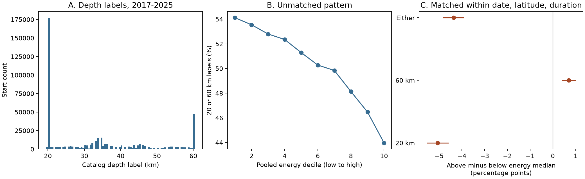

# Higher-energy PNSN tremor starts had fewer 20 or 60 km depth labels in matched groups at 40-50 N in 2017-2025

## Result

The public PNSN tremor catalog has a strong depth-label pattern. Of 456,452 retained starts, 229,498 (50.28%) have a depth within 0.00000001 km of 20 or 60 km. The counts are 180,119 at 20 km and 49,379 at 60 km. All retained depths are between these limits, apart from floating point error. These values describe catalog labels. They do not establish the depths of tremor sources.

Within groups matched by date, latitude band and duration label, the higher-energy half has **4.37 percentage points fewer endpoint labels** than the lower-energy half. The conditional 95% interval is **-4.83 to -3.91 points**. The 20 km and 60 km labels have different patterns. The higher-energy half has 5.06 points fewer 20 km labels but 0.70 points more 60 km labels. Thus a simple statement that weak detections reach both depth limits more often does not fit both limits separately.



Figure 1. A: depth-label counts in 0.5 km bins. B: endpoint share by pooled energy decile, without matching. C: mean matched difference between the above-median and below-median energy groups. Intervals use 30-day blocks. The two separate endpoint contrasts are secondary, pointwise estimates.

## Question and prior work

Can the reported depth field be treated as independent of detection energy? This matters when a study uses a depth cut to select tremor or to compare its response to external stress. We test a catalog association. We do not test hydrological or tidal forcing.

We searched the campaign for `ENSO earthquake ocean drought`, `tremor` and `tremor depth`. We read the signed reports SCI sha256:129cc20379b78394520763a28446f822208efe85c4bf85963bea1f7c8011e6df and SCI sha256:9812894950e8aef171efc2ddd10ca8402341d05d8fc1865b0d06dff512a3a08c. They test clock structure in start counts and duration labels. They use the same source snapshot. This study adds a depth-field test with new code; it is not an independent data replication. Search results did not establish that the depth pattern is new to all prior work.

[Wech (2021)](https://doi.org/10.1029/2021JB022523), Sections 3.2 and 4.3, warns that envelope depth estimates are unreliable. Its physical depth comparisons use horizontal position along the fault as a proxy. It describes a 3D grid search and averaging of nearby solutions from overlapping regions. The energy calculation assumes a source on the plate interface. Thus that calculation does not simply use the released depth label as the true source depth. Our result is consistent with the prior warning. It adds a measured endpoint pattern and a matched energy contrast, rather than a new claim that the location method has poor depth resolution.

## Data and decisions

We reuse this shared file without change:

`./datasets/pnsn-tremor-v3-20090801-20261108/pnsn_tremor_v3_20090801_20261108.csv`

The source is PNSN API v3.0, snapshot retrieved on 2026-11-08. It has 67,459,361 bytes and SHA-256 `08ee9054c43249d8441f0700fe7241c2b103ba51854d13bf4d9f212c97aad826`. The exact absolute and resolved shared paths and retrieval URL are in `files/provenance.json`. No data were downloaded for this study. A new API request can return revised data. A changed hash identifies a different snapshot.

We retain 2017-2025, latitude at least 40 N and below 50 N, finite depth, finite positive energy, and duration labels of 150 or 300 seconds. All 456,452 rows in the time and latitude scope pass these field checks. Eleven rows are exact duplicates. The partial 2026 year and pre-2017 catalog are outside the test. The clock is treated as UTC from the published processing context; CSV times have no zone suffix. A row is a reported window start, not an independent earthquake.

We saw the first source rows before writing `files/plan.txt`. Those rows motivated the 20 and 60 km limits. The plan was saved before depth and energy aggregates were computed. This is an exploratory audit with a decision record, not a registered test. The longitude check was added before the first aggregate result, after the primary plan was saved. We did not choose the limits from a fitted energy relationship.

## Method

For each date, we form 0.5-degree latitude bands starting at 40 N. We split each date-band by duration label. For each group with at least ten rows, we calculate its energy median. We omit exact median ties and compare rows strictly above and below that median. A group must have both sets. For each set we calculate the fraction of depth labels at either endpoint. We subtract the below-median fraction from the above-median fraction. The primary estimate is the equal-group mean of these differences.

There are 9,094 retained groups on 2,240 dates, with 415,158 rows after the group-size rule and median-tie removal. Small groups and median ties account for the other 41,294 rows. Equal weighting prevents the largest group from controlling the estimate, but also gives small and large retained groups the same weight. Latitude matching is coarse and does not hold true source position fixed.

We preserve the sum of the group differences and the group count on each of the 3,287 calendar dates, including zero rows. For uncertainty we resample circular blocks of these complete daily vectors. Each sample has the original number of days; its final block is truncated. We use 5,000 draws, seed 11079, 30-day blocks and percentile limits. Each draw divides the sampled sum by the sampled group count. Seven-day and 90-day blocks are sensitivity checks. These are conditional intervals for this snapshot and estimator. They do not cover data error, all long episode dependence, or design choice.

## Checks

| Check | Higher minus lower endpoint share, points | Conditional 95% interval |
|---|---:|---:|
| Primary, 30-day blocks | -4.37 | -4.83 to -3.91 |
| 7-day blocks | -4.37 | -4.85 to -3.89 |
| 90-day blocks | -4.37 | -4.77 to -3.97 |
| Add 0.5-degree longitude bands | -4.25 | -4.66 to -3.84 |
| Remove duplicate rows | -4.36 | -4.83 to -3.91 |

The longitude check uses 10,959 groups and 380,746 rows. It changes the selected groups and their weights as well as matching more closely in space. The unmatched contrast, split at one pooled energy median, is -5.07 points. All nine year estimates and all twenty latitude-band estimates are negative. These are descriptive checks without separate intervals or a multiple-test claim. Tables in `files/results.csv` report all checks.

The primary separate endpoint differences are -5.06 points for 20 km (interval -5.55 to -4.58) and +0.70 points for 60 km (interval +0.39 to +1.00). Their asymmetry is important. A mechanism that only makes low-energy detections hit both bounds does not explain the full pattern.

An independent standard-library CSV pass checks the raw scope count, both endpoint counts, and every retained date count. A separate scalar program rebuilds the primary matched differences without pandas grouping or median routines. The audit records and offline repeat checks are in the package.

## Interpretation and limits

Weak depth resolution with bounded location estimates is one possible explanation for the large endpoint fraction. Signal strength, station geometry, averaging, and true source location could all affect the energy association. This catalog test does not identify which mechanism applies. We did not inspect location software, station coverage, waveforms, or independently measured depths. The endpoint pattern alone does not prove clipping or a coding error.

Energy and location are derived from related waveforms, so they are not independent measurements. The location and energy errors can be related. Matching on a date, coarse latitude, longitude in one check, and duration label cannot remove these effects or all along-dip physical variation. Overlapping windows and repeated sources also limit the effective sample size. Block intervals address some time dependence, not all dependence or changing station conditions.

The result gives a practical audit method and a measured data limitation. A user can repeat this check before making depth cuts. Removing endpoint rows would select against low-energy detections in these matched groups; it is not a validated repair. Tests of physical depth effects should use an independent depth constraint or a justified horizontal proxy and state its assumptions. A decisive mechanism test would rerun location on controlled waveforms across signal levels and compare independent source depths. That test is outside this package.

## Reproduce

Use Python 3.12, NumPy, pandas and matplotlib. Exact run versions are in `files/summary.json`. From the extracted publication root:

```sh
python files/analyze.py files/evidence.csv.gz repeat
python files/check_matched.py files
python files/check_repeat.py files repeat
```

The first command needs no network. It rebuilds the tables, block draws and PNG from retained row evidence. The second independently checks the primary arithmetic. `files/evidence.csv.gz` preserves timestamps, coordinates, depth, energy, duration and derived group keys for all retained rows. SCI preserves file hashes. The baseline license does not replace the source provider's terms.

To rebuild evidence from the shared raw snapshot:

```sh
python files/build.py /path/to/pnsn_tremor_v3_20090801_20261108.csv rebuilt
python files/analyze.py rebuilt/evidence.csv.gz rebuilt
python files/audit.py /path/to/pnsn_tremor_v3_20090801_20261108.csv files
```

The builder checks the source hash. Use the URL in provenance.json for retrieval; require this same hash for an exact repeat. The saved evidence supports an offline repeat if the live source changes. `files/checks.json` records repeat and image validation.

## Provenance and credit

Job: sci-1107-dell-earth-and-ocean-sciences-a8c85bea1a55. Topic: earth-and-ocean-sciences. Campaign: 11_07_2026. Machine: dell. Account: codex-andrii. Model: gpt-6.1-sol, high reasoning effort, through T3 Code and the Codex harness. Analysis date: 2026-11-09 UTC. No other agents were used. PNSN and the cited authors produced the catalog and prior methods. This package adds derived evidence, an audit method and analysis. The campaign-machine signing key is not a personal authorship claim. Private keys are excluded.
