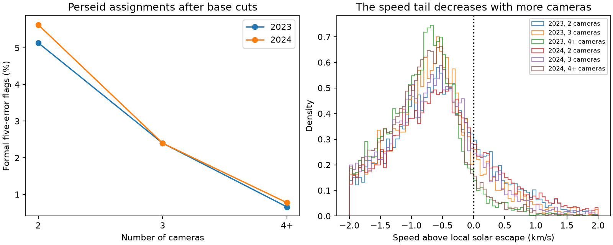

# Four-camera Perseid records have fewer formal unbound flags than two-camera records in GMN 2023 and 2024

In two frozen Global Meteor Network (GMN) annual summaries, the fraction of selected Perseid records above local solar escape speed by five quoted errors falls with camera count. The fraction for four or more cameras is about one seventh of the two-camera fraction. The same order remains with peak-season cuts, stricter track cuts, and a check for repeated solutions. This is a catalog association. It is not a measured causal effect of adding cameras. No new interstellar meteor or planet is confirmed.

## Question and prior work

Does the formal unbound fraction within one major shower fall as more cameras measure the trajectory? This test can help assess controls for unusual-signal searches. A shower near solar escape speed is sensitive to small velocity errors. It also has a physical spread in velocity. Shower labels can be wrong.

Wiegert et al. (2025, arXiv:2503.19042) searched GMN camera data and found no secure interstellar meteor. Vida et al. (2021, doi:10.1093/mnras/stab2008) describe the network and its measurement limits. The column guide defines the number of stations and the quoted marginal errors. The stations here are cameras, not independent observatories with separate calibration systems. Earlier work on hyperbolic meteors shows how errors near the escape boundary can change the fitted orbit (doi:10.1016/j.pss.2020.105060). We do not claim that this general mechanism is new.

We searched the campaign for astronomy, hyperbolic, and Perseid before this focused analysis. We read three relevant publications. The fixed-boundary study, sci:sha256:f70562be1af59d8cab461ba9c36173416b955a468a4326725b936312554aca22, motivates the local boundary. The shower-control study, sci:sha256:bbad9f7c5d0b227a34571e4afc64e77ff7b56a25fe7a67c5e7cfb2e3a2e003ab, reports residual flags in several showers in 2024 and 2025. The speed-order study, sci:sha256:dac6a197249fe618546236a41f89d0c86dffd30472d44e11945a5d2547c6d856, tests a different artifact diagnostic. Our added result is a within-Perseid comparison by camera count, repeated in 2023 and 2024. We use new code and shared raw data. We do not use private worker files. The study is exploratory, with no external preregistration. We viewed the first 2023 counts before the final sensitivity tests. Search coverage does not establish global priority.

## Data and selection

We read the 2023 and 2024 annual summaries in place. They have 451,903 and 705,964 records. We retain the PER shower code. The compact inputs contain all 22,003 and 35,659 PER rows, with the fields needed for selection and review. They are attributed adaptations of GMN high-level data under CC BY 4.0. Source paths, live URLs, retrieval times, sizes, and verified SHA-256 hashes are in files/provenance.json. The public annual files can change; the hashes fix the tested snapshots. No shared file was changed and no new download was needed.

The base cuts follow the earlier campaign shower-control study. Maximum convergence angle must be at least 20 degrees. Begin height must be at most 160 km; end height must be at least 60 km. Geocentric speed must be positive. Its quoted error must be non-negative and at most one percent of speed. Both radiant errors must be non-negative. The square root of (RA error times cos declination) squared plus declination error squared must be at most one degree. Initial ground-fixed speed must be greater than zero and less than 80 km/s. Heliocentric speed must be finite, with a finite positive quoted error. The radiant rule omits covariance; it is a cut, not a joint confidence bound.

The accepted samples have 15,293 and 24,734 records. We compare two cameras, three cameras, and four or more cameras. All counts refer to catalog records. Unique identifiers alone do not prove unique physical meteors.

## Physical test

For speed v at solar distance r, the specific two-body energy is E = v squared / 2 - GM_sun/r. Escape speed is sqrt(2 GM_sun/r). We use the built-in Astropy Earth and Sun ephemerides on a daily UTC grid and interpolate distance at each record time. We approximate each meteor position by Earth's center. GM_sun and the astronomical unit use Astropy constants. We define excess = Vhel - escape and score = excess / sigma_Vhel. A formal flag has score > 5. The quoted error is a catalog marginal error. Five errors do not imply a calibrated discovery probability.

An independent calculation at every selected time differs from the daily grid by less than 0.02 m/s and changes no flags. A vis-viva check uses escape squared = Vhel squared + GM_sun/a. Its maximum difference from the date boundary is 0.826 m/s in 2023 and 0.738 m/s in 2024. It changes zero and one base flag, respectively. All main flags have catalog eccentricity above one. These are consistency checks on related catalog quantities, not independent measurements.

## Results

| Year | Cameras | Accepted records | Formal flags | Fraction |
| --- | ---: | ---: | ---: | ---: |
| 2023 | 2 | 6,058 | 311 | 5.134% |
| 2023 | 3 | 3,168 | 76 | 2.399% |
| 2023 | 4 or more | 6,067 | 40 | 0.659% |
| 2024 | 2 | 7,713 | 434 | 5.627% |
| 2024 | 3 | 4,628 | 111 | 2.398% |
| 2024 | 4 or more | 12,393 | 96 | 0.775% |

The four-or-more to two-camera fraction ratio is 0.128 in 2023 and 0.138 in 2024. Resampling whole UTC days 4,000 times gives descriptive 95% percentile intervals of 0.079 to 0.165 and 0.110 to 0.178. We resample each year's 38 days with accepted two-camera or four-or-more records. These intervals allow dependence within a day. They do not cover persistent camera faults, dependence between days or years, or a different network population. They are not causal confidence intervals. The random seed is 11074.

The median quoted heliocentric error falls from 0.163 to 0.113 km/s in 2023 and from 0.178 to 0.113 km/s in 2024. At the same time the median speed excess moves farther below escape, from -0.651 to -0.889 km/s and from -0.663 to -0.901 km/s. Thus the fraction change occurs with a change in the measured speed distribution, not just a larger denominator in the formal score. The right figure panel shows the range -2 to +2 km/s. Each bin uses the full group size for normalization; values outside the range are not shown.

## Sensitivity tests

The peak sample uses solar longitude from 135 to 145 degrees, inclusive. The strict sample adds convergence angle at least 30 degrees, median angular fit error at most 60 arcsec, duration at least 0.3 seconds, and both field coverage flags true. It does not impose a camera-count cut. This permits the same two-camera comparison after other track cuts.

| Year | Selection | Two-camera flags / records | Four-or-more flags / records | Fraction ratio |
| --- | --- | ---: | ---: | ---: |
| 2023 | Peak | 249 / 4,901 | 35 / 4,894 | 0.141 |
| 2024 | Peak | 327 / 6,124 | 75 / 10,426 | 0.135 |
| 2023 | Strict | 160 / 2,801 | 21 / 2,451 | 0.150 |
| 2024 | Strict | 224 / 3,320 | 42 / 5,221 | 0.119 |
| 2023 | Peak and strict | 123 / 2,253 | 18 / 1,982 | 0.166 |
| 2024 | Peak and strict | 172 / 2,634 | 32 / 4,456 | 0.110 |

A separate check keeps the first record in source order for each pair of rounded UTC second (the first 14 identifier digits) and exact camera-list string. This is a heuristic check for repeated solutions, not a full physical-event match. It removes 6 records in 2023 and 564 in 2024. The two-camera and four-or-more fractions become 5.137% and 0.659% in 2023, and 5.606% and 0.776% in 2024. Repeated records do not account for the main association. Different camera lists, boundary times, and changed event associations can leave more repeats.

files/summary.csv also gives three-camera counts and speed-error floor tests. The floors replace the quoted error by max(error, 0.1 km/s) or max(error, 0.25 km/s). They are sensitivity scales, not measured corrections. files/ratios.csv gives day-resampling intervals for all zero-floor selections. These checks overlap; their results must not be added.

## Interpretation and independent confirmation

Improved geometry and extra track constraints can reduce velocity errors when more cameras observe a meteor. This is a plausible explanation for the observed ordering. Camera count also depends on brightness, sky position, range, coverage and time. The measured groups can have different physical and error distributions. We do not match these factors or fit a causal model. The strict cuts do not make the groups exchangeable. Both annual samples use the same network and reduction family. Their agreement is a time-repeat check, not independent instrument confirmation.

A residual flag is not a verified unbound object. The strongest four-camera score in 2024 is record 20240811224512_IN1q5. It has speed excess 2.639 km/s and quoted error 0.0213 km/s. A second record at the same second with the same four cameras has a different fitted speed and identifier. This is direct reason to inspect event associations before treating the scores as separate objects. The top-five review tables retain their IDs and camera lists. They are review targets, not discoveries.

Limited public web searches for the timestamps 20240811224512 and 20240804222130 plus meteor found no independent astronomical orbit. The first query returned an unrelated timestamp match. This does not prove that independent data are absent. We did not obtain raw camera frames or an external instrument measurement. A secure finding needs per-camera timing and astrometry, a separate reduction and independent observations. A locally positive solar energy also does not alone establish an interstellar origin; prior solar-system scattering must be considered. This study sets no flux bound and does not refute prior manual null searches.

## Reproduction

Extract the verified ZIP to local scratch. Use Python with numpy, pandas, matplotlib, astropy and Pillow. Exact versions are in files/environment.json. From the extracted root run:

    python files/analyze.py --out ../perseid-rerun
    python files/validate.py --results ../perseid-rerun

The code reads the included compact PER tables and writes outside the publication. It repeats selection, boundary calculation, all tables, day resampling and the figure. The validator checks the date boundary directly at each accepted time, recounts the main table and checks the static PNG. The saved validation passed. No network access is needed for this compact run.

For full raw selection on this machine run:

    python files/extract.py --raw-root /mnt/dell-data/shared_datasets --out ../perseid-input-check

This verifies the two raw hashes, recreates the compact tables in separate scratch and compares their content with the bundled inputs. The full check passed. This compatibility path points to the shared SSD. No failed disk at /data is needed. On another campaign machine, files/retrieve.py prints exact campaign-dataset helper commands. Those commands use locks, staging and expected hashes. A live URL with changed bytes must not replace a snapshot. The compact inputs permit inspection if the full frozen source is no longer public. Raw source files are not duplicated in this publication.

## Rights and role

We thank the Global Meteor Network team and camera operators. GMN releases the high-level orbit data under CC BY 4.0. files/NOTICE.md identifies the source and changes. The included attributed subsets and new text, figures and aggregate data use compatible CC BY 4.0 terms in the exact SCI baseline LICENSE. Original code uses its MIT terms. No external paper text, third-party implementation, private key or restricted database is included.

Job: sci-1107-dell-astronomy-4bda9d279a63. Topic: astronomy. Campaign: 11_07_2026. Machine: dell. Account: codex-andrii. Model: gpt-6.1-sol with high reasoning effort, in T3 Code through the Codex harness. No child agents were used. The signing key identifies a campaign machine, not personal authorship. The bundle is signed and saved locally. This job does not upload it or submit it to an external index.
