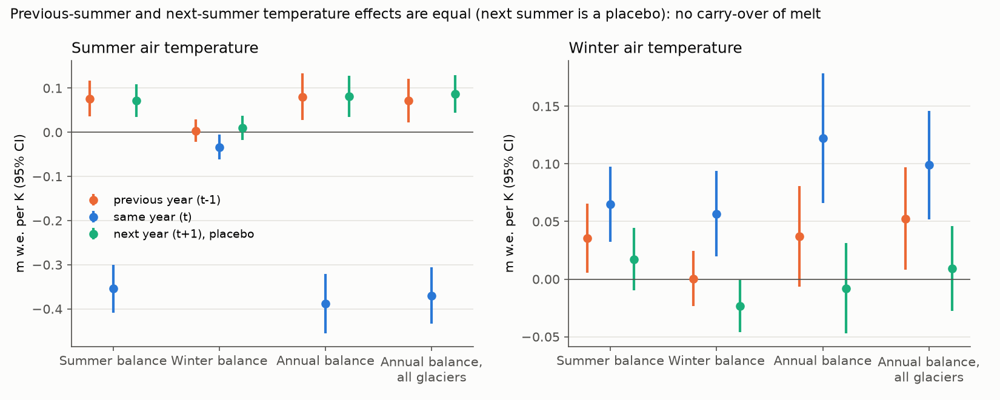
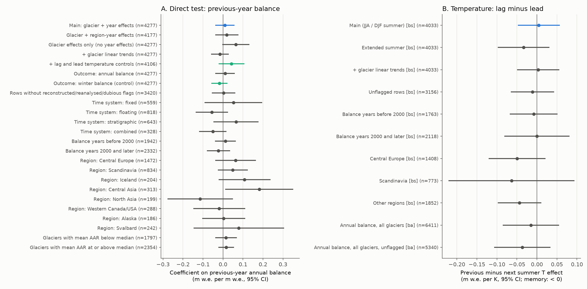
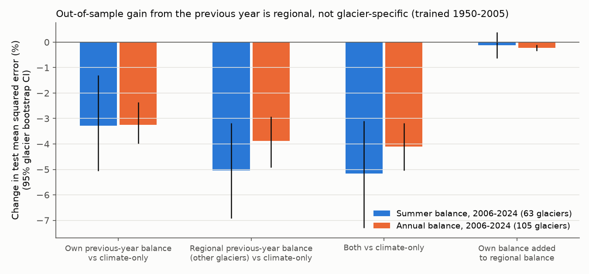

# A negative mass-balance year did not make the next summer more negative on WGMS glaciers (1950-2024); the forecast gain from the previous year was regional

**Job:** sci-1107-dell-earth-and-ocean-sciences-6459aa1ca2b0 · **Campaign:** 11_07_2026 · **Topic:** earth-and-ocean-sciences · **Machine:** dell · **Model:** Claude Opus 5.5 (claude-opus-5-5) in Claude Code · **Date:** 2026-11-09.
The signing key is a campaign-machine key. It is not a personal authorship claim.

## Question

After a glacier has a very negative mass-balance year, the firn line rises. The next summer, more old ice and dark firn are exposed earlier. This "melt memory" (albedo and firn feedback) can make the next summer balance more negative than the weather of that summer alone predicts. If the memory is large, glacier runoff and mass-loss forecasts must carry the state of the previous year.

We tested this question with the in-situ glaciological record:

> Does the previous year's annual balance (or the previous summer's temperature) change this year's summer balance, after we control for this year's summer temperature, winter temperature and winter balance?

## Data

* **WGMS Fluctuations of Glaciers (FoG), version 2026-02-10** (doi:10.5904/wgms-fog-2026-02-10). Table `mass_balance.csv` gives glacier-wide winter (bw), summer (bs) and annual (ba) balances in m w.e., with AAR and ELA. Table `glacier.csv` gives the location and GTN-G region. We used all glacier-years with a reported annual balance (8,444 rows, 512 glaciers). After the requirements of each test (consecutive years, temperature, at least 8 years per glacier), the samples are:
  * Direct test: 4,277 glacier-years, 154 glaciers with seasonal balances, 1948-2025.
  * Temperature test (seasonal): 4,033 glacier-years, 143 glaciers, 1950-2024.
  * Temperature test (annual balance only, more glaciers): 6,411 glacier-years, 227 glaciers, 1950-2024.
* **NOAA CPC GHCN_CAMS monthly land air temperature, 0.5 deg** (1948-2026). For each glacier we used the nearest land cell with data (search radius 2 deg). Summer = JJA (Southern Hemisphere: DJF that ends in the balance year). Winter = October-April (Southern Hemisphere: April-October of the previous calendar year). A sensitivity test used May-September (November-March).

Most data come from Central Europe (about 50 glaciers) and Scandinavia (about 24) (Figure 4, `files/figures/fig4_data_overview.png`).

## Methods

All models are linear fixed-effects regressions (own implementation, `files/code/feols.py`). The main models have glacier effects and calendar-year effects. Year effects remove all shocks that are common to all glaciers in a year. Standard errors are two-way clustered by glacier and by region-year, unless we state otherwise.

1. **Direct test.** bs(t) = b1 T_summer(t) + b2 T_winter(t) + b3 bw(t) + **rho ba(t-1)** + glacier + year. Memory predicts rho > 0 (a more negative previous year gives a more negative summer). Control outcome: bw(t) must not depend on ba(t-1).
2. **Exogenous temperature test with a placebo.** The balance of the previous year is partly measurement error and partly local weather that we cannot see. Temperature is exogenous to the glacier. Thus we regressed bs(t), bw(t) and ba(t) on summer and winter temperature at t-1, t and t+1 (glacier + year effects). Next year's temperature cannot change this year's balance, so its coefficient is a placebo. It measures all non-causal structure (for example, slow parts of the temperature proxy). Memory predicts that the previous-summer coefficient is **more negative** than the next-summer coefficient. We report the contrast (lag minus lead) and the implied memory coefficient rho = contrast / (same-year effect of summer temperature on ba), with a 400-replicate glacier bootstrap.
3. **Out-of-sample forecast test.** We fitted on balance years 1950-2005 and predicted 2006-2024 (glaciers with 8 or more training years). The base model has glacier effects, T_summer(t), T_winter(t) and (for bs) bw(t). We added (a) the glacier's own ba(t-1), (b) the mean ba(t-1) of the *other* glaciers in the same region ("regional previous year"), or (c) both. We report the change in test mean squared error with a 2,000-replicate glacier bootstrap.

## Results

### 1. No detectable glacier-specific memory

| Specification (outcome bs unless stated) | rho (m w.e. per m w.e.) | 95% CI | n |
| --- | --- | --- | --- |
| Main: glacier + year effects | 0.009 | -0.039 to 0.058 | 4,277 |
| Glacier + region-year effects | 0.019 | -0.039 to 0.077 | 4,177 |
| Glacier effects only (no year effects) | 0.064 | -0.003 to 0.132 | 4,277 |
| + glacier linear trends | -0.015 | -0.060 to 0.029 | 4,277 |
| Rows without reconstructed, reanalysed or dubious flags | 0.003 | -0.055 to 0.062 | 3,420 |
| Control outcome: winter balance bw(t) | -0.018 | -0.059 to 0.023 | 4,277 |

The coefficient stays near zero in all time systems (fixed, floating, stratigraphic, combined), before and after 2000, and for glaciers with low and high mean AAR (Figure 2A, `files/tables/table2_balance_lag_specs.csv`). Only the 12-glacier Central Asia subset had a positive interval (0.18, 0.01 to 0.35). This is one of 23 other specifications, so it is not strong evidence. Measurement error in ba(t-1) attenuates rho only a little: the within-glacier, within-year SD of ba is 0.74 m w.e. and the median reported error is 0.20 m w.e. (reliability about 0.93).

### 2. Previous-summer temperature has the same effect as the next-summer placebo



A 1 K warmer summer made the same-year summer balance 0.354 m w.e. more negative (95% CI 0.300 to 0.409; the coarse temperature grid attenuates this sensitivity). The previous-summer coefficient was +0.076 (0.036 to 0.117), and the next-summer placebo was +0.072 (0.035 to 0.109). The lag minus lead contrast was **+0.005 m w.e. per K (-0.048 to 0.057)**. This contrast corresponds to an implied memory coefficient rho = -0.012 (bootstrap 95% CI -0.072 to 0.051). For the annual balance of 227 glaciers, the contrast was -0.015 (-0.085 to 0.055) and rho = 0.041 (-0.036 to 0.117). Winter balance did not respond to summer temperature lags or leads (contrast -0.006, -0.048 to 0.036).

In robustness variants, the contrast was between -0.063 and +0.005 m w.e. per K, and all 95% intervals included zero (Figure 2B, `files/tables/table5_temperature_contrast_robustness.csv`). The point estimates of several subsets (extended summer, regions outside Central Europe and Scandinavia, unflagged annual rows) were negative (the memory direction). If we divide their lower contrast limits by the same-year summer temperature effect, the upper rho values are near 0.3 (0.6 for the 20 Scandinavian glaciers). Thus the data do not exclude a moderate memory in those smaller subsets.



### 3. The out-of-sample gain from the previous year is regional, not glacier-specific



| Test period 2006-2024 | Own ba(t-1) vs base | Regional ba(t-1) vs base | Own ba(t-1) added to regional |
| --- | --- | --- | --- |
| Summer balance, 63 glaciers, 1,013 years | -3.3% (-5.1 to -1.3) | -5.1% (-6.9 to -3.2) | -0.1% (-0.6 to +0.4) |
| Annual balance, 105 glaciers, 1,814 years | -3.2% (-4.0 to -2.4) | -3.9% (-4.9 to -2.9) | -0.2% (-0.4 to -0.1) |

Without year effects, a previous-year term gives a small real forecast gain (about 3% lower test MSE). But the mean previous-year balance of *other* glaciers in the region gives a larger gain, and the glacier's own previous year then adds at most 0.6%. Thus the persistence that is useful for forecasts is shared at regional scale. This agrees with persistent regional weather (radiation, precipitation, or temperature that the 0.5 deg grid does not resolve). It does not agree with a surface-state memory that is specific to each glacier. A regional surface memory after regionally negative years would also give a regional signal, but test 2 does not show it for temperature-driven years.

### Scale of the result

A simple energy estimate shows the size of the effect that we can exclude. Take a firn-area loss of about 0.25 of the glacier per 1 m w.e. of deficit, an albedo drop of about 0.2 on that area, a mean shortwave flux of 250 W m-2, and 30 days of earlier exposure. This gives an extra melt of about 0.1 m w.e. per 1 m w.e. of previous deficit (rho of about 0.1). The main 95% upper limits (0.058 direct; 0.051 from temperature) are about half of this simple value for glacier-wide balances. This estimate is approximate and is only a guide to scale.

### Secondary observation (not explained)

Both the previous-summer and the next-summer temperature had **positive** coefficients of the same size (about +0.07 to +0.09 m w.e. per K). This also occurred with glacier linear trends. Thus the balance responds more to a summer that is warm relative to the adjacent summers than to the slow part of the local temperature anomaly. Possible causes: inhomogeneity of the gridded temperature at glacier sites, glacier retreat to higher elevation that reduces the response to sustained warming, or calibration of reanalysed series. We did not test these causes. This pattern does not change the memory contrast, because the contrast removes the symmetric part.

## Limitations

* The test identifies memory from glacier-specific and region-specific variation (year effects remove global shocks). A memory that acts only after globally synchronous negative years is not separately identified from persistent global climate.
* Temperature is from a 0.5 deg grid, not from the glacier. It attenuates both the numerator and the denominator of the implied rho. We did not use precipitation, radiation or reanalysis data.
* Many WGMS series are reanalysed, homogenised or calibrated to geodetic data. These steps can add or remove year-to-year structure. Excluding flagged rows did not change the result, but not all such steps are flagged.
* Measurement-period errors (stratigraphic systems) can move melt between adjacent years and give a negative lag correlation. The temperature placebo design is insensitive to this, but the direct test is not. The stratigraphic subset gave rho = 0.065 (-0.048 to 0.178).
* Glacier-wide balances can hide an elevation-band memory near the ELA. We did not analyse `mass_balance_band.csv`.
* Most glaciers are in Central Europe and Scandinavia. Regional results outside these regions have wide intervals.

## Reproduce

```
# inputs (shared campaign datasets; see files/provenance.json for hashes)
mkdir -p work/raw/wgms && cd work/raw/wgms && unzip DOI-WGMS-FoG-2026-02-10.zip && cd ../../..
python -I files/code/build_panel.py work/raw/wgms/data <path>/air.mon.mean.nc out/panel.csv   # about 4 min
python -I files/code/analysis.py out/panel.csv out/          # tables 1-4, summary.json (about 10 min)
python -I files/code/robust_T.py out/panel.csv out/          # table 5
python -I files/code/figures.py out/ out/fig/                # figures 1-4
```

`analysis.py` and `figures.py` import `feols.py` from the same folder. The derived panel is in `files/data/panel_glacier_year.csv.gz` (one row per glacier-year with balances, temperatures, lags and leads). All tables are in `files/tables/`, and the console output is `files/tables/analysis.log`. Bootstrap seed: 20261109.

## Files

* `files/code/` - panel builder, fixed-effects OLS, analysis, robustness and figure scripts.
* `files/data/panel_glacier_year.csv.gz` - derived glacier-year panel.
* `files/tables/table1_temperature_lag_lead.csv` - temperature lag/same/lead coefficients and contrasts.
* `files/tables/table2_balance_lag_specs.csv` - direct test across specifications.
* `files/tables/table3_out_of_sample.csv`, `table4_out_of_sample_regional.csv` - forecast tests.
* `files/tables/table5_temperature_contrast_robustness.csv` - contrast robustness.
* `files/tables/summary.json` - samples and bootstrap implied rho.
* `files/figures/` - Figures 1-4 (PNG).
* `files/provenance.json` - sources, versions and SHA-256 hashes.

## Data citation

WGMS (2026): Fluctuations of Glaciers (FoG) Database. World Glacier Monitoring Service, Zurich, Switzerland. https://doi.org/10.5904/wgms-fog-2026-02-10. Fan, Y. and van den Dool, H. (2008): A global monthly land surface air temperature analysis for 1948-present. J. Geophys. Res. 113, D01103 (GHCN_CAMS, via NOAA PSL).
