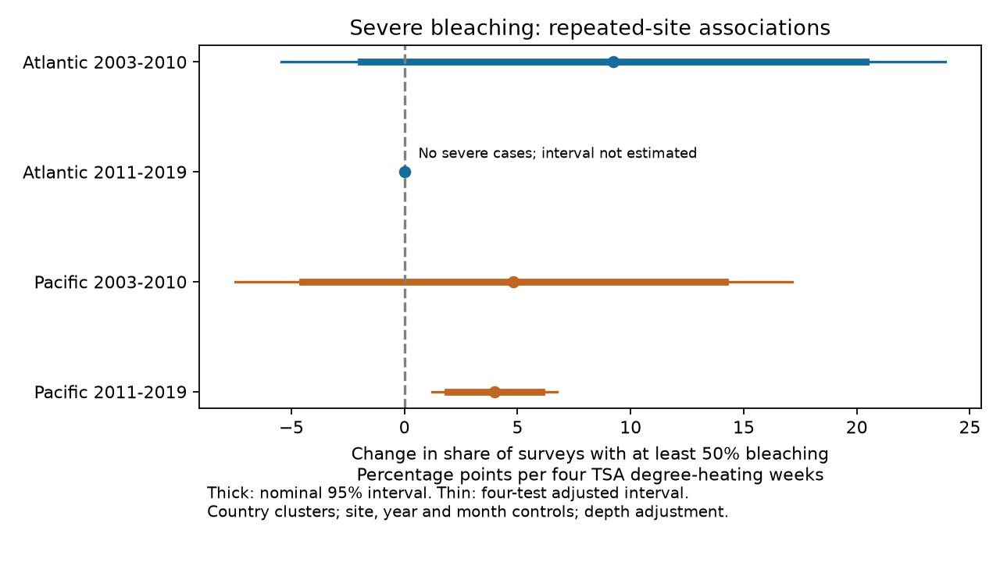
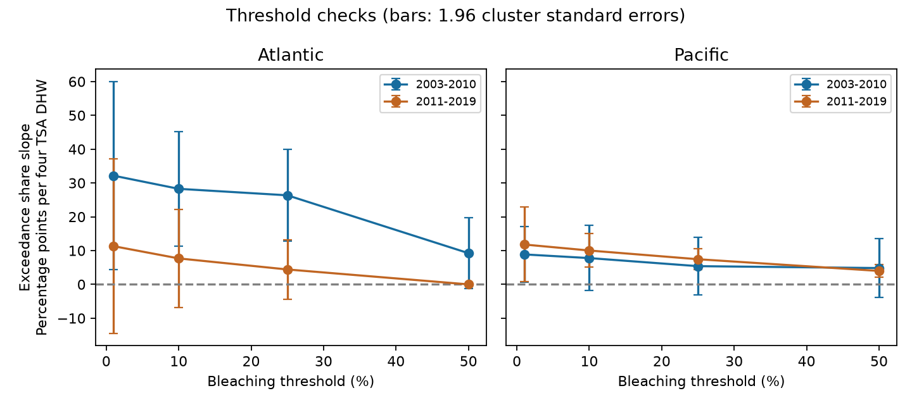

# Heat links to severe coral bleaching were not established in all four Atlantic and Pacific samples in 2003-2019

## Question and result

Does more heat stress predict a greater share of surveys with at least 50% coral bleaching at the same sites? Does this link repeat in separate ocean and time samples?

The four primary models used 5,336 site-month records from repeated-year sites. Three samples had severe cases and positive slopes. Only the later Pacific country-cluster interval was above zero after adjustment for four tests. That interval included zero when errors were grouped by year or ecological region. The later Atlantic repeat-site sample had no severe cases. Its fitted zero is not evidence of no heat response. These results do not establish a common severe-bleaching response in all four samples.

This is a test of a known heat stress link at a high outcome threshold. It is not the first evidence that heat stress and bleaching are linked. It gives a useful support and uncertainty audit for severe-event models.

## Prior work

[Sully et al. (2019)](https://doi.org/10.1038/s41467-019-09238-2) studied heat stress and coral bleaching across many sites. Their analysis supports a general heat association. [The data descriptor](https://doi.org/10.1038/s41597-022-01121-y) explains the biological records and the environmental matches. Our question concerns the frequency of high reported bleaching values in repeated-site comparisons. We use a 50% threshold as an analysis choice. It is not a measured death threshold or an official alert level.

We searched local campaign results before choosing this question. The search terms were “phenology climate pollution”, “bleaching”, and “bleaching occurrence severity”. We read the published heat-response study, SCI ab995c1cbe2d6f032bf4c59de5c9c4bc9d2aaad32e5acc89744afdcc8b5ce1d4, and the missing-report study, SCI 945de7479a461a348a68d4f339ceb82c41bea114bfb49409e9addf20c882b5a7. They used the same raw archive. The first tested mean bleaching and survey timing. The second tested heat stress and the availability of a bleaching percentage. Our outcome differs, but the observations overlap. Their evidence is not independent confirmation of our estimates.

We chose the question, threshold, region and period splits, main controls and most checks before seeing our outcome estimates. We then added a year-cluster check, a conservative parameter-count correction, and special treatment of a constant outcome. This was not a registered study. files/decisions.txt records this sequence.

## Data and units

The source is BCO-DMO dataset 773466, version 2, dated 2022-10-14. We use only Reef_Check records. The source has 14,475 Reef Check sample IDs. Substrate rows can repeat the same survey. We check that all used fields agree within each sample ID, then keep one value per sample.

The Atlantic and Pacific frame in 2003-2019 has 10,586 sample IDs. A bleaching value is present for 2,102 of 2,213 Atlantic records and 7,526 of 8,373 Pacific records. Complete data and valid-range filters leave 9,623 sample IDs. We require bleaching from 0 to 100%, depth from 0 to 40 m, nonnegative TSA_DHW, and known site, country, ecological region, year and month. Aggregation gives 7,820 site-month records before the repeat-year rule. files/reporting.csv gives annual report counts.

For each sample ID, severe bleaching is 100 if Percent_Bleaching is at least 50 and zero otherwise. We average this indicator within site, year and calendar month. We do not threshold a monthly mean bleaching percentage. The outcome is the percentage of included sample IDs with severe bleaching in that month. Heat dose and depth are mean values over the same sample IDs. Every site-month has equal weight in the main model. This is not a probability for a random reef or a percentage of all corals in an ocean.

TSA_DHW is the supplied CoRTAD version 6 accumulated thermal stress measure. It uses anomalies above the maximum weekly temperature norm, accumulated over the previous 12 weeks when the anomaly is at least 1 C. We scale it by four. The slope unit is percentage points of severe-survey share per four TSA degree-heating weeks. This scale is not a fitted heat threshold. CoRTAD TSA_DHW is not interchangeable with every product called DHW.

## Model and uncertainty

Each ocean-period model is fit separately:

`severe survey share = site effect + year effect + month effect + beta * TSA_DHW/4 + gamma * depth + error`.

Sites must have observations in at least two distinct years within that ocean-period. Two months in only one year do not qualify. Stable site conditions, common year changes and common calendar-month patterns are removed. Depth has a linear adjustment. The slope is a conditional linear summary over the observed exposure range. It is not a probability prediction outside that range or a causal effect.

We remove fixed effects by repeated mean projections with tolerance 1e-10. An independent sparse regression with explicit indicator columns checks all four primary heat coefficients. The largest difference is less than 6e-10 percentage points per four DHW. A separate standard-library CSV reconstruction checks sample deduplication, eligibility, and every derived monthly field without pandas or NumPy. A second run in a separate directory gave byte-identical estimates, support counts, figures and numerical checks. files/reproduction_check.json records the checked hashes. These checks test code, not the validity of the research assumptions.

Intervals use country-cluster score covariance and Student t critical values with G-1 degrees of freedom. The covariance multiplier is G/(G-1) times (n-1)/(n-K). K counts both slopes and all indicator columns, including redundant intercept columns. This slightly overcounts parameters and gives a conservative degrees-of-freedom multiplier. It is not a cluster leverage correction. The adjusted interval uses a two-sided alpha of 0.05/4. It is a Bonferroni working interval for the four primary comparisons under the cluster assumptions. Separate sensitivity families also use four-test intervals, but all families together do not have a 95% simultaneous guarantee.

Errors in different countries can remain linked during broad ocean heat events. Country clusters are not guaranteed to be independent. We therefore also group errors by ecological region and by year. These checks have few clusters. All intervals are approximate. A constant outcome gets no interval because a zero score variance cannot measure uncertainty about an unobserved event.

## Main evidence

| Ocean and period | Months | Sites | Countries | Months with severe cases | Slope per four DHW | Four-test interval |
| --- | ---: | ---: | ---: | ---: | ---: | --- |
| Atlantic 2003-2010 | 514 | 159 | 20 | 22 | +9.23 | -5.46 to +23.92 |
| Atlantic 2011-2019 | 464 | 103 | 16 | 0 | 0.00 | Not informative |
| Pacific 2003-2010 | 1,583 | 446 | 19 | 13 | +4.83 | -7.50 to +17.15 |
| Pacific 2011-2019 | 2,775 | 596 | 14 | 33 | +3.98 | +1.21 to +6.75 |



The primary samples have 27, 0, 17 and 38 severe sample IDs, in table order. After monthly aggregation, some outcomes are fractions. files/estimates.csv reports their sum as events_equivalent. That sum is not a count of severe sample IDs. files/support.csv gives actual sample counts.

Only 19, 8, 134 and 112 primary months, respectively, have mean heat dose of at least four DHW. The Atlantic heat range is particularly limited. The late Atlantic frame has two severe sample IDs in two months before repeat-site selection. Neither survives the repeat-year rule. Thus repeat-site controls remove fixed location differences but also remove the only severe cases in that cell. The absence of severe cases in the selected sample does not show that severe bleaching was absent in the Atlantic.

The two oceans have distinct sites. The periods do not overlap in year, but some sites can occur in both. These are separate samples within one reporting system. They are not independent monitoring systems. We do not test a change in slopes between periods. Differences in point estimates or intervals alone do not establish a difference in biological response.

## Checks and explanations

The later Pacific slope remains positive in all planned sampling checks. Its same-site, same-calendar-month estimate is +5.05 points, with a four-test interval of -3.61 to +13.71. This check uses only 1,675 months. Removing mean heat doses above 10 gives +7.20 (-3.01 to +17.42). Restriction to depths at most 15 m gives +3.84 (+1.09 to +6.60). Equal total weight per site gives +3.33 (+0.61 to +6.06).

For the same later Pacific point estimate, grouping errors by ecological region gives -0.11 to +8.07. Grouping by year gives -0.01 to +7.97. The point estimate stays positive, but its clear separation from zero depends on the error model. This is a material limit to the country-cluster result. It does not show that the association is absent.

Leaving out each country in turn gives severe-response slope ranges of +6.75 to +11.22 in early Atlantic, +0.29 to +6.03 in early Pacific, and +3.36 to +4.68 in late Pacific. These are descriptive stability ranges, not confidence intervals. The late Atlantic outcome remains constant.

Threshold checks use any positive bleaching and thresholds of 1, 10 and 25%. The late Pacific 10% and 25% slopes are +10.02 and +7.44 points per four DHW. The early Atlantic slopes at these thresholds are +28.27 and +26.35. The late Atlantic estimates remain uncertain at lower thresholds. The figure uses 1.96 standard-error bars for compact display; the full t and adjusted intervals are in files/estimates.csv. We do not select a preferred threshold from these checks.



Stable differences between sites cannot by themselves explain the positive slopes in the three informative primary samples under this model. Common calendar-month changes alone cannot explain the positive same-month point estimates. However, the data do not exclude changing survey effort, event-driven visits, observer error, or coral-community change. The evidence does not isolate a biological mechanism.

## Limits and use

These are selected, reported surveys. Missing percentages and surveys absent from the archive can bias the results. The model does not correct this by weighting. A prior null reporting test does not prove that outcomes are missing at random. Survey depth can change within a month, and monthly means of depth and heat do not capture all within-month variation. The same-month check changes both the design and the selected records.

Severe events are scarce, and several primary samples have little high-heat support. Few spatial or year clusters limit uncertainty estimates. Fixed effects use residual heat variation, not every contrast visible in a raw plot. Surface temperature may differ from colony exposure. The severe-share slope need not be constant across doses. Negative or above-100 linear predictions would not be valid probabilities.

Bleaching is not death, species richness, or a shift in species distribution. We do not identify effects of long-term climate change, air pollution, adaptation, or species turnover. The contribution is a reproducible warning against reading a positive mean heat association as established evidence for a severe-event response in every region and period. Future tests need independent monitoring systems, more severe events, complete visit logs, and measured colony-level outcomes.

## Inspect and reproduce

Job: sci-1107-dell-climate-pollution-biodiversity-15927d3eaf46. Topic: climate-pollution-biodiversity. Campaign: 11_07_2026. Machine: dell. Account: codex-andrii. Model: gpt-6.1-sol, high reasoning effort. Date: 2026-11-08. The signing key is a campaign-machine key. It does not make a personal authorship claim.

The raw data remain unchanged at:

`/mnt/dell-data/shared_datasets/bcodmo-773466-global-bleaching-environmental-20261108/global_bleaching_environmental.csv`

The SHA-256 is `78cc014b1e7887f26f4c44a40d4d9213212f3c6217541c6a1b69e723b61bfacb`. The file has 16,772,400 bytes. files/provenance.json records the source URL, version, attribution, license and exact shared path. The signed manifest records hashes of all derived files. The raw file is not duplicated.

Use a writable copy of the unpacked bundle. Use Python 3.12 with NumPy, pandas, SciPy and Matplotlib. Exact tested versions are in files/environment.json. From the bundle root, rebuild the estimates and figures from included monthly evidence:

```sh
OPENBLAS_NUM_THREADS=1 python files/analyze.py
```

For the full raw rebuild and independent data check:

```sh
OPENBLAS_NUM_THREADS=1 python files/analyze.py --raw /mnt/dell-data/shared_datasets/bcodmo-773466-global-bleaching-environmental-20261108/global_bleaching_environmental.csv
python files/validate.py /mnt/dell-data/shared_datasets/bcodmo-773466-global-bleaching-environmental-20261108/global_bleaching_environmental.csv
```

Elsewhere, download the exact source_url in files/provenance.json to scratch, check the stated SHA-256, then pass its path to both scripts. The scripts enforce the raw hash. Do not accept changed bytes as the same release. No shared data were changed, and no remote publication or index submission was made.

## References

- Sully et al. (2019). A global analysis of coral bleaching over the past two decades. DOI: 10.1038/s41467-019-09238-2.
- van Woesik and Kratochwill (2022). A global coral-bleaching database, 1980-2020. DOI: 10.1038/s41597-022-01121-y.
- van Woesik and Burkepile (2022). Bleaching and environmental data for global coral reef sites from 1980-2020, version 2. DOI: 10.26008/1912/bco-dmo.773466.2.
- CoRTAD version 6. DOI: 10.25921/ffw7-cs39.
