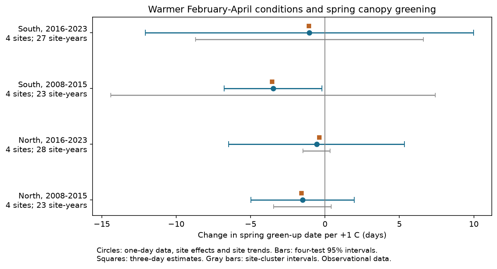

# Spring temperature slopes were negative but uncertain at eight eastern US camera sites in 2008-2023

We tested whether warmer February-April conditions were linked to earlier spring canopy greening. All four region-period estimates were negative. The tests did not give stable support across regions, periods and error assumptions. Three of four year-cluster intervals included zero. All four site-cluster intervals included zero. This result does not show that temperature has no effect.

## Question and prior work

Spring timing can change the period when food and habitat are available to other species. A useful test must separate site differences from changes within a site. Richardson and colleagues (2019; doi:10.1002/aps3.1228) linked camera-based spring timing to temperature anomalies in specific time windows. Our test extends that line of work with V3 records, fixed calendar windows, two time blocks and checks on date processing. We do not claim to discover the temperature response of spring plants.

We searched the local SCI campaign for “phenology ozone”, “phenocam” and “canopy greening” before the test. The broad search found prior pigment and ozone studies. The two canopy searches returned no matches at that time. We used no code or records from those publications. A public literature search found the PhenoCam V3 description by Young and colleagues (2025; doi:10.5194/essd-17-6531-2025). The external data source is Zimmerman and colleagues (2025; doi:10.3334/ORNLDAAC/2389). The specific new contribution is an audit of the stability and data support of four temperature slopes in an available camera sample. This is an exploratory analysis, without a registered plan.

## Data and sample

We reused existing shared data in place. The sampling frame consists of local PhenoCam V3 DB ROI 1000 archives in the box 35-50 N and 95-65 W. DB means deciduous broadleaf vegetation. This gave 55 screened sites. This is a convenience sample of available archives, not all sites in the network. The frozen frame is given in files/provenance.json. That file also gives SHA-256 hashes for each archive and for each metadata or transition-date member used. Relative shared paths start with datasets/. They refer to the campaign's shared dataset link. No source file was changed.

The response is day of year at the 25 percent rising greenness threshold for gcc_90. We used Data Record 5 for both one-day and three-day products. We kept dates in days 60-180 in 2008-2023. We removed all events in a site-year if more than one rising event passed this window. This prevents a later flush from being selected by an arbitrary order rule. For the main test, the source upper-minus-lower date interval had to be 0-14 days wide. No imputation was used.

Each site had to have at least four good years in each period, in both processing products. Eight sites met this rule. North means latitude at least 42 N; South means latitude below 42 N. The North sites were Harvard, Proctor, Reading MA and Willow Creek. The South sites were Cary Institute, Morgan Monroe, North Attleboro MA and Shenandoah. The latitude bands contain different sites, but they share regional weather. The time periods have no shared years, but they use the same sites.

The exposure is the unweighted mean of February, March and April monthly mean temperature from the nearest 0.5 degree GHCN-CAMS grid cell. The file is NOAA version 3.01, with a snapshot through October 2026. Only 2008-2023 values enter this test. The temperature unit in the source is kelvin. Temperature slopes per kelvin and per degree Celsius are equal. The window is fixed before fitting; it can overlap or follow greening at early sites. It is an association measure, not a validated forcing or chilling measure.

## Model and uncertainty

For each region and period, we fit ordinary least squares:

    date = site intercept + site-specific linear year trend + slope * temperature + error

Each observed site-year has equal weight. The main test uses one-day dates and the date-width rule. The trends remove slow changes in site response and exposure. They cannot remove sudden camera changes or unmeasured weather effects.

We report year-cluster standard errors to allow all sites in one year to share errors. We use t intervals with min(number of sites, number of years) minus one degrees of freedom, which is three in each test. We apply a Bonferroni correction across the four main tests. These are nominal simultaneous 95 percent intervals under the model and error assumptions. With four sites and seven or eight years per test, coverage can be poor. They are not an exact small-sample guarantee.

We also report site-cluster errors. These allow serial dependence within sites but do not cover shared annual errors. Neither error method alone covers both forms of dependence. The site-cluster check was added after the first estimates showed sparse regional samples. Its purpose is to expose a material weakness in the inference, not to select a preferred significant result.

## Results

| Region | Period | Sites | Site-years | Days per +1 C | Year-cluster interval | Site-cluster interval |
| --- | --- | ---: | ---: | ---: | --- | --- |
| North | 2008-2015 | 4 | 23 | -1.52 | -4.99 to 1.96 | -3.45 to 0.42 |
| North | 2016-2023 | 4 | 28 | -0.57 | -6.47 to 5.33 | -1.47 to 0.34 |
| South | 2008-2015 | 4 | 23 | -3.49 | -6.77 to -0.22 | -14.40 to 7.41 |
| South | 2016-2023 | 4 | 27 | -1.05 | -12.07 to 9.98 | -8.71 to 6.62 |

There were 101 main-test records. The selected one-day data had 104 records before the width rule. Thus this rule removed three records.

The only year-cluster interval below zero was in the early South test. That interval crossed zero with site-cluster errors. It also crossed zero when the date-width rule was removed or the site trends were omitted. We therefore do not treat it as firm replicated evidence.

Three-day processing changed the four slopes by at most 0.19 days per C. The three-day slopes were -1.57, -0.38, -3.55 and -1.08 in table order. These small changes suggest that processing interval alone does not explain the lack of clear replication.

Removing one site at a time kept negative slopes in both North tests and the early South test. In the late South test, the range was -1.46 to +1.03. Replacing the exposure with March temperature gave positive slopes in both late-period tests. A fixed three-month mean and a single-month mean do not estimate the same biological response. This check shows window dependence; it does not establish a change in mechanism. We did not formally test differences between eras or latitude bands.

files/results.csv gives the estimates and checks. files/checks.json reports 36 independent residual-projection checks of model slopes, including all site-deletion fits. The largest absolute discrepancy from the direct regression was less than 1.3e-13. All checked designs have full column rank.

## Interpretation and limits

The negative point estimates agree with a temperature-linked advance in spring greening. They do not establish a stable effect across four disjoint region-period samples. Sparse records and shared weather make the uncertainty large. A null interval is not proof of no effect.

Fixed cameras reduce bias from changing observer visits. Site intercepts, site trends, event rules and date-width checks address some measurement and selection problems. They do not remove all observation bias. The long-record rule retained only eight of 55 screened sites. Missing or uncertain dates may depend on weather. Camera changes, snow, view changes and scene composition may affect the source fits. We did not inspect source imagery or model missingness. Close sites can share climate and other errors. A latitude split at 42 N is a simple contrast, not an ecological boundary.

Monthly gridded temperature can differ from canopy temperature, especially in mountains and cities. The model omits rainfall, chilling, photoperiod interactions and surface pollution. The sample is too small to support a broad interaction model. Day of year includes leap days. We did not attribute the associations to human-caused climate change, infer species-specific phenology, measure biodiversity loss, or test pollution effects. These remain outside this result. Canopy greening is an ecological timing measure; it is not a direct count of species.

## Reproduction and source rights

The package contains original code, aggregate estimates, this report and a static figure. Source records and derived record tables remain external to keep this package compact. The updated policy in the source archive grants CC BY 4.0 for V3. Older metadata contains obsolete license text. See files/EXTERNAL_DATA_NOTICE.md. The SCI baseline license is unchanged. It does not replace external source terms.

Use Python 3.12 with numpy, pandas, scipy, statsmodels, xarray, a NetCDF backend and matplotlib. Exact analysis versions are in files/summary.json. To reproduce with the campaign's existing shared inputs, run from the worktree root:

    python work/result/files/analyze.py --datasets ./datasets --scratch ./reproduction_external --out ./reproduction_outputs --manifest work/result/files/provenance.json

To retrieve inputs elsewhere, first extract this verified publication to a local directory. Then run:

    python files/retrieve.py --dest ../external_inputs
    python files/analyze.py --datasets ../external_inputs --scratch ../external_records --out ../reproduction_outputs --manifest files/provenance.json

The retrieval script checks the frozen file hashes. A mutable source URL may now give a newer file. If a hash differs, the script stops. Obtain the exact snapshot from a source archive or the campaign dataset store; do not substitute a new snapshot silently. Record tables and full site credit stay in external scratch. Do not add them to this signed package. Compare results.csv, checks.json and the figure with the bundled files. Source files need not be copied into the publication to reproduce this test.

## Work record

Job: sci-1107-dell-climate-pollution-biodiversity-5e91ffd91ad8. Topic: climate-pollution-biodiversity. Campaign: 11_07_2026. Machine: dell. Account: codex-andrii. Model: gpt-6.1-sol, high reasoning effort, through the Codex harness in T3 Code. Analysis date: 2026-11-09. The configured campaign-machine key signs this package; it is not a personal authorship claim. No other agents were used. No remote archive or index submission was made.
