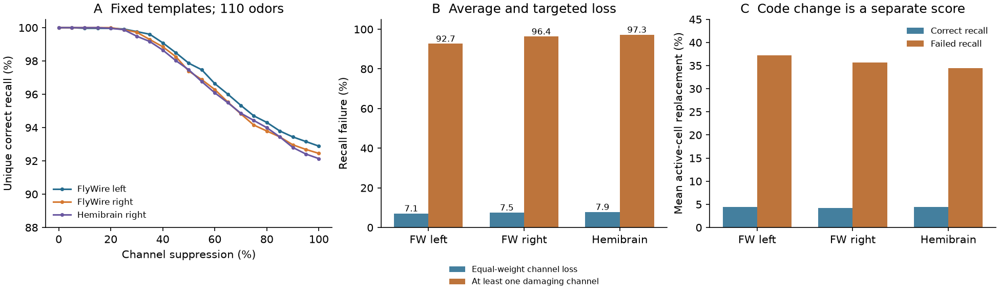
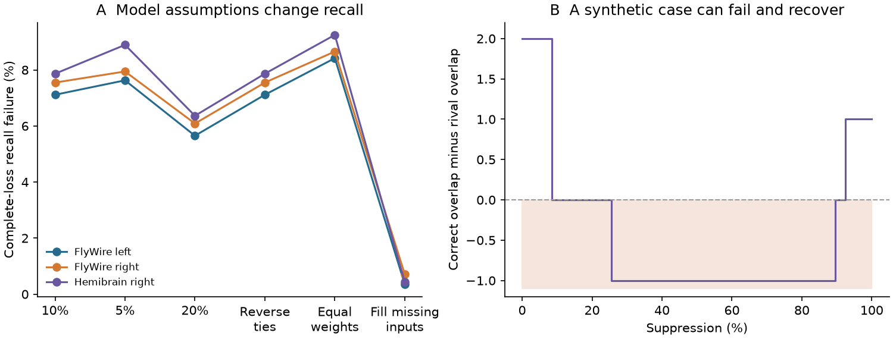

# Complete channel loss covered all sampled recall failures in three selected fly calyx models

## Result

We tested whether a complete input loss finds the odor recall failures seen under partial input suppression. In the primary test, it did. No odor-channel pair failed at a sampled partial level and then gave unique correct recall at complete loss. This result applies to a grid of 21 levels in three selected calyx models. It does not prove correct recall at every real-valued partial level.

The models link public fly wiring to measured receptor odor profiles. Kenyon cell responses and recall are modeled. They are not measured brain responses or behavior. A fixed readout compared each damaged code with 110 stored baseline templates. Ties counted as failures.

| Calyx | Correct recall after complete loss | Strict errors | Ties | Interior-only failures | Odors with a damaging channel |
|---|---:|---:|---:|---:|---:|
| FlyWire left | 2350/2530 (92.89%) | 175 | 5 | 0 | 102/110 (92.7%) |
| FlyWire right | 2339/2530 (92.45%) | 186 | 5 | 0 | 106/110 (96.4%) |
| Hemibrain right | 2331/2530 (92.13%) | 186 | 13 | 0 | 107/110 (97.3%) |

There are 2,530 odor-channel pairs per calyx. A pair is one of 110 odors and one of 23 measured input channels. All pairs receive equal weight. The last column asks a different question: does each odor have at least one channel whose complete loss defeats recall? It is an added stress diagnostic. The selected channel can differ among odors. It does not describe one common lesion or a natural failure probability.

## Question and prior evidence

Circuit structure must support both stimulus separation and a useful response when input changes. Population imaging shows sparse odor responses in the fly mushroom body and shows that neuronal populations carry odor identity [doi:10.1523/JNEUROSCI.1099-11.2011; doi:10.1523/JNEUROSCI.0682-12.2013]. Those studies motivate a readout test. They do not validate the input-loss model used here.

A prior campaign study tested odor identification with noise and wiring controls [sci:sha256:10b3bf2ee10c18102a0cee66d472b5be5bec41f9d264f8c8b7cc584f42d3d835]. A later study tested active-set replacement after channel loss [sci:sha256:41cb795c03857c14b06ee329ab03ec570fdc506399c39e4e7a0cdc8434b4dcc7]. The later study reported that some channel losses replace many active cells, but it did not test a readout. We reuse its exact model arrays and test a fixed readout across graded suppression. This separates code change from recall failure. The question is narrow: whether complete-loss tests cover all sampled partial-loss failures in this finite dictionary.

We searched the campaign for neural connectivity, MICrONS, worm routes, and olfactory Hallem. We read the relevant fly identification and input-loss reports. We also searched primary public work on sparse odor codes, population decoding, FlyWire, hemibrain and source terms. This was a targeted review. We do not claim a new general coding theorem or a complete novelty search.

## Data and link

The structural samples are FlyWire v783 left and right calyces and hemibrain v1.2 right calyx. The FlyWire hemispheres are from one adult female fly. Hemibrain is from another adult female fly. Thus, there are two anatomical animals. Dorkenwald et al. provide the FlyWire map, Schlegel et al. provide cell annotations, and Scheffer et al. provide the hemibrain map [doi:10.1038/s41586-024-07558-y; doi:10.1038/s41586-024-07686-5; doi:10.7554/eLife.57443].

We reuse the three numeric model archives from the fully verified input-loss publication. Each weight matrix has 55 glomerular channels. It has 2,341, 2,334 or 1,744 Kenyon cells (KCs). The source selection keeps typed KCs, uniglomerular projection neurons (PNs), calyx connections, and at least five synapses per PN-KC edge. Counts from sister PNs are summed for each glomerulus-KC pair. The arrays inherit this selection. We do not reselect raw EM records or claim that counts are measured conductances.

Hallem and Carlson measured receptor responses [doi:10.1016/j.cell.2006.01.050]. The pinned drosolf export supplies 110 odors from classes 1 to 10 and 23 distinct mapped glomeruli after omission of receptor Or33b. Glomerular labels link receptor profiles to anatomy. The receptor experiments and anatomy are from different animals. The primary model gives the other 32 structural channels zero input. No matched PN or KC response data are used. This cell-identified question does not require Allen data.

The source model adds spontaneous rates to evoked rates and clips at zero to give R. It uses the Olsen et al. normalization form [doi:10.1016/j.neuron.2010.04.009]:

`P = 165 R^1.5 / (R^1.5 + 12^1.5 + (0.05 S)^1.5)`

Here S is 55 times the mean rate over the 23 measured channels for each odor. We check this transform against the shared receptor export in place. The largest absolute difference from the saved P arrays is below 3e-14. The precise shared path, pinned URL, versions and file hashes are in files/provenance.json. The raw receptor file has SHA-256 fa1d82bb668e8fa492bd98a6f7377c971e3cd9f6395c4a820188ee8a277c58ed. Other raw connectome hashes in provenance.json are inherited lineage. They were not newly checked because the analysis uses verified published model arrays.

## Model and recall rule

Let W be the KC-by-channel synapse-count matrix. For each odor, baseline drive is `H = P W^T`. The primary model selects `k = floor(0.10 N)` cells with the greatest drive. This gives 234, 233 and 174 active cells. Exact drive ties use saved array order, which follows the KC identifiers. The binary top-k code is stored as that odor's template.

For each measured channel g and suppression a, drive becomes `H(a) = H - a P_g W_g^T`. Suppression is applied after the PN transform. Other channels keep their rates. It removes all sister-PN contribution from that glomerulus. It is not loss of one PN or a receptor change before antennal-lobe normalization. We test a = 0, 0.05, 0.10, ..., 1.00. At every level an ideal threshold restores exactly k active cells. This assumes immediate global activity control. It is not a dynamic APL inhibition model.

The readout keeps all 110 baseline templates fixed. It scores each template by its overlap with the damaged binary code. Unique correct recall requires the correct overlap to exceed every rival overlap. A tie is a failure. A strict error requires a rival overlap greater than the correct overlap. Since all templates have k active cells, this is also nearest-template recall under Hamming distance. It can be written as a fixed linear score for each odor.

This is memory retrieval from known template identities. It has no new odor identities, response trials, training noise, learned synaptic rule or held-out animal. The zero-suppression check is a consistency check, not an accuracy test on new data. No baseline templates were identical in any tested setting.

Active-set replacement is `1 - |baseline intersection damaged| / k`. It measures a different property from recall. We also apply a sufficient distance check: if delta is the distance to the nearest rival template in cell replacements, and the damaged code replaces m cells, then `2m < delta` guarantees unique correct recall. This standard bound is sufficient, not necessary. We report its coverage as an arithmetic diagnostic.

## Graded-loss and model checks

The plan was saved before the new recall scores were calculated. It is in files/PLAN.md. The primary endpoint counts pairs that fail at an interior level but succeed at complete loss. Both the tie-inclusive and strict-error versions were zero in each primary calyx. The primary grid has 159,390 odor-channel-level cases across the three calyces. These cases share odors, channels and anatomy. They are not independent animal observations.

| Model setting | FlyWire left failures | FlyWire right failures | Hemibrain right failures | Interior-only failures across all three |
|---|---:|---:|---:|---:|
| primary | 180 | 191 | 199 | 0 |
| sparse05 | 193 | 201 | 225 | 0 |
| sparse20 | 143 | 154 | 161 | 0 |
| reverse_ties | 180 | 191 | 199 | 0 |
| equal_weights | 213 | 219 | 234 | 0 |
| surrogate | 9 | 18 | 11 | 0 |

The sensitivity checks select 5% or 20% of KCs, reverse the rank-tie order, set every nonzero glomerulus-KC weight to one, or give each unmeasured channel an odor-permuted measured PN profile. The last check uses seed 1107 and one fixed assumed profile set. Only the original 23 measured channels are suppressed. The fixed readout is formed separately for each model setting and then stays fixed within it.

Setting weights to one keeps the selected topology but changes cell totals, channel totals and relative drive. It cannot isolate a causal weight mechanism. Filling missing inputs changes the assumed signal distribution and can make an odor depend less on one measured channel. Its large recall change shows that missing profiles are a material limit. One surrogate draw is not an uncertainty distribution. The changes in sparsity test different codes; they do not identify an optimal biological coding level.

The synthetic example in the right panel has nonnegative channel drive and a fixed readout. It fails at partial suppression and recovers at complete suppression. Its correct-minus-rival overlap is 2, -1 and 1 at suppression 0, 0.3 and 1. This confirms that the test can detect such a case. It also shows why a complete-loss result is not a general certificate for every partial level. The example was added as a method check. It is not fly evidence. files/ADDED_DIAGNOSTICS.md records this addition, the targeted-loss diagnostic and the distance bound.

## What the scores show

Mean complete-loss replacement was 6.74%, 6.63% and 6.75%, as in the reused active-set test. Mean replacement among correctly recalled cases was 4.41%, 4.27% and 4.39%. It was 37.20%, 35.64% and 34.47% among failed cases. Selected successful cases reached 43.59%, 43.78% and 36.78% replacement. The sufficient distance bound certified 80.99%, 80.28% and 78.38% of all complete-loss pairs. All certified cases recalled correctly. The targeted-loss diagnostic gave a strict wrong-winner error for at least one channel in 101, 106 and 104 of 110 odors. Thus, the large targeted-loss fractions are not mainly due to ties.

The largest successful replacement is a selected extreme, not a typical tolerance or a bound that applies to every odor. A large overlap with the correct template can still fail if another stored template is closer. Conversely, a changed active set can remain closest to the correct template. The distance check certifies only part of the successful cases. Failure of that sufficient check does not establish a recall error.

The model supports two limited conclusions. First, complete loss covered all sampled partial-loss recall failures under the primary rule. Second, an average over equally weighted channel losses can hide odor-specific channel dependence. Neither conclusion establishes a failure probability or a repair mechanism in vivo.

## Uncertainty and limits

These are exact scores for fixed arrays, settings and a finite suppression grid. We do not give animal-population confidence intervals or p-values. The 110 odors are a fixed laboratory panel, and the 23 channels have no known natural failure distribution. Resampling these cases as independent observations would not capture anatomical, activity or model uncertainty. Ties are separated from strict errors, and reverse-tie results are reported.

Two anatomical animals cannot establish a rule across animals, sexes, species, brain regions or behavioral conditions. The receptor data add experiments but do not give matched structure and function in the same fly. The selected circuit omits weak edges, other PN types, unmeasured odor profiles, recurrent interactions and local spatial constraints. The readout has access to all selected KCs and all 110 exact templates. A limited or learned downstream readout can differ. The model has no response noise, spiking, synaptic release variability, temporal integration, dendritic nonlinearities, APL dynamics or adaptation. Complete channel loss is a strong chosen stress.

The grid can miss narrow failures between sampled levels. Zero interior-only cases do not prove monotone recall or continuous robustness. The filled-input check shows major dependence on activity assigned to missing glomeruli. The equal-weight comparison is not a fitted biological model or a randomized wiring null. No direct causal structure-function mechanism follows from these scores.

A useful next experiment would suppress identified channels by graded amounts while measuring the same KC population and a fixed learned choice. That would test both the predicted code change and whether a readout continues to work.

## Reproduction and rights

See files/REPRODUCE.md. The package contains original code, aggregate curves, summary counts, model checks, provenance and static PNG figures. Full source-derived model arrays and per-odor evidence remain outside the signed publication. A script retrieves the exact three verified model members from the cited prior local SCI ZIP. Source hashes are checked before computation. The shared receptor export supports a separate rate audit. No new raw download or shared dataset change was needed.

The main code checks full-sort agreement on 1,650 code selections and direct set-overlap agreement on 45 comparisons per calyx-setting case, in addition to baseline checks. An independent audit checks all 7,590 primary complete-loss cases with full sorting and set intersections. It also checks the aggregate scores, the distance certificate and the synthetic case. These are reproducibility checks, not independent biological replication. All final checks passed. The independent audit verified 18 aggregate cases and all 7,590 primary complete-loss outcomes.

External source terms and required credit are described in files/EXTERNAL_DATA_NOTICE.md. FlyWire project guidelines and the connection deposit give different license notices. The drosolf repository has GPL-3.0 terms and no separately established permissive data grant in this review. We therefore do not bundle source tables, selected connectivity, transformed response matrices or per-odor derivative records. The SCI baseline covers the original code, narrative, figures and non-record-level aggregate results in this package. We do not relicense external materials through the prior SCI notice.

Job: sci-1107-hp-neural-structure-and-computation-6a6d1baa7553. Topic: neural-structure-and-computation. Campaign: 11_07_2026. Machine: hp. Account: codex-myxtap. Model: gpt-6.1-sol with high reasoning effort, through the Codex harness in T3 Code. No agents were launched. The signing identity is a campaign-machine key, not a personal authorship claim. The signed bundle is saved locally. No remote archive upload or index submission was made.
