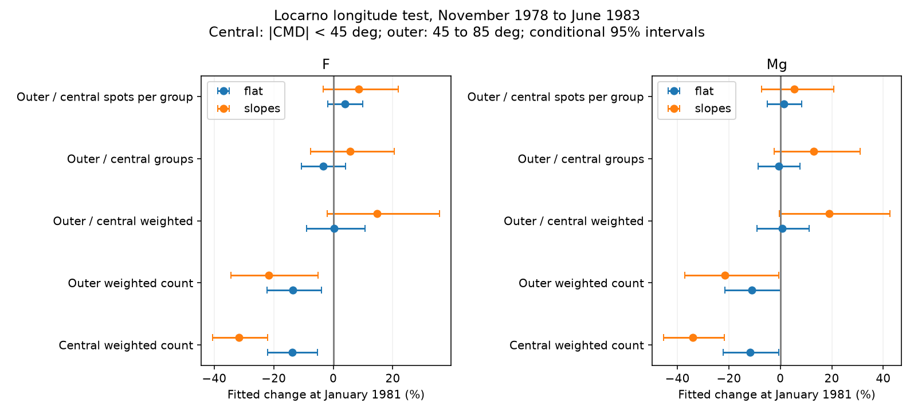

# A longitude test finds no clear limb-specific fall in Locarno weighted spot counts near 1981

Job: sci-1107-dell-astronomy-e6dd06bf1b42. Topic: astronomy. Campaign: 11_07_2026. Machine: dell. Account: codex-myxtap. Model: gpt-6.1-sol, high reasoning effort. Date: 2026-11-10. The signing key is a campaign-machine key. It does not state personal authorship.

## Finding

At matched F10.7, Locarno weighted spot counts fall by 13.84% in the central longitude band and 13.58% in the outer band in our main model. The change in the outer-to-central ratio is +0.30%, with a conditional 95% interval from -9.02% to +10.73%. Thus the data do not show a clear extra loss in the outer band. This is not an equivalence result.

A loss confined to the solar limb is an incomplete description of the all-observer main fit. However, the single-observer flat-level model does not establish a central fall. Time trends change the estimates. A coordinate-source change occurs at the tested boundary. These limits prevent a general rejection of a visibility effect or a claim of a solar cause.



## Question and prior evidence

The selected SCI studies resolve much of the Cycle 25 M-flare excess through GOES scale changes and magnetic flux. They leave an important problem in the activity indices: the sunspot number falls relative to F10.7 and Mg II near 1979-1983. SCI 545024b6 finds the same fall in Locarno. SCI 02336790 splits its weighted Wolf count by group class. The fitted fall is not confined to groups without penumbrae. SCI 864124e4 shows that historical weighted and unweighted pairs do not isolate size weighting on one fixed spot set.

This study adds a longitude test. Foreshortening can make small spots harder to see away from the central meridian. Work on optical resolution and count thresholds shows that counts can depend on the observing system (for example, https://academic.oup.com/mnras/article/488/3/3804/5543917). That mechanism motivates this test, but does not supply a quantitative prediction here. We ask whether the change has an extra loss in the outer longitude band and whether the central count is stable. We do not assume that all physical spot-size changes must have one longitude signature.

A campaign search for sunspot results preceded the choice of this question. No result in that search used this longitude contrast for the 1981 anomaly. Small-spot loss and count-threshold effects are established questions. We claim only a new test of their spatial signature in this archive and window.

## Data and selection

We reuse the Locarno archive 2026A by Ramelli and Cagnotti, DOI 10.5281/zenodo.19118343; NRC Canada adjusted F10.7 from LASP; and the Bremen Mg II composite from LASP. Exact shared dataset paths, hashes, source URLs and byte counts are in files/inputs.json. The raw files and all dated derived tables stay outside this publication. External terms and attribution are in files/EXTERNAL_DATA.md.

The window is November 1978 to June 1983. January 1981 is the chosen model boundary, not a measured change date. We start with 14,696 rows on 1,369 drawing dates. We retain complete active drawings with unique nonmissing group IDs, one observer and time, positive weighted counts, known Zurich classes, a recorded longitude for each group, and no group beyond 95 degrees of central-meridian distance. Suffixed group IDs are allowed. The retained sample has 14,565 group records on 1,356 dates. It excludes spotless and incomplete drawings. This selection estimates a relation on retained active days, not an unconditional all-day solar rate.

Use software-measured longitude when available and manual longitude otherwise. Both columns have a 0-360 degree range consistent with Carrington longitude. Compute the apparent central-meridian longitude L0 with SunPy at the recorded UT time. Define CMD = wrap(longitude - L0) into [-180, 180) degrees. No raw row in this window has |CMD| greater than 95 degrees. This checks gross coordinate agreement; it does not establish subdegree accuracy.

There is a complete coordinate-source split: all 7,624 retained pre-boundary rows use software positions; all 6,941 retained post-boundary rows use manual positions. This is a potential measurement confound. The source states about one degree precision. We use broad bands and two-degree perturbations as controls, not as a complete error model. We do not use heliocentric angle, projected area, measured spot sizes, or tracked group identities.

The central band has |CMD| < 45 degrees. The outer band has 45 <= |CMD| < 85 degrees. Omit the final five degrees near each limb. Assign a whole group to its recorded group longitude. The test cannot locate individual spots within a group. Sum its weighted spot count W, and count groups G, separately in each band for each drawing. W is a weighted spot count, not the Wolf index 10G+W, a spot-area measurement, or a count of distinct spots.

F10.7 is the daily median of adjusted readings from 30 to 2,000 sfu. Mg II excludes source code 20, which is filled from radio data. For each reference separately, select valid common drawing days for all four responses, then take monthly means. Require eight days per month and positive means. The radio sample has 56 months and 1,356 days; ultraviolet has 56 months and 949 days. Both bands use exactly the same dates within each fit. These references share solar information and are not independent experiments.

## Model and uncertainty

For each reference, regress log monthly mean W and log monthly mean G in each band on an intercept, a natural cubic spline of log emission with three centred degrees of freedom, and a post-boundary indicator. A flat model has no explicit time trend. A second model adds a linear month coordinate and its interaction with the indicator. The latter permits different slopes on the two sides. Its boundary coefficient is a fitted discontinuity at January 1981, not the average post-period deficit.

Fit all responses on the same design. Also fit log(W_outer/W_central), log(G_outer/G_central), and log[(W_outer/G_outer)/(W_central/G_central)]. These are logs of ratios of monthly daily means. They are not averages of daily ratios. By least-squares linearity, their step coefficients equal the corresponding differences of log-count coefficients. We check these identities numerically.

Report 100[exp(beta)-1]. Conditional 95% intervals use 4,000 paired circular moving-block resamples of monthly multivariate residuals on the fixed design. Use six retained monthly rows per block, with three and twelve as main-sample controls. The same residual row resample applies to every response. The random seed is 71026. These intervals assume adequate activity and time models and stable residual behavior. They omit calibration, position and model uncertainty and are not simultaneous intervals. Months missing in observer controls can make blocks nonconsecutive in calendar time. Twelve-row blocks contain few independent units.

Controls vary the longitude split to 35 or 55 degrees, retain Cortesi alone (observer 1), or retain seeing >=3 (5 is best in the dataset). Coordinate controls add +2 or -2 degrees to post-boundary signed CMD, or to its absolute value. The latter move groups radially across band boundaries and also affect the 85-degree exclusion. All model statistics are in files/effects.csv. None of these choices is an independent replication.

## Estimates

Main bands, all observers, six-row blocks. Parentheses give conditional 95% intervals. Changes are percentages.

| Response | F10.7, flat | Mg II, flat |
|---|---:|---:|
| Central weighted count | -13.84 (-22.06 to -5.23) | -11.84 (-22.29 to -0.71) |
| Outer weighted count | -13.58 (-22.18 to -4.04) | -11.15 (-21.63 to +0.08) |
| Central group count | -14.77 (-21.14 to -7.73) | -14.94 (-20.89 to -8.39) |
| Outer group count | -17.70 (-25.99 to -8.06) | -15.39 (-24.16 to -6.26) |
| Outer / central weighted count | +0.30 (-9.02 to +10.73) | +0.77 (-9.13 to +11.26) |
| Outer / central group count | -3.44 (-10.63 to +4.20) | -0.53 (-8.52 to +7.53) |
| Outer / central weighted spots per group | +3.87 (-1.80 to +9.89) | +1.31 (-5.03 to +8.19) |

The absence of a clear ratio change does not prove equal responses. The nominal radio interval permits an extra outer loss of about 9%. It does not include a 14% outer-only ratio fall under this specific model. This is a model-conditional bound, not a calibrated bound on a physical visibility threshold.

With time slopes, central W falls by 31.77% for radio and 34.11% for ultraviolet. The outer-to-central change is +14.80% (-2.11 to +35.66) for radio and +19.02% (-0.33 to +42.70) for ultraviolet. Both intervals contain zero; neither shows clear extra outer loss. The different point estimates show strong time-model dependence. Design condition numbers increase from about 5 to 112-119.

At 35 and 55 degrees, the radio flat central falls are 13.90% and 14.53%; their intervals exclude zero. Good-seeing drawings give a 15.51% central fall. Three- and twelve-row blocks retain a negative central interval and a ratio interval that contains zero. Cortesi alone gives a smaller central fall, 5.22% (-15.36 to +5.67) for radio and 2.80% (-13.40 to +8.93) for ultraviolet. Thus the all-observer flat central result is not established within one observer. With slopes, the Cortesi central falls are 24.85% and 28.56%, but this is a more model-dependent boundary estimate.

Signed post-boundary shifts of two degrees leave the radio flat ratio estimate near zero. Radial shifts are more consequential: a two-degree outward shift gives +9.99% (-0.67 to +22.19), and an inward shift gives -9.54% (-18.85 to +0.83). Their central W estimates remain negative, but the ratio is sensitive to this coordinate-error pattern. The nominal interval is not a full uncertainty bound.

## Meaning and limits

This study finds a central-disk deficit in the main all-observer model and no clear extra outer-band loss. It narrows an explanation in which all missing weighted counts occur near the limb while the central count stays fixed at matched emission. It does not separate a physical change from an observer change, a shared counting change or size weighting. A threshold change can also affect central spots; fewer spots can affect both bands. Counts within large groups can change without a group disappearing. The flat estimates of W and G are similar, but this does not identify which process changed.

Only one cycle maximum is covered. Emission, phase and time are correlated. The boundary was chosen from prior work. Coordinate method changes at the same boundary. Observer control loses days and may sample different activity. A latitude shift also changes foreshortening at fixed CMD. Group evolution, group extent, selection of complete active drawings, magnetic structure and measurement errors are not modeled. No independent station or photograph was used. No correction to SILSO or a long historical activity record follows from this test.

The useful next measurement is a common-method recount of matched pre- and post-boundary drawings, with individual spot areas and positions, or a simultaneous independent photographic series. This could distinguish a position-data effect from a count effect and test spot-size distributions directly.

## Reproduction and checks

Use Python 3.12 with the packages in files/requirements.txt. Versions, seed and bootstrap size are in files/environment.json. From the extracted publication root:

```
python files/analyze.py /mnt/dell-data/shared_datasets /tmp/longitude-results /tmp/longitude-scratch
python files/validate.py /mnt/dell-data/shared_datasets /tmp/longitude-scratch /tmp/longitude-results
```

The first command recreates the model table, figure, provenance and diagnostics. The second independently reads source rows with the standard csv parser, checks all 14,565 weighted counts and band sums for the radio monthly table, and checks fitted log-ratio identities. The maximum monthly aggregate difference is zero; the maximum coefficient-identity difference is 9.65e-16. Saved evidence is in files/validation.json. Complete removal of the private scratch does not remove any required code.

On another machine, run `python files/retrieve.py /tmp/longitude-inputs`, then use that directory as the first argument. Retrieval checks exact hashes and fails on revised provider files. Fresh remote retrieval was not tested in this run. The immutable shared snapshots were used successfully. Keep external observations and dated derivatives outside the publication. No raw download, new service, remote publication, or other agent was used. All computations have ended before signing.
