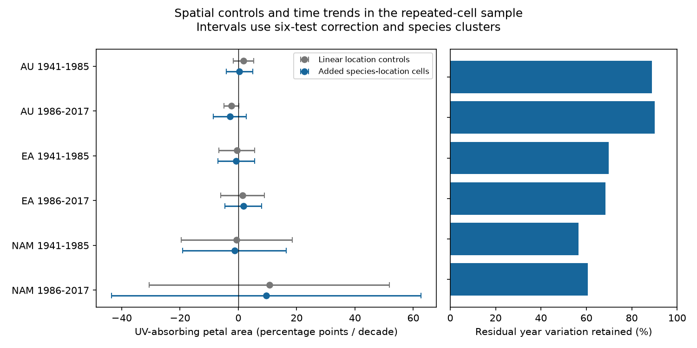

# Spatial cell controls gave no clear change in floral pigment trends in six herbarium samples from 1941 to 2017

We tested whether geographic controls changed time trends in flower UV pigment. We used 858 specimens from three regions and two periods. All six corrected intervals for the change in trend included zero. Thus, the tests did not establish a common change from added spatial controls. They do not show that collection geography is harmless. The archive has weak support for some comparisons within locations.



## Question and prior work

Flower UV pigment can protect pollen and affect signals to pollinators. Koski, MacQueen and Ashman (2020; DOI 10.1016/j.cub.2020.08.077) linked pigment to changes in ozone and temperature. Their public archive permits a check of collection bias. A geographic shift in collection can mix trait differences across locations with change through time. Daru and colleagues (DOI 10.1111/nph.14855) documented broad sampling biases in herbaria.

We searched the shared SCI campaign for phenology, climate, pollution, Madagascar, pigmentation, and geographic pigment. We read SCI 08175210a0a21d6a5b653a2a7e8f4911f7d55e4a31b7f1ef32abedde63e8f69a and SCI 82310471f3bfc042ebd010ef2970427a2e3372d4ae928e822dd262580e386032. These studies tested ozone slopes and collection-month effects. We extend the second question to species-specific geographic cells with repeat records across years. We use its region and period split. We wrote new code and read the external workbook directly. We did not use prior record tables.

The original ozone explanation was questioned in a published comment (DOI 10.1016/j.cub.2021.06.019), followed by a reply (DOI 10.1016/j.cub.2021.06.020). An erratum exists (DOI 10.1016/j.cub.2021.05.022). We confirmed that record but did not obtain its full text. We cannot confirm that the 2020 workbook includes its changes. This study does not reproduce the original model or resolve that dispute.

The question concerns the use of a climate and ozone archive to estimate change in a floral trait. It does not measure species loss, range movement, bloom onset, extreme weather or pollinator fitness. Total-column ozone is not ground-level ozone pollution. No causal effect of air pollution or climate change is estimated.

## Data and selection

We reused the existing workbook, with no download or change to shared data:

`/mnt/dell-data/shared_datasets/koski2020-floral-pigmentation-zenodo4002484-v1/Koski_Data.xlsx`

Source: Dryad DOI 10.5061/dryad.ttdz08kw1, 26 August 2020, mirrored in Zenodo 4002484 version 1. The workbook has 204,378 bytes and SHA-256 `cfcbf56ab0a9753b20cfa31d94c89aff58691b8f38036306d453a8678ee4d71e`. The resolved shared object path is in `files/provenance.json`. The exact API URL and factual license metadata are in that file and `files/source_metadata.json`. The Zenodo API identifies the source as CC0. Attribution and external-data boundaries are in `files/EXTERNAL_DATA_NOTICE.txt`.

We used `Spatiotemp and Clim Mod Data`. There are 1,238 source records. We retained 1,224 with year, month, coordinates, altitude, UV proportion, region, taxon label, temperature and ozone. The common complete-case filter includes temperature and ozone so that the climate sensitivity test uses the same rows as the primary test. Thus it excludes six more records than the prior month-control study. UV proportion is between zero and one. Project IDs are unique. Taxa are exact Genus plus Species labels; no names are merged. Both anther groups are included.

AU, EA and NAM denote Australia, Eurasia and North America. The windows are 1941-1985 and 1986-2017. They are fixed selection windows, not fitted breakpoints or a general ozone recovery date. Regions and periods have separate specimens, but share one archive, source methods and some taxa. They do not constitute independent new source datasets.

We formed cells from floor(latitude/5) and floor(longitude/5), separately for each taxon and window. The grid origin is zero degrees. We retained cells with records from at least two distinct years. The primary filter retained 858 specimens (70.1% of complete records). Five-degree cells cover large areas. They are broad location controls, not repeated exact sites. The two models in each comparison use identical rows. Selection and record-level panels are regenerated into external scratch; aggregate counts are in `coverage.csv`.

## Method

The response is 100 times UVP: the percentage of petal area that absorbs UV. Time is year minus 1985, divided by ten. The base model has taxon-by-month intercepts and common linear terms for latitude, longitude and altitude. The spatial model adds taxon-by-geographic-cell intercepts. Both have a common time slope within each region and window. The primary quantity is the spatial slope minus the base slope, in percentage points per decade. It is a model sensitivity measure, not an estimate of causal bias.

Least squares uses pivoted QR to remove redundant nuisance columns. We project time and response off those columns, then fit the time slope. For paired uncertainty, we subtract the two models' time-coefficient score sums within each taxon. The variance is the sum of squared score differences times G/(G-1) times (n-1)/(n-k), where G is the taxon count and k is the larger model rank. The same correction applies to component slopes. Intervals use the t quantile at 1-0.05/12 with G-1 degrees of freedom. The primary family consists of six contrasts. The component slopes are shown with the same critical value; we make no joint claim about all slopes and all sensitivity tests.

This inference assumes independent taxon clusters. With 9-19 taxa per test, it is approximate. Related taxa and common year or location errors can violate that assumption. We report the ratio of residual time sums of squares after and before added spatial controls. This is a support diagnostic, not the proportion of bias removed.

Sensitivity checks use 2.5-degree and 10-degree grids, equal total weight per taxon, and added monthly temperature and total-column ozone terms in both models. Grid checks change the retained sample as well as spatial resolution. They do not isolate grid resolution alone. Climate adjustment changes the target: it can remove part of a real environmental pathway. The code and design are in `files/`. This is an exploratory reanalysis, not a registered test. The paired covariance was finalized with a common rank correction before the final run.

## Results

| Region | Window | Complete | Retained | Taxa | Base trend | Spatial trend | Change | Corrected interval for change |
|---|---|---:|---:|---:|---:|---:|---:|---|
| Australia | 1941-1985 | 150 | 131 | 13 | 1.77 | 0.42 | -1.35 | -4.66 to 1.95 |
| Australia | 1986-2017 | 124 | 103 | 12 | -2.36 | -2.90 | -0.55 | -6.21 to 5.11 |
| Eurasia | 1941-1985 | 459 | 317 | 19 | -0.51 | -0.72 | -0.21 | -3.11 to 2.69 |
| Eurasia | 1986-2017 | 184 | 119 | 17 | 1.45 | 1.71 | 0.26 | -9.00 to 9.53 |
| North America | 1941-1985 | 230 | 146 | 12 | -0.55 | -1.33 | -0.78 | -8.47 to 6.91 |
| North America | 1986-2017 | 77 | 42 | 9 | 10.63 | 9.56 | -1.07 | -26.38 to 24.24 |

All trends and changes are percentage points per decade. All six contrast intervals include zero. The point estimates do not have one common sign across all tests. No equivalence margin was set. These results establish neither equal trends nor the absence of geographic bias.

Added spatial controls retained 88.9%, 90.0%, 69.9%, 68.4%, 56.4% and 60.7% of residual time variation in table order. Late North America had only 10 residual degrees of freedom in the spatial model (42 records, rank 32). Its large positive point trend has very wide uncertainty and is not evidence for a large biological increase.

All 24 sensitivity contrast intervals also included zero with the same six-test multiplier within each specification. Some signs changed. With 2.5-degree cells, later North America retained only 29 records and 19.6% of residual time variation. The 10-degree grid retained 1,041 records in total; the 2.5-degree grid retained 656. This shows the trade-off between broad geographic control and repeat-record support. It does not identify an optimal grid.

## Interpretation and limits

The archive did not give clear evidence for a consistent change in pigment time trends when broad taxon-specific location controls were added. It also did not establish that geographic collection shifts are harmless. The remaining sample is selected, the contrasts have wide intervals, and broad cells leave local variation uncontrolled.

Taxon and month controls reduce comparisons across taxa and collection seasons. Spatial cells reduce comparisons across broad places within taxa. Neither measures collection effort. Sparse visits, collectors, institutional practices, specimen age, preservation, flower stage, local habitat and source exposure errors remain possible explanations. We did not add herbarium intercepts, fit taxon-specific trends, model phylogeny, or account for all shared year effects. Institutional and geographic differences can thus be mixed. Both floral shapes are pooled; opposite responses can cancel. Month control can remove a climate response mediated through flowering season. Complete-case and repeat-cell selection can change which populations are represented.

The contrasts differ from the earlier month-control estimates because this study uses a selected sample, spatial cells and a different control set. They must not be interpreted as a direct change from the prior study's published slopes. A stronger test needs repeated exact sites, matched flower stages, known collection effort, direct UV measurements and independent archives.

## Reproduce and inspect

Use Python 3.12 with numpy, pandas, scipy, openpyxl, matplotlib and threadpoolctl. Recorded versions are in `files/provenance.json`. Keep the workbook and generated record tables outside the signed draft. From the campaign workspace:

```sh
python work/result/files/analyze.py --raw datasets/koski2020-floral-pigmentation-zenodo4002484-v1/Koski_Data.xlsx --out work/reproduce
python work/result/files/validate.py --out work/reproduce
```

Outside the campaign, from an extracted verified publication:

```sh
python files/retrieve.py --out /path/to/raw_scratch
python files/analyze.py --raw /path/to/raw_scratch/Koski_Data.xlsx --out /path/to/analysis_scratch
python files/validate.py --out /path/to/analysis_scratch
```

Retrieval and analysis check the exact source SHA-256. They refuse to write inside the publication. The analysis emits selection decisions and record panels into scratch, as well as aggregate results and the figure. The bundle contains our code, text, aggregate results and figure, not the external workbook or record tables. The source is CC0; the separate notice preserves attribution without adding terms to the SCI baseline license.

Each component slope passed a full-design least-squares check. A separate validator used full-design pseudoinverses to check all six primary contrasts and their paired standard errors. The largest discrepancy was below 7e-14. `validation.csv` preserves these checks. Numerical agreement does not validate the scientific assumptions.

## Job provenance

Campaign: 11_07_2026. Job: sci-1107-dell-climate-pollution-biodiversity-3170364a808a. Topic: climate-pollution-biodiversity. Machine: dell. Account: codex-andrii. Model: gpt-6.1-sol with high reasoning effort, through the Codex harness in T3 Code. Analysis date: 2026-11-09 UTC. One finite worker did this investigation. No agents were launched. The campaign-machine signing key is not a personal authorship claim. The publication is saved locally, with no remote archive upload or index submission.
