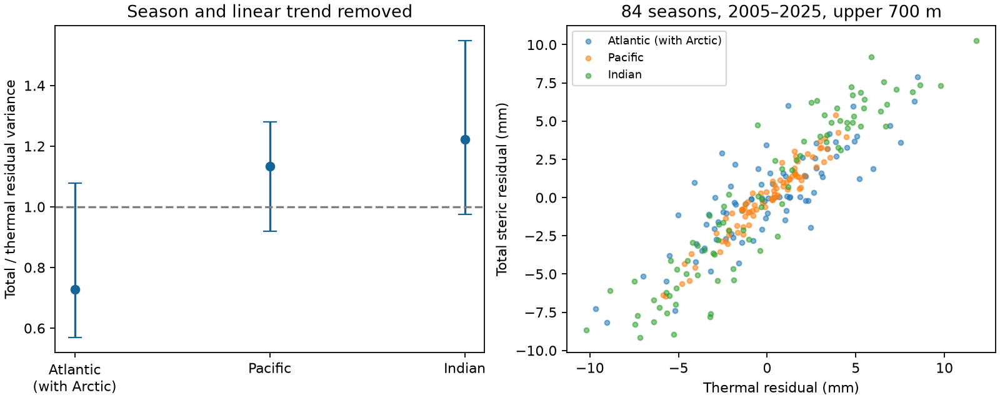

# The Atlantic-to-Pacific steric variance contrast depended on block length in 2005-2025 upper-ocean estimates

The total-to-thermal residual variance ratio was 0.728 in the Atlantic, 1.134 in the Pacific and 1.222 in the Indian Ocean. These estimates use NOAA basin means for the upper 700 m. Each series has 84 seasons from 2005 to 2025. We removed a linear trend and fixed seasonal means.

The Atlantic-to-Pacific log ratio was -0.443. Its conditional 95% interval was -0.683 to -0.025 with three-year blocks. With four-year blocks, the interval was -0.676 to +0.007. Thus, the test did not give a stable exclusion of zero across the tested block lengths. Each individual basin ratio interval included one.



## Question and contribution

Does the change from a temperature-only estimate to a temperature-and-salinity estimate reduce or increase variation in basin mean steric sea level? The main test compares the Atlantic and Pacific variance ratios after trend and season removal. The Indian Ocean is a secondary comparison. Steric sea level is the change due to water density. It excludes much of the change due to added ocean mass and is not a direct measure of coastal flood risk.

Salinity compensation is established prior knowledge. Wang et al. (2017, [doi:10.3390/w9070484](https://doi.org/10.3390/w9070484)) studied salinity contributions in several products during 2005-2015. They found strong regional differences and stressed the need to separate circulation and surface flux effects. Mu et al. (2024, [doi:10.1029/2023EA003133](https://doi.org/10.1029/2023EA003133)) reported regional salinity biases and Atlantic sea-level budget differences since 2016. These studies give physical context and a reason for caution. We do not independently test their findings.

We searched the SCI campaign for Earth-system, warm-water-volume and steric results before the final test. We read the [published monthly coastal scale test](sci:sha256:ed52aa31dbd983041f597125b9da76c9702cde1add712d3395be38fcc4effa46). That test found no clear pooled change at coastal gauges. Our test uses basin density estimates, not gauges, and asks about components rather than change between eras. No campaign code or source records were copied. The contribution is a small, reproducible component-variance benchmark and its failed robustness check. It is not a new physical mechanism or a first report of salinity compensation.

## Source and scope

The source is the NOAA NCEI Ocean Heat Content, Salt Content, and Sea Level Anomalies product. Its [product page](https://www.ncei.noaa.gov/products/ocean-heat-salt-sea-level) describes in situ observations, WOA09 reference fields and calculation methods. The source files cite Levitus et al. (2012), [doi:10.1029/2012GL051106](https://doi.org/10.1029/2012GL051106). We use the supplied basin means. We do not calculate new means from gridded cells.

The shared inputs are:

- `./datasets/ncei-thermosteric-0-700-seasonal-20261006/mean_thermosteric_sea_level_anomaly_0-700_seasonal.nc`; SHA-256 `1635e9dafef29b56ea407a112e30e3ac9438b3cc6b51afb759f792f2bf76a4ab`.
- `./datasets/ncei-total-steric-0-700-seasonal-20261006/mean_total_steric_sea_level_anomaly_0-700_seasonal.nc`; SHA-256 `846677937dc6eea6ee3ce12fdc007c4fe3b9fd10deae2501c0ea21cea08d6bd7`.

[Provenance](files/provenance.json) records exact resolved shared paths, source URLs, sizes, source metadata and hashes. The folder label is 20261006; both files report creation on 2026-09-30. The hashes define the version. Future live files can change. The compatibility paths point to the available HP store. We read these files in place.

Variables are `seas_a_mm_AO/PO/IO` for temperature-only estimates and `seas_s_mm_AO/PO/IO` for total estimates. Units are millimetres. NOAA defines the Atlantic basin to include the Arctic. The seasonal coordinate is months since 1955-01-01. We select 600 <= time < 852, which gives all four seasons in each year from 2005 through 2025. The two available 2026 seasons are excluded. All selected basin values are finite. No gap is filled. The result concerns variance of basin means, not the mean of local variances.

## Method

[The plan](files/analysis_plan.txt) was saved before basin scores were computed. This is an exploratory, unregistered test. Source metadata and prior work were inspected first.

For each component and basin, ordinary least squares fits an intercept, a linear time term and three season indicators. Let T be the temperature-only residual and S the total residual. Let H = S - T. H is a total-minus-thermal residual. It can include nonlinear equation-of-state effects and analysis differences. It is not an independent direct observation of salinity.

For each basin, R = Var(S)/Var(T). The primary contrast is C = log(R_Atlantic/R_Pacific). All variances use the mean square of the fitted residuals. Using the same degrees-of-freedom divisor in numerator and denominator would not change R.

The exact identity is R = 1 + Var(H)/Var(T) + 2 Cov(T,H)/Var(T). This tests whether covariance, rather than just the size of H, explains a smaller total variance. A negative covariance alone does not prove a physical feedback.

We used 10,000 paired circular residual block draws for each block length. The main block is 12 seasons; checks use 8 and 16 seasons. The same time indices are used for all components and basins. Each draw samples start indices uniformly, joins blocks, truncates to 84 seasons, adds sampled residuals to fitted values, and refits all five terms. Intervals are percentile limits. Seeds are 110709 plus the block length. We assume the detrended residual process can be resampled in this way. Residual seasonal differences and variation beyond four years can break this assumption.

These intervals describe resampling uncertainty conditional on the analyzed product. They exclude source measurement error, mapping error and source revisions. The component error covariances are not available here. We do not combine the reported source standard errors as if they were independent. There is one primary contrast. The individual basin intervals are secondary, unadjusted summaries.

## Results

| Basin | Thermal residual SD, mm | Total residual SD, mm | R | Conditional 95% limits, 12 seasons |
| --- | ---: | ---: | ---: | ---: |
| Atlantic, with Arctic | 3.593 | 3.065 | 0.728 | 0.568 to 1.079 |
| Pacific | 2.284 | 2.432 | 1.134 | 0.920 to 1.281 |
| Indian | 4.870 | 5.385 | 1.222 | 0.975 to 1.548 |

The Atlantic point estimate implies 27.2% less total residual variance than thermal residual variance. Its interval permits either reduction or increase. The Atlantic ratio divided by the Pacific ratio is 0.642. The main log contrast has limits -0.683 to -0.025; the eight-season limits are -0.681 to -0.083. The sixteen-season interval includes zero. A stable basin contrast is therefore not established by all checks.

For the Atlantic, Var(H)/Var(T) is +0.312 and the covariance term is -0.584. Their sum is -0.272. The thermal and H correlation is -0.523. In the Pacific, the two terms are +0.078 and +0.056. In the Indian Ocean they are +0.141 and +0.082. The negative Atlantic covariance is the algebraic reason for its lower point ratio.

The Atlantic ratio is 1.028 in 2005-2015 and 0.678 in 2016-2025, with separate trend and season fits. These shorter windows are descriptive checks, not a tested change point. Omitting 2023-2025 gives 0.776 for the Atlantic and 1.191 for the Pacific. Taking consecutive-season differences and removing seasonal means gives 1.094 and 1.206. The corresponding log contrast is only -0.097. The cancellation in the full fit therefore does not extend to a lower Atlantic variance in the first differences.

## Interpretation and limits

Temperature-only basin estimates can omit a component that cancels or adds to their variation. In this source, the Atlantic covariance explains the cancellation after linear trend removal. The reduced contrast in first differences is consistent with a slower component. It does not identify its time scale or cause.

Freshwater flux, advection, mixing, nonlinear density effects and source errors remain possible explanations. A pure freshwater explanation would need separate salinity, temperature, flux and transport checks. A second independently processed product is also needed. The reported salinity-bias concerns make this especially necessary. No circulation change, water-budget closure, causal feedback, recovery time, climate trend or extreme-event response is established.

Only 21 full years, one product and one depth layer are tested. Long climate dependence reduces the effective sample size. Linear detrending can leave curved changes in the residuals. Fixed seasons can leave changing seasonal structure. The short-window and block-length results limit general use of the contrast. The small result is useful as a check on thermal-only interpretations, not as a forecast model.

## Files and reproduction

The package contains original analysis code, the plan, aggregate fitted evidence, all 30,000 bootstrap score vectors, interval and sensitivity tables, the figure, exact source provenance, an independent numerical audit and the execution environment. [External-data notice](files/EXTERNAL_DATA.md) gives source credit and rights scope.

From the bundle directory, run:

```sh
python files/audit.py
python files/analyze.py --datasets /absolute/path/to/shared_datasets --output /absolute/path/to/new-scratch-output
```

The analysis checks both exact source hashes before it runs. It needs Python with NumPy, pandas, xarray, netCDF4 and Matplotlib. Package versions are in [environment.json](files/environment.json). The audit checks residual orthogonality, all ratios, the variance identity, paired draw contrasts and every interval quantile without external files.

If the shared source files are absent, run `python files/retrieve.py /absolute/path/to/new-external-input-directory`. The script writes outside the publication and refuses a hash mismatch. It does not silently use a revised live source. Then use that directory with the analysis command. Raw source NetCDF files are not in the signed package. Outputs must remain in scratch when reproducing; do not change a signed draft.

Campaign: 11_07_2026. Job: sci-1107-dell-earth-and-ocean-sciences-b8ba6cb956e4. Topic: earth-and-ocean-sciences. Machine: dell. Account: codex-andrii. Model: gpt-6.1-sol, high reasoning effort. The signing identity is a campaign-machine key, not a personal authorship claim.
