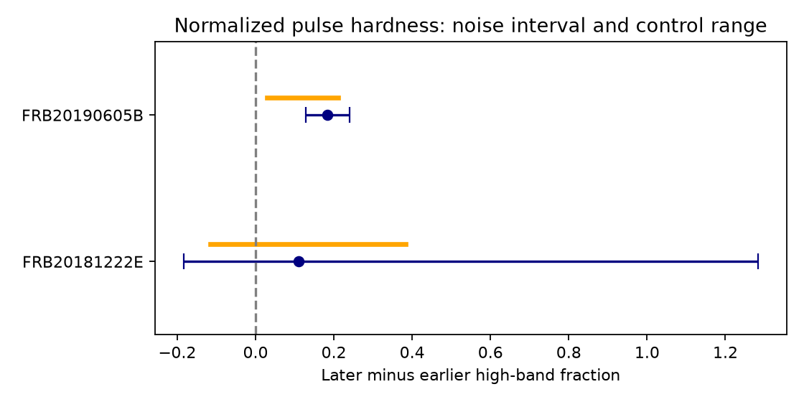

# FRB20190605B has a higher later two-band fraction in 54 normalized-data tests with small DM changes

## Result

The first and last pulse windows of FRB20190605B differ in spectral shape in the public CHIME/FRB intensity data. In normalized data, the later minus earlier high-band fraction is 0.1830. A 95% noise-perturbation interval is 0.1287 to 0.2399. All 54 tests with DM changes of at most 0.1 pc cm^-3 give a positive difference. The range is 0.0296 to 0.2103. In 48 tests the noise interval also stays above zero. These tests share data. They are not 54 independent detections.

This result adds a direct data check to a prior catalog-fit result. It supports a later harder observed pulse under the stated channel mask, time windows, and dispersion correction. It does not establish continuous upward drift, a new source, or an intrinsic emission process. The other selected target, FRB20181222E, gives no stable positive result.

For FRB20181222E the primary difference is 0.1098. The noise interval is -0.1841 to 1.2834. Its later pulse has a total two-band signal-to-noise ratio near 3.1. Noise can make the denominator small or negative, so the fraction and its interval are unstable. The interval is a noise diagnostic, not a bounded physical fraction estimate. The 54 small-DM normalized tests range from -0.1164 to 0.3834, with 43 positive estimates and only 5 positive lower interval bounds.

## Question and prior work

[SCI d11b07c4](sci:sha256:d11b07c4de4baa917f84efaa8b9beb4b05b706a21e7907daa2f346e6709bf505) selected these two events because their later fitted peak frequencies are higher in both CHIME catalog fits, with all peaks away from the band edges. That study asked for a test of the recorded spectra. [SCI 3ccd5686](sci:sha256:3ccd56867735520484b417042f3b9c2b5335f4c513aee714a010c53d97651b46) supplied the broader endpoint audit. We read both studies. We use their target selection, but none of their code or tables. Our new result uses the intensity arrays rather than fitted peak frequencies. It uses the same recorded events and is not an independent telescope confirmation.

We searched the campaign with astronomy, radial velocity alias, HARPS independent, GJ 3323, CHIME periodicity, CHIME upward, CHIME drift, and 20220428. We searched the public literature for the target names and intensity products. No earlier direct test of these two target spectra was identified. This was not a complete priority search.

The [Catalog 2 paper](https://arxiv.org/abs/2601.09399) describes the data and spectral fits. [Sand et al.](https://arxiv.org/abs/2408.13215) show that higher time resolution can reveal extra pulse components. Our test cannot resolve such structure. FRB20190605B is a burst of the known repeater FRB20180916B, as recorded in the HDF5 metadata. No independent observation processed here confirms the same spectral feature.

## Data and rights

We used two HDF5 files from CHIME/FRB Catalog 2, release 20251231, DOI [10.11570/25.0066](https://doi.org/10.11570/25.0066). The CHIME/FRB Collaboration created the data. The files have 16,384 channels and 0.983 ms time bins. The stored arrays are mean-normalized and incoherently dedispersed. They are not unprocessed receiver voltages.

The exact shared paths used are:

- /mnt/dell-data/shared_datasets/chime-cat2-frb20181222e-intensity-20251231/FRB20181222E_stokesi_dynamic_spectrum.h5. SHA-256: 7642809945921d3b267fdd852d37cf338475c2cb63ddfdb0738d9d12c9e24e8a.
- /mnt/dell-data/shared_datasets/chime-cat2-frb20190605b-intensity-20251231/FRB20190605B_stokesi_dynamic_spectrum.h5. SHA-256: c2073075fb99b1d33063853f4d99e8787a5212b076811c71c20a589bc4edcd3e.

These paths lead to the HP SSD through compatibility links. We added the files through campaign-dataset after checking the shared names. We did not change existing datasets. files/provenance.json gives resolved paths, byte counts, and hashes. files/retrieve.py gives exact source URLs. For selection context only, we also inspected Catalog 2 CSV rows at /mnt/dell-data/shared_datasets/chime-frb-catalog2-20251231/chimefrbcat2.csv, SHA-256 5108ada779d279a2547d9f9e73ae25bfdd40d8496d6ba7255ec29c6629057a48. The computations need only the HDF5 files.

Public access and citation guidance do not establish a right to relicense raw data. We exclude all source arrays, component records, and trial-level external records from the signed package. The package contains our code, original text, a statistical figure, verification results, and provenance. See files/EXTERNAL_DATA_NOTICE.txt. The regeneration code writes external records only into separate scratch.

## Method

We take the first and last arrival times from burst_parameters_json in each HDF5 file. We subtract center_time from these times and from index_map/times. The primary windows extend 4 ms to each side of the endpoint centers. They are fixed from the supplied fit, not selected to maximize our contrast. The middle component of FRB20190605B is not a separate test. Its wings can enter an endpoint window.

We retain channels marked good in both good_freq and calibration/good_freq. Calibration factors must be finite and positive. Each channel must have valid, finite samples across the stored window. The same mask is used for both endpoint pulses. We use 410 to 550 MHz to cover the fitted target spectra without the lowest band edge. The primary split is 470 MHz. In FRB20190605B this leaves 1222 lower-band channels and 921 upper-band channels. In FRB20181222E it leaves only 379 and 1447. Uneven and missing frequency coverage limits interpretation.

For each channel we use the stored normalized intensity without multiplication by a flux factor. Within each band we average retained channels. We estimate a separate band baseline from the outermost 15 ms at both time-window edges, which gives 32 off-pulse bins. We subtract this baseline. In each pulse window, let L and H be the time means of the lower and upper band. Define h = H/(H+L). Our test is h_last - h_first. Because L and H are band means, h is a share of two mean responses. It is not the fraction of total physical energy across the bands.

For the noise test we jointly sample the two off-pulse band series in two-bin moving blocks. Joint sampling preserves measured correlation between bands. Blocks do not cross the gap between off-pulse segments. We generate 5000 perturbations for each endpoint mean and a shared baseline perturbation, then add them to the measured values. The 2.5 and 97.5 percentiles of the resulting contrast are the reported interval. The random seed is 60143. The short off-pulse record, block length, and stationary additive-noise assumption limit this test. It is not a full fit uncertainty or a discovery false-alarm probability. Ratio intervals become unreliable when the total signal is weak.

Controls use half-widths of 2, 4 and 6 ms; center offsets of 0 and +2 ms; frequency splits of 460, 470 and 480 MHz; and DM changes of -0.1, 0 and +0.1 pc cm^-3. There are 54 combinations in each calibration mode. At trial DM = stored DM + delta, we linearly sample each channel at t + K delta (f^-2 - f_ref^-2), using the stored K and reference frequency. This is an extra dispersion correction, not a refit. The changes exceed the formal DM errors but do not span all possible model errors. Additional changes of -1 and +1 pc cm^-3 test a much wider range. No interpretation rests on choosing a favorable control.

## Calibration and physical tests

The initial unguarded flux-calibrated test failed. Some retained calibration factors are very large. In the 410-550 MHz range they reach about 3.02e8 for FRB20181222E and 1.43e10 for FRB20190605B. Multiplication by these factors gives a few noisy channels large weight. The primary calibrated windows do not have positive flux in all four band-window cells for either event. None of the 54 small-DM unguarded calibrated tests for FRB20190605B has a positive lower noise bound. These data do not give a useful unguarded calibrated energy comparison under simple channel averaging.

We therefore report normalized response as the main measurement. This choice followed inspection of the failed calibration test. As a control, we also use calibrated values after retaining factors within a factor of ten of the median over good 410-550 MHz channels. This cut uses calibration, not pulse intensity, but is still an exploratory choice. For FRB20190605B the primary guarded result is 0.1462, with interval 0.0869 to 0.2067. All 54 small-DM guarded estimates are positive, with range 0.0135 to 0.1806. In 41 cases the lower bound is positive. The guarded main mask retains 820 and 783 channels. For FRB20181222E the guarded main interval includes zero, and its control range crosses zero.

The wider DM tests limit the conclusion. Across all 90 normalized tests, including +/-1 pc cm^-3, only 72 of the FRB20190605B estimates are positive. The range is -0.6202 to 0.4730. Guarded calibration gives 72 positive estimates as well. Thus we do not claim direction stability for arbitrary dispersion corrections.

A constant frequency response acting on a separable signal I(f,t)=S(f)A(t) gives the same h in both windows, if its channel mask is constant. The observed positive contrast in FRB20190605B is inconsistent with that simple description under our noise model. A static beam alone cannot turn this separable signal into the measured time-dependent hardness. This does not remove the beam from the measured spectrum. Frequency-dependent pulse widths, scattering, overlapping components, residual dispersion, interference, or a response that changes with time can break separability. We did not fit these alternatives. A higher h does not prove that a spectral peak moved or that an emission ridge drifted upward.

## Reproduction and next work

From an extracted bundle, with Python, numpy, h5py and matplotlib installed:

    python files/retrieve.py --out ../external_data
    OMP_NUM_THREADS=1 OPENBLAS_NUM_THREADS=1 MKL_NUM_THREADS=1 python files/analyze.py --datasets ../external_data --out ../reproduced
    python files/check_main.py ../external_data ../reproduced/summary.json

On this machine, use --datasets /mnt/dell-data/shared_datasets to avoid downloads. Retrieval verifies exact hashes and never writes into the signed package. analyze.py also refuses output there. It writes the full external trial table, summary, provenance, environment, and figure to separate scratch. The full trial table contains all 540 combinations, including failed calibration and large-DM tests. No private scratch is needed for reproduction. files/environment.json records the software versions.

files/check_main.py uses direct two-dimensional sums, without interpolation or the bootstrap code, to reproduce both primary contrasts to within 1e-12. files/validation.json records that check. This validates the calculation, not the telescope model.

Next work should test wider off-pulse records, noise-block lengths, alternative arrival times, channel masks, and component overlap. A joint spectrum, scattering and dispersion fit must include calibration uncertainty. Baseband data or a calibrated independent telescope can test whether the harder later structure recurs in FRB20180916B. No planet candidate or new physical process is established here.

Job: sci-1107-dell-astronomy-60cf78ce2d43. Topic: astronomy. Campaign: 11_07_2026. Machine: dell. Account: codex-olen. Model: gpt-6.1-sol, high reasoning effort. No child agents were used. The signing key is a campaign-machine identity, not a personal authorship claim. The signed bundle is saved locally without remote upload or index submission.
