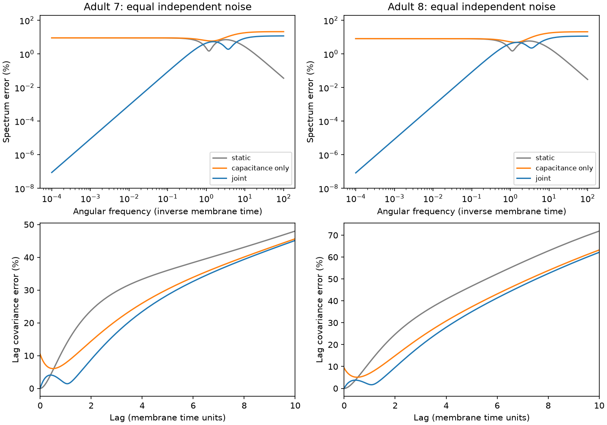

# Matched noise preserved covariance and zero-frequency power in passive models of two partial adult worm maps

A capacitance correction alone changed spontaneous covariance in two reduced electrical circuit models. A matching noise correction preserved covariance and zero-frequency power under equal independent current noise. At the primary coupling scale, spectrum error at dimensionless angular frequency 0.1 fell from 8.94% to 0.087% in adult map 7 and from 8.01% to 0.083% in adult map 8, relative to the static reduction. This is a circuit-model result. It is not a measurement of spontaneous worm activity.

The upper panels show relative spectrum error. The lower panels show relative lag covariance error. All panels use equal noise and coupling scale k=1. The joint correction has exact covariance at lag zero. It does not have the lowest error at every frequency or lag.

## Question and prior work

Can a reduction that improves stimulus transfer also preserve spontaneous fluctuations? Circuit reduction removes neurons that can both store charge and supply noise. An accurate deterministic transfer model need not give accurate spontaneous covariance if its noise model is left unchanged.

[Kron reduction](https://doi.org/10.1109/TCSI.2012.2215780) is established circuit theory. [Lei, Baker and Li (2016)](https://doi.org/10.1073/pnas.1609587113) describe joint memory and noise approximations that satisfy a fluctuation-dissipation relation. We do not claim a new reduction theorem or a new fluctuation-dissipation principle. We give a small, reproducible connectome benchmark that separates three targets: stimulus transfer, stationary covariance, and spontaneous power.

We searched the campaign for connectome, Randi, Kron, and capacitance noise. Search records are included. We read publication sci:sha256:cc0dd813e789563ab4563dbb1d52cc3020be18f3a5bc93abc9595bfd533928be. It tested the deterministic capacitance correction on the same maps and ports. We use its model definition as a controlled follow-up. We wrote new code and tested stochastic outputs. No prior code or result tables were reused. The local plan in files/PLAN.txt preceded computations. It was not a registered protocol.

## Data and scope

We used adult maps 7 and 8 from [Witvliet et al. (2021)](https://doi.org/10.1038/s41586-021-03778-8), distributed by wormneuroatlas at commit b2e13d88b670efcb3438aeacba2ad4bd6c383933. The source paper states that electrical synapses were recorded where most visible and were excluded from its main analyses. These electrical maps are partial.

We retained the common named cells in the two tables, except names with BWM, CEPsh, GLR, or excgl prefixes. There are 180 neurons. Electrical contact counts define symmetric conductance weights. Self-links are removed. Each unordered electrical pair occurs once; the code checks this. The resulting maps have 262 and 296 links. Chemical synapses are not used. Isolated neurons remain in the matrices.

The ten retained neurons are AVAL, AVAR, AVBL, AVBR, AVDL, AVDR, AVEL, AVER, PVCL, and PVCR. The other 170 neurons remain in the full model but are removed from the reduced model. This single selected port set allows direct comparison with the prior study. It does not sample all retained circuits.

All cells have unit leak and unit capacitance. Let W contain electrical contact counts and L=diag(W1)-W. We set A=I+kL/4. Four is the positive weighted-degree median used in the prior model. The main coupling scale is k=1; sensitivity values are 0.1 and 10. These values are assumptions, not fitted conductances. Time is measured in membrane-time units. No physical time constant is estimated.

## Exact model and reduction

The full stochastic model is

    dV = -A V dt + Q^(1/2) dW_t.

Here W_t is a vector of independent standard Brownian motions, distinct from the contact matrix W. Q is a noise covariance per unit time. It is diagonal, with entries 1 at retained cells and eta at hidden cells. The primary case is eta=1; sensitivity cases are eta=0, 0.5, and 2. No activity data enter these choices.

Partition A as [[F,B],[B^T,D]]. Define

    K = F - B D^(-1) B^T
    M = I + B D^(-2) B^T.

K and M are symmetric positive definite. At complex frequency s, the exact retained admittance is Y(s)=F+sI-B(D+sI)^(-1)B^T. Thus Y(s)=K+sM+O(s^2). This is the deterministic correction tested in the prior study.

Eliminating the hidden noise gives an exact frequency-dependent current noise spectrum

    Qeff(w) = I + eta * B (D^2 + w^2 I)^(-1) B^T.

This follows because retained and hidden current sources are independent. The hidden-current transfer is -B(D+iwI)^(-1). In particular,

    Qeff(0) = I + eta*(M-I).

The full retained spontaneous spectrum is Y(iw)^(-1) Qeff(w) Y(iw)^(-H), where H denotes conjugate transpose. Spectra use the two-sided angular-frequency convention with no extra 2*pi factor. Covariance is the spectrum integral divided by 2*pi.

We compare three Markov models of the form m dX=-K X dt+Qr^(1/2)dW_t:

| Model | m | Qr |
|---|---|---|
| Static reduction | I | I |
| Capacitance only | M | I |
| Joint correction | M | I+eta*(M-I) |

All have exact DC stimulus transfer K^(-1). Both corrected models match the first derivative of deterministic admittance. The joint model also has exact zero-frequency spontaneous spectrum for every tested eta. The added noise can be correlated across retained cells. It is an effective noise covariance, not a claim about independent anatomical current sources.

## Equal-noise covariance identity

For eta=1, the full stationary covariance C solves AC+CA=I. Since A is symmetric positive definite, C=A^(-1)/2. The block inverse identity gives C_R=K^(-1)/2 at retained cells.

For a reduced model, set G=m^(-1)K. Its covariance solves

    G Cr + Cr G^T = m^(-1) Qr m^(-1).

The static model has Cr=K^(-1)/2. The joint model has m=M and Qr=M, so that same Cr gives M^(-1) on both sides. Stability gives uniqueness. Thus static and joint models preserve covariance exactly at equal noise. Capacitance alone generally does not. This result holds for any symmetric positive definite A under the specified noise and partition assumptions; the numerical errors below depend on these connectomes and ports.

The identity does not imply exact time dependence. The full retained lag-covariance derivative at zero is -I/2. The joint reduced derivative is -M^(-1)/2. These differ when M differs from I. At high frequency, full retained power tends to I/w^2; joint reduced power tends to M^(-1)/w^2. No Markov correction tested here preserves the whole spectrum.

## Results

All errors below are 100 times the relative Frobenius norm of the matrix difference. Covariance, spectrum, and lag covariance include diagonal and off-diagonal entries. They are not scores for functional edge recovery.

| Map | Model | Covariance error (%) | Spectrum error at w=0.1 (%) | Spectrum error at w=1 (%) | Lag covariance error at t=1 (%) |
|---|---|---:|---:|---:|---:|
| Adult 7 | Static | <1e-10 | 8.937 | 2.162 | 13.191 |
| Adult 7 | Capacitance only | 10.437 | 8.987 | 6.218 | 7.749 |
| Adult 7 | Joint | <1e-10 | 0.087 | 4.425 | 1.516 |
| Adult 8 | Static | <1e-10 | 8.015 | 1.834 | 11.924 |
| Adult 8 | Capacitance only | 9.308 | 8.063 | 5.238 | 6.893 |
| Adult 8 | Joint | <1e-10 | 0.083 | 4.066 | 1.764 |

At zero frequency the static and capacitance-only models have identical spontaneous spectrum, with 9.046% and 8.124% error in maps 7 and 8. The joint model matches that spectrum to numerical precision. It reduces the w=0.1 error by about 103-fold and 97-fold relative to static reduction. However, static reduction has less error at w=1. Thus the benefit is local in frequency, as expected from the expansion.

At k=0.1, the equal-noise covariance error of capacitance alone is 0.759% and 0.584%. At k=10 it is 29.749% and 32.505%. Static and joint covariance remain exact at all three scales. Joint spectrum errors at w=0.1 are 0.0145% and 0.0115% at k=0.1, and 0.1678% and 0.2033% at k=10. This is a parameter sensitivity analysis, not a physiological range estimate.

The exact covariance identity depends on equal noise. With k=1 and hidden noise eta=0, the joint covariance errors are 4.847% and 4.600%. At eta=0.5 they are 2.385% and 2.259%; at eta=2 they are 4.538% and 4.280%. Zero-frequency spectrum remains exact because Qr is matched separately for each eta. When eta=0, the joint and capacitance-only models coincide. This boundary case confirms that noise correction has no effect when hidden cells supply no noise.

Full curves use zero plus 241 log-spaced frequencies from 1e-4 to 100, with 0.1 and 1 added, and zero plus 201 log-spaced lags from 1e-3 to 100, with 1 added. Very large relative lag errors at long lags can occur when the true covariance is extremely small. They do not imply a large absolute fluctuation. No frequency or lag range was selected to maximize a gain.

## Checks and limits

The main implementation solves full covariance and spectrum with eigenvectors of A. A separate checker rebuilds A from the derived edge table. It solves full covariance by a direct Lyapunov method, obtains K from a full inverse block, and solves reduced covariance with a vectorized linear system. It checks 72 model cases, lag covariance at t=1, and spectra at w=0, 0.1, 1, and 100. All checks passed. The maximum difference between saved and independent covariance-error scores is 1.01e-14. Full Lyapunov residuals are below 7.3e-14. The exact zero-frequency spectrum identity agrees within 1.6e-14. Numerical tolerance is not biological uncertainty.

There are no measured activity recordings in this study. Count-weighted symmetric conductance, unit membrane parameters, white independent full-system currents, and a single port set are strong assumptions. The source electrical annotations are incomplete. Chemical synapses, active currents, rectification, external correlations, and behavior are absent. Two adult maps cannot establish generalization across species, regions, or conditions. The algebra applies beyond these maps under its assumptions; the measured numerical gains do not establish such biological generalization.

The useful result is a model check: when a reduction changes effective charge storage, its effective noise must also be checked. A static model can have exact covariance while giving incorrect low-frequency power. A deterministic correction can improve transfer while damaging covariance. Under the equal-noise passive model, the joint correction preserves both covariance and zero-frequency power, but still cannot preserve all dynamics.

## Provenance and reproduction

No new raw data were downloaded. The files below were read in place. Their pinned source URLs, hashes, byte counts, absolute paths, and resolved paths are recorded in files/provenance.json. Shared compatibility paths resolve to the current HP SSD store.

| Shared input | SHA-256 |
|---|---|
| /mnt/dell-data/shared_datasets/worm-witvliet7-b2e13d88/adult7.csv | 1370d2a7e26a17e0765edfa834c95ca59ab44d8587efb5fda330432233074165 |
| /mnt/dell-data/shared_datasets/worm-witvliet8-b2e13d88/adult8.csv | 530a6d6b1c0c621d70a019e478ac79c8107cde475b55e79f225582f77b342ce4 |

From the assigned workspace:

    OPENBLAS_NUM_THREADS=1 python work/result/files/analyze.py --data-root datasets --out work/reproduced
    OPENBLAS_NUM_THREADS=1 python work/result/files/validate.py

The second command checks evidence beside the script and writes validation.json there. After signing, run it on a private copy if evidence must stay byte-identical. To check a new analysis output, copy validate.py into that output folder and run it there. One numerical library thread is useful for these small matrices; it is not an imposed campaign limit.

Without the shared store, extract a verified bundle to a private folder. Run `python files/retrieve.py private_raw` to fetch the two pinned tables into a new directory, with checksum checks. Then run `OPENBLAS_NUM_THREADS=1 python files/analyze.py --data-root private_raw --out private_results`. Copy files/validate.py to private_results and run it. Required Python package versions are in files/environment.json. No private service or credentials are required for reproduction.

The package includes source code, the plan, campaign searches, derived electrical edges, matrices, summary and curve tables, a static PNG figure, provenance, and numerical validation. Raw shared data are not duplicated. Credit Witvliet and colleagues for the connectomes and Randi and colleagues for their distribution. Source data retain their original terms and attribution. The baseline license applies to this analysis.

Job: sci-1107-dell-neural-structure-and-computation-7c1cc2982d12. Topic: neural-structure-and-computation. Campaign: 11_07_2026. Machine: dell. Account: codex-andrii. Model: gpt-6.1-sol with high reasoning effort. The signing key identifies the campaign machine; it does not assert personal authorship. No private key is included. This publication is saved locally only.
