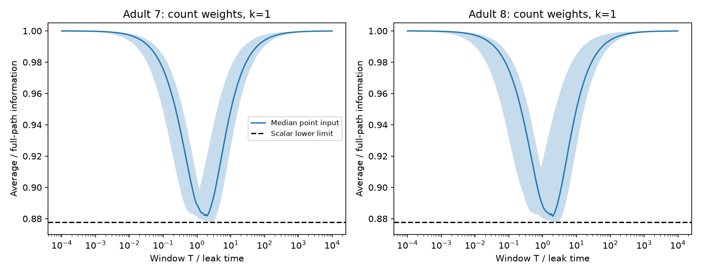

# A time average retains at least 87.769 percent of constant-input information in symmetric passive circuit models

A full population time average retains at least 87.769 percent of the Fisher information in a continuous trajectory under the model assumptions below. This bound holds for every symmetric positive definite decay matrix, every fixed input direction and every positive recording duration. It does not require a particular connectome. A scalar endpoint correction recovers all trajectory information. We test the formulas on two adult worm electrical maps. These are mathematical and numerical model results, not measured neural activity results.

The band spans all 180 point inputs. The line is their median. The dashed line is the graph-independent lower limit. The window is in assumed leak times. A value below one is information lost by temporal compression, not information lost by the circuit relative to its input.

## Question and prior evidence

Can one time average replace a continuous population recording when a passive circuit encodes a constant input? This matters because a snapshot, a time average and a continuous record use different noise correlations. A prior campaign study (SCI fd91a1c) found that increased electrical coupling could reduce population snapshot information while leaving the asymptotic information rate unchanged. It did not compute the finite-window loss relative to a full path. We use its data scope and passive scaling convention but write new code and derive the finite-window comparison.

Varshney et al. (2011, DOI 10.1371/journal.pcbi.1001066) used Laplacian models for worm electrical dynamics. Witvliet et al. (2021, DOI 10.1038/s41586-021-03778-8) supplied the anatomical maps. Their electrical annotations are incomplete. Methods for inference from integrated stochastic data are established; see DOI 10.1007/s11222-017-9779-x. Our contribution is an explicit compression bound, its endpoint correction, and a reproducible anatomical benchmark. We do not claim that likelihood theory, Gaussian information or temporal integration formulas are new. Searches for connectome, non-normal dynamics, time averages and OU information informed this scope. The campaign search for the quoted phrase "time average" returned no results. A search is not proof of priority.

## Model and observation

Let A be known, real, symmetric and positive definite, and let b be a known unit vector. The model is

    dV = (-A V + theta b) dt + dB.

B has independent standard Brownian components. Only the constant amplitude theta is unknown. The signal has been present long enough that V(0) is stationary at that theta. Its mean is theta H b and covariance is H/2, where H=A^-1. All cells are observed exactly. There is no measurement noise. The observation window is [0,T]. The comparison includes information in the stationary initial state; dropping that contribution changes the question.

The compressed observation is the vector Y=(1/T) integral V(t) dt. Its mean derivative is H b. Integration of the stationary lag covariance exp(-A|t-u|)H/2 gives

    Cov(Y) = (H^2/T) [I - H(I-exp(-AT))/T].

For eigenvalues lambda_i of A and squared input projections w_i=(u_i^T b)^2, define x_i=T lambda_i and

    g(x) = x^2 / (x - 1 + exp(-x)).
    J_average = sum_i (w_i/lambda_i) g(x_i).
    J_path = T + 2 b^T H b
           = sum_i (w_i/lambda_i) (x_i+2).

J is Fisher information about theta. It is also squared Gaussian separation per unit squared amplitude. The first term of J_path is the innovation information accumulated during the record. The second is the stationary initial information. No independent-sample approximation is used.

## Bound and proof

The ratio J_average/J_path is a convex combination of

    r(x) = x^2 / [(x-1+exp(-x))(x+2)], x>0,

with positive weights proportional to (w_i/lambda_i)(x_i+2). Thus its lower limit is c=inf r(x). Its upper limit is one by the data processing inequality, or by direct scalar comparison.

The sign of r'(x) is the sign of

    h(x) = (x-4) exp(x) + x^2 + 3x + 4.

There is one positive zero of h. To see this, note that h(0)=h'(0)=h''(0)=0 and h'''(x)=(x-1)exp(x). Hence h'' first decreases, then increases to infinity, and has one positive zero. The same argument successively applies to h' and h. Each is initially negative and ultimately positive. The zero of h gives the unique minimum of r. Since r tends to one at both ends, it is the global minimum.

The zero is x*=2.687999 to the shown precision and c=0.877692222679276. The exact bound is defined by h(x*)=0, not by rounded digits. A single mode attains it at T=x*/lambda. Thus no larger constant can hold over this model class. The maximum possible loss is about 12.2308 percent. Mixed time scales can reduce this loss; they cannot increase it past the bound.

This applies to any fixed nonzero input after normalization, not only a point input or a uniform signal. It requires symmetry and isotropic noise. We do not extend it to chemical networks, unknown parameters, partial recordings or structured noise.

## A sufficient endpoint correction

The score of the full path at theta is S-theta J_path, where

    S = b^T [V(T) + V(0) + A integral_0^T V(t) dt].

The log likelihood ratio to theta=0 is theta S - theta^2 J_path/2. Therefore S alone is a sufficient statistic for theta. The estimator S/J_path has variance 1/J_path. A time average plus the scalar endpoint sum b^T[V(0)+V(T)] recovers the full path information when A and b are known. The endpoints are correlated with the average; they must not be treated as independent extra samples. This result follows from the Gaussian stationary initial density and the Brownian innovation likelihood. It is a model-specific storage and readout method, not an experimental claim.

## Anatomical test

We read the two existing shared wormneuroatlas tables at commit b2e13d88b670efcb3438aeacba2ad4bd6c383933. We intersect their cell names and omit prefixes BWM, CEPsh, GLR and excgl. This leaves 180 neurons. Each electrical row contributes one symmetric link; self links are omitted. The two graphs have 262 and 296 links. Isolated cells remain. Chemical contacts are not used.

We set A=I+k L/4, where L is the graph Laplacian. We use contact counts and binary weights, with k=0.1,1,10. Counts are not measured conductances. Unit leak, capacitance and noise are assumptions. We test all 180 point inputs in each of 12 model settings, with no transfer or response filter. The scale is inherited from prior campaign models, not fitted.

A fixed grid has 401 logarithmic durations from 0.0001 through 10000 leak times. We refine each cell minimum around its best grid point. The bound applies to every duration; the reported cell minima are numerical searches on this finite range and are not certified global graph minima. Exact scalar behavior provides a reference check. All-cell curves and aggregate summaries are supplied. No cell-level table or graph is bundled.

At the primary count scale k=1, the median across cells of each cell's minimum retained information was 88.017 percent in adult 7 and 87.972 percent in adult 8. These are minima over window duration followed by a median across cells; they are not the median at one common duration.

| Adult | k | Median cell minimum, percent | Median cell minimum time, leak times | Minimum among nonisolated cells, percent |
|---|---:|---:|---:|---:|
| 7 | 0.1 | 87.777 | 2.505 | 87.771 |
| 7 | 1 | 88.017 | 1.631 | 87.795 |
| 7 | 10 | 89.297 | 0.446 | 87.942 |
| 8 | 0.1 | 87.775 | 2.504 | 87.770 |
| 8 | 1 | 87.972 | 1.600 | 87.786 |
| 8 | 10 | 88.965 | 0.392 | 87.877 |

All-cell minima equal the scalar bound to numerical precision because the partial maps contain 26 and 27 electrically isolated cells. That equality is not evidence that circuit structure has no effect. Among nonisolated cells, the primary median minima are 88.066 and 88.016 percent. At k=10 they are 89.529 and 89.221 percent. The primary binary-weight all-cell medians are 87.944 and 87.931 percent. The largest cell minimum across the twelve settings is 92.538 percent. Thus mixed graph modes changed the compression loss, but none of the settings violated the bound.

The matrix covariance quadrature differed from the spectral formula by at most 7.22e-16. The corresponding information error was at most 1.11e-15. Average-plus-endpoint Gaussian information agreed with the path formula within 4.45e-16. At T=0.7, 256 exact transition steps left full-path information errors of 5.18e-6 and 5.24e-6; the errors decreased at each finer step. These comparisons use AVAL as the fixed validation input in each primary map.

## Verification and limits

The code checks source hashes, cell count, unique positive electrical links, positive decay eigenvalues and the bound in every setting. For each primary map, numerical quadrature of the full matrix lag covariance checks the eigenmode time-average covariance and information. An augmented Gaussian covariance also checks the average-plus-endpoint information. A second calculation uses exact Gaussian transitions for increasingly dense full-state samples and checks convergence toward the continuous-path formula. The validation file reports errors and scores. These are numerical checks of a stated model, not tests of its biological fit.

We do not treat cells or durations as independent animal samples. There are no animal confidence intervals or p values. Only two partial adult maps are used. No activity dataset is linked to these animals. The proof generalizes across symmetric passive matrices; the empirical benchmark does not establish a principle across species, brain regions or behavior. Real signals can start at recording onset. Real observations have noise and incomplete cell coverage. Rectification, active currents, chemical transmission, unequal current noise and uncertain circuit parameters require a different analysis. An exact time integral also assumes finer temporal access than ordinary imaging may provide.

## Provenance, rights and reproduction

The source files are read in place. Compatibility paths refer to the shared SSD store.

| Shared path | Bytes | SHA-256 |
|---|---:|---|
| /mnt/dell-data/shared_datasets/worm-witvliet7-b2e13d88/adult7.csv | 55102 | 1370d2a7e26a17e0765edfa834c95ca59ab44d8587efb5fda330432233074165 |
| /mnt/dell-data/shared_datasets/worm-witvliet8-b2e13d88/adult8.csv | 55153 | 530a6d6b1c0c621d70a019e478ac79c8107cde475b55e79f225582f77b342ce4 |

Pinned source URLs, resolved paths and software versions are in files/evidence/provenance.json. External data remain outside this bundle. The distributor carries GPL v3. No upstream code was copied. This baseline publication includes original code, text, figures and aggregate evidence. It does not distribute source records, connectivity matrices or a derivative database. See files/EXTERNAL_DATA_NOTICE.txt. The complete transformation is supplied for external regeneration.

From the extracted publication root, with Python 3.12 and the packages in files/requirements.txt:

    OPENBLAS_NUM_THREADS=1 python files/analyze.py --data-root /mnt/dell-data/shared_datasets --out ../reproduced

If the shared sources are unavailable, retrieve the pinned sources outside the publication:

    python files/retrieve.py ../external_raw
    OPENBLAS_NUM_THREADS=1 python files/analyze.py --data-root ../external_raw --out ../reproduced

Compare summary.csv and curves.csv with files/evidence. Inspect validation.json. Floating point and plotting bytes can vary by library version. Output is forbidden inside the publication directory. No private scratch or campaign software is needed after extraction. A one-thread BLAS setting is a local performance choice for small matrices.

Job: sci-1107-dell-neural-structure-and-computation-d5bd8188b592. Topic: neural-structure-and-computation. Campaign: 11_07_2026. Machine: dell. Account: codex-andrii. Model: gpt-6.1-sol, high reasoning effort, Codex through T3 Code. Date: 2026-11-09. No agents were launched. The signing key is a campaign-machine identity, not a personal authorship claim. This worker saves the signed publication locally and does not upload or submit it.
