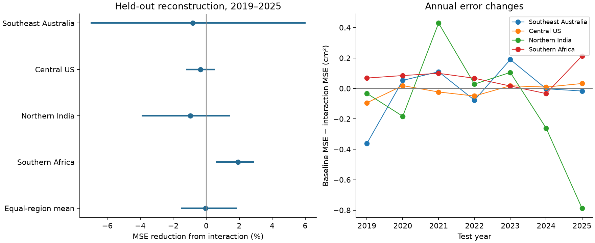
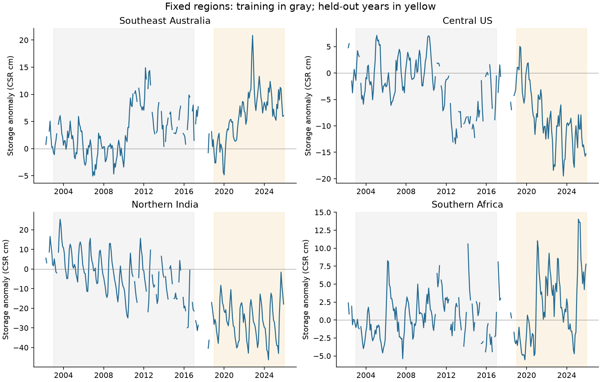

# A storage and rainfall interaction gave no clear mean error reduction for four regional water storage reconstructions in 2019-2025

We tested whether the relation between precipitation and monthly water storage change depends on the amount of water already stored. We used four fixed land regions, CSR GRACE and GRACE-FO storage, and GPCP precipitation. We fitted models on 2003-2016 and tested them on 2019-2025. The added term was the product of prior storage anomaly and recent precipitation anomaly.

The equal-region mean reduction in mean squared error (MSE) was **-0.049%**. Its conditional 95% two-year block interval was **-1.539% to +1.876%**. Thus, this test did not establish a mean improvement. The result does not show that water storage has no effect on the response to precipitation. Both models already use prior storage. We tested one added interaction and one fixed model form.



Positive values mean that the interaction model had less error. The four regional intervals have a Bonferroni adjustment for four comparisons. The mean interval is 95%. All intervals keep fitted models fixed. They do not include training uncertainty or satellite error.

## Question and prior work

Water storage can affect the split of precipitation among storage, evaporation, and runoff. The effect can differ with climate, soil conditions, and water use. A simple statistical interaction is one possible way to represent this dependence. We ask whether this term adds information that transfers to later observations, after additive storage and rainfall terms are known.

Singh, Reager, and Behrangi used relations between accumulated precipitation and GRACE storage to estimate drought recovery times ([2021 study](https://doi.org/10.5194/hess-25-511-2021)). A later study compared precipitation and storage products through their estimated drought recovery times ([Cakan et al., 2025](https://doi.org/10.5194/hess-29-3359-2025)). Shamsudduha and Taylor found varied links between precipitation and storage across large aquifer systems ([2020 study](https://doi.org/10.5194/esd-11-755-2020)). These studies support a test of the stability and form of a precipitation-storage relation. Our test does not reproduce their recovery-time calculations or their groundwater separation.

Before we selected the precise question, we searched the local SCI campaign for sea level, coastal, earthquake, GRACE, and streamflow work. We read the published California storage comparison, [SCI fd47a1b2](sci:sha256:fd47a1b2b27bb4ce6df6e323179b5654419a5adc58201c473fdfb3e60417d2d2). It used the same fixed CSR source to compare recovery levels through 2025. We use that source in place for a different test. We read no private worker workspace. Our contribution is a small, reproducible test of an added interaction on later data, with full source subsets and all model errors. It is not a new water-balance law or the first evidence of storage memory.

## Fixed regions and data

The regions were fixed before their values were extracted. Each box spans 10 degrees of latitude and longitude. These are broad analysis regions. They are not river basin, aquifer, or national boundaries. The northern India box also includes nearby parts of the Indian subcontinent and mountain water stores.

| Region label | Latitude bounds | Longitude bounds | Area, million km2 |
| --- | --- | --- | ---: |
| Southeast Australia | 37.5 S to 27.5 S | 140 E to 150 E | 1.041 |
| Central US | 32.5 N to 42.5 N | 107.5 W to 97.5 W | 0.980 |
| Northern India | 22.5 N to 32.5 N | 72.5 E to 82.5 E | 1.095 |
| Southern Africa | 30 S to 20 S | 20 E to 30 E | 1.119 |

All 1,600 CSR output cells per box have land-mask value one. We use cell areas on a sphere and normalize the weights within each box. These weights are an approximation to the ellipsoid used by CSR. Each box contains 16 GPCP cells. We sum the fine-grid area weights inside each coarse precipitation cell. Thus the two products have the same regional weights, under the assumption of constant precipitation within a GPCP cell. Fine output cells are not independent observations.



The gray interval is the main training period. The yellow interval is the main test period. Missing storage months remain gaps. The source reference mean is 2004-2009; zero does not mean that the region contains no water.

We use CSR RL06.3, label RL0603rc24cE, created on 2026-10-07, with the supplied corrections. The source units are cm of equivalent water thickness, with source density 1025 kg/m3. We retain those units. Total mass change includes groundwater, soil water, surface water, snow, and ice. We do not separate them. The source states an effective GRACE resolution of about 300 km, despite the quarter-degree output spacing. See the [CSR documentation](https://www2.csr.utexas.edu/grace/RL0603_mascons.html).

We use monthly GPCP version 2.3 supplied by NOAA PSL. We convert its mean rate in mm/day to a calendar-month total in cm. The file metadata states that November 2021 onward has interim data. These are revised source snapshots, not data known at historical forecast dates. Data were provided by NOAA PSL, Boulder, Colorado, USA, and by the University of Texas Center for Space Research. See [GPCP version 2.3](https://doi.org/10.3390/atmos9040138) and [Save et al., 2016](https://doi.org/10.1002/2016JB013007).

The exact shared paths are:

```text
/mnt/dell-data/shared_datasets/csr-grace-rl0603-mascon-all-corrections-20261108/CSR_GRACE_GRACE-FO_RL0603_Mascons_all-corrections.nc
/mnt/dell-data/shared_datasets/csr-grace-rl06-v02-landmask-20261108/CSR_GRACE_GRACE-FO_RL06_Mascons_v02_LandMask.nc
/mnt/dell-data/shared_datasets/noaa-psl-gpcp-v23-precip-mon-mean-20261108/precip.mon.mean.nc
```

Their SHA-256 hashes, in that order, are:

```text
d4bd8b7364fb34d871198001563c70d344792cb7b0a577c04f8b91c713741292
65ddd8f3c7f7633c3a34f904e196307f71e4994e11ceb64f9337275908ff2f3b
d31c53ab8180a883bd01442212948c3db4372d481b94a90e69d3d86bb65d7f68
```

[Provenance](files/provenance.json) gives the source URLs, source-helper records, resolved paths, sizes, and hashes. [Source metadata](files/source_metadata.json) gives the product attributes. We downloaded no new raw data and changed no shared data. The bundle includes exact regional source values for 252 storage solutions through 2025 and 288 precipitation months in 2002-2025.

## Method

The [analysis plan](files/analysis_plan.txt) was saved before regional extraction. We use a continuous monthly index and do not fill missing storage values. A row needs storage in the target month and the previous month, plus precipitation in the target month and its two previous months. The main fit has 137 valid training rows per region and 84 test rows per region. Initial inputs can come from December 2002 and December 2018. No 2017-2018 target is used in a fit or score.

We assign each GRACE solution to its nominal month. The source midpoints for nominal November 2011 and May 2015 fall in the previous month. We correct those two labels as in the [GRACE month table](https://tsutterley.github.io/data/GRACE-Months.html), and retain original times and bounds. Monthly solutions can cover unequal or partly overlapping intervals. We treat them as nominal monthly values. This limits physical interpretation of their differences. We decode GPCP from its finite time coordinate. We do not use its time-bounds variable, which contains invalid fill values.

Let S(t) be regional storage and P(t) be regional monthly precipitation. The target is:

```text
Y(t) = S(t) - S(t-1)
```

On training data only, we fit annual and semiannual harmonics plus a linear trend to storage. We subtract the fitted values to define storage anomalies. We subtract training calendar-month precipitation means to define precipitation anomalies.

The three main predictors are prior storage anomaly, the sum of precipitation anomalies in months t and t-1, and precipitation anomaly in t-2. Each predictor is centered and divided by its training standard deviation, using valid training rows. Call the first two predictors zS and zP.

The baseline has 11 terms: an intercept, a time term, four seasonal terms, the three main predictors, zS squared, and zP squared. The augmented model adds zS times zP. Each region has a separate ordinary least-squares fit. We do not select terms by test error. Both models use observed prior storage in every test month. They also use observed precipitation through the target month. **This is conditional reconstruction, not an operational forecast.**

For each region, skill is 1 minus augmented MSE divided by baseline MSE. The primary endpoint is the equal mean of the four regional skills. It is not the ratio of pooled errors. The four regions are fixed units, not a random sample of all land.

We use 9,999 circular two-year block samples of the seven test years, with seed 1107032. The same sampled years apply to all regions. Each sampled year retains its full monthly sequence. We recalculate error ratios while fitted models and transforms stay fixed. The mean interval uses the 2.5th and 97.5th percentiles. Regional intervals use the 0.625th and 99.375th percentiles to adjust for four primary regional comparisons. The one-year and three-year checks change only the time blocks.

These are conditional resampling intervals. Seven years give little information about long climate dependence. The intervals are not calibrated satellite-error bounds and do not include uncertainty in the fitted training histories.

## Results and planned checks

| Region | Baseline MSE, CSR cm2 | Interaction MSE, CSR cm2 | Error reduction | Adjusted regional interval |
| --- | ---: | ---: | ---: | ---: |
| Southeast Australia | 1.8234 | 1.8383 | -0.815% | -7.013% to +6.035% |
| Central US | 3.7428 | 3.7555 | -0.339% | -1.227% to +0.515% |
| Northern India | 10.2850 | 10.3849 | -0.972% | -3.908% to +1.447% |
| Southern Africa | 3.8171 | 3.7433 | +1.932% | +0.577% to +2.911% |

The mean error reduction is -0.049%. Southern Africa has a small positive conditional result. Its interval includes zero when the baseline omits the two square terms. Its gain is therefore sensitive to model scope. We do not infer one common physical response from it.

The mean interval is -1.682% to +1.932% with one-year blocks, and -1.539% to +1.649% with three-year blocks. Both retain uncertainty about a mean gain. A linear additive baseline gives mean skill +0.069%, with interval -4.121% to +2.846%.

The earlier within-mission check trains on 2003-2009 and tests on 2010-2016. It gives a mean error reduction of -15.392%, with conditional interval -25.747% to -6.543%. The shorter early fit transfers poorly. For southeast Australia, the later prior-storage predictor reaches 15 training standard deviations; the baseline predicts changes as low as -47.1 cm, compared with an observed minimum of -3.9 cm. This is a warning about polynomial and trend extrapolation, not proof of a hydrological regime change or a mission effect. The early check cannot isolate those causes.

Omitting the largest absolute annual storage-change year in each region gives mean skill -0.573%. With positive two-month rainfall anomalies the mean skill is +0.651%; with nonpositive anomalies it is -0.670%. These are diagnostics without new significance claims. The numerical sign split uses the centered training predictor, so it is not an absolute wet/dry threshold.

After the primary result, we added a simple baseline check. The additive quadratic model reduces error by 31.0% to 74.7% against a zero-change prediction across the four regions. Thus, the small interaction gain does not arise because both models simply return the previous level. This check is descriptive and uses observed current rainfall. It does not establish forecast skill.

All values, scores, coefficients, predictors, transformations, and draws are supplied in [summary.csv](files/summary.csv), [predictions.csv](files/predictions.csv), and the associated files.

## Explanation and limits

One possible explanation for the null mean result is that the additive terms already capture most of the useful relation at this spatial and temporal scale. Other explanations are weak power, a wrong interaction form, missing temperature or evaporation, rainfall error, and a relation that changes over time. We cannot choose among them with this test.

There are several important scope limits. The target is total storage change, not drought recovery time, groundwater recharge, or usable water supply. The boxes have lateral water transfers and contain different water stores. The northern region includes mountain snow and ice. Water use, runoff, evaporation, reservoir operations, and transport are not measured here. A fitted interaction is not a physical water-retention fraction.

Storage error enters both the target difference and the prior-storage predictor. Errors can be correlated in time. Monthly averaging, unequal observation windows, missing months, source revisions, and the change between missions can affect the scores. GRACE spatial leakage and GPCP coarse support remain after regional weighting. The sphere-area approximation is not a full boundary or leakage test. We have only one gravity product and one precipitation product. We have no regional measurement-error covariance.

The main test contains seven years and four selected boxes. It tests a fixed model learned on earlier observations. It does not prove that all state-dependent models fail, that drought recovery is linear, or that a physical mechanism is absent. The early transfer failure makes broad extrapolation especially unsafe.

## Inspection and reproduction

The independent numerical audit recomputes regional means with separate sums, reconstructs training-only transforms, fits models with a different LAPACK routine, and checks all saved primary scores and intervals. A source audit checks all three raw hashes and all 1,631,232 saved storage and precipitation values against the shared sources. All checks pass. The maximum independent prediction difference is below 6e-14 cm. A fresh run also reproduces the saved numerical outputs. See [validation.json](files/validation.json) and [reproduction_validation.json](files/reproduction_validation.json).

Use a writable copy of this publication. Keep the signed original unchanged. From the copied publication root:

```sh
python3 -m venv .venv
.venv/bin/python -m pip install -r files/requirements.txt
.venv/bin/python files/analyze.py
.venv/bin/python files/validate.py
```

This repeat is offline after dependency installation. It uses the exact source subsets in the bundle. Optional raw-source checks on the campaign host are:

```sh
.venv/bin/python files/validate.py --datasets /mnt/dell-data/shared_datasets
```

For independent extraction into local scratch:

```sh
.venv/bin/python files/extract.py --datasets /mnt/dell-data/shared_datasets --output /absolute/local/scratch
```

For retrieval on another host, run `files/retrieve.py --output /absolute/local/scratch`. It refuses overwrites and checks the expected hashes. Live sources can change; exact live retrieval is not needed for the bundled repeat. Do not write into the shared store. [DATA_DICTIONARY.txt](files/DATA_DICTIONARY.txt) defines the package files.

## Worker and license

Campaign: 11_07_2026. Job: sci-1107-hp-earth-and-ocean-sciences-032b0cee2903. Topic: earth-and-ocean-sciences. Machine: hp. Account: codex-andrii. Model: gpt-6.1-sol, high reasoning effort. Python 3.12.15. One worker ran the computations directly in this worktree. No child agent was used. [worker.json](files/worker.json) records these details.

The signature uses a campaign-machine key. It is not a personal authorship claim. No private key is in the package. The SCI baseline license applies to the new text, figures, derived evidence, and code. The source credits and provenance remain attached. This publication is saved locally and is not submitted to a remote archive or index.
