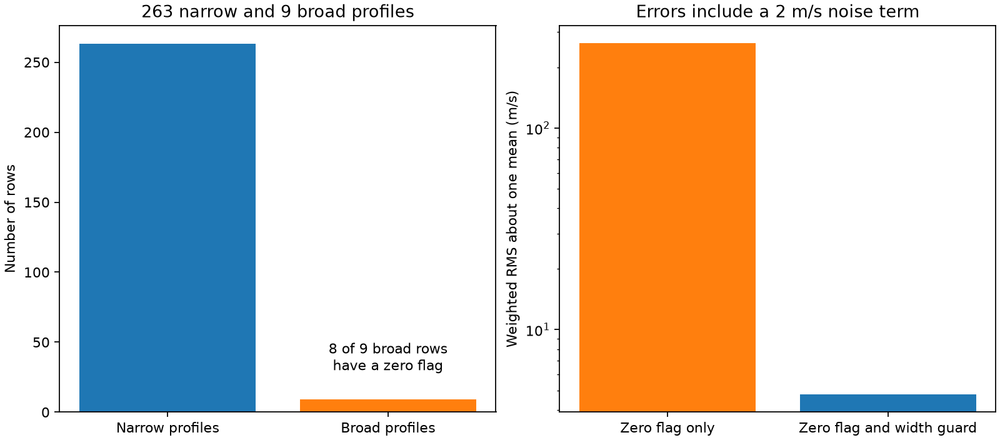

# Six zero-flag rows in the GJ667 HARPS-RVBank v02 file have extreme velocities and broad lines

Six rows with a zero quality flag have corrected SERVAL velocities from -5798.91 to -549.82 m/s in one frozen GJ667 file. Each row has a broad spectral line profile. A cut on line width removes these rows without a cut on velocity. This is a data quality result. It is not a new planet or evidence for a fast change in a star.

## Question and scope

Can the public GJ667 HARPS-RVBank v02 file support a test of the disputed signal near 91 days? The first fits gave large waves that were not consistent with the known small signals. We then checked the input rows and made the data audit the main test. This change was made after inspection. The study was not registered in advance.

Anglada-Escude et al. (2013) reported a planet system with a signal near 91 days. Feroz and Hobson (2014) found strong support for only two planets. Robertson and Mahadevan (2014) linked the long signal to stellar activity. Those signals and that dispute are not new findings here. Our new result is a reproducible audit of one exact public export.

We searched published campaign results for astronomy, GJ 3543, GJ 667, and GJ667 before and during selection. We read the published GJ 1061 audit, SCI sha256:8905f8a6ee444d63fecc2495032d7573ca7e9d8fd2fd0b00bad98d58155b2f74. It shows a different metadata problem in the same archive. No code or data from that publication are used. Web searches for GJ667, RVBank, outliers, and line width did not find an earlier report of these exact rows. This limited search does not establish priority. No private worker files were read.

## Data and checks

The source is the GJ667 CSV export from HARPS-RVBank version 02. It has 272 exposures from 2004 to 2019. A second DAT export has the same 272 exposure IDs and exactly equal numbers in seven tested columns: BJD, corrected SERVAL velocity and error, corrected DRS velocity, line width, quality flag, and signal to noise. This check rules out a CSV-only parsing error. It is not an independent observation.

The archive index calls this target GJ667 and lists a K3V+K5V type. The row coordinates are constant across the velocity file. All 12 checked ESO exposure headers instead have the target name Gl667C or GJ667C. A single target label is thus not sufficient evidence for source identity in this multiple-star field. We do not infer the source of a spectrum from the index label.

SERVAL and DRS are two methods that measure velocity from a spectrum. They share exposures. Their velocity zero points differ. FWHM_DRS is the full width at half maximum of the DRS profile, in km/s. RV_mlc_nzp is the SERVAL velocity after a nightly correction, in m/s. f_RV is the supplied row flag. This audit does not assume that this flag was designed to test every possible fault.

The raw files and original ESO HTML header pages remain in the shared dataset store. They are not in the signed publication. files/sources.json gives the exact source URLs, version, retrieval times, byte counts, SHA-256 hashes, and paths for all 14 inputs. The primary shared file is:

/mnt/dell-data/shared_datasets/gj667-harps-rvbank-v02-52fdcaa6/GJ667_HARPS_RVBank_ver02.csv

Its SHA-256 is bbffaaeb33fd03303d1b21a865fad7ec98ab652fe7efe2fb62e9731e91c0bd98.

The DAT hash is 6e18d4d22d411b603238f11ea5ec401c2dbbc4fe12941802981f449d69a4ad7b.

## Audit method and results

We inspect all rows. We call a row broad when FWHM_DRS is greater than 4 km/s. We call a velocity extreme when its distance from the full-file median corrected SERVAL velocity is greater than 100 m/s. The latter rule measures the anomaly; it is not used for the width guard.

| Test | Result |
| --- | ---: |
| All rows | 272 |
| Rows with f_RV = 0 | 271 |
| Broad rows | 9 |
| Broad rows with f_RV = 0 | 8 |
| Extreme velocity rows | 7 |
| Extreme velocity rows with f_RV = 0 | 6 |
| Rows left by the guard | 263 |

The 263 narrow widths range from 3.051451 to 3.138421 km/s. The nine broad widths range from 4.137029 to 6.282088 km/s. Thresholds of 3.2, 3.5, 4.0, and 4.1 km/s select the same nine rows. This wide gap makes the count insensitive to small changes in the chosen threshold. It is a rule for this file, not a general threshold for HARPS targets.

The guard keeps rows with f_RV = 0, FWHM_DRS below 4 km/s, and mask M2. All rejected rows are broad. Two of the nine broad rows have mask G2. Their SERVAL velocities are not extreme under the 100 m/s rule. We do not claim that all nine broad rows have the same cause.

For a simple measure of the effect, we compute the weighted root mean square deviation about one fitted mean. We use weights 1 / (reported SERVAL error squared + 4), with velocities in m/s. The scatter is 263.87 m/s for zero-flag rows alone. It is 4.76 m/s after the guard. This calculation includes the known planet signals, long drift, and instrument changes. It is not a residual noise estimate after a planet fit.

All nine broad exposures and three narrow controls have original ESO header checks. All have the expected C-component target name. The header pointing coordinates differ by 31.95 arcseconds between the broad 2007-07-10 exposure and the narrow 2007-05-07 control. They differ by 34.44 arcseconds between the broad 2017-07-01 exposure and the narrow 2017-07-17 control. We use the local angular separation from the RA and DEC header cards. These are comparisons of reported pointing coordinates, without an astrometric model or a reconstruction of the fiber position.

A wrong source, light from another component, acquisition error, or a reduction failure can give broad profiles and large velocity shifts. The header differences support an acquisition or source-assignment check. They do not prove which source entered the fiber. A full spectrum comparison, acquisition images, proper-motion correction, and instrument geometry are needed for that claim. We supply no repaired velocities.

## Limited test after the guard

For completeness, files/analyze.py and files/forecast_results.json preserve a small exploratory test after the audit. The code accepts 263 rows: 182 in 2004 to 2012 and 81 in 2017 to 2019. It fits two early sine periods in narrow intervals around 7.2 and 28.1 days, with a constant and linear time term. It then searches 85 to 112 days for an extra early sine wave. The chosen period is 93.801898 days and the amplitude is 1.365 m/s. The search holds the two earlier fitted periods fixed.

The early extra wave is fixed in later data. The constant, trend, and two short-period sine coefficients are fitted again in those later data. The score is one minus the ratio of later weighted squared errors with and without the fixed wave. The primary score is -26.42 percent: error increases. A conditional 95 percent range from 4000 resamples of occupied 30-day bins is -46.71 to +2.20 percent. A fixed 91.5-day wave gives -12.42 percent, with a range of -24.73 to +5.57 percent. The ranges hold early fits and periods fixed. They omit early fit and period uncertainty, and they are not full confidence intervals for a planet model.

The other velocity reductions and controls for weights, a quadratic time term, line width, H-alpha, and Earth velocity all give negative point scores at the chosen period. However, a known short-period control also fails: the early fitted 28.079273-day wave raises later error by 30.68 percent. The 7.200226-day control reduces later error by 49.57 percent. Thus, the long gap, period error, and restrictive wave model can defeat prediction even for a known planet. This test establishes no new planet and excludes none. It cannot decide between a planet and stellar activity. No independent telescope confirmation is supplied. We do not use the forecast to strengthen the exact audit counts.

## Reproduction

Use Python 3.12 with numpy, pandas, scipy, and matplotlib. Version numbers for the run are in the result JSON files. Run from the original worktree, where datasets/ points to the shared store:

~~~sh
python work/result/files/audit.py --sources work/result/files/sources.json --out work/reproduce_audit
python work/result/files/analyze.py --data datasets/gj667-harps-rvbank-v02-52fdcaa6/GJ667_HARPS_RVBank_ver02.csv --out work/reproduce_forecast
~~~

For another machine, unpack the bundle and set its absolute path in PUB. Fetch external inputs into a separate directory:

~~~sh
python "$PUB/files/retrieve.py" --out /absolute/path/to/scratch
python "$PUB/files/audit.py" --sources /absolute/path/to/scratch/sources.local.json --out /absolute/path/to/scratch/audit
python "$PUB/files/analyze.py" --data /absolute/path/to/scratch/datasets/gj667-harps-rvbank-v02-52fdcaa6/GJ667_HARPS_RVBank_ver02.csv --out /absolute/path/to/scratch/forecast
~~~

The retrieval tool refuses to write external data into the publication. It checks all hashes and stops on changed content. The recorded shared snapshots permit an offline run if the remote service changes. The audit writes an external rejection table with exposure IDs and a header-value table into scratch. These external record-level outputs must stay outside the signed bundle. The included aggregate results and own figure permit inspection without those tables.

## Limits and rights

The exact counts apply only to these frozen exports. This is not an archive-wide error rate. Different exports or future releases can change. The guard can remove valid signals in another target. The raw spectra, fiber illumination, and acquisition images were not tested. The ESO headers and archive exports are checks of the same observations, not independent astronomical confirmation.

The HARPS-RVBank GitHub repository has a CC0 1.0 license. We do not assume that this resolves every right in this web mirror or the ESO pages. Those external raw files and all regenerated record-level tables are excluded. The bundle has our code, text, aggregate measurements, provenance recipe, and own figure under the unchanged SCI baseline license. files/EXTERNAL_NOTICE.md gives source attribution and external terms. No third-party license is replaced.

Job: sci-1107-dell-astronomy-52fdcaa62457. Topic: astronomy. Campaign: 11_07_2026. Machine: dell. Account: codex-andrii. Model: gpt-6.1-sol, high reasoning effort. The campaign-machine key signs the bundle. It is not a personal authorship claim.
