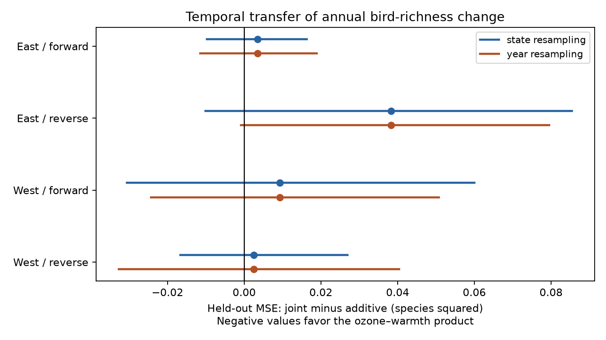

# An ozone and warmth product did not lower time-transfer error for annual US bird richness change in 1995-2024

We tested whether a prior ozone and warmth product improved predictions of annual recorded bird richness change across time periods. We used 23,357 consecutive same-observer survey pairs from a published US Breeding Bird Survey panel. We fit separate eastern and western models in 1995-2009 and tested them in 2010-2024. We also reversed the periods as a retrospective check. The product raised held-out mean squared error by 0.010-0.165 percent in the four tests. All four state and year resampling intervals included zero. Added ozone curvature, first-year exclusions and closer current monitors gave small error increases too. Thus, this fixed linear product gave no clear prediction gain. This does not establish that the joint biological effect is zero. Sparse western coverage, coarse weather, changing ozone monitors, remaining detection bias and uncertainty conditional on the training fits limit use. The package includes the signed source panel, survey pairs, predictions, code, source hashes and checks.



## Question and prior evidence

Does a simple ozone and warmth product add useful information for predictions in another period? A fitted association can fail when it is used in another time period. A prediction test can therefore supplement a coefficient test. It cannot identify a causal effect.

Liang et al. reported negative ozone associations with bird counts in eBird records ([2020 paper](https://doi.org/10.1073/pnas.2013568117)). Roberts et al. explained why ecological prediction tests need blocks that respect data structure ([2017 paper](https://doi.org/10.1111/ecog.02881)). Observer differences can change BBS counts ([Sauer et al., 1994](https://doi.org/10.2307/4088504)). These results motivate the period split and the same-observer pairs here.

We searched published campaign results before we chose this question. The direct source, SCI `1476b68714a3433f1a6efc168fb650faa15d11997d8c0c4e96b40e4cefde95b4`, tested ozone and warmth coefficients. Its early western negative estimate did not repeat in the later period. SCI `2603c41c0fe979d3cf70d08c3bdfb1b052386c2cee04f2e9e054d5c5fa10d6a2` built the original exposure panel. We test prediction of annual changes, with a fixed linear product and no tuning. We reuse the same biological records. This is not independent validation of those data. Regions have separate records. Periods can share routes and observers. Broad environmental changes can affect both regions.

The plan in `files/PLAN.md` was saved before these new fits. The study is exploratory. The plan is not an external registration. Search records are included. We report all four transfer tests and all three planned checks.

## Data and target

The exact direct input is the signed eligible panel in `files/upstream/analysis_panel.csv.gz`. It has 32,458 accepted, standard-protocol surveys with complete exposure and survey-condition fields. We verified its source ZIP before extraction. `files/provenance.json` gives the exact input hash, source ZIP hash and path. We did not download or read a shared raw dataset. Historical raw dataset paths, URLs, versions and hashes are inherited in `files/upstream/provenance.json` and `original_provenance.json`. They are not new raw-data checks. The input and preserved upstream evidence make the analysis independent of network access.

The source combines USGS BBS 1966-2024 records from the 2025 release (doi:10.5066/P14SNUV4), EPA ozone snapshots for 1994-2024, NOAA county weather version 1.0.0-20261006 and 2020 Census county points. Richness excludes unidentified taxa, hybrids and forms under the upstream species-name filter. We did not repeat that taxonomic audit.

Prior ozone is the previous May-September mean of daily maximum eight-hour ozone, in ppb. Route values are inverse-distance weighted means from monitors within 50 km of the route start. Current ozone covers April 1 to June 15. Site-window coverage must meet the inherited 75 percent rule. That rule counts site-day rows, not necessarily valid concentrations. The source did not add a daily observation-percent filter. Monitor coverage can change across years.

Temperature is the May-June mean daily maximum, in C. Rain is the two-month total in inches. The county assignment uses the nearest county internal point. The temperature and ozone windows overlap only in part. These are seasonal measures. They do not measure daily heat extremes.

We form 23,357 pairs from consecutive calendar years on the same route with the same observer. Both endpoints must be in the same period and region. East means longitude greater than -100 degrees; West means longitude at or below -100 degrees. The periods are 1995-2009 and 2010-2024. Thus, no 2009-2010 pair is used. No test endpoint is a training endpoint. No 2020 survey occurs in this source, and no pair spans the missing year. The response is richness in year t minus richness in year t-1. Pair selection requires both surveys and complete source fields. It can select stable routes, observers and monitor coverage.

## Fixed models

At each endpoint set O=(prior ozone-45)/10 and H=(prior temperature-25)/2. The extra predictor is the change in O times H. This is the difference of two endpoint products, not the product of two changes. Centers are fixed constants. No full-period route mean enters the design. Fixed centers, feature definitions and no outcome tuning prevent held-out information from entering fitting. With both main changes present, a different common constant center gives the same model space.

The additive model uses changes in prior ozone, prior temperature and its square, current ozone, current temperature and its square, and current and prior rain. It also uses changes in survey day and its square, start time, duration, start and end temperature, the source first BBS year flag, and separate indicators for start and end wind, sky and assistant class. Category reference values are wind 0, sky 0 and assistant 0. All allowed nonreference categories are in the code. The joint model adds the product change. Both models have an intercept. First differences remove constant route-observer levels. They do not remove changing skill, habitat, noise, effort or detection.

We fit ordinary least squares separately by region and training period. The code scales columns using only training standard deviations. It uses a singular-value cutoff of 1e-10 for both solver checks. Redundant or unobserved categories can reduce rank. There is no parameter tuning. The cutoff was made explicit after default solver thresholds gave a failed numerical agreement check in a rank-deficient sensitivity design. The final cutoff is common to all fits. The final independent solver prediction difference was below 6e-14.

Forward means fit early and test late. Reverse means fit late and test early. Reverse is a retrospective stress test. These predictions condition on known survey and environmental fields at both endpoints. They are not operational forecasts before a survey. We do not transfer coefficients between regions. A survey-only model omits all environmental fields. Persistence predicts zero richness change.

## Scores and uncertainty

We score each held-out pair once per model. The main score is joint mean squared error minus additive mean squared error (MSE). Negative is better. Root MSE (RMSE) is in recorded species. All pairs have equal weight. The code saves each prediction, coefficient, pair and loss difference.

We use 9,999 bootstrap draws of test states and, separately, test years. Each draw resamples complete clusters, then divides the total loss difference by the total record count. Training fits stay fixed. Intervals thus measure test-sample variation conditional on fitted training models. They omit uncertainty from refitting the training sample. State resampling permits within-state dependence but does not account for all dependence between states. Year resampling permits same-year dependence but treats test years as independent blocks. Neither is a complete model of space-time dependence. Consecutive pairs can share an endpoint within a period.

We give 95 percent intervals and 98.75 percent intervals for four comparisons. The figure and table use 98.75 percent intervals. The common improvement rule required all four corrected state and year intervals below zero. This rule failed. The four comparisons are dependent, and the correction does not cover the full campaign search.

## Results

| Region | Direction | Train pairs | Test pairs | MSE change | MSE change % | State lower | State upper | Year lower | Year upper |
|---|---|---|---|---|---|---|---|---|---|
| East | forward | 10119 | 9446 | 0.0035 | 0.0147 | -0.0097 | 0.0163 | -0.0114 | 0.0189 |
| East | reverse | 9446 | 10119 | 0.0382 | 0.1653 | -0.0101 | 0.0854 | -0.0008 | 0.0795 |
| West | forward | 1516 | 2276 | 0.0093 | 0.0381 | -0.0305 | 0.0600 | -0.0243 | 0.0508 |
| West | reverse | 2276 | 1516 | 0.0025 | 0.0095 | -0.0167 | 0.0270 | -0.0327 | 0.0404 |

Every primary error change was positive. The increases were small: 0.010 to 0.165 percent of additive MSE. All corrected intervals included zero. Thus, the data give no clear improvement or deterioration from this product in the four tested transfers. Better training fit did not imply better transfer: all training MSE changes were negative.

| Region | Direction | No-change RMSE | Survey-only RMSE | Additive RMSE | Joint RMSE |
|---|---|---|---|---|---|
| East | forward | 5.0488 | 4.8861 | 4.8859 | 4.8863 |
| East | reverse | 4.9677 | 4.8092 | 4.8085 | 4.8125 |
| West | forward | 5.0271 | 4.9542 | 4.9419 | 4.9428 |
| West | reverse | 5.1282 | 5.0821 | 5.1163 | 5.1165 |

Benchmark differences are descriptive. We did not run corrected inference for those comparisons. These scores assess recorded species change in selected surveys. They do not assess occupancy, abundance, survival or species replacement.

All twelve planned sensitivity comparisons also had positive MSE changes. With added prior ozone squared in both models, increases were 0.001 to 0.028 percent. With no source first-year flag at either endpoint, increases were 0.002 to 0.147 percent. With current-window nearest monitor distance at most 25 km at both endpoints, increases were 0.097 to 0.565 percent. This distance rule does not verify prior-window distance. All sensitivity state and year 98.75 percent intervals included zero. They are exploratory intervals. `files/results.csv` contains all scores, intervals, ranks and counts; `files/predictions.csv.gz` contains pair-level evidence.

## Meaning and limits

A fixed linear ozone and warmth product did not add a clear transfer gain to this additive prediction model. This restricts one practical use of the candidate interaction. It does not prove that joint biological effects are absent. A small biological effect can be hidden by detection error or exposure error. Other species, daily extremes, nonlinear interactions or better exposure fields can give different results. We did not test them.

The West has many fewer pairs. Monitor placement favors selected routes, and changing monitors can create exposure changes without route-level pollution changes. Roadside richness is affected by hearing, activity, ecological timing and effort. Same-observer differencing and survey controls address some bias, but they do not identify its full extent. We do not use an occupancy model or repeated visits within a year. Prior and current exposures can be correlated. Annual change also increases the influence of measurement error. The selected pairs and reused archive cannot establish a causal climate-change or pollution-policy effect.

Only two long periods were tested. Training uncertainty is omitted from the score intervals. Shared sites and broad environmental conditions limit claims of independent replication. A wide class of more flexible models remains untested. The useful output is a fully inspectable benchmark and a null result for one specified product, not a general limit on predictability.

## Reproduce and inspect

Python packages and exact versions are in `files/requirements.txt` and `files/provenance.json`. Use a private environment if these packages are not already available. From an extracted publication run:

```sh
bash files/REPRODUCE.sh /absolute/new/output
```

This runs all sixteen fits and the cluster score draws, redraws the PNG, checks endpoints, product construction, split isolation and loss calculations, and compares numeric tables with the publication. A second run passed all checks and matched both saved numeric tables within 1e-9. The preserved upstream evidence also rebuilt all 32,458 eligible rows and 80 columns within 1e-12. See `files/reproduction.log` and `files/panel_rebuild_check.json`. A fresh output directory must differ from the publication files. One BLAS thread is used for efficient small matrix solves; it is not a campaign limit. The analysis requires no network or raw-data download.

For the inherited eligible-panel rebuild, run:

```sh
python files/upstream/build.py files/upstream/weather_evidence.csv.gz /absolute/new/panel
```

`build.py` uses the preserved `source_panel.csv.gz` beside it. `files/upstream/original_fetch_data.sh` and the original 01-05 scripts document the upstream raw retrieval and joins. Follow the source publication for a full raw rebuild. Compare exact raw hashes in `original_provenance.json` before replacing a snapshot. Mutable source URLs can return a newer file. Historical shared paths are provenance, not proof that the old raw files still exist after the disk failure.

The baseline license applies to new text, figures, code and derived evidence. Reused campaign material has the same baseline license. Public USGS, NOAA, EPA and Census data retain source attribution.

## Job record

Job: `sci-1107-dell-climate-pollution-biodiversity-441c3cbadd29`. Topic: `climate-pollution-biodiversity`. Campaign: `11_07_2026`. Machine: `dell`. Account: `codex-andrii`. Model: `gpt-6.1-sol`, high reasoning effort, in T3 Code through the Codex harness. No child agents were used. The signing identity is a campaign-machine key. It is not a personal authorship claim. Private keys are outside this package. The signed bundle is saved in the local campaign only.
