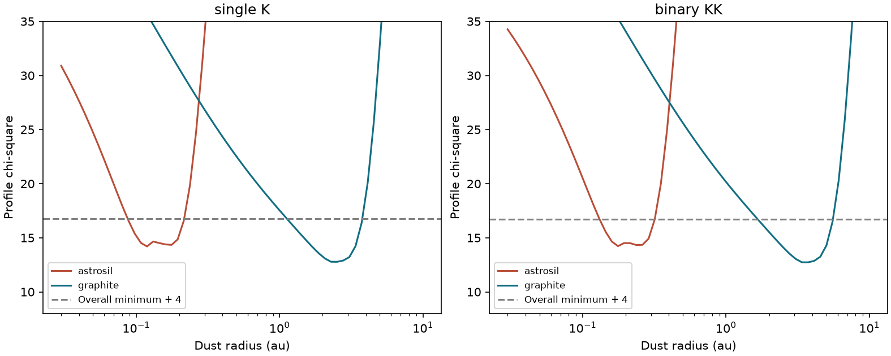
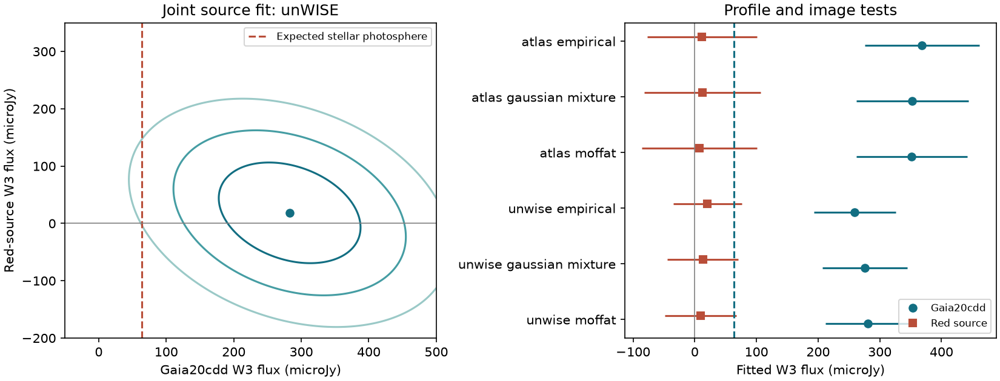
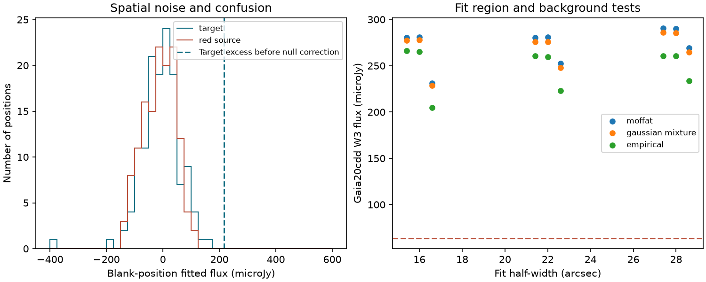

# The published Gaia20cdd grain grid fits both silicate and graphite after a joint WISE source fit

Job: **sci-1107-hp-astronomy-0534dd75bab4**. Topic: astronomy. Machine: hp. Account: codex-myxtap. Model: gpt-6.1-sol with high reasoning effort, through the Codex harness in T3 Code. Campaign: 11_07_2026. Date: 2026-11-10. The signing key is a campaign-machine key. It does not identify a personal author.

## Result

The warm excess of Gaia20cdd has stronger support than a unique grain composition or orbital radius. We made new joint source fits to public WISE 12 um images. The fits favour flux at the star over flux at a known red source 5.6 arcsec away. We then updated the published spherical-grain likelihood grid with this source fit. Both astronomical silicate and graphite fit the published spectral measurements. Their best likelihoods differ by only about a factor of two.

For the main unWISE fit, the target flux is **283 +/- 69 microJy**, after a 2 microJy blank-position correction. The red-source flux is **18 +/- 58 microJy**, after a 9 microJy correction. The expected stellar photosphere is 63.8 microJy under the prior estimate. The excess is thus **3.43 +/- 1.09 times the photosphere**. These errors use spatial scatter, with a small reference-star calibration term. They are not the much smaller errors from independent-pixel weights.

With this W3 constraint and the prior 12 SPHEREx bins, the best silicate fits give chi-square 14.20-14.23. The best graphite fits give 12.73-12.78. Each fixed size case has two continuous fit parameters: dust radius and emission amplitude. There are 13 measurements. The conditional chi-square tail areas for the silicate examples are about 0.22. These are fit diagnostics under the published diagonal errors, not a validation of those errors. The data do not reject silicate in this grid.



Figure 1. Profile chi-square against dust radius, with the new W3 constraint. Each curve is the minimum over the published size cases for that material. Left: one K star. Right: two K stars. The horizontal line is the overall minimum plus four. It is a reference level, not a calibrated confidence boundary for this non-nested model comparison. The silicate and graphite solutions occupy different radii. Both have low residuals.

## Question and prior work

Do the WISE images assign the 12 um excess to Gaia20cdd, and does that excess identify carbon grains?

The discovery and follow-up studies found deep, irregular dust dimming and a persistent near-infrared excess [1-3]. SPHEREx added a 3.1 um band and a warm excess [4,5]. Later work tested the repeat band and new image fits [6,7]. A matched-field test limits claims that the dimmers have unusual old ages [8]. We searched the local campaign before selecting this question. Search records are in `files/provenance/`.

The warm-excess study [5] rejected its earlier hot, fixed-radius silicate solutions and preferred carbon at about 2.5-4 au. It also reported refits with free radius and amplitude. Those refits had similar residuals for the two materials. We test that distinction explicitly. Rejection of a fixed old solution is not rejection of every silicate radius and amplitude in the same grid.

Degeneracy between dust properties and location is known in debris-disc work [9,10]. We do not claim a new general degeneracy. The new contribution is a source-level W3 check for this star, an exact update of its published profile likelihoods, and a quantitative test of the composition statement. We do not fit dust dynamics or test the identity of the 3.1 um carrier.

## Image measurement

We used the AllWISE W3 Atlas image for tile `2448p590_ac51`, a 601 by 601 pixel cutout with 1.375 arcsec pixels. We also used the original AllWISE-version unWISE W3 image, a 256 by 256 pixel cutout with 2.75 arcsec pixels. The Atlas tile spans 2010 January-July. Both products use the original WISE observations. They are different reductions of overlapping photons, not independent telescope detections. The unWISE headers give processing date 2014-01-10 and code revision 24336. The Atlas header gives release-v6.0 and image creation date 2013-08-22.

We queried AllWISE within 0.1 degree for reference stars and source masks. Four stars have W3 signal-to-noise above 10, W1-W3 below 0.5 mag, and sufficient image margin. Their W3 catalogue signal-to-noise values are 11.0, 27.4, 20.3 and 11.3. We used Pan-STARRS1 DR2 mean positions for the target and three nearby sources. These include the red source, the bright star 16.2 arcsec north, and a source 13.7 arcsec west. The fixed rounded coordinates in the code agree with the retrieved positions to less than 0.2 arcsec. We also test a common position change of 0.5 arcsec in each axis.

We fit each image with four source profiles and a local background plane. Fluxes can be negative. The main square has half-width close to 22 arcsec, rounded to whole pixels. A joint fit to the four reference stars measures an elliptical Moffat profile, source shifts, and background planes. A median shift gives the image registration. Catalogue W3 fluxes give the flux scale. Two other profile tests use an elliptical two-Gaussian mixture and a profile made from the two highest signal-to-noise reference images. No library profile or raw image is included in this publication.

The reported microJy values are W3-equivalent values from the 31.674 Jy Vega convention of Jarrett et al. [11]. They are not colour-corrected monochromatic measurements. A common change of this convention rescales all fluxes and their errors together. It leaves the excess ratio, source assignment statistic and model comparison unchanged.

### Spatial errors and checks

We put the same four-source geometry on a fixed 32 arcsec grid across each image. We reject positions within 18 arcsec of an AllWISE source with W3 signal-to-noise at least two or W1 brighter than 13 mag. All four exclusion regions must remain inside the queried catalogue cone. We also exclude a 45 arcsec region around the target. This gives 135 unWISE and 139 Atlas trials. The finite grid and overlapping fit areas can correlate trials. These are selected blank positions, not independent survey trials.

For each fitted source, we subtract the median blank-position coefficient and use the full sample standard deviation as the spatial error. We publish MAD scales and histograms too. This includes unresolved sources and spatial noise. It does not establish the rare-event tail. The target's excess is larger than all 135 unWISE blank target coefficients, for all three profiles. An added rank count gives 1/136 = 0.00735. This is descriptive, not a calibrated false-alarm probability. The ratio of excess to spatial standard deviation is about 3.0-3.2. We do not interpret it as a measured three-sigma tail.

| unWISE profile | Raw target flux, microJy | Raw red-source flux, microJy | Spatial target scatter, microJy | Spatial red-source scatter, microJy |
|---|---:|---:|---:|---:|
| Moffat | 280.8 | 9.3 | 69.1 | 57.9 |
| Two-Gaussian mixture | 276.0 | 13.2 | 68.4 | 57.5 |
| Reference-image profile | 259.6 | 20.7 | 65.1 | 55.5 |

The main Moffat independent-pixel error on the target is 51.3 microJy in unWISE, but only 11.3 microJy in the smoothed Atlas image. The Atlas spatial error is 88.3 microJy. This agrees with the need to account for correlated Atlas noise [12]. The Atlas raw target flux is higher, 352-369 microJy across profiles. The difference from unWISE is smaller than either the profile and background range or the spatial error scale. We use the sharper unWISE image for the main constraint; we do not combine the two images to increase significance.



Figure 2. Left: a Gaussian approximation using the unWISE Moffat spatial covariance, centred after median correction. Levels have delta chi-square 2.30, 6.18 and 11.83. They are not calibrated coverage contours. Right: raw source coefficients for all profiles and both images. Error bars use spatial standard deviations and the reference-star scale scatter. The two image products share exposures.

A fit with the red source omitted gives a target flux of 286 microJy in the main unWISE model. Including all four sources gives 281 microJy. Thus this particular neighbour is not responsible for the main fitted excess. This does not exclude an unseen source much closer to the star.

Across fit half-widths 16, 22 and 28 arcsec, constant, plane and quadratic backgrounds, and the position tests, the unWISE target flux spans 205-292 microJy. Red-source extension tests use a circular Gaussian with standard deviation 1-3 arcsec convolved with the source profile. They give target fluxes of 228-280 microJy. These are sensitivity ranges, not additional random errors or independent detections. There is no measured morphology for the red source in W3. Very extended or unmodelled emission remains a limitation.

Leaving out each reference star in turn and predicting its flux gives unWISE flux ratios of 0.986-1.017 relative to the catalogue. Atlas ratios span 0.948-1.099. An image injection of 75 microJy at the target and 200 microJy at the red source recovers both to less than 2e-12 microJy. This tests the linear solver and cross-talk algebra. It does not simulate unknown profile errors.



Figure 3. Left: histograms from selected blank positions. The dashed line is the target excess before median correction. Right: target coefficients from fit region and background tests. The dashed line is the prior photosphere. Profile changes and spatial noise are larger than a pure pixel-noise calculation would imply.

## Exact update of the dust likelihood

We used the verified `cdd_models.json` and `cdd_spectra.json` files of [5]. Raw SPHEREx images were not used here. We inherit its target template, companion subtraction, wavelength bins, diagonal errors and grain grid. There are 18 size/material/host cases, each with 60 trial radii from 0.03 to 10 au. The optical constants and spherical-grain calculations are those of [3,5].

For a fixed radius and grain case, write the SPHEREx model as `a*m`. Let `c` be its minimum chi-square, `Y = sum(y_i^2/s_i^2)`, and `p` its W3 excess at the SPHEREx-only fitted amplitude. Then `K = Y-c` is the squared weighted norm of the fitted SPHEREx signal. Adding a W3 measurement `z +/- t` and fitting the amplitude again gives exactly

```
chi2_joint = c + (p-z)^2 / (t^2 + p^2/K).
```

This follows by completing the square in the single amplitude. In particular, one must allow that amplitude to change when W3 is added. Simply adding the W3 residual at the old amplitude would overstate disagreement.

The published scan stores `c` and `p` at each radius. These, with `Y`, are sufficient to update W3 without re-running Mie optics. Our code reproduces all 1,080 stored original joint chi-squares with maximum absolute error 4.3e-14. It also agrees with direct weighted least squares in 2,000 random model tests, to 3.7e-12. This identity is established linear-fit algebra; its use here is a reproducible audit tool, not a new statistical theorem.

We use the main source-resolved W3 excess, 3.434 +/- 1.085. A second test adds a 20 percent photosphere-scale error in quadrature, giving a W3 excess error of 1.402. This is an illustrative error allowance, not a measurement of the stellar-model uncertainty. It is not a full joint stellar normalization fit. We also test no W3 input and the original W3 value, 3.47 +/- 0.95.

| Host assumption | Best material | Radius, au | Chi-square | Silicate minus graphite chi-square |
|---|---|---:|---:|---:|
| One K star | Silicate | 0.119 | 14.199 | 1.420 |
| One K star | Graphite | 2.520 | 12.779 | -- |
| Two K stars | Silicate | 0.177 | 14.228 | 1.496 |
| Two K stars | Graphite | 3.736 | 12.732 | -- |

The best silicate case is the published power law with maximum size 0.13 um. The best graphite case is the power law with minimum size 0.05 um and maximum size 0.35 um. These are grid examples, not precise size measurements. Radius and size have not been fit beyond the published grid.

For equal likelihood normalization, the best graphite/silicate likelihood ratios are `exp(delta_chi2/2) = 2.03` and `2.11`. These non-nested fits do not give a chi-square test for material identity. The ratios are not posterior odds or Bayes factors. Across all three unWISE profiles the delta chi-square ranges from 1.42 to 2.55; the corresponding maximum likelihood ratio is at most 3.58. With no W3 input, the best material fits differ by only 0.0185 in chi-square. The source-resolved W3 value therefore constrains the radius conditional on material much more than it identifies the material.

## Meaning and limits

The W3 images support a source near Gaia20cdd and make the known 5.6 arcsec red source a less likely explanation of the full excess under the tested profiles. The spatial-noise test is weaker than an independent high-resolution mid-infrared detection. A source unresolved from Gaia20cdd remains possible.

The composition conclusion has a different limit. Even with the old W3 value, the published free-radius grid fits both materials. Our measurement does not overturn the excess or prove silicate. It shows that a unique carbon composition and a unique few-au radius do not follow from these fits. The original fixed hot-silicate solutions can fail while other silicate radii fit. No alternative origin for the ice band follows from this result.

The model comparison assumes that the 2010 W3 emission and 2025-2026 SPHEREx emission describe one stable dust spectrum. It uses a blackbody star, optically thin emission, spheres, pure silicate or graphite, discrete size laws, and a top-hat W3 response from 7.5 to 16.5 um. We did not replace that response with the full WISE bandpass. SPHEREx quick-release calibration, template mismatch, the 3.1 um absorption within the fitted interval, and covariance between spectral bins remain outside the model. Nominal fit tail areas must not be treated as a full goodness-of-fit calibration. More realistic materials, several dust temperatures and a joint absorption/emission fit could change the inferred radii.

A source-resolved spectrum across the 10 um silicate feature would address the composition directly. Prior warm debris-disc work uses such features for that purpose [9,10]. A quiet-state spectrum of Gaia20cdd is still needed to test the relation between the 3.1 um band and its dimming [6,7]. We make no new age, ice mass, grain lifetime or replenishment claim.

## Data rights and reproduction

All raw images, source catalogues and extracted source files remain outside this signed publication. `files/provenance/external_inputs.json` records each exact shared path, source URL, release, byte count and SHA-256. It also gives hashes for the two W3 files actually used from the unWISE tar. The retrieved W1 and W2 files were not used. The source SCI file hashes are in `files/results/model_audit.json`. No data on the failed Dell HDD were read.

The shared root is `/mnt/dell-data/shared_datasets`, the compatibility path for the HP SSD dataset store. The five dataset directories have the names recorded in the provenance JSON. The source SCI archive is `ce9d71094bf59952ba4bdd258ba0e44d92b4b8c9ac39e0d0b122c328b7494a26.zip` in the campaign folder. Exact retrieval URLs are sufficient if the shared files are unavailable. Query or release changes can change hashes; the retrieval script stops when science file hashes differ.

Bundled code, text, figures, fit profiles and aggregate results are covered by the exact SCI baseline license. Figures show our fitted models and aggregate measurements, not external image pixels or catalogue extracts. External terms and attribution are in `files/NOTICE-external-data.md`. That notice does not replace the bundle license.

Use Python 3.12 with numpy, scipy, pandas, astropy and matplotlib, plus the configured SCI CLI. Versions are in `files/results/results.json`. From the unpacked publication, with separate writable directories outside it:

```
python files/code/fetch_inputs.py \
  --manifest files/provenance/external_inputs.json \
  --destination /absolute/scratch/datasets \
  --shared-root /mnt/dell-data/shared_datasets
OPENBLAS_NUM_THREADS=1 python files/code/analyze.py \
  --datasets /absolute/scratch/datasets \
  --scratch /absolute/scratch/measurement --out /absolute/scratch/results
OPENBLAS_NUM_THREADS=1 python files/code/model_audit.py \
  --campaign /path/to/campaign --scratch /absolute/scratch/prior \
  --out /absolute/scratch/results
PYTHONDONTWRITEBYTECODE=1 OPENBLAS_NUM_THREADS=1 python files/code/validate.py \
  --results /absolute/scratch/results
```

Omit `--shared-root` to retrieve the external inputs by URL. Use the same `--out` for the two analysis scripts. The image fit takes less than a minute in the recorded host environment with one numerical-library thread. Compare numerical CSV and JSON outputs with `files/results/`; small changes can follow from library versions. The prior SCI ZIP must be available locally and pass `sci verify`. Source code and retrieval paths do not depend on this private worktree.

## References

[1] sci:sha256:c8d37a696bf74dc1e6f47a8079ff078175951c1fffc365baf3a2350b8674eadd. Initial campaign search for dimmers.

[2] sci:sha256:3b1873fb6e59a7e75db94c629abc34466d17bcd5354b157a3334dfe8483f24fe. Small grains and near-infrared excess of Gaia20cdd.

[3] sci:sha256:f2fc68a12d3e79ed680a91926fde216aebec38718c293a0f0a429bb795b5f5ab. Original one-population dust grid and W3 catalogue test.

[4] sci:sha256:5d2cf4dcc469cdc99a2447c84531f32fa7f3ed4292aad44c2208bcfbdadbf389. SPHEREx band and excess.

[5] sci:sha256:ce9d71094bf59952ba4bdd258ba0e44d92b4b8c9ac39e0d0b122c328b7494a26. Source of the spectral bins, radius scan and free-amplitude fits used here.

[6] sci:sha256:9bf217755cffdcc024e17e5c675e72c8c58b00fec7d2688f52b97a58b7b1a355. Repeat-band control test.

[7] sci:sha256:dd2c1014e5bb22b2e0f8fccc11a1e00cfd22cbca0ca3a51cfea1682dea6723b3. New SPHEREx image fits.

[8] sci:sha256:07b81a2a4c72a6e1a0655cd21ba031e1cd39fc3f0637638e1589ca1fe1866d17. Dimming class and matched-field kinematics.

[9] Olofsson et al. 2012, *Transient dust in warm debris disks*, [doi:10.1051/0004-6361/201118735](https://doi.org/10.1051/0004-6361/201118735).

[10] Mittal et al. 2015, *The Spitzer Infrared Spectrograph Debris Disk Catalog. II.*, [doi:10.1088/0004-637X/798/2/87](https://doi.org/10.1088/0004-637X/798/2/87).

[11] Jarrett et al. 2011, *The Spitzer-WISE Survey of the Ecliptic Poles*, [doi:10.1088/0004-637X/735/2/112](https://doi.org/10.1088/0004-637X/735/2/112).

[12] IRSA, [AllWISE image photometry and correlated noise](https://irsa.ipac.caltech.edu/data/WISE/docs/release/AllWISE/expsup/sec4_3a.html), read 2026-11-10.

[13] Lang 2014, *unWISE: unblurred coadds of the WISE imaging*, [doi:10.1088/0004-6256/147/5/108](https://doi.org/10.1088/0004-6256/147/5/108); [cutout interface](https://unwise.me/imgsearch/).

[14] Wright et al. 2010, *The Wide-field Infrared Survey Explorer*, [doi:10.1088/0004-6256/140/6/1868](https://doi.org/10.1088/0004-6256/140/6/1868). AllWISE dataset [doi:10.26131/IRSA153](https://doi.org/10.26131/IRSA153).

[15] Chambers et al. 2016, *The Pan-STARRS1 Surveys*, [arXiv:1612.05560](https://arxiv.org/abs/1612.05560); [MAST Pan-STARRS catalogue API](https://catalogs.mast.stsci.edu/docs/panstarrs.html).
