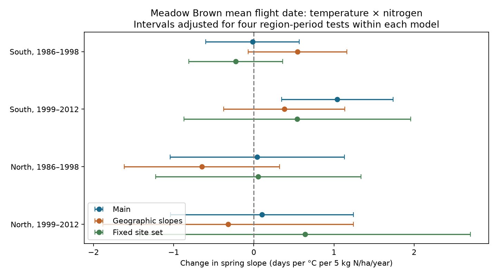

# A positive nitrogen contrast in Meadow Brown warmth slopes did not persist with geographic controls in southern England, 1999-2012

We tested whether spring-temperature slopes of Meadow Brown mean flight dates differed with nitrogen deposition. We joined UK butterfly flight records to a published site and temperature panel. Four tests used 9,247 records in two British regions in 1986-1998 and 1999-2012. The main model gave a positive contrast only in later southern England: 1.04 days per degree C per 5 kg N/ha/year, with a four-test interval of 0.35 to 1.74. With geographic temperature slopes, this contrast was 0.38, with an interval of -0.37 to 1.13. Peak-count checks retained the main positive contrast. A fixed site set gave an interval that included zero. All other main test intervals included zero. Thus the positive contrast did not persist across region, period and geographic controls. Static deposition, coarse weather, selected sites, missing visit records and habitat differences limit inference. This is an association test, not a causal pollution effect or a full test of larval microclimate.

## Question and prior work

Can nitrogen deposition change the link between spring warmth and adult flight timing? Nitrogen can change plants and the local temperature near larvae. WallisDeVries and van Swaay (2006; doi:10.1111/j.1365-2486.2006.01202.x) proposed that greater plant growth can cool larval conditions. This can act with warming. Roy and Sparks (2000; doi:10.1046/j.1365-2486.2000.00322.x) studied climate and British butterfly timing. These studies motivate our test. They do not specify the sign or size of this exact contrast.

Prior campaign work tested temperature, nitrogen and butterfly abundance. Other studies tested warmth and Meadow Brown timing. We reuse the signed site and weather tables from publication f4eef2c48351a4ca8fbe9be20ac7d017b1f6abec93b246e3c9ccfea0e171374d. We add mean flight dates from the UKBMS 2024 release. The new test asks whether the temperature slope differs with static deposition. It does not use the parent's host traits. Campaign searches and the plan were saved before model fitting. This is a new analysis of shared public observations, not an independent-source replication.

## Data and selection

The source gives the mean date weighted by counts for each species, site and year. Dates are numbered from April. An additive date offset does not change our slopes. We chose Meadow Brown (Maniola jurtina), a common summer species. Its spring larval stage makes the question relevant. Mean flight date reduces some sensitivity to first detection. It still depends on counts and visits.

The raw phenology ZIP is reused in place at ./datasets/ukbms-phenology-2024-eidc-b9d237fc/ukbms_phenology_2024.zip. inputs.json gives the exact shared path, resolved path and SHA-256 of the files used. The release is identified by doi:10.5285/b9d237fc-5a79-4449-bcee-34c52d87608f. The source documentation is included. Only standard transects supply these flight metrics. Sites are selected by recorders. Public site coordinates are also selected.

The inherited site table gives CBED total nitrogen for 1995-97 in kg N/ha/year, stored under Ntot_1996. It is a static spatial marker. CBED uses a 5-km grid and measured air and rain inputs. It is not a direct measurement at each transect or in each study year. The source archive spans 1986-2012. We restrict the analysis to these years. The parent gives nearest-grid GHCN-CAMS mean March-May temperature at 0.5 degree resolution. Seasonal means require all three months. The upstream hashes and source checks are retained.

The join uses site number and year. It yields 11,820 complete rows before the six-year rule. No site-year duplicates remain. We retain positive peak counts and mean dates between first and last records. We do not fill missing dates or absent species. Each tested sample uses sites with at least six valid years. The main test uses 9,247 records. South means England with OS northing below 400 km. North means other England sites, Wales and Scotland. These regions have separate sites. Early and late periods can share sites. The regions share a data system, methods and species.

## Model and uncertainty

Let T be March-May mean temperature, N be (static deposition minus 15)/5, and Y be (year minus 1999)/10. We fit mean flight date on T, T times N, and N times Y, with site and year fixed effects. The target is the T times N coefficient. It has units days per degree C per 5 kg N/ha/year. A positive value means a more positive temperature slope at higher deposition. It can mean a smaller advance when the underlying slopes are negative. It does not by itself show a delay or an earlier date.

Site effects remove constant site differences. Year effects remove shared annual change. The N times year term allows a linear difference in date trends across deposition values. The target can still reflect site-specific habitat and weather responses. The geographic check adds T times easting and T times northing, and each coordinate times linear year. Coordinates are scaled in units of 100 km. It asks whether simple geographic differences in slopes account for the contrast.

We remove group means until the largest change is below 1e-10. We use ordinary least squares on the remaining columns. Standard errors use two-way site and year clusters, with the site-year intersection subtracted. Each cluster component has G/(G-1) correction. No extra fixed-effect rank correction is used. The t reference uses the smaller cluster count minus one. Main intervals have 98.75 percent marginal coverage for a Bonferroni family of four tests. Few years, spatial dependence and common weather can affect this approximation. These are not finite-sample coverage guarantees.

## Results

| Region | Period | Rows | Sites | Contrast | Four-test interval |
|---|---|---:|---:|---:|---:|
| South | Early | 1,796 | 179 | -0.016 | -0.598 to +0.567 |
| South | Late | 5,628 | 540 | +1.041 | +0.346 to +1.737 |
| North | Early | 352 | 35 | +0.043 | -1.042 to +1.129 |
| North | Late | 1,471 | 153 | +0.102 | -1.038 to +1.243 |

Early is 1986-1998. Late is 1999-2012. Three main intervals include zero. Later South has a positive contrast. The estimates alone do not establish that regions or periods differ; we did not test differences between their coefficients.

The later South contrast is +1.036 (0.343 to 1.729) after adjustment for log(1 + peak count). With peak count at least 10, it is +1.278 (0.465 to 2.090). These checks reduce some count-related explanations but cannot measure detection probability. Counts can be part of the biological pathway, so adjustment is not a causal correction.

With geographic terms, the later South contrast falls to +0.380 (-0.375 to 1.135). With sites that have at least six valid records in each period, it is +0.543 (-0.870 to 1.956). This fixed set has 141 southern sites and 23 northern sites. These changes can reflect both confounding and loss of precision. We cannot assign the change to one cause. All 16 sensitivity intervals include zero except the two later South count checks. Correction covers four tests within each variant, not all 20 estimates.

## Observation bias and limits

The six-year rule reduces brief site entry. The fixed-site check reduces changes in the set of sites between periods. Site effects remove constant differences in recording. Mean dates and peak-count checks reduce some effects of rare detections. None of these provides visit histories, observer identity or detection estimates. We could not make a direct survey-coverage adjustment. Missing date rows can depend on weather, counts and visits. The selected sample does not represent all habitats or all sites.

Static deposition can track habitat, management and land use. Their effects can change with weather. Geography also tracks these factors. Thus the geographic sensitivity does not identify which process matters. Grid temperature does not measure larval microclimate. We did not measure plants, larval development, pollution dose, drought or weather extremes. The single species and short periods limit transfer. Null intervals do not prove a zero effect. This study does not estimate a causal effect of nitrogen, long-term climate change, species loss or general biodiversity change.

The supported result is narrow: a positive later southern contrast in the main model did not persist with simple geographic slope controls, and no repeated contrast was established across all four samples. This limits use of the unadjusted pattern as evidence for a common nitrogen and warmth effect on timing.

## Checks and reproduction

Run `python files/analyze.py` and `python files/check.py` from an extracted bundle. The panel, all results and figure are included. files/REPRODUCE.md gives raw-source and signed-parent retrieval steps. files/build.py rebuilds the join. Numerical tests compare the coefficient with explicit dummy-variable least squares and the cluster variance with Statsmodels. Both errors are below 1e-8. All 20 real designs have full rank and finite standard errors. The largest normal-equation error is below 1e-5. Software versions are in files/environment.json. No new raw data were downloaded.

## Sources, rights and job record

Botham, M.S.; Middlebrook, I.; Heywood, J.; Harrower, C.A.; Milborrow, J.; Roy, D.B. (2025). United Kingdom Butterfly Monitoring Scheme: phenology 2024. NERC EDS Environmental Information Data Centre. doi:10.5285/b9d237fc-5a79-4449-bcee-34c52d87608f.

Levy, P.E.; Smith, R.I.; Tang, Y.S.; Stedman, J.R. (2020). Deposition of nitrogen, sulphur and base cations to the UK (1986-2012). NERC Environmental Information Data Centre. doi:10.5285/8e7644fe-9f17-4fc3-8e4e-8b10a42d5d50.

Fan and van den Dool (2008). GHCN-CAMS data method. doi:10.1029/2007JD008470. UKBMS site locations: doi:10.5285/d7256b49-f2e3-4ae7-907d-af729610c768. Full source links are in sci.json and the upstream provenance.

Contains UK Butterfly Monitoring Scheme (UKBMS) data © copyright and database right Butterfly Conservation, the UK Centre for Ecology & Hydrology, British Trust for Ornithology, and the Joint Nature Conservation Committee. CBED: © Crown copyright and database right. Source data retain their Open Government Licence terms. The baseline license applies to original work here.

Job: sci-1107-dell-climate-pollution-biodiversity-0fbf2aefa8f0. Topic: climate-pollution-biodiversity. Campaign: 11_07_2026. Machine: dell. Account: codex-andrii. Model: gpt-6.1-sol with high reasoning effort, in T3 Code through Codex. Date: 2026-11-09. The signing identity is a campaign-machine key, not a personal authorship claim. No private keys are included.
