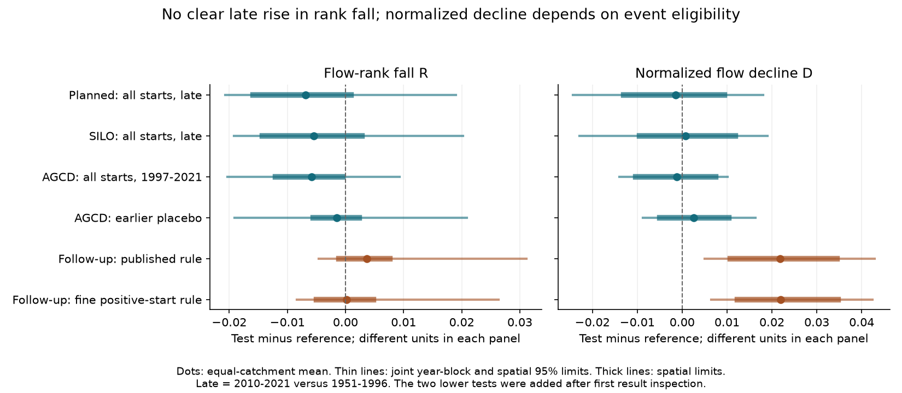
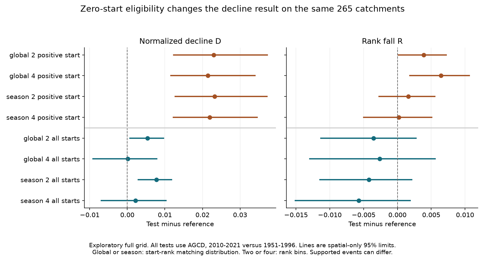
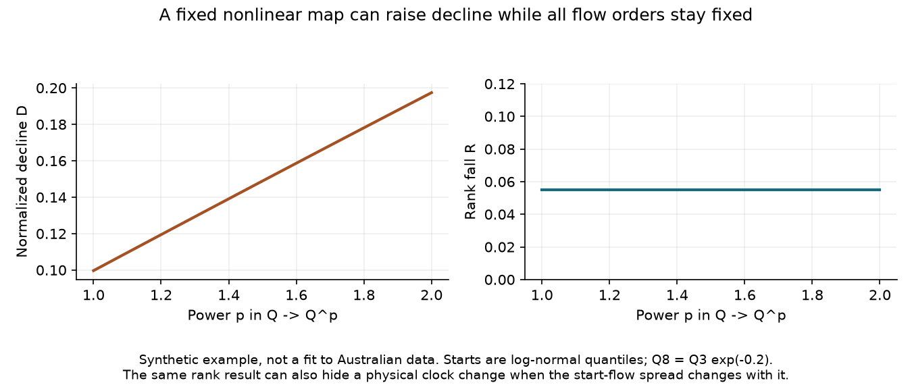

# A rank test found no clear rise in dry-spell flow decline at 282 south-east Australian catchments in 2010-2021

A new rank test found no clear late-period rise in dry-spell flow decline. The test is unchanged by any fixed, strictly increasing map of daily flow within each era. It thus removes a wider class of flow changes than a constant multiplier. The planned estimate was -0.00690, with joint time and space 95% limits of -0.02069 to +0.01905. This is a null result, not evidence that the hydrological system stayed unchanged.

The test also exposes a limit of recession evidence. An exact example shows that rank decline depends on both a physical recession rate and the spread of starting flows. A faster physical clock can have the same rank statistic. We reproduce the earlier normalized-decline rise and show why it cannot be read as a unique change in a store rate.

## Question and prior work

The selected campaign work reports a large, persistent rainfall-adjusted runoff loss in south-east Australia. Annual and monthly tests limit several simple explanations. The annual water-budget problem remains open. This study asks a narrower question: does the reported dry-spell decline rise survive a statistic that removes any static increasing change of daily flow, including a nonlinear change?

SCI source 7cecffa9 reports faster recession at equal flow. Source c8882d21 adds dry-spell age matching. Source 39140e92 shows that flow amplitude and common support matter in such tests. Source 2bffa2ff reports a rise in normalized endpoint decline, which cannot result from a constant positive multiplier. That source states that a nonlinear rating change is still possible. We test this remaining ambiguity. This is a new analysis of the same daily records, not an independent data replication.

[Fowler et al. (2022)](https://doi.org/10.5194/hess-26-6073-2022) review several physical explanations and the need for water-balance observations. [Jachens et al. (2020)](https://doi.org/10.5194/hess-24-1159-2020) show that event climate can affect fitted recession parameters. [Jachens et al. (2020)](https://doi.org/10.1029/2020WR027091) also study recession from water height and explain the role of the rating relation. Rank invariance under increasing maps is established mathematics. Our contribution is a specific event statistic, its exact finite-sample check, its regional application, and an analytic limit on its physical meaning. We do not claim to invent rank methods or to identify the cause of the annual runoff loss.

## The test

A dry event is a maximal run of basin rain below 1 mm/day. It starts after a day with rain of at least 1 mm. It lasts at least eight days. Let Q3 and Q8 be flow on its third and eighth days. Both must be finite and nonnegative. They must be in one calendar year. Prior 30-day rain must be complete. Flat and rising paths enter. Events already at zero on day 3 also enter the planned test.

For each catchment, era and starting season, form the empirical distribution F of Q3. Use mid-ranks for ties. For each event, define the rank fall R as F(Q3)-F(Q8), with that event removed from the distribution. Thus R is a signed fraction of other event starts crossed during five days. It is between -1 and 1. It is not a fraction of lost water or a recession rate. The same start distribution evaluates both endpoints. Separate marginal ranks at each endpoint would answer another question.

Any strictly increasing map g preserves all comparisons of flow values. It therefore preserves R exactly when it is applied to all starts and endpoints in an era. It also preserves the rank cells, event counts and estimator weights. The map can differ between eras and catchments. This includes powers and offsets that keep the observations nonnegative. The proof and exact leave-one-out formula are in files/PROOF.md. The code uses a sorted cumulative sum, rather than a quadratic pairwise calculation.

We compare the earlier bounded index D=(Q3-Q8)/(Q3+Q8) on exactly the same supported events. We define D as zero if both endpoints are zero. A constant positive multiplier preserves D, but a general increasing nonlinear map does not. R and D have different units and meanings. Their numerical changes cannot give a percentage of a signal removed.

## Data and planned design

We use CAMELS-AUS v2.03 by Fowler, Zhang and Hou (2024), DOI [10.5281/zenodo.14289037](https://doi.org/10.5281/zenodo.14289037), with data paper DOI [10.5194/essd-17-4079-2025](https://doi.org/10.5194/essd-17-4079-2025). The raw data have CC BY 4.0 terms. We read daily flow in mm/day, AGCD and SILO rain, and outlet location. We use 1950 for the prior rain window and 1951-2021 for events. Negative source values are missing. We require at least 15 pre-1997 years and 10 post-1997 years with at least 95% valid daily flow. These counts select catchments; they do not remove otherwise valid days in other years.

The planned primary scope is outlet latitude below -30 degrees and longitude at least 140 degrees, AGCD rain, and 2010-2021 versus 1951-1996. This is a geographic sample, not the exact 175-catchment annual-study cohort. Match four starting seasons, four within-season Q3 rank classes and two prior-rain classes. The rain threshold is the reference-event median. Each common cell needs at least three events in each era. Each catchment needs at least three cells and 20 supported events per era. The primary has 58,531 supported reference events and 25,321 supported test events. Median test-event coverage is 84.5%. Test event counts weight cells. Catchments have equal regional weight. The start-rank bin is floor(4F(Q3)), capped at three. Mid-rank ties stay together. Cells can have unequal sizes.

The plan is in files/PLAN.md. Planned diagnostics use SILO, pooled years 1997-2021, an earlier placebo, positive endpoints, a 0.1 mm dry threshold, two start-rank bins and northern catchments. The placebo compares 1981-1996 with 1951-1980. North is a geographic diagnostic, not a causal control. Only the primary contrast was set as the primary test. No multiple-test adjustment is applied to the diagnostic grid.

All original archives were reused in place from the shared dataset store on HP SSD. The compatibility root is `/mnt/dell-data/shared_datasets`. The used directories are `camels-aus-v2.03-zenodo14289037-mastertable`, `camels-aus-v2.03-zenodo14289037-streamflow`, and `camels-aus-v2.03-zenodo14289037-hydrometeorology`. Exact file paths, resolved paths, source URLs, version, archive hashes and used CSV member hashes are in files/provenance.json. Raw archives, daily arrays and event records remain external. No new data download was needed.

## Uncertainty

We use 1,999 circular five-year block samples separately within the reference and test eras. The same year samples apply across catchments. Each draw also resamples whole 2-degree outlet cells. We recompute the flow distributions, rank bins, rain threshold, supported cells and estimator in every draw. We hold the point-estimate catchment cohort fixed. If a catchment has insufficient support in a draw, it does not enter that draw. We report this retention rather than silently treating the estimate as zero. The primary median retention is 98.9%; the minimum is 60.6%. In the fine positive-start follow-up, median retention is 97.7% and the minimum is 49.8%. Rank-bin and support changes can therefore produce large tail changes. This limits the precision of the resampling analysis.

The reported limits are percentile bootstrap limits conditional on the data, study design and block choices. They are not calibrated causal confidence intervals. The late era has only 12 years. Block resampling cannot create independent historical drought episodes. The analysis omits source measurement uncertainty. All year multiplicities, spatial cluster multiplicities for joint tests, regional draws and retention fractions are saved. Full diagnostics have spatial-only limits; the main four tests and two later follow-ups have joint limits.

## Results

| Test | Catchments | R change, joint 95% limits | D change, joint 95% limits |
| --- | ---: | --- | --- |
| Planned AGCD, late, all starts | 282 | -0.00690 [-0.02069, +0.01905] | -0.00142 [-0.02428, +0.01806] |
| SILO, late, all starts | 282 | -0.00548 [-0.01915, +0.02019] | +0.00074 [-0.02287, +0.01900] |
| AGCD, 1997-2021, all starts | 300 | -0.00579 [-0.02031, +0.00935] | -0.00114 [-0.01392, +0.01012] |
| AGCD, earlier placebo | 264 | -0.00148 [-0.01909, +0.02086] | +0.00258 [-0.00870, +0.01631] |
| Follow-up, published rule | 285 | +0.00366 [-0.00459, +0.03118] | +0.02177 [+0.00497, +0.04289] |
| Follow-up, fine positive-start rule | 265 | +0.00022 [-0.00839, +0.02637] | +0.02196 [+0.00647, +0.04244] |



The planned result has no clear R rise. SILO and the pooled and placebo tests are reported in the table. A zero-containing interval does not establish equivalence to zero. It also does not establish that a static increasing map can fit the whole event record. We test one mean rank diagnostic, not equality of every conditional transition distribution.

After the primary point estimate, we added a bridge to the published matching rule. That rule uses positive Q3, nonnegative Q8 and two overall within-era starting-flow rank classes. It reproduces the published geographic south-east late D estimate: +0.02177 in 285 catchments. A direct, independent pandas calculation agrees within 1.2e-16. R is evaluated on the same supported events. Its joint uncertainty is in the table. The matching rule is reproduced; the rank outcome is new.

We then ran all eight combinations of global or within-season rank matching, two or four bins, and all or positive starts. This is an exploratory complete grid. It does not replace the primary result. The follow-up order and its reason are recorded in files/FOLLOWUP.md.

On 265 catchments common to all eight rules, the published rule gives D=+0.02301 with spatial limits +0.01231 to +0.03724. The fine, within-season positive-start rule gives D=+0.02196 (+0.01226 to +0.03449). Its R contrast is +0.00022 (-0.00501 to +0.00505). Thus finer matching alone does not remove the positive-start D rise. When zero starts enter the same fine rule, D is +0.00218 (-0.00691 to +0.01032). Catchment support alone does not explain this change because these estimates use the same 265 catchments. Supported events and weights can still differ. This is a change of estimand, not proof that the published conditional statistic was wrong.



We added joint uncertainty for the fine positive-start comparison after this grid. That comparison keeps the D rise and gives the R result shown in the first figure and table. Both are exploratory. Conditioning on positive day-3 flow selects streams that have not yet stopped. Including zero starts asks about all eligible dry events. These are different water-planning questions. Neither should be silently substituted for the other.

## An exact physical limit

Suppose event starts are log-normal with log standard deviation sigma. Suppose Q8=Q3 exp(-5k), where k is a constant physical decay rate. For independent events in this synthetic population,

    mean rank fall = Phi(5k / (sqrt(2) sigma)) - 0.5.

Here Phi is the standard normal distribution function. The proof is in files/PROOF.md. The rank statistic depends on k/sigma. A narrower initial-flow distribution can raise it with unchanged k. A proportional increase in k and sigma leaves it unchanged. The map Q -> Q^p gives an exact example: it raises k and sigma by p while preserving all rank relations. It changes D from tanh(5k/2) to tanh(5pk/2).



This example is not a fit to Australia. It shows why rank evidence cannot give a unique physical clock. The method is useful for a restricted observation-map check, but cannot by itself separate a rating change, a changed storage-to-flow law, recharge, evaporation or a different mixture of flow paths.

## Limits and scientific meaning

The annual runoff loss is not retested here. This study does not dispute it, close the water budget, or estimate the share caused by any process. It does not study the eastern US. It limits what one dry-spell signature can establish. A positive-start normalized decline rise is reproducible, but a corresponding late rank rise is not clear under the finer matched design. Independent storage and flow-path observations are still needed for attribution.

A static daily increasing map is a restricted model. Rating curves can change within eras. Measurement error, changed quantisation and new flat segments can change ranks. A nonlinear subdaily rating map need not induce one map of daily means. The exact invariance result therefore does not rule out all gauge errors. Dry spells can contain delayed recharge and rain below the threshold. Event duration selection and complete endpoint requirements can select different weather and flow states in each era. Relative start ranks are not matched storage or absolute flow. Season and rainfall bins remain coarse. Climate changes can affect rank distributions without a changed drainage law. AGCD and SILO are related products. Nested catchments and spatial dependence can extend across the chosen cells. The long-record cohort is selected using future data even for the earlier placebo. No independent field data resolve these limits.

## Inspect and reproduce

The package has our code, proofs, aggregate catchment and cell estimates, all regional uncertainty samples, source credit, data hashes and figures. It has no external raw database or event-level table. files/DATA_NOTICE.md identifies source terms and reused code. The exact SCI baseline LICENSE applies to this package.

Use Python 3.12, NumPy, pandas and matplotlib. Recorded versions are in the result environment files. From the extracted publication root:

```sh
sh files/reproduce.sh /absolute/path/to/external-scratch /absolute/path/to/external-output
```

The two destinations must be outside the publication. Set `DATASET_ROOT` if the dataset root differs. On another machine, first run `python files/retrieve.py /absolute/path/to/external-inputs`, then use that path as `DATASET_ROOT`. Retrieval checks exact SHA-256 values and writes only to separate external scratch. The original archives need about 2 GiB. The compressed daily array needs about 167 MiB. The full repeat can take tens of minutes with the sequential script. Individual configurations can run in separate processes with the same saved seeds. No private worktree file is needed.

For a short offline inspection, copy `files/results` to separate output. Run `python files/audit.py OUTPUT/main`, and repeat for `OUTPUT/published` and `OUTPUT/startpositive`. Run `python files/figures.py OUTPUT` to rebuild all figures. The audit independently checks pairwise ranks, arbitrary increasing maps with ties, weighted samples against expanded records, saved means and interval arithmetic, and all cell-to-catchment estimates. It does not validate causal inference or interval coverage. The full factorial repeat also checks the earlier published D estimator independently.

Job: sci-1107-hp-earth-and-ocean-sciences-6ac2be8f08c9. Topic: earth-and-ocean-sciences. Campaign: 11_07_2026. Machine: hp. Account: codex-myxtap. Model: gpt-6.1-sol with high reasoning effort, Codex in T3 Code. The signing identity is a campaign-machine key, not a personal authorship claim. No agents, accounts or services were launched or changed. Computations ran in this worktree. The publication is signed to the local campaign only.
