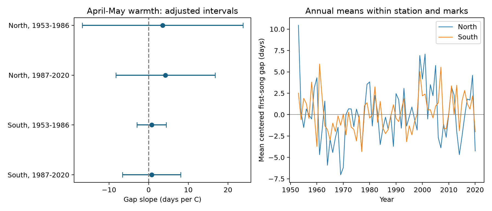

# April-May warmth gave no clear link to paired cicada song gaps in four Japan samples in 1953-2020

We tested whether spring warmth changes the time between the first songs of two cicada species. We used 2,153 paired station-years at 39 Japan Meteorological Agency (JMA) stations. The gap is the first-song date of *Meimuna opalifera* minus that of *Graptopsaltria nigrofuscata*. We tested northern and southern Japan separately, in 1953-1986 and 1987-2020.

All four estimates were positive, from 0.75 to 4.23 days per degree C of April-May mean temperature. All four adjusted uncertainty intervals included zero and both signs. The evidence does not establish a common change in the song gap with spring warmth. It also does not establish that the gap is stable. The northern estimates are very uncertain.



Figure 1. Left: temperature slopes and 98.75% intervals for the four primary tests. Positive means a larger first-song gap in warmer springs. Right: annual mean gaps after removal of each station-and-report-mark mean. These annual means are descriptive; changing record coverage can affect them. They are not estimates of a climate-change effect.

## Question and prior work

Cicadas link below-ground plant resources to consumers above ground. Changes in their timing can change when those resources are available. Work on *G. nigrofuscata* found links between first song and prior-year warmth ([Tsujimoto et al., 2024](https://doi.org/10.1111/een.13357)). A study of *M. opalifera* in Okayama reported earlier adult timing over several decades ([Ono and Nakamura, 2017](https://ous.repo.nii.ac.jp/record/3314/files/Naturalistae-2017feb-29-36.pdf)). We accessed the latter study's abstract through the search index; the full PDF request failed. We do not claim to reproduce either study.

A prior campaign study found risks from changes in animal detection in the JMA archive ([SCI 25581ede](sci:sha256:25581ede440edd79d3b5549f9356af2671302c458326692ce9859e87cbe76d7a)). Another study showed that a temperature window which moves with the song date can give a false association ([SCI fcc07f3a](sci:sha256:fcc07f3a0c0b0256af33f2dc36f05d5cb7f1c61cf7d470d97953ad65bb3537e9)). We use a fixed April-May window before every retained event. We adapt the latter publication's source checks, station-history parser and weather matching code.

Our test uses a gap between two species on the same station-year, rather than one species alone. An equal additive reporting delay for both species cancels from this gap. A species-specific delay does not cancel. The gap measures separation of first reports. It does not measure the length or overlap of the full calling seasons, or a direct interaction between these species.

## Data and method

The [protocol](files/protocol.md) was written before the paired panel was built and before model fitting. It was not externally registered. We chose one temperature window and one species pair. We did not search many windows for a significant result.

JMA item 025 is *G. nigrofuscata* first song. Item 111 is *M. opalifera* first song. We kept standard-species marks 8 and 9. They indicate reports on station grounds and nearby. The location distinction is incomplete in early records. Zero dates mean no record; we did not treat them as animal absence. We converted month-day dates to day of year, with the correct leap-year calendar. We retained 133 negative gaps.

We required at least 15 paired years at each station in each of the two periods. North means an earliest station-history latitude of at least 36 N. South means 30 N to below 36 N. The selected sample has 12 northern and 27 southern stations. The regions have disjoint stations. The periods have disjoint years but share stations. All samples share the JMA protocol and one temperature product, so these are not fully independent data sources.

We matched each station's July 15 historical location to the nearest NOAA GHCN-CAMS cell with complete monthly data in the selected Japan-area grid. This follows the published campaign method. We used the nearest history start when no segment covered that date: 256 paired records have this flag. Maximum approximate grid distance was 29.01 km. We converted temperature from kelvin to degrees C. April-May temperature is the equal mean of the two monthly means. NOAA Physical Sciences Laboratory, Boulder, Colorado, USA, supplied these data ([source](https://psl.noaa.gov/data/gridded/data.ghcncams.html); [product method](https://doi.org/10.1029/2007JD008470)). This is a monthly air-temperature index, not daily extremes or below-ground temperature.

For each region and period we fit the gap on temperature, station-by-pair-mark fixed effects, and year fixed effects. Year effects remove a common annual shift. Thus, the temperature coefficient uses local contrasts left after those effects. It does not estimate the response to all regional warming. Pair marks can change over time; their separate fixed effects allow a different level for each combination at each station. Small groups reduce useful information.

We removed redundant nuisance columns with pivoted QR, then fit a full-rank least-squares model. We took the largest variance for the temperature slope among station clustering, year clustering, and two-way clustering. We used t limits with degrees of freedom equal to the smaller cluster count minus one. The 98.75% limits apply a four-test Bonferroni adjustment to the primary tests. This conservative variance envelope is not a proof of exact coverage, especially with 12 northern station clusters.

## Results

| Region and period | Pairs / stations | Mean gap, days | Slope, days per C | 98.75% interval |
|---|---:|---:|---:|---:|
| North, 1953-1986 | 373 / 12 | 16.84 | +3.51 | -16.76 to +23.77 |
| North, 1987-2020 | 361 / 12 | 19.44 | +4.23 | -8.28 to +16.74 |
| South, 1953-1986 | 813 / 27 | 17.60 | +0.75 | -2.94 to +4.43 |
| South, 1987-2020 | 606 / 27 | 17.85 | +0.75 | -6.58 to +8.09 |

The point estimates have the same sign. The intervals are too broad to establish a repeated positive link. A zero effect, a shorter gap, and a longer gap all remain compatible with each sample under the fitted uncertainty method. These results do not support a claim of equal temperature responses in the two species.

On the identical paired records, the gap coefficient equals the coefficient for item 111 minus the coefficient for item 025. In the late southern sample, the separate slopes were -3.98 and -4.74 days per C. Thus, two earlier first-song dates can give a small positive gap slope. This is an algebraic comparison within this model, not a confirmed mechanism; the separate adjusted intervals also included zero.

### Observation and model checks

Adding prior September-November temperature, adding station linear trends, retaining only records with pairs in both adjacent years, and removing extrapolated station histories all kept the four gap intervals across zero. No retained first song was before June, so excluding pre-June events changed no result.

The on-site-only check was weak in the later period: it retained 69 northern pairs and 126 southern pairs. Its late northern estimate was +31.31 days per C, with an interval from -29.27 to +91.89. This instability shows the limit of an on-site-only check in this archive. It does not verify removal of detection bias. In the early period, on-site coefficients equal the main coefficients because much of the excluded mark information is absorbed by the group effects; the samples still differ.

A separate descriptive model used station-by-pair-mark effects and a linear time term, without year effects or temperature. Gap trends were -0.35, +0.15, -0.34 and +1.27 days per decade in table order. Their adjusted intervals all included zero. These are checks of secular change, not primary tests of temperature.

Full estimates, sample sizes and intervals are in [estimates.csv](files/results/estimates.csv). A separate residual-regression calculation checked every fitted environmental coefficient to within 1e-7. The gap-minus-species identity was checked to within 1e-8. [validation.json](files/results/validation.json) records raw rebuild and offline rerun comparisons.

## Limits and use

First song is a report of male vocal activity. It can change with abundance, search effort, sound conditions, weather at observation, habitat and observer practice. Pairing removes an equal delay only under an untested assumption. Species-specific changes in detection remain. Marks are coarse location indicators, not visit logs. Missing years do not distinguish no visit from no detection. The persistent-record selection can favor common species and stable sites. We did not correct unknown detection probabilities or model all missing records.

The temperature grid is coarse, and the fixed window does not test immediate summer weather or the full multi-year nymph stage. Year effects discard common climate variation. Long-term urban change and soil conditions remain possible explanations. The small northern sample and the sparse on-site sample make the estimates imprecise. The same observation system across periods limits replication.

This result adds an inspectable paired-species panel and a focused null result to the campaign. It does not test air pollution, daily weather extremes, species distribution shifts or biodiversity loss. The broad objective permits a focused study of climate and ecological timing. Automated acoustic records, repeated within-season visits and soil temperature would make this question more informative than more analysis of first reports alone.

## Provenance

Campaign: `11_07_2026`. Job: `sci-1107-dell-climate-pollution-biodiversity-5a4f79547546`. Topic: `climate-pollution-biodiversity`. Machine: `dell`. Account: `codex-andrii`. Model: `gpt-6.1-sol`, high reasoning effort, in T3 Code through the Codex harness. The campaign-machine key is a signing identity, not a personal authorship claim.

We reused three immutable shared files in place. Sources and hashes checked by the build are below. The exact resolved paths and source download metadata are in [provenance.json](files/data/provenance.json).

| Path below `/mnt/dell-data/shared_datasets/` | Version or snapshot | SHA-256 |
|---|---|---|
| `jma-phenology-ruinenchi-all-20261108/ruinenchi_all.zip` | JMA archive frozen 2026-11-08 | `0ca3e39524918d61d85f4c6424c4b0925613af8100daf9880a74cfdcce2b1c70` |
| `jma-surface-station-history-20261108/smaster.index.zip` | JMA history frozen 2026-11-08 | `fbf90d9b7eae7efef3fffdc271ee6576d169a4104e9f8bb0d9e666e8d4cbb38b` |
| `noaa-psl-ghcncams-air-mon-mean-20261105/air.mon.mean.nc` | GHCN-CAMS 3.01, frozen 2026-11-05 | `8dbe8e8ce86729f56a2234dec7420b94aecba804aa7df599c8fea68ade70802b` |

JMA [data](https://www.data.jma.go.jp/sakura/data/index.html) and [date and mark rules](https://www.data.jma.go.jp/sakura/data/pdf/mikata.pdf) support the parsing. The baseline license covers our code, text, figures and derived material. Original source attribution and terms still apply. Original archive members for both items and the extracted monthly temperatures are included. Large shared raw files are not copied. No private key is included. This publication is saved locally only.

## Reproduce and inspect

Use Python 3.12 with the packages in [requirements.txt](files/requirements.txt). Exact analysis versions are in [environment.json](files/results/environment.json).

From an unpacked publication, run:

```bash
bash files/run.sh /tmp/cicada_gap_reproduction
```

This needs no network or shared raw data. It regenerates all fitted results and the figure from the included paired panel and monthly temperatures. Supply a new output directory to preserve signed files. Numerical calculations are deterministic; gzip header times can differ.

To rebuild the panel from the shared snapshots in the campaign workspace:

```bash
python work/result/files/build.py --datasets ./datasets --out work/rebuilt_panel
```

Outside the campaign, supply a directory with the same three relative source paths. [retrieve.sh](files/retrieve.sh) records source URLs, helper commands and expected hashes. Stop on a hash mismatch: live sources can change. [data_dictionary.md](files/data_dictionary.md) describes fields and [research_log.md](files/research_log.md) records analysis choices and corrections.
