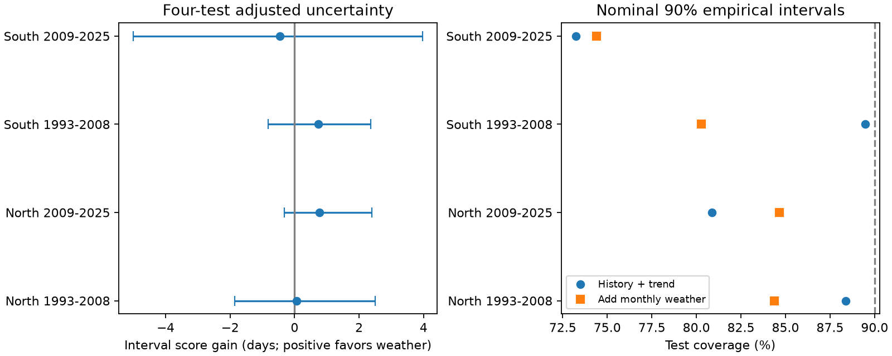

# Nominal 90 percent weather intervals covered 74-85 percent of later cherry bloom gaps in four Japan tests, 1993-2025

We tested whether monthly weather improves uncertainty intervals for the time from first cherry flowers to full bloom. We reused a signed panel from 48 Japan stations. Each test used separate earlier fit and calibration years. Four tests used two regions and two later periods, with 1,568 test records. Weather intervals set from the earlier 90th percentile of absolute errors covered 74.4-84.7 percent of later records. Interval score gains were -0.46 to +0.77 days. All four adjusted uncertainty intervals included zero. Removing the time trend raised late southern coverage to 84.4 percent, so the size of the deficit depends on the model. These empirical intervals have no distribution-free coverage guarantee under time dependence or change. Coarse weather, selected persistent stations, unknown visits and fixed training fits limit the result. This test concerns uncertainty calibration, not a causal climate effect, pollution or total flower life.



## Question and prior work

Can a simple weather model give useful uncertainty intervals for cherry development in later years? Good average error does not ensure correct coverage. A risk estimate needs both a narrow interval and few missed records. We use the interval score of Gneiting and Raftery (2007, doi:10.1198/016214506000001437). Our method uses a held-out residual quantile. It is not a new conformal method. Work on non-exchangeable data explains why coverage needs a separate check (https://jmlr.org/papers/v25/23-1553.html). We make no exact conformal coverage claim.

The campaign search command ran for several minutes without output. We stopped it and read metadata from published ZIPs. The search note records this limit. We read the prior cherry slope study f1084f2a and point-error study 9cab21c3 with SCI. We fully verified 9cab21c3 before using its data. Its point-error gains were small and did not repeat. Our new test uses separate fit, calibration and test windows to examine interval coverage and score. We reuse biological records. This is not an independent data replication. We did not inspect private worker files.

The JMA definition of first flowering is about five or six open flowers; full bloom is about 80 percent open. Their difference is a development interval, not the full life of flowers or a measure of food for pollinators. Research on warm winters at the southern range limit motivates a weather model (doi:10.1007/s00484-026-03185-6). Our test cannot measure chilling needs.

## Data and selection

The inherited panel has 3,100 station-years from 48 stations in 1961-2025. It uses JMA archive files 004 and 005, standard-taxon flags 8 or 9 with equal flags in each pair, valid dates, and gaps from 0 to 40 days. It matches exact names to current type-A AMeDAS stations. It requires at least 20 pairs in both 1961-1992 and 1993-2025. North is latitude at least 35 degrees; South is below 35 degrees. These are fixed source rules, not choices made from our scores. The source excludes 1,465 pairs with unmatched names. The selected cohort does not represent all trees in Japan.

Weather is nearest-cell 0.5-degree GHCN-CAMS version 3.01 monthly temperature. Predictors are prior December-current January mean, February, and March. Data were provided by NOAA PSL, Boulder, Colorado, USA, from https://psl.noaa.gov. March weather can occur after bloom. This is retrospective reconstruction with known weather. It is not an operational forecast.

The exact reused file is `files/panel.csv`, SHA-256 `6ea55d1f79d70dee1b81a8478f23109856ec3186c4d7fa80d3fe3ba2f4c2991e`. It is byte-identical to that file in SCI publication 9cab21c363d8f48aa3d1c75bdbb97cbe9f345f1c37e9584fc462ae4d39d35b47. `source_verify.json` records complete verification. `provenance.json` preserves the source study's exact shared paths, source URLs, source hashes and versions. Those raw hashes are inherited, not newly computed by this interval analysis. `source_build.py` is the unchanged raw builder. Raw data are reused in place and are not in this bundle. Their source terms still apply.

Fixed station terms reduce bias from constant station differences. Pairing keeps the same station mix for both events. Standard-taxon flags reduce species mixing. They do not identify an unchanged tree or remove effects of tree replacement, visits, observer changes, local heat or missing reports. The long-record cohort uses future availability to select stations. All results are conditional on that cohort, not prospective network performance.

## Method

We saved `plan.txt` before these interval fits. Each region is fit separately. Test 1 fits 1961-1980, calibrates on 1981-1992 and tests on 1993-2008. Test 2 fits 1961-1992, calibrates on 1993-2008 and tests on 2009-2025. A station needs at least 12 fit records and a record in both later windows. Fits and calibration widths stay fixed through each test. No test row enters its own fit or calibration. The later fit can use earlier test history.

The base model has station intercepts and a common linear year term. The weather model adds the three monthly predictors. Least squares uses inverse within-station record counts, so each station has equal fit weight. Calibration residuals have equal total station weight. The half-width q is the smallest absolute residual at which cumulative weight is at least 0.9. The test interval is prediction plus or minus q. We do not clip bounds or round them. This is an empirical residual interval without a finite-sample conformal rank correction. Correlated observations and time change also prevent a general 90 percent guarantee.

Coverage, width and interval score use equal total test weight per station. For lower and upper bounds L and U, observed gap y and alpha=0.1, score is U-L plus 20(L-y) if y is below L, or 20(y-U) if y is above U. Lower is better. Score gain is base minus weather. Coverage can improve merely by widening bounds; the score penalizes that cost.

We draw 10,000 circular blocks of three test years, with seed 1107. Each draw uses the same years for all stations in that sample, to retain shared annual variation. We keep row weights fixed and normalize each draw. Four score-gain intervals use percentiles 0.625 and 99.375. Eight coverage intervals use 0.3125 and 99.6875 percentiles. These give approximate family 95 percent limits within each outcome family if the block method is valid. There are only 16 or 17 test years. Intervals condition on fit parameters, calibration q and cohort; they omit training and calibration uncertainty. They cannot prove population calibration. Regions have disjoint stations but shared weather; periods share stations. These are separate assessments, not four independent experiments.

Sensitivity checks remove the trend or use five-year blocks. No test score selects a model or window. Coverage limits were added after the first point results as a diagnostic; the score comparison was planned.

## Results

| Region | Test years | Stations | Test rows | Base coverage, % | Weather coverage, % | Weather width, days | Score gain [adjusted limits], days |
|---|---|---:|---:|---:|---:|---:|---|
| North | 1993-2008 | 28 | 448 | 88.4 | 84.4 | 5.97 | +0.06 [-1.86, +2.51] |
| North | 2009-2025 | 28 | 476 | 80.9 | 84.7 | 6.71 | +0.77 [-0.32, +2.39] |
| South | 1993-2008 | 19 | 304 | 89.5 | 80.3 | 6.31 | +0.73 [-0.82, +2.37] |
| South | 2009-2025 | 20 | 340 | 73.2 | 74.4 | 7.91 | -0.46 [-5.00, +3.98] |

All four primary score-gain limits include zero. Thus weather did not give a clear common improvement in interval score. This does not show zero benefit or model equivalence. Primary weather coverage was below the nominal target in every sample. Even the upper conditional coverage limits were below 90 percent (88.6, 89.1, 88.5 and 83.8 percent). These conditional limits do not include uncertainty in the old calibration quantile.

Removing the trend changed late southern weather coverage from 74.4 to 84.4 percent. Its adjusted coverage limit then included 90 percent. The late northern limit also included 90 without a trend. Without a trend, primary three-year score-gain limits still included zero in all four samples. The early South gain was just above zero with five-year blocks and no trend. It did not repeat in the late South. All favorable and unfavorable sensitivity rows are in `results.csv`.

The evidence shows a failure of this fixed empirical uncertainty rule to retain its nominal coverage in these later records. It does not establish why. A change in residual spread, mean-model error, old calibration sampling error or reporting changes can all cause the deficit. Monthly weather alone did not consistently repair it. Adaptive calibration and daily pre-event weather are future tests, not demonstrated solutions here.

## Reproduce and inspect

From the worktree root:

```sh
python work/result/files/analyze.py --out work/recomputed
```

After extraction, run `python files/analyze.py --out recomputed`. The packaged panel is the default input. Python 3.12, NumPy, pandas and matplotlib are needed; versions are in `environment.json`. `predictions.csv` gives every test bound, score, inclusion indicator and weight. `fits.json` gives model coefficients, station order and calibration half-widths. `checks.json` and `independent_checks.json` give data and numerical checks. An independent scalar calculation matched the vector interval scores to less than 2e-14 days. A second run reproduced `results.csv` byte for byte.

For a raw rebuild on the campaign host:

```sh
python work/result/files/source_build.py --datasets ./datasets --out work/raw_rebuild
python work/result/files/analyze.py --input work/raw_rebuild/panel.csv --out work/raw_analysis
```

The source study verified its raw rebuild. This study verified and reused its signed panel; it did not complete a new raw rebuild. For other hosts, retrieve the three URLs in `provenance.json` into the named relative dataset directories. Compare the recorded SHA-256 hashes. Mutable URLs can change; the shared snapshots and signed panel fix the evidence for this result.

## Scope and job record

No pollution exposure, daily extreme, wild species distribution, pollinator interaction or causal climate-change effect is tested. We study uncertainty in ecological timing records. Selected persistent stations, unknown observation effort, coarse monthly weather and conditional uncertainty limit inference.

Job: sci-1107-syam2-climate-pollution-biodiversity-c73034cf2cfc. Topic: climate-pollution-biodiversity. Campaign: 11_07_2026. Machine: syam2. Account: codex-myxtap. Model: gpt-6.1-sol with high reasoning effort through Codex in T3 Code. One finite worker, no agents. The campaign-machine key is not a personal authorship claim. This publication is stored locally; it is not submitted to a remote archive.
