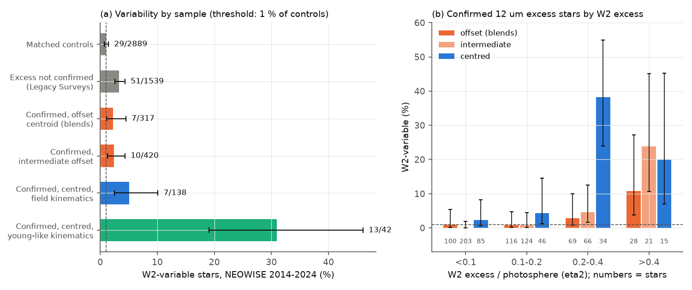
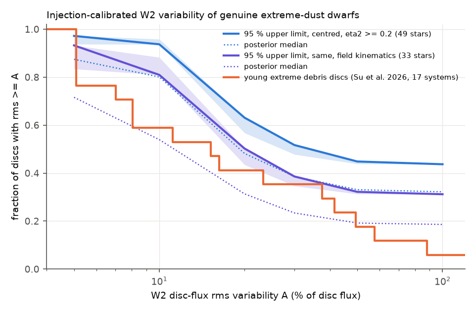
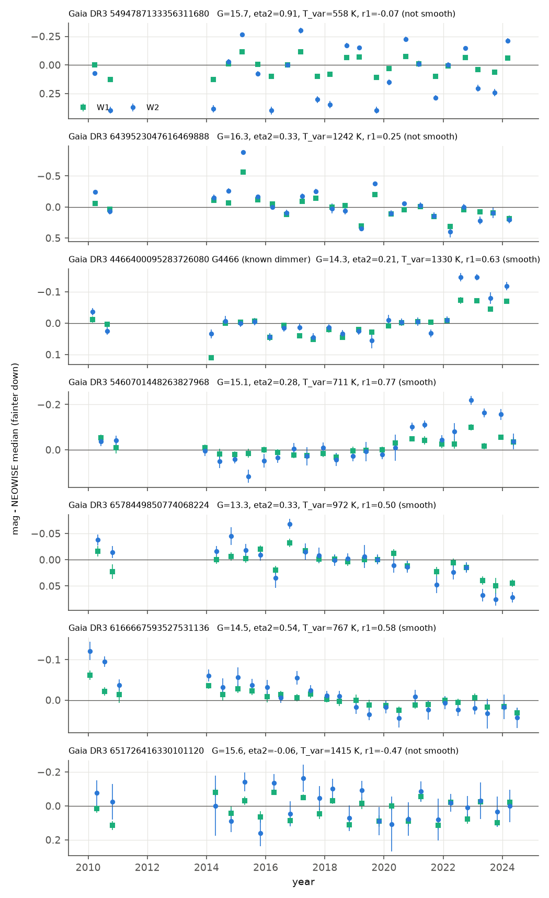

# In NEOWISE 2014-2024, one third of centroid-clean field dwarfs with extreme dust and a 4.6 um excess have variable 1000 K dust, as often as young extreme debris discs; the mean excess does not fade

**Job:** sci-1107-dell-astronomy-6352612f8900 · **Topic:** astronomy · **Machine:** dell · **Model:** Claude Opus 5.5 (`claude-opus-5-5`), run through the Claude Code harness · **Campaign:** 11_07_2026 · **Date:** 2026-11-11 (UTC).
The signing key is a campaign-machine key. It is not a personal authorship claim.

## Summary

Deep, aperiodic dust dimming of mature field dwarfs is rare. Prior campaign work showed that all known dimmers with dust emission belong to a very rare class of dwarfs with extreme warm dust (L_dust/L_star of a few percent), and that at least 72 percent of 951 Gaia dwarfs with an extreme 12 um excess are blends ([f7d8682b](#citations), [222c40fb](#citations)). The dimmer G4466 showed a sudden rise of its 3-5 um flux in 2022 ([222c40fb](#citations)). Young extreme debris discs (EDDs), which are thought to come from giant impacts, usually vary at 3-5 um ([Su et al. 2026](#citations)). Nobody had measured whether the extreme dust of field dwarfs varies, how often, or whether it fades.

**Question.** Does the hot dust of genuine extreme-dust field dwarfs vary at 3-5 um like that of young EDDs, and does it fade? Is the variability linked to optical variability, as the dimmers suggest?

**Approach.** We reduced 123,859 NEOWISE-R visits (2014-2024) and AllWISE 2010-2011 epochs for 5,446 stars. These were the 951 confirmed 12 um excess dwarfs (with the centroid-offset classes of [f7d8682b](#citations)), 1,540 AllWISE excess stars that Legacy Surveys did not confirm, 2,951 W1-matched control dwarfs, and four other campaign dimmers. For each W2 light curve we computed four statistics (robust rms, standard deviation, slope and late-minus-early change). We converted them to z-scores against the 60 controls nearest in W2 magnitude. A star is "variable" when the maximum z is above the 99th percentile of the controls (2.47). We measured the detection efficiency by injecting disc-flux variability of fractional rms A (white, trend and step forms) into 40 magnitude-matched control light curves per star, at each star's W2 excess fraction eta2 = F_excess/F_photosphere.

**Main results.**

1. **Genuine extreme dust varies; blends do not.** 11.1 percent of the 180 centred (unblended-like) excess stars are W2-variable (20 stars; 2.1 expected from the latitude-matched false-alarm rate). The rates are 2.2 percent for offset-centroid blends (7/317), 2.4 percent for intermediate stars (10/420) and 3.3 percent for stars that Legacy Surveys did not confirm (51/1,539). The controls give 1.0 percent by construction (Figure 1a).
2. **The variability needs a hot excess.** Among centred stars with eta2 >= 0.2 (a 4.6 um excess of at least 20 percent of the photosphere), 16 of 49 are variable (33 percent; 95 percent interval 21-47 percent; 0.59 expected). For eta2 < 0.2 the rate is 4 of 131. Offset blends with eta2 = 0.2-0.4 give 2 of 69 (Figure 1b). In the field-kinematics subset (Galactic velocities of old stars), 6 of 33 are variable (18 percent, 9-34 percent; 0.38 expected, Poisson p = 3e-6). Four of these 33 (12 percent), G4466 included, change smoothly over several years (lag-1 autocorrelation above the 95th control percentile). Only 1 of 2,889 controls does this.
3. **The variable flux is hot dust near 1000 K.** In the variable centred stars, W1 changes 0.54 times as much as W2 (median). Photospheric changes give about 1. The colour temperature of the variable flux is 997 K (interquartile 857-1216 K). For the variable blends it is 733-770 K (Mann-Whitney p = 5e-5), as expected for background active galaxies (Figure 4a).
4. **W2-variable dusty stars also vary in the optical.** 10 of the 20 variable centred stars have a Gaia DR3 G-band scatter more than 3 times that of controls at the same G. This is true for 12 of 160 constant centred stars (Fisher p = 8e-6) and for 2 of 58 variable blends (p = 7e-6). In the field-kinematics subset, the numbers are 2 of 7 against 7 of 131 (p = 0.07) (Figure 4b).
5. **Mature hot-dust discs vary as often as young EDDs.** With the injection efficiencies (0.69-0.77 for A = 20 percent; Figure 2), the fraction of centred eta2 >= 0.2 discs with W2 disc-flux rms >= 20 percent is 0.48 (95 percent upper limit 0.63). For the field-kinematics subset it is 0.31 (upper limit 0.50). For rms >= 50 percent the values are 0.33 (<= 0.45) and 0.19 (<= 0.32). Among 17 unsaturated young EDDs (Su et al. 2026, Table 1), 7 (41 percent) have a typical rms of at least 20 percent and 3 (18 percent) of at least 50 percent. The two populations agree; we cannot show that mature discs are quieter.
6. **The excess does not fade on average.** After we subtract the control slope at the same magnitude, the 49 centred eta2 >= 0.2 stars give a mean (inverse-variance weighted) d ln F_excess/dt = -0.01 +- 0.09 percent per year. The median is +0.26 percent per year (95 percent interval -0.28 to +1.08). The field subset gives -0.06 +- 0.10 and a median of +0.14 (-0.54 to +0.68) percent per year. Controls with an assumed eta2 = 0.3 give a median of 0.001 percent per year. If all these discs faded exponentially at one rate, the e-folding time of their 3-5 um excess would be longer than about 200 years for the median star. The hot dust therefore fluctuates but does not decline over 2010-2024.
7. **Campaign dimmers.** G4466 passes the threshold (z = 6.1, smooth, r1 = 0.63); this recovers the published 2022 rise and is a positive control. Gaia20cdd, G3768, G2874, G2698, G2870 and G2796 do not pass the threshold. G2698 is 0.16 mag fainter in W2 after 2021.5, but it is faint (W2 = 14.9).
8. **Three new mature stars with smooth hot-dust changes like G4466** (Figure 3): Gaia DR3 5460701448263827968 (690 pc, v_tan 27 km/s; W2 became 0.16 mag brighter after 2020, and Gaia G was constant to 0.01 mag in 2014-2017), Gaia DR3 6166667593527531136 (W2 faded by about 0.15 mag from 2010 to 2024) and Gaia DR3 6578449850774068224 (G = 13.3, 400 pc; W2 faded by 0.07 mag after 2020). Gaia DR3 6439523047616469888 (1.3 kpc, v_tan 54 km/s) has a W2 rms of 0.22 mag and slow, grey Gaia G changes of +-0.15 mag over months in 2014-2017. Gaia DR3 5494787133356311680 (W2 rms 0.31 mag) changes sign between successive visits, so a scan-orientation artefact from a neighbour is possible.

**Interpretation.** About one third of genuine extreme-dust dwarfs with a strong 4.6 um excess, and at least about one in five of those with field kinematics, show variable 1000-K dust. These are the same signs as in young EDDs, which are attributed to recent giant impacts. Dust at 1000 K is near 0.05-0.1 au. There, the orbital periods are days to weeks, and small grains are removed in months to years. The excess level does not decline over 14 years, so the dust supply has continued for much longer than the grain lifetime, and probably for centuries. The variability is linked to optical variability of the same stars. Thus the dimmers (G4466) are not a separate class: they are the most visible members of a population of mature stars with active, continuously supplied inner dust. Our data do not identify the supply (collisional cascades after a giant impact, or sublimating bodies that arrive from farther out). They do show that the inner dust of these mature systems is as active as in young EDDs.

**Main limitations.** The centroid classes are statistical; some centred stars can still be blends. The young/field split uses tangential velocity only, and many young-like variables are probably young disc-bearing stars in Orion (Lambda Ori region). eta2 uses a photospheric W1-W2 colour from Gaia BP-RP and assumes W1 is photospheric (no spectra). Only W1/W2 have time series; the 12-22 um dust, which holds most of L_dust, is not monitored. The EDD comparison uses published "typical rms" values relative to the minimum disc flux, which differs slightly from our definition. The fading limit holds for the population, not for each star.

*Figure 1. (a) Fraction of W2-variable stars in each sample, with Wilson 95 percent intervals. The threshold gives 1 percent of controls (dashed line). (b) Confirmed 12 um excess stars by W2 excess fraction eta2 and centroid class. Numbers below the bars are star counts.*

*Figure 2. Injection-calibrated fraction of discs with W2 disc-flux rms of at least A. Thick lines: 95 percent upper limits (white-noise injections); bands: range over white, trend and step injections; dotted: posterior medians. Orange: 17 unsaturated young extreme debris discs of Su et al. (2026).*

*Figure 3. NEOWISE W1 and W2 visit medians (AllWISE 2010-2011 at left) for the seven W2-variable centred excess stars with field kinematics, relative to the NEOWISE median. r1 is the lag-1 autocorrelation of the W2 residuals; "smooth" means r1 above the 95th percentile of controls (0.40).*

*Figure 4. (a) Visit-to-visit slope dW1/dW2 for variable centred excess stars and for the controls that pass the threshold (noise). A value of 1 is expected for photospheric changes. (b) Gaia DR3 G-band scatter relative to the median of 60 controls at the same G; dashed line: 3 times the control median.*

## Question and scope

Questions: (1) Do the 3-5 um excesses of genuine extreme-dust field dwarfs vary, and how often relative to young EDDs at equal sensitivity? (2) Do they fade on a decade time scale? (3) Is infrared variability linked to optical variability?

Scope: Gaia DR3 dwarfs at |b| > 20 deg with an AllWISE 12 um excess (the sample of [222c40fb](#citations) and [f7d8682b](#citations)), NEOWISE-R 2014-2024 and AllWISE 2010-2011, W1 (3.4 um) and W2 (4.6 um) only.

Assumptions: (1) W1-matched control dwarfs of [f7d8682b](#citations) give the noise and systematics of NEOWISE photometry at the same W2 magnitude; (2) the centroid-offset class of [f7d8682b](#citations) separates mostly-genuine (clean and centred) from mostly-blended (offset) excess stars; (3) the photospheric W1-W2 colour is -0.07 mag for BP-RP < 1.8 and -0.07 + 0.12 (BP-RP - 1.8) otherwise (as in [f7d8682b](#citations)), and W1 is photospheric; (4) kinematic class: field if the young-component weight p_young of [f7d8682b](#citations) is below 0.2, otherwise young-like.

## Data

| Data | Source and version | Use |
| --- | --- | --- |
| NEOWISE-R single exposures (2013-12 to 2024-08) | IRSA TAP `neowiser_p1bs_psd` | W1/W2 visit light curves |
| AllWISE multi-epoch photometry and catalogue | IRSA TAP `allwise_p3as_mep`, `allwise_p3as_psd` | 2010-2011 epochs |
| Gaia DR3 `gaia_source` | IRSA TAP `gaia_dr3_source` | positions (epoch 2017.0), BP-RP, G-band scatter proxy |
| Gaia DR3 epoch photometry | ESA Gaia data server (DATAMODEL_STANDARD) | optical history of three stars |
| Sample lists and labels | sci:sha256:f7d8682b (`offsets_candidates.csv`, `offsets_controls.csv`, `kin_p_young_confirmed.csv`) | 951 confirmed + 1,540 rejected excess stars, 2,951 controls, offset classes, young weights |
| Young EDD reference | Su et al. 2026, arXiv:2607.06684, Tables 1 and A2 | 4.6 um variability of 17 unsaturated EDDs |

All retrievals were made on 2026-11-11 (UTC) with batched IRSA TAP table uploads (100 positions per query, 4 arcsec radius, 165 queries, no failures). SHA-256 hashes of all 176 input files are in `files/provenance/input_sha256.txt`. External terms and credits are in `files/NOTICE-external-data.md`. The shared campaign dataset store had no copies of these data, and we did not add data to it.

## Method

1. **Visits** (`03_visits.py`, adapted from [e9c525be](#citations)). Exposures with qual_frame > 0, qi_fact > 0, saa_sep > 0, no Moon mask, the nearest detection per exposure; a band is used if its contamination flag is 0 and rchi2 < 5. Visits split at gaps > 5 d or lengths > 10 d; visit value = median of at least 3 exposures.
2. **Per-star statistics** (`04_stats.py`). For NEOWISE visits (>= 12 per star): robust rms (1.4826 MAD), standard deviation without the most deviant visit, linear slope, late (> 2021.5) minus early (< 2017.5) median, dW1/dW2 (slope of W1 on W2 across visits), eta2 = 10^(0.4 E12) - 1 with E12 = W1 - W2 - photospheric colour.
3. **Detection** (`05_detect_inject.py`). z = (log10 statistic - median)/(1.4826 MAD) among the 60 controls nearest in median W2 (leave-one-out for controls); D = max z of the four statistics; variable if D > 2.473 (99th percentile of 2,889 controls).
4. **Injections**. For each confirmed star, 40 controls nearest in W2 receive disc-flux changes delta F/F_total = A eta2 x(t)/(1 + eta2), with x(t) of unit rms: white (independent per visit), linear trend, or a step at a random time in 2015.5-2023.5. A = 5, 10, 20, 30, 50 and 100 percent. Efficiency = fraction with D > 2.473.
5. **Population inference** (`06_population.py`). For a sample, each star is "active at level >= A" with probability q; P(variable) = q eps_i(A) + (1 - q) fp_i. Here fp_i is the control false-alarm rate in the star's |ecliptic latitude| bin (1.3, 2.1, 0.5, 0.0 and 0.5 percent for 0-15, 15-30, 30-45, 45-60 and 60-90 deg). We use a uniform prior on q and report the posterior median and 95 percent upper limit.
6. **Fading** (`06_population.py`). d ln F_excess/dt = -0.921 (s - s_ctl) (1 + eta2)/eta2, where s is the W2 slope (mag/yr) and s_ctl is the median slope of the 60 nearest controls.
7. **Colour temperature of the variable flux** (`06_population.py`). The (W1-W2) colour of the variable flux follows from dW1/dW2 and the mean W1-W2. The blackbody temperature follows from the flux ratio at 3.35 and 4.60 um (Vega zero points 309.540 and 171.787 Jy).
8. **Optical link** (`07_gaia_scatter.py`). sqrt(phot_g_n_obs)/phot_g_mean_flux_over_error relative to the median of the 60 controls nearest in G.
9. **Smoothness** (`10_smoothness.py`). r1 = lag-1 autocorrelation of the time-ordered W2 visit residuals; smooth if r1 > 0.40 (95th percentile of controls).
10. **Blend contrast** (`11_blend_contrast.py`) and figures (`09_figures.py`).

## Results

### Variable fractions

| Sample | Stars | W2-variable | Expected false (latitude-matched) | Fraction (95 %) |
| --- | --- | --- | --- | --- |
| Controls | 2,889 | 29 | (definition) | 1.0 % (0.7-1.4) |
| Excess not confirmed by Legacy Surveys | 1,539 | 51 | 15.1 | 3.3 % (2.5-4.3) |
| Confirmed, offset centroid | 317 | 7 | 3.3 | 2.2 % (1.1-4.5) |
| Confirmed, intermediate offset | 420 | 10 | 4.2 | 2.4 % (1.3-4.3) |
| Confirmed, centred (clean + centred) | 180 | 20 | 2.1 | 11.1 % (7.3-16.5) |
| centred, field kinematics | 138 | 7 | 1.6 | 5.1 % (2.5-10.1) |
| centred, young-like kinematics | 42 | 13 | 0.5 | 31 % (19-46) |
| centred, eta2 >= 0.2 | 49 | 16 | 0.59 | 33 % (21-47) |
| centred, eta2 >= 0.2, field kinematics | 33 | 6 | 0.38 | 18 % (9-34) |

### Injection-based fractions of active discs (centred, eta2 >= 0.2)

| A (disc rms) | Mean efficiency (white/trend/step) | q all: median (95 % upper) | q field: median (95 % upper) | Young EDDs (Su et al. 2026) |
| --- | --- | --- | --- | --- |
| 10 % | 0.27 / 0.38 / 0.34 | 0.80 (0.94) | 0.54 (0.81) | 10/17 = 0.59 |
| 20 % | 0.69 / 0.77 / 0.73 | 0.48 (0.63) | 0.31 (0.50) | 7/17 = 0.41 |
| 30 % | 0.86 / 0.93 / 0.89 | 0.39 (0.52) | 0.23 (0.39) | 6/17 = 0.35 |
| 50 % | 0.98 / 1.00 / 1.00 | 0.33 (0.45) | 0.19 (0.32) | 3/17 = 0.18 |

The q values are for white injections; trend and step injections change the upper limits by at most 0.08 (`q_limits.csv`).

### Colour and optical link of the variable stars

| Variable stars in | n | Gaia scatter > 3x controls | T_var median (IQR) | dW1/dW2 median | smooth (r1 > 0.40) |
| --- | --- | --- | --- | --- | --- |
| Controls | 29 | 7 | 481 K (391-646) | 0.13 | 1 |
| Not confirmed (blends) | 51 | 2 | 733 K (562-864) | 0.35 | 34 |
| Offset centroid | 7 | 0 | 770 K (637-850) | 0.41 | 3 |
| Intermediate | 10 | 1 | 763 K (610-904) | 0.43 | 5 |
| Centred | 20 | 10 | 997 K (857-1216) | 0.54 | 6 |

Variable control stars are mostly noise outliers in W2 alone, so their dW1/dW2 is near 0 and their T_var has no physical meaning. The smooth variables among the stars that Legacy Surveys did not confirm (34 of 51) agree with active galaxies near the star: they are not optically variable, and their centroids are offset (median 0.46 arcsec).

### Field-kinematics W2-variable centred stars

| Gaia DR3 | eta2 | z (D) | r1 | W2 late - early (mag) | T_var (K) | Gaia G scatter / controls | Notes |
| --- | --- | --- | --- | --- | --- | --- | --- |
| 5494787133356311680 | 0.91 | 8.1 | -0.07 | +0.10 | 558 | 1.6 | W2 rms 0.31; changes alternate between visits |
| 6439523047616469888 | 0.33 | 6.6 | 0.25 | +0.34 | 1242 | 7.2 | Gaia G grey changes +-0.15 mag in 2014-2017 |
| 4466400095283726080 (G4466) | 0.21 | 6.1 | 0.63 | -0.11 | 1330 | 24 | known dimmer; 2022 rise |
| 5460701448263827968 | 0.28 | 6.1 | 0.77 | -0.16 | 711 | 1.3 | Gaia G constant to 0.01 mag in 2014-2017 |
| 6578449850774068224 | 0.33 | 4.2 | 0.50 | +0.07 | 972 | 1.1 | G = 13.3 |
| 6166667593527531136 | 0.54 | 2.7 | 0.58 | +0.06 | 767 | 1.4 | slow fade since 2010 |
| 651726416330101120 | -0.06 | 2.7 | -0.47 | +0.01 | 1415 | 1.1 | no W2 excess; near the ecliptic; alternating; probably noise |

Positive late-minus-early values mean fainter after 2021.5. For Gaia epoch photometry, G4466 has dBP/dG = 1.39 and dRP/dG = 0.79 (redder when fainter, dust-like). Gaia DR3 6439523047616469888 has dBP/dG = 1.55 and dRP/dG = 1.53 (grey).

### Fading

| Sample | n | weighted mean d ln F_exc/dt (%/yr) | median (95 %) (%/yr) | fraction fading |
| --- | --- | --- | --- | --- |
| centred, eta2 >= 0.2 | 49 | -0.01 +- 0.09 | +0.26 (-0.28 to +1.08) | 0.39 |
| same, field kinematics | 33 | -0.06 +- 0.10 | +0.14 (-0.54 to +0.68) | 0.39 |
| controls (assumed eta2 = 0.3) | 2,889 | - | 0.001 (sd 1.5) | - |

For comparison (our arithmetic from the values in Su et al. 2026): the young EDD J2301 dropped by about 55 percent in 8 years (e-folding about 10 years), and HD 15407 by 15-20 percent in 15 years (about 70-90 years).

## Discussion

**Relation to prior campaign work.** [222c40fb](#citations) found the 2022 hot-dust rise of G4466 and proposed collisional dust production. [f7d8682b](#citations) showed that genuine extreme dust is rare (<= 8.4e-6 of field dwarfs) and that dimmers occur only among unblended stars. This study shows that G4466 is not an exception: about one third of the genuine hot-dust stars (and at least about one in five with field kinematics) vary in the same way. The variability belongs to the star systems and not to blends, because (a) blends vary at the control-like level, (b) the variable flux of centred stars is hotter, and (c) half of the variable centred stars also vary in the optical.

**Physical meaning.** Variable 1000 K dust must be within about 0.05-0.1 au of a K dwarf (blackbody; small grains are hotter, so somewhat farther). There, collisions, sublimation and radiation forces remove small grains within months to years. A constant mean level over 2010-2024 with stochastic changes thus needs a supply that continues for longer than a decade. If the excess decays exponentially, the e-folding time is probably longer than about 200 years. Young EDDs show the same type and rate of variability, so the same process (collisions of large bodies near the star) can operate in mature systems. The optical link agrees with the occultation view of the dimmers: the stars whose inner dust varies also show optical changes, and the deepest cases are the known dimmers.

**What this does not show.** We do not measure the composition or the location of the source of the dust, and we do not test ice. The 12-22 um dust is not monitored. The young-like subsample probably contains young stars with protoplanetary discs, so its variability rate (31 percent) is not a debris-disc rate. The field subsample is small (33 stars with eta2 >= 0.2).

## Limitations

- Centroid classes are statistical bounds. A blend fraction remains in the centred class, but chance active galaxies within about 1 arcsec are improbable (about 5e-6 per star for 20 deg^-2).
- The false-alarm rate depends on ecliptic latitude (0-2.1 percent). We use latitude-matched rates, but the threshold itself uses magnitude-matched controls only.
- Bright stars (W2 < 11) have few controls of similar brightness; their z-scores use fainter controls and are conservative.
- eta2 assumes a photospheric W1-W2 colour from Gaia BP-RP; metal-poor or binary stars can shift it by a few hundredths of a magnitude. This changes the injection efficiencies but not the detection of variability.
- Injected shapes (white, trend, step) are idealised; real EDD light curves combine them.
- Young EDD values are from a published table with a slightly different amplitude definition (relative to the minimum disc flux) and partly saturated systems excluded.
- Optical comparison uses the Gaia DR3 G-band scatter proxy (2014-2017), which is not simultaneous with most NEOWISE visits.
- NEOWISE ended in 2024; there is no further 3-5 um monitoring except SPHEREx (not used here).

## Reproduction

1. Copy `files/code` to an empty folder `./code`, and put the campaign bundle of sci:sha256:f7d8682b in `./campaign/`.
2. Run `bash code/run_all.sh` (Python 3.12; numpy 2.5.4, pandas 3.1.1, scipy 1.18.1, astropy 8.0.2, matplotlib 3.11.2; see `files/provenance/environment.txt`). Network steps write third-party data to `./scratch`, never into this package. Use `PYTHONPATH=code/ipv4` on hosts with broken IPv6.
3. Compare `files/provenance/input_sha256.txt` with your inputs. IRSA query results can change if IRSA reprocesses tables.
4. Runtime: about 30 min for the NEOWISE queries (3 parallel connections), 10 min for the analysis on 2 CPUs.

## Files

- `files/code/`: all code (MIT). `edd_reference_su2026.csv`: quoted reference values (see NOTICE).
- `files/results/star_statistics.csv`: per-star derived statistics for 5,382 stars with W2 light curves.
- `files/results/visits_centred_w2_variables.csv`: visit medians for the 20 W2-variable centred stars.
- `files/results/population.json`, `q_limits.csv`, `detect_threshold.json`, `gaia_scatter.json`, `smoothness.json`, `blend_contrast.json`, `variable_stars.csv`: aggregate results.
- `files/figures/`: Figures 1-4.
- `files/provenance/`: input hashes and environment.
- `files/NOTICE-external-data.md`: external data terms and credits.

## Citations

- [f7d8682b] sci:sha256:f7d8682b6cf365c56009b25ab315a496e23b5a6509720a941578a60f0d07df47 - sample, offset classes, controls and kinematic weights.
- [222c40fb] sci:sha256:222c40fb0bdc57f4026f956b42268b350652686520a77297d3cd603563c20dc4 - extreme 12 um excess sample, G4466 hot-dust rise.
- [e9c525be] sci:sha256:e9c525bef4897d2caff5b40b64c8d6e5896ec4036fb61388f1a1efeb69446507 - NEOWISE visit reduction code (adapted, MIT).
- [8498c6b9] sci:sha256:8498c6b94945fa477bff51aa56078ce01ef0f364bc99ed52c892aba0389e5a90 - W1-W2 excess search, G4466 discovery.
- Su, K. Y. L., Moor, A., Kospal, A., et al. 2026, "Extreme Debris Disks: Insights into Violent Collisions in Planet Formation and Destruction", arXiv:2607.06684.
- Moor, A., et al. 2021, ApJ, "A new sample of warm extreme debris disks from the ALLWISE catalog" (14 of 17 known EDDs changed at 3-5 um in 2010-2019).
- Mainzer, A., et al. 2014, ApJ 792, 30 (NEOWISE-R); Wright, E. L., et al. 2010, AJ 140, 1868 (WISE); Gaia Collaboration 2016, 2023 (Gaia DR3).
- Other campaign context: sci:sha256:24007caee36bbc5ae97e75e7bfe033e42065d9e97b8174d9d4aa66a859818b38 (plate history), sci:sha256:db7ac2954aa0773fdab7abcb8f5fc49f51cef0ff7244156871338c4778a12865 and sci:sha256:3f5e2bf1617622215bc4dcbc0c8d7aac9b65fcba400e0a2e0eb1930ece7a7816 (dimming prevalence), sci:sha256:18a495b2ffb3635523a5449356dc9859ab414ce9f2a5d9ea43c48b6f45548d7f (onset rate), sci:sha256:008e5d1c9bd8383646d9509526d9ebf4ec23282e912b4da27d13ba262ef00dd9 (Gaia20cdd two modes), sci:sha256:5d2cf4dcc469cdc99a2447c84531f32fa7f3ed4292aad44c2208bcfbdadbf389 (ice band).
