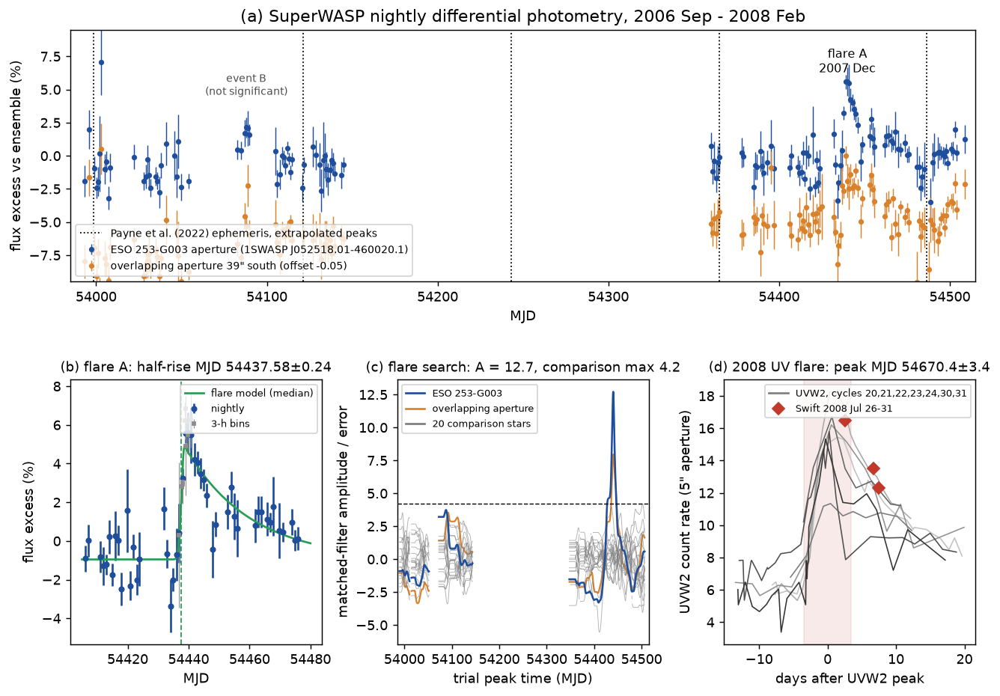
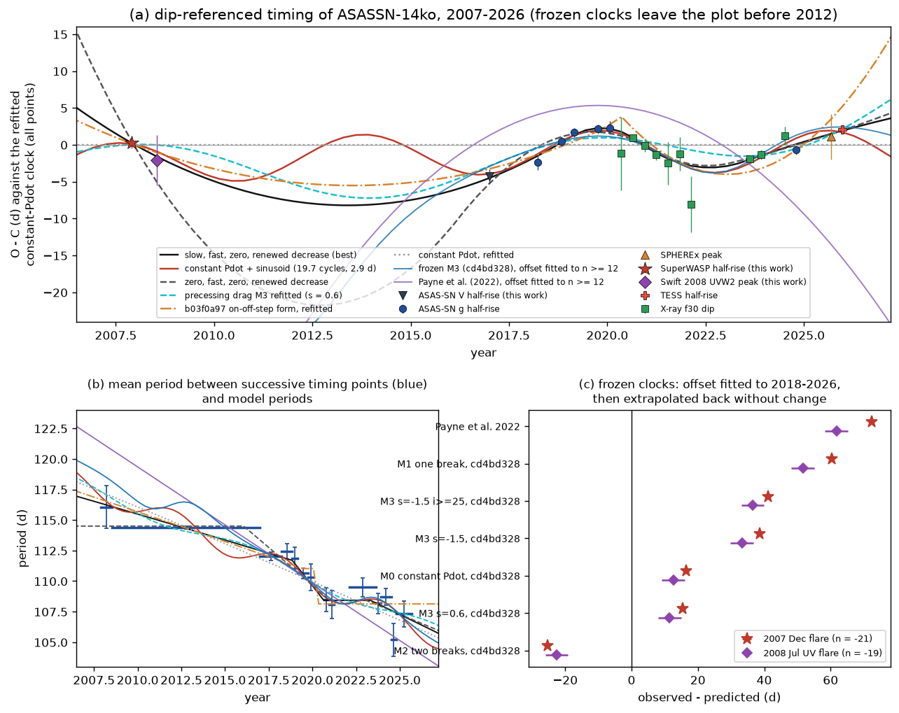
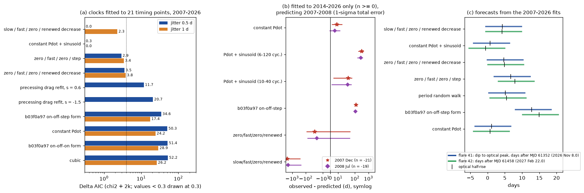

# ASASSN-14ko flares in 2007 (SuperWASP) and 2008 (Swift) show a slow period decrease before 2016 and a temporary fast decrease in 2018-2020; earlier clocks miss them by 11-72 days

**Job:** sci-1107-dell-astronomy-d993048e2966. **Topic:** astronomy. **Campaign:** 11_07_2026. **Machine:** dell. **Account:** claude-sci. **Model:** Claude Opus 5.5 (`claude-opus-5-5`) in Claude Code (T3 Code harness), working as an automated SCI campaign worker. **Analysis date:** 2026-11-11 (UTC). The signing key is a campaign-machine key. It is not a personal authorship claim.

## Summary

**Question.** ASASSN-14ko is a nuclear transient in ESO 253-G003 that flares every 104-115 days. It has been monitored since its discovery in 2014. Payne et al. (2021, 2022) found a decreasing period (Pdot = -0.0026) and stated that no earlier data constrain when the flares began. Campaign studies then found that the decrease stopped in 2020-2024 and started again after 2023 (SCI 049d6e3e, 2b5fd32c, b03f0a97). They also found that a precessing star-disc drag clock fits best (SCI cd4bd328). All of these clocks rest on 2014-2026 data only (about 38 orbits). We ask: (1) Do archival data from before 2014 contain flares of ASASSN-14ko? (2) If so, what was the period before 2014, and which clocks predict these flares? (3) Is the 2018-2024 behaviour a long-term trend, an episode, a periodic modulation or random period noise?

**Approach.** We searched three archives with pre-2014 data of the galaxy: Catalina (the service returned no data), ASAS-3 (only 26 valid points; the galaxy is at the survey limit) and SuperWASP DR1 (9,722 points, 2006 September to 2008 February). We also measured the only pre-2014 Swift visits (2008 July 26-31). For SuperWASP we made differential photometry against 14 comparison stars, ran a matched-filter flare search on the galaxy and on 20 comparison stars, and fitted the flare with the model of SCI b03f0a97. We timed the 2008 Swift UV flare against the UVW2 light curves of seven 2020-2024 flares. We converted both events to the X-ray dip clock of the campaign (half-rise minus 4.75 d; UVW2 peak minus 5.51 d) and added them to the timing set of SCI b03f0a97. We added one 2014-2017 ASAS-SN V-band flare that passes the same quality rules (four more in a variant with a relaxed rule). We then (a) tested frozen clocks without refitting, (b) fitted ten clock models to the 21 timing points from 2007-2026, (c) predicted the 2007-2008 points from fits to 2014-2026 data only, and (d) compared deterministic clocks with a period random walk (Kalman filter).

**Results.**

1. **A flare of ASASSN-14ko in 2007 December.** The SuperWASP aperture on the galaxy brightened by 5.9 +/- 0.4 % (about 0.4 mJy) within two nights and then declined with an e-folding time of 21 +/- 3 d. The half-rise was at MJD 54437.58 +/- 0.24 and the peak at MJD 54438.67 +/- 0.36 (2007 December 9-10). The matched-filter statistic is 12.7. The maximum of 20 comparison stars over the full 1.4-year light curve is 4.2. The comparison ensemble stays flat (offset below 0.004 mag). A weak event in 2006 December (statistic 3.7) is not significant. These data push the first observed flare back by seven years, from 2014 to 2007.
2. **A UV flare in 2008 July.** The UVW2 rate of the nucleus was 16.5 counts/s on 2008 July 26 and fell to 13.5 and 12.3 counts/s 4.1 and 4.9 d later. This is higher than 95 % of all 2020-2026 visits. UVW1 was also high (12.6 counts/s, higher than 95 % of the 19 UVW1 visits of 2020-2026). Against the UVW2 light curves of seven narrow 2020-2024 flares, the 2008 visits started 2.6 +/- 3.4 d after the UVW2 peak. Thus the UVW2 peak was at MJD 54670.4 +/- 3.4.
3. **The cycle count is unique.** The two events are exactly two cycles apart. The local period in 2007-2008 was 116.0 +/- 1.7 d (dip clock). The 2007 flare is cycle n = -21 in the numbering of Payne et al. (22 cycles before the first ASAS-SN flare in 2014 November). Counts of 21 or 23 cycles fit worse by Delta chi2 = 5-24 for the most flexible clock (strict and relaxed V-band sets), by Delta chi2 = 12.8 for the sinusoid clock and by Delta chi2 = 286-311 for constant Pdot.
4. **All earlier clocks miss the 2007-2008 flares.** With only an offset fitted to the 2018-2026 points, the Payne et al. (2022) ephemeris predicts the flares 72 and 62 days too early. The frozen campaign clocks miss by +15 to +60 d (M0, M1, M3) or by -25 d (M2) (Table 2; at least 3.3 sigma at the 2008 point and 17 sigma at the 2007 point). The precessing-drag clock M3, which was the preferred frozen clock in SCI cd4bd328 and b03f0a97, misses by 39 and 33 days. The forms of the b03f0a97 clocks, in which the fast early decrease extends back in time, fail by Delta AIC = 35-51. Fitted to the 2014-2026 points only, the b03f0a97 on-off-step clock predicts the 2007 flare 122 +/- 22 d too early (5.5 sigma).
5. **The fast decrease is an episode.** The best clocks on the 21 points (Table 3) have a slow decrease before 2016-2018 (dP/dn = -0.13 +/- 0.01 d per cycle, or zero before cycle 5), a fast decrease of -0.55 +/- 0.03 d per cycle from about 2018 to 2020 (cycles 14-20), a constant period in 2020-2023, and a decrease of -0.20 +/- 0.03 d per cycle after cycle 29. Over 2007-2026 the mean change is -0.13 to -0.19 d per cycle (Pdot = -0.0012 to -0.0017). This is 35-55 % below the published Pdot and 3-4 times below the 2018-2020 rate. A constant Pdot fitted to 2014-2026 data predicts the 2007-2008 flares within 1.3 sigma (+8.7 +/- 6.9 d), but it fails on the dense 2018-2026 points (Delta AIC = 24-50). A cubic does not help.
6. **Periodic modulation or random noise?** A constant Pdot (dP/dn = -0.190 d per cycle) plus a sinusoidal O-C term (amplitude 2.9 d, period 19.7 cycles = 5.8 years) fits the main set as well as the best piecewise clock (Delta AIC = +0.3 and -2.3 for 0.5-d and 1-d jitter). But its period is not unique (other peaks at 22.8 and 36.4 cycles), and with the four extra 2014-2016 V-band flares it is worse than the piecewise clocks by Delta AIC = 3.5-12.6. A period random walk with kicks of 0.34 d per orbit (95 % range 0.20-0.59) fits worse than the smooth sinusoid clock by Delta AIC = 15.8 on the same likelihood. A random walk added to that clock goes to zero.
7. **Precessing drag refitted.** When we refit the precessing-drag clock with the two new points, its chi2 rises from 11.8 (2014-2026 only) to 30.8 for a radiation-pressure disc (s = -1.5). For a gas-pressure disc (s = 0.6) the chi2 is 21.9. It is worse than the best clock by Delta AIC = 20.7 and 11.7.
8. **Forecasts for flare 41 (now) and flare 42.** All surviving clocks put the X-ray dip of flare 41 on 2026 November 3-9, the optical half-rise on November 8-14, the UVW2 peak on November 9-15 and the optical peak on November 14-20. For flare 42 the half-rise is on 2027 February 21 - March 1. The sinusoid clock is the earliest. The b03f0a97 on-off-step form is the latest (November 20 and March 8).

**Interpretation.** The flares of ASASSN-14ko were already present in 2007, seven years before discovery. Thus the partial disruptions have lasted at least 19 years and about 61 orbits. The period was 116.0 +/- 1.7 d in 2007-2008. It then decreased slowly or not at all until about 2016, decreased quickly in 2018-2020, stayed constant in 2020-2023, and decreased again. The fast decrease that defined the published Pdot is not the long-term rate. It is an episode about 3-4 times faster than the 19-year mean. Thus a smooth secular clock (gravitational-wave or steady drag decay, constant Pdot, cubic) is excluded. All clocks frozen from 2014-2026 data fail. The new points cannot separate an episodic clock from a smooth modulation of about 3 d on a 6-10 year time scale. They do disfavour random period kicks as the main cause of the timing structure. They also disfavour the specific precessing-drag geometry that earlier campaign work preferred. Any physical clock must now explain a period change that switches between at least three rates (about 0, -0.13 and -0.55 d per orbit) over 19 years. The mean must stay near -0.16 d per orbit.

**Limitations.** (1) Two pre-2014 points carry the new constraint. The 2007 flare comes from a 14" pixel survey: a 48" aperture holds the galaxy, a G = 14.9 foreground star at 38" and several faint (G = 19-21) sources. The larger excess in the galaxy aperture (5.9 %) than in the aperture on the star (4.3 %) and the Swift UV flare two cycles later support ASASSN-14ko as the source. But an outburst of a faint field source (for example a dwarf nova) is not fully excluded. (2) The 2008 UV peak time comes from a template comparison of three visits (error 3.4 d; Delta chi2 < 4 range -2.8 to +10 d). (3) We assume that the half-rise and UVW2 lags on the X-ray dip were the same in 2007-2008 as in 2020-2023. The 2007 flare is narrow (rise sigma 1 d), like the calibration flares. (4) The SuperWASP band is broad (400-700 nm); we add 0.42 d for band differences. (5) 2009-2013 has no timing point. The episodic and sinusoid clocks differ most in that gap. (6) The choice between episodic and sinusoid clocks depends on the 2014-2016 V-band flares, which have half-rise errors of 1.7-2.7 d. (7) AIC values for the Kalman model and the deterministic models agree only on the conditional likelihood used in `15_rw_vs_sine.py`. In that comparison the sinusoid parameters are fixed at their best values (and counted as parameters). (8) On 2026-11-11 no public data cover flare 41 (Swift: last visit 2026-02-05).

**Figure 1.** (a) SuperWASP nightly differential flux of the galaxy aperture (blue) and of the overlapping aperture 39" south (orange, offset -5 %), with the peak times that the Payne et al. (2022) ephemeris gives for 2006-2008 (dotted). (b) The 2007 December flare with the median one-component model and 3-hour bins of single frames across the rise. (c) Matched-filter statistic against trial peak time for the galaxy, the overlapping aperture and 20 comparison stars; dashed line: comparison maximum. (d) Swift UVW2 rates of 2008 July (red) on the UVW2 light curves of seven 2020-2024 flares, aligned on the adopted 2008 peak.

## 1. Context

ASASSN-14ko (z = 0.0425) flares every 104-115 d. Payne et al. (2021, ApJ 910, 125; 2022, ApJ 926, 142) found a period derivative of -0.0026 from 2014-2021 data. They also wrote that "no prior available data appear to constrain when these flares first began". Campaign studies found that the 2022-2026 flares arrive up to 21 d late relative to that ephemeris (SCI 9398601f, 9817499f, b29ea789, 8ce2fda4). They found a constant X-ray dip clock in 2020-2024 (SCI 049d6e3e, 2b5fd32c) and a renewed decrease after 2023 (SCI b03f0a97). They found that the host AGN stayed steady (SCI cd4bd328) and that the X-ray source has an on-off soft state (SCI dc60fe15, 9c84683e). The physical clock is open. Random period kicks of about 0.6 d per orbit (SCI 9817499f), precessing star-disc drag (SCI cd4bd328) and light-travel-time clocks (SCI 8e6f3b54) were proposed. Bootstrap tests rejected steady decay and a cubic on 2016-2026 data (SCI 77860d3a). All of these studies use data from 2014 or later. A campaign search (`sci search` for ASASSN-14ko, pre-2014, Catalina, ATLAS, Gaia, eROSITA; 2026-11-11) found no study of pre-discovery data.

## 2. Data

| Data | Source | Use |
| --- | --- | --- |
| SuperWASP DR1, 30 objects within 3' (camera 227; 2006-09-14 to 2008-02-12; 9,722 points on the galaxy) | WASP DR1 archive, CERIT-SC (Butters et al. 2010) | flare search and fit |
| Swift UVOT sky images, obsids 00037354001-003 (UVW2, UVW1, U; 2008 July 26-31) | HEASARC | 2008 UV flare |
| ASAS-3 V, ASAS 052518-4600.4 (2000-2009) | ASAS cgi service | checked: 26 valid points (most frames below the detection limit); not used |
| Catalina Surveys DR (CSDR2/3) cone search | nunuku.caltech.edu | the service returned no photometry, also for a test position (M87); not used |
| ASAS-SN Sky Patrol v2 V band, 2014-2017 | SCI b29ea789 `asassn_skypatrol_14ko.csv` | half-rises of flares 1-10 |
| Timing set of 18 points, cycles 12-38 | SCI b03f0a97 `clock_points_full.csv` | unchanged |
| UVW2 light curves and UVW2 peak times of cycles 20-31 | SCI b29ea789 `uvot_lc.csv`; SCI 049d6e3e `xclock_oc.csv` | 2008 phase templates |
| Frozen clocks M0-M3 | SCI cd4bd328 `clock_fits.csv`, `clock_fit_curves.csv` | backward extrapolation |
| Gaia DR3 (GAVO `gaia.dr3lite`) | Gaia Collaboration 2023 | source confusion check |

SHA-256 of every input file: `files/data/input_sha256.txt`. Terms and acknowledgements: `files/NOTICE_external_data.md`.

## 3. Methods

**3.1 SuperWASP photometry** (`wasp_frames.py`, `01_wasp_flares.py`). We matched frames by HJD. The ensemble offset is the median magnitude deviation of 14 comparison stars with nightly robust scatter below 0.02 mag. For each night we kept frames within 4 MAD of the night median and required at least 10 frames, an ensemble offset below 0.03 mag and a frame MAD below 0.15 mag (143 of 160 nights remain). Relative flux excess = 10^(-0.4 dm) - 1. Matched filter: a fixed flare template (half-Gaussian rise sigma 2.5 d, exponential decline 12 d) on a 0.25-d grid of peak times, with a free baseline per season; the statistic is the fitted amplitude divided by its error (scaled by the reduced chi2 if above 1). We applied the same search to every comparison star with at least 80 good nights, each against an ensemble without itself.

**3.2 Flare fit** (`02_wasp_fit.py`). One-component model of SCI b03f0a97 (`flarelib`: half-Gaussian rise, exponential decline, free jitter), emcee 3.1.6, 40 walkers, 1,500 burn-in and 2,500 steps, window -45 to +40 d. Half-rise th = tp - 1.177 sigma.

**3.3 Swift 2008** (`03_swift2008.py`). We used the UVOT photometry code of SCI b29ea789 unchanged (5" aperture, 60-90" background annulus, coincidence-loss correction), so the 2008 rates are on the same scale as the 2020-2024 rates. We removed two snapshots that differ by more than 25 % from their obsid median (0.16 and 8.5 counts/s, against 12-13.6 counts/s). For a trial offset tau, each template cycle (20-24, 30, 31: the narrow flares of the b03f0a97 lag calibration) is interpolated at the 2008 visit times and scaled by a free factor 0.6-1.4. The adopted tau is the median of the per-template best offsets. Its error is the quadrature sum of the scatter between templates and the mean Delta chi2 = 1 half-width.

**3.4 V-band flares 2014-2017** (`04_fit_asassn_v.py`). Same model and rules as b03f0a97 (sampled within 5 d on both sides of th, th error below 1.5 d, rise sigma at most 6 d). Only flare 8 passes. In the variant "vrelax" the error limit is 3.5 d (flares 2, 4, 5, 8, 10).

**3.5 Timing set** (`06_clock_models.py`). Dip-equivalent times: SuperWASP th - 4.75 d (error sqrt(0.24^2 + 0.52^2 + 0.42^2) = 0.71 d), Swift UVW2 peak - 5.51 d (error 3.43 d), ASAS-SN V th - 4.75 d, and the 18 b03f0a97 points unchanged (`files/data/timing_set_main.csv`).

**3.6 Clock models.** The period recursion is t_{n+1} = t_n + P_n, P_{n+1} = P_n + k_n. The models are: constant P; constant Pdot ("quad"); cubic; the b03f0a97 forms on-off-on and on-off-step (first slope extends to the earliest cycle); zero/fast/zero/renewed ("off-on-off-on"); zero/fast/zero/step; slow/fast/zero/renewed ("k0-on-off-on"); constant Pdot plus sinusoid (period on a 160-point log grid of 6-120 cycles). Breaks are profiled on integer grids and counted as parameters. Weighted least squares with jitter 0.5 d, 1 d or free. AIC = chi2 + 2k for fixed jitter (Table 3).

**3.7 Frozen clocks** (`05_frozen_backward.py`, `09_frozen_test.py`). We rebuilt the cd4bd328 clocks from their parameters (forward part reproduces its curves to 1e-11 d) and extended the period recursion backward (first-segment slope for M0-M2, the drag recursion for M3). Each frozen curve gets one offset, fitted to the n >= 12 points (all frozen curves are optical-peak curves; the offset absorbs the marker lag).

**3.8 Out-of-sample test** (`13_predict_back.py`). Each model is fitted to n >= 0 (or n >= 12). For grid parameters the prediction is a likelihood-weighted mixture (marginal likelihood over the linear parameters, flat prior on breaks and on log period), with the parameter covariance propagated.

**3.9 Random walk** (`11_kalman.py`, `15_rw_vs_sine.py`). Kalman filter on the state (t_n, P_n) with P_{n+1} = P_n + k + w, w ~ N(0, sigma_kick^2), diffuse start; likelihood of the innovations after the first two. Free k, sigma_kick, jitter. We compare it with the deterministic clocks on the same likelihood by running the filter with sigma_kick = 0 on the data minus the best sinusoid.

**3.10 Precessing drag refit** (`07_m3_refit.py`). The M3 recursion of SCI cd4bd328 (eccentricity 0.85, Sigma ~ r^-s, inclinations 5-175 deg) with free K, precession rate dw and phase w0 (Nelder-Mead from 20 starts per inclination); t26 and P26 linear.

## 4. Results

### 4.1 The 2007 flare and the 2008 UV flare

Table 1. Pre-discovery events (`files/results/wasp/wasp_flare_fits.json`, `files/results/swift2008/`).

| Quantity | Value |
| --- | --- |
| SuperWASP flare A: half-rise / peak (MJD) | 54437.58 +/- 0.24 / 54438.67 (+0.38/-0.34) |
| rise sigma / decline e-folding time | 0.95 (0.54-1.36) d / 21.3 (18.2-25.0) d |
| amplitude (fraction of the 48" aperture flux, V ~ 14.3) | 5.9 % (5.5-6.2 %), about 0.4 mJy (ASAS-SN V flares 2014-2017: 0.4-0.65 mJy) |
| Delta chi2 against no flare | 281 |
| matched filter: galaxy / overlapping aperture / comparison maximum (20 stars) | 12.7 / 8.0 / 4.2 |
| Swift UVW2 2008 July 26.0, 30.1, 30.9 (counts/s) | 16.49 +/- 0.17, 13.49 +/- 0.10, 12.29 +/- 0.07 |
| fraction of 2020-2026 UVW2 visits below 16.49 | 0.946 |
| per-template best offsets after the UVW2 peak (cycles 20, 21, 22, 23, 24, 30, 31) | 2.3, 3.1, 2.6, 7.4, -0.5, 1.2, 3.8 d |
| adopted UVW2 peak (MJD) | 54670.4 +/- 3.4 |
| local period 2007-2008 (dip clock) | 116.0 +/- 1.7 d |

The Swift XRT soft-band rate of SCI 049d6e3e (blended with the obscured companion nucleus; SCI dc60fe15) was 0.0026 and 0.0031 counts/s on July 26 and 29 and 0.0075 counts/s on July 31 (SCI 049d6e3e `xrt_per_obs.csv`). The 2020-2026 median is 0.0059 counts/s.

### 4.2 Frozen clocks

Table 2. Observed minus predicted dip-equivalent time; offset fitted to n >= 12 (`files/results/models/frozen_prediction_test.csv`).

| Clock | n = -21 (2007 Dec) | n = -19 (2008 Jul) | period at n = -20 |
| --- | --- | --- | --- |
| Payne et al. (2022) ephemeris | +72.4 d | +61.8 d | 121.2 d |
| M1 one break (cd4bd328) | +60.3 | +51.6 | 120.2 |
| M3 s = -1.5, i >= 25 deg (cd4bd328) | +41.1 | +36.5 | 118.2 |
| M3 s = -1.5 (cd4bd328) | +38.6 | +33.3 | 118.5 |
| M0 constant Pdot (cd4bd328) | +16.5 | +12.6 | 117.9 |
| M3 s = 0.6 (cd4bd328) | +15.5 | +11.5 | 118.0 |
| M2 two breaks (cd4bd328) | -25.3 | -22.6 | 114.6 |
| observed | 0 +/- 0.7 | 0 +/- 3.4 | 116.0 +/- 1.7 |

### 4.3 Clock models on 2007-2026

Table 3. 21 timing points (`files/results/model_table.csv`). Delta AIC = Delta(chi2 + 2k).

| Model | k | chi2 (0.5 d) | Delta AIC 0.5 d | Delta AIC 1 d | Breaks / period | Rates (d per cycle) |
| --- | --- | --- | --- | --- | --- | --- |
| slow / fast / zero / renewed | 8 | 6.1 | 0.0 | 2.3 | 14, 20, 29 | -0.133, -0.546, 0, -0.203 |
| constant Pdot + sinusoid | 6 | 10.4 | 0.3 | 0.0 | 19.7 cycles, 2.9 d | -0.190 |
| zero / fast / zero / step | 7 | 11.1 | 2.9 | 3.4 | 5, 21, 31 | 0, -0.380, 0, step -1.24 d |
| zero / fast / zero / renewed | 7 | 11.7 | 3.5 | 3.8 | 5, 21, 28 | 0, -0.378, 0, -0.175 |
| precessing drag refit, s = 0.6 | 6 | 21.9 | 11.7 | - | i = 5 deg, modulation 34 cycles | - |
| precessing drag refit, s = -1.5 | 6 | 30.8 | 20.7 | - | i = 5 deg, modulation 23 cycles | - |
| b03f0a97 on-off-step form | 6 | 44.7 | 34.6 | 17.4 | 16, 18 | -0.153, step -2.90 d |
| constant Pdot | 3 | 66.4 | 50.3 | 24.2 | - | -0.189 |
| b03f0a97 on-off-on form | 6 | 61.6 | 51.4 | 28.9 | 25, 27 | -0.197, -0.159 |
| cubic | 4 | 66.3 | 52.2 | 26.2 | - | - |

**Figure 2.** (a) Dip-referenced O-C of the 21 timing points against a constant-Pdot clock fitted to all points, with the fitted clocks and two frozen clocks (offset fitted to n >= 12). (b) Mean period between successive timing points (blue bars; errors above 2.5 d not shown) and model periods. (c) Frozen clocks extrapolated back without change: observed minus predicted time of the 2007 and 2008 flares.

Table 4. Robustness (`files/results/summary.json` key `variants`; `files/results/models/clock_models_*.csv`).

| Variant | Result |
| --- | --- |
| relaxed V rule (flares 2, 4, 5, 8, 10 added) | slow/fast/zero/renewed best (-0.106, -0.494, 0, -0.179; breaks 12, 20, 28); constant Pdot worse by 52-110; b03f0a97 forms worse by 20-110; sinusoid worse by 3.5-12.6 (best period 41 cycles) |
| 2007 point dropped / 2008 point dropped | best models and rejections unchanged (constant Pdot worse by 23-50; b03f0a97 forms by 17-51) |
| 2008 error doubled (6.8 d) | unchanged |
| cycle count 21 or 23 (both pre-2014 points shifted) | best chi2 rises from 6.1 to 11.3 and 18.7 (strict) and from 14.2 to 25.6 and 37.8 (relaxed V) |
| without both pre-2014 points | b03f0a97 forms worse by only 1.3-6.1: the pre-2014 points carry their rejection |

### 4.4 Out-of-sample prediction and noise models

Table 5. Fitted to n >= 0 (2014-2026), jitter 0.5 d (`files/results/models/predict_back_main*.csv`).

| Model | n = -21: obs - pred | z | n = -19: obs - pred | z |
| --- | --- | --- | --- | --- |
| constant Pdot | +8.7 +/- 6.9 d | 1.3 | +5.7 +/- 6.3 d | 0.8 |
| constant Pdot + sinusoid, 10-40 cycles | +32.8 +/- 28.9 | 1.1 | +28.3 +/- 26.7 | 1.1 |
| b03f0a97 on-off-step form | +121.8 +/- 22.2 | 5.5 | +106.8 +/- 19.8 | 5.3 |
| zero / fast / zero / renewed | -21.7 +/- 67.8 | -0.3 | -18.1 +/- 61.4 | -0.3 |
| period random walk (Kalman, n >= 0) | +28.2 +/- 36.8 | 0.8 | +24.1 +/- 33.3 | 0.7 |

Flexible clocks have prediction errors of 30-3,000 d when they are fitted to 2014-2026 only, so only the new points fix their early segment.

Period random walk (all 21 points): sigma_kick = 0.34 d per orbit (95 % range 0.20-0.59), k = -0.164 d per cycle. It improves on steady decay plus white jitter by Delta lnL = 5.2. On the same conditional likelihood (`rw_vs_sine_main.json`): steady decay AIC 99.4; random walk 90.9; constant Pdot + sinusoid 75.1; sinusoid + random walk 77.1 (sigma_kick -> 0).

**Figure 3.** (a) Delta AIC of the clocks on the 21 timing points (0.5-d and 1-d jitter). (b) Clocks fitted to 2014-2026 only (n >= 0) and their prediction of the 2007 and 2008 flares (symlog axis). (c) Forecasts of flares 41 and 42: X-ray dip to optical peak (bars) and optical half-rise (ticks).

### 4.5 Forecasts

Table 6. Forecasts (UTC dates; `files/results/forecasts_41_44.csv`). Half-rise = dip + 4.75 d; UVW2 peak = dip + 5.51 d; optical peak = dip + 10.35 d.

| Clock | flare 41 dip | 41 half-rise | 41 UVW2 peak | 41 optical peak | flare 42 half-rise | flare 44 half-rise |
| --- | --- | --- | --- | --- | --- | --- |
| slow / fast / zero / renewed | 2026-11-07 | 11-12 | 11-12 | 11-17 | 2027-02-26 | 2027-09-25 |
| constant Pdot + sinusoid | 2026-11-03 | 11-08 | 11-09 | 11-14 | 2027-02-21 | 2027-09-18 |
| zero / fast / zero / renewed | 2026-11-07 | 11-12 | 11-13 | 11-18 | 2027-02-26 | 2027-09-26 |
| zero / fast / zero / step | 2026-11-09 | 11-14 | 11-15 | 11-20 | 2027-03-01 | 2027-10-02 |
| period random walk (sd 2.0 / 2.7 / 4.2 d) | 2026-11-08 | 11-13 | 11-13 | 11-18 | 2027-02-27 | 2027-09-27 |
| b03f0a97 on-off-step form (rejected) | 2026-11-16 | 11-20 | 11-21 | 11-26 | 2027-03-08 | 2027-10-11 |

A half-rise of flare 41 later than about November 17 would reject all surviving clocks. At flare 44 the sinusoid and the episodic clocks differ by 7-14 d.

## 5. Discussion

**Flares since at least 2007.** Payne et al. (2021) left the start of the flares open. The 2007 SuperWASP flare and the 2008 Swift UV flare show that the repeating flares were present at least 19 years ago (61 orbits). The 2007 flare had a narrow rise (sigma 1 d) and a decline of 21 d, like the narrow flares of 2014-2021. Its amplitude was similar to the 2014-2017 V-band flares. The UV level in 2008 was as high as in 2020-2024 flares. Thus the flares did not change much in 19 years while the period decreased from about 116 d to about 107 d.

**What the long baseline changes.** Before this study, all clocks were fitted to 2014-2026. They took the fast 2018-2020 decrease as the base trend and the 2020-2023 constant period as a stall. With the 2007-2008 points, the base trend is slower (-0.13 to -0.19 d per cycle). The fast decrease is a temporary excess, about 3-4 times the mean rate. The stall and the renewed decrease can be parts of the same pattern: the period follows the long-term mean with excursions of a few days. Two kinds of clock describe this. In an episodic clock the decay switches between rates (about 0, -0.13 and -0.55 d per orbit). In a modulated clock a steady decay has a periodic O-C term of about 3 d. The present data do not separate them; the choice depends on the 2014-2016 V-band flares. The gap of 2009-2013 is where they differ most.

**Physical clocks.** A secular decay alone (gravitational waves, steady hydrodynamic drag, a smooth Pdot) does not fit the dense 2018-2026 points. Its extrapolation to 2007 works only because the 2007-2008 points lie on the long-term mean. The precessing-drag clock of SCI cd4bd328 has the right kind of behaviour (rates that switch on and off). But its frozen form predicts too long a period in 2007 (118.5 d), and the refit is worse by Delta AIC = 12-21. A precession clock in which the O-C oscillates (for example a precessing debris-return geometry or a light-travel effect) would need an amplitude of about 3 d and a period of 6-10 years; the 2014-2016 V flares disfavour the 5.8-year solution. Random period kicks of 0.2-0.6 d per orbit fit the data less well than a smooth modulation on the same likelihood.

**Tests.** (1) Flare 41 (now) and flare 42 (2027 February-March): a half-rise later than about November 17 or March 2 rejects the surviving clocks. (2) Flare 44 (2027 September) separates the sinusoid from the episodic clocks by 7-14 d. (3) Data from 2009-2013 (Catalina Siding Spring Survey, SkyMapper, Gaia epoch photometry, or Swift/GALEX UV snapshots) would separate them directly. (4) The 2026 Chandra visits (public from 2026 December) give the X-ray state near flares 39-40.

## 6. Limitations

- Two pre-2014 points carry the new constraint, and source confusion in the 48" SuperWASP aperture cannot be excluded fully (see Summary). The timing agreement with the Swift UV flare two cycles later and with the long-term clock supports ASASSN-14ko as the source.
- The 2008 UV peak time has an error of 3.4 d. It rests on templates from 2020-2024 and on three visits.
- The half-rise and UVW2 lags on the X-ray dip are assumed equal in 2007-2008 and in 2020-2023. A lag different by more than about 5 d would change the 2007 point but not the cycle count or the rejection of the frozen clocks (misses of 11-72 d).
- Band differences between SuperWASP and ASAS-SN g are covered only by a 0.42-d error term.
- The sinusoid and episodic clocks are not separable with these data; the relaxed V-band variant prefers the episodic clock.
- The Kalman comparison uses a conditional likelihood and fixes the sinusoid at its weighted-least-squares best fit.
- Catalina and ASAS-3 gave no usable data. ATLAS forced photometry needs an account and was not used.
- The robustness variants "vrelax" and "nshift_m1" were run before the cubic and sinusoid models were added to the code; a rerun adds rows for these two models only. The sinusoid on the relaxed set is in `clock_models_vrelax_sine.csv`.

## 7. Reproduction

`files/code/run_all.sh <campaign_dir> <scratch_dir>` downloads the external data (`00_retrieve.sh`), verifies and extracts the four input SCI bundles, and runs all steps in `<scratch_dir>`. It never writes into the publication. Python 3.12 with numpy, scipy, pandas, astropy, matplotlib (`files/code/requirements.txt`) and emcee 3.1.6 (`pip install --no-deps --target <scratch_dir>/pylib emcee==3.1.6`). Run time on one CPU: about 5 min for the MCMC fits, 5 min for the main clock grid, 40 min for the robustness variants, 10 min for the rest. Compare the downloaded files with `files/data/input_sha256.txt`. The SuperWASP archive and HEASARC files were retrieved on 2026-11-11.

Files:
- `files/code/`: all code (MIT). `flarelib_b03f0a97.py`, `from_b29ea789/` and `from_cd4bd328/` are unchanged copies from earlier SCI publications.
- `files/data/timing_set_*.csv`: the dip-referenced timing sets of all variants (`timing_set_main.csv` is the main set).
- `files/data/input_sha256.txt`: SHA-256 of every input file.
- `files/results/summary.json`: all main numbers. `model_table.csv`: Table 3. `forecasts_41_44.csv`: Table 6.
- `files/results/wasp/`: flare fits, per-star search summary. `files/results/swift2008/`: UVOT rates, template phase grid, adopted peak. `files/results/asassn_v/`: V-band flare fits. `files/results/m3/`: precessing-drag refits. `files/results/models/`: all model tables, curves, logs, out-of-sample predictions, Kalman profiles, sine-period profile, frozen curves.

## References

- Butters, O. W. et al. 2010, A&A 520, L10 (WASP DR1); Pollacco, D. L. et al. 2006, PASP 118, 1407 (SuperWASP).
- Gehrels, N. et al. 2004, ApJ 611, 1005 (Swift); Roming, P. W. A. et al. 2005, SSRv 120, 95 (UVOT).
- Payne, A. V. et al. 2021, ApJ 910, 125; Payne, A. V. et al. 2022, ApJ 926, 142.
- Pojmanski, G. 2002, AcA 52, 397 (ASAS-3). Drake, A. J. et al. 2009, ApJ 696, 870 (Catalina).
- Shappee, B. J. et al. 2014, ApJ 788, 48; Kochanek, C. S. et al. 2017, PASP 129, 104502; Hart, K. et al. 2023, arXiv:2304.03791 (ASAS-SN).
- Gaia Collaboration 2023, A&A 674, A1. Foreman-Mackey, D. et al. 2013, PASP 125, 306 (emcee).
- Campaign publications: SCI 049d6e3e, 2b5fd32c, b03f0a97, b29ea789, cd4bd328, dc60fe15, 9c84683e, 9398601f, 9817499f, 8ce2fda4, 8e6f3b54, 77860d3a (full identifiers in `sci.json`).
