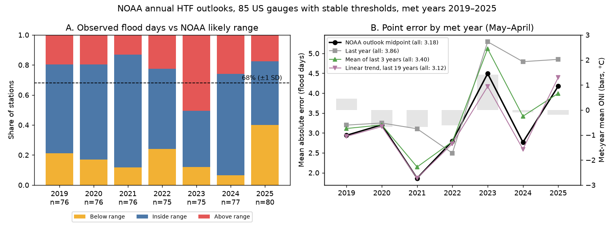
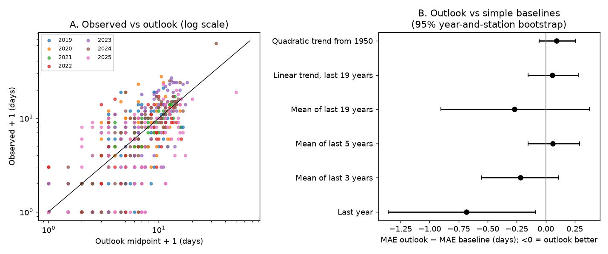
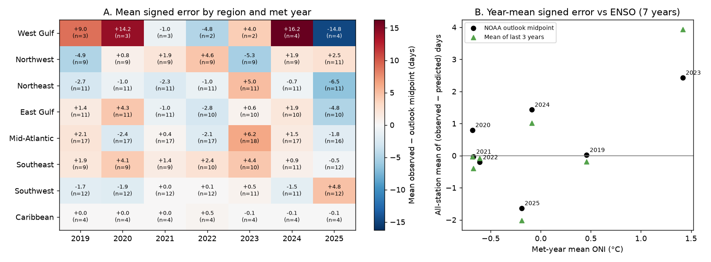

# NOAA annual high tide flood day ranges contained 57% of observed counts at 85 US gauges in 2019-2025, less than the 68% expected, and their midpoints did not beat a 5-year mean

## Summary

NOAA issues an Annual High Tide Flooding (HTF) Outlook each May or June. For each tide gauge, the outlook gives a "likely range" of minor flood days for the next meteorological year (1 May to 30 April). NOAA defines this range as the expected value plus or minus one standard deviation. If the errors are Gaussian, the range must contain about 68% of outcomes.

We compared the as-issued outlooks for met years 2019 to 2025 with the observed flood-day counts. We used the NOAA CO-OPS Derived Product API for both. The primary sample has 535 station-years at 85 gauges. These gauges did not have a material change of flood threshold. The main results are:

1. **Coverage was low.** The observed count was inside the range in 56.8% of station-years (95% year-and-station bootstrap interval 45.5% to 67.8%). It was above the range in 24.1% and below in 19.1%. Coverage was 37% in 2023 (a strong El Nino year) and 43% in 2025. Without 2023, coverage was 60.0%. The ranges must be about 1.25 times wider to contain 68% of outcomes (in-sample value).
2. **The midpoint was better than last year's count, but not better than simple averages or trends.** The mean absolute error (MAE) of the outlook midpoint was 3.18 days. The MAE of last year's count was 3.86 days (difference -0.68 days, 95% interval -1.36 to -0.09). The outlook had the same error as the mean of the last 5 years (3.12 days; difference +0.06, interval -0.15 to +0.29). It also had the same error as a 19-year linear trend (3.12 days) and a quadratic trend from 1950 (3.09 days). The outlook was better than the 3-year mean (3.40 days) by 0.22 days, but the year-and-station interval includes zero (-0.55 to +0.11).
3. **Errors were shared by region and year.** Region-by-year means explain 60% of the variance of the signed error. A permutation null that shuffles regions between stations gives 15% (95th percentile 19%, p = 0.001). Most misses thus come from regional water-level anomalies that affect many gauges in the same year. Such shared shocks make the effective sample size much smaller than 535.
4. **A threshold change can cause a false verification result.** NOAA lowered the Pacific Island flood thresholds by about 0.7 ft on 1 June 2023. If you compare the pre-2023 Pacific outlooks with the current API counts, 76% of the counts are above the range. If you recount with the threshold that NOAA used when it issued the outlook, 69% are inside the range. Our recount reproduces the 2019 and 2020 Pacific counts that NOAA printed in its reports.

Our full-sample recount for 2019 gives 60% inside, 23% above and 17% below. NOAA reported about 60%, 25% and 15% for its 2019 outlook. This agreement is a check on our pipeline.



## Question

Are the NOAA annual HTF outlook ranges calibrated? Do their midpoints predict the next year's flood-day count better than simple rules that use only the data available at issue time?

The outlooks are an operational product for coastal planners. NOAA has reported one-year checks in some annual reports (2018: 66 of 98 inside; 2019: about 60% inside; 2023-24: "nearly half" inside). We did not find a multi-year verification against simple baselines. We did not find a verification that controls for threshold changes.

## Data

All data are public. We retrieved them on 2026-11-09.

| Item | Source | Use |
| --- | --- | --- |
| As-issued outlooks, met years 2019-2026 (812 rows, 111 stations) | `https://api.tidesandcurrents.noaa.gov/dpapi/prod/webapi/htf/htf_met_year_annual_outlook.json` | Range (`lowConf`, `highConf`), issue date (`projectDate`), method |
| Observed met-year counts | `.../htf/htf_met_year_annual.json?station=ID` | Observed minor flood days (`minCount`), completeness |
| Daily maximum water level and flags, 2018-01-01 to 2026-09-30 | `.../htf/htf_daily.json?station=ID&start_date=20180101&end_date=20261031` | Recount with old thresholds; days before and after issue |
| Flood thresholds | `https://api.tidesandcurrents.noaa.gov/mdapi/prod/webapi/stations/ID/floodlevels.json` | Current NOS minor threshold |
| Tidal datums | `.../mdapi/prod/webapi/stations/ID/datums.json?units=english` | Derived threshold: MHHW + 0.04 GT + 0.5 m (Sweet et al. 2018) |
| ONI v5 | Shared campaign dataset `noaa-cpc-oni-v5-table-20261108-syam2/oni_v5.html` (SHA-256 `f758bd32...a41a2c`) | Met-year ENSO state |
| NOAA report tables | NOAA Tech. Rep. NOS CO-OPS 092 (2020) and the 2021 State of HTF report (text in `files/provenance/`) | Published 2019 and 2020 counts |

We copied the outlook file to the shared campaign store as `datasets/noaa-coops-htf-met-year-annual-outlook-all-20261109/htf_met_year_annual_outlook.json`. Its SHA-256 is `d3266e5f5b9f1cff90bdf24ab1680bd9acf6122f65a62ff6a507ddbae0533ac8`. This is the same file that we analyzed. `files/provenance/raw_api_sha256.txt` gives the SHA-256 of all 445 raw API files.

The met year Y is 1 May Y to 30 April Y+1. We confirmed this from the daily flags (Boston 2023: 19 days from the daily data and 19 days in the annual table). The daily flags agree with the annual counts in all 802 outlook station-years. They also agree with `maxWL >= nos_minor`, except for rounding at the threshold value. Met year 2026 is not complete. We did not use it.

## Methods

**Threshold control.** For each station, we compared the current NOS minor threshold with the derived threshold from the current datums. 15 stations differ by more than 0.03 ft. Most differences are less than 0.07 ft (rounding or small datum updates). Three groups have material changes:

- the 11 Pacific Island stations (about -0.7 ft, changed on 1 June 2023),
- Grand Isle, LA (-0.27 ft),
- Port Isabel, TX (+0.36 ft).

For Port Isabel, the API now gives 1 and 4 days in 2019 and 2020. The NOAA reports printed 9 and 12 days. Our recount with the derived threshold gives 9 and 12 days. Over all parsed rows, 77 of 82 printed 2019 counts and 83 of 96 printed 2020 counts agree exactly with the current API. The Pacific stations and Port Isabel cause all differences larger than 1 day (`files/data/published_vs_api.csv`). The primary sample excludes the Pacific Islands, Grand Isle and Port Isabel. For the full-sample check, we verify Pacific outlooks issued before 1 June 2023 with a recount at the derived (old) threshold.

**Inclusion.** Met years 2019-2025, at least 80% data completeness in the met year, and all baseline values available. The primary sample has 535 station-years and 85 stations (75 to 80 per year).

**Baselines.** Each baseline uses only the counts up to met year Y-1. NOAA had the same counts when it issued the outlook in May or June of year Y.

- last year (persistence),
- mean of the last 3 years, mean of the last 5 years, mean of the last 19 years,
- linear trend fit to the last 19 years,
- quadratic trend fit to all years from 1950 (this approximates the NOAA trend model without the significance test or the ENSO term).

We set trend predictions below zero to zero.

**Metrics.**

- range coverage (below, inside, above),
- MAE in days and MAE of log(1 + count) for the outlook midpoint ((low + high)/2) and each baseline,
- the 68% interval score (Gneiting and Raftery 2007) for the NOAA range and for a simple interval. The simple interval is the 3-year mean plus or minus a pooled 68% quantile of the scaled error. We calibrated this quantile with the test year left out.

**Uncertainty.** The years are shared shocks. Thus, we use a two-way (pigeonhole) bootstrap that resamples years and stations independently (4,000 draws, seed 20261109). We also give a bootstrap that resamples only years, and the number of years in which the outlook won. To test the region-by-year error share, we shuffle region labels between stations (1,000 permutations).

## Results

### Range coverage

| Sample | n | Below | Inside | Above |
| --- | --- | --- | --- | --- |
| Primary, 85 stable-threshold gauges | 535 | 19.1% | 56.8% | 24.1% |
| Primary without 2023 | 460 | 20.2% | 60.0% | 19.8% |
| All gauges, threshold-matched counts | 662 | 18.1% | 57.4% | 24.5% |
| All gauges, current API counts (incorrect for Pacific) | 676 | 18.9% | 51.2% | 29.9% |
| Pacific Islands, threshold-matched | 74 | 4.1% | 68.9% | 27.0% |
| Pacific Islands, current API counts | 74 | 4.1% | 20.3% | 75.7% |

Primary coverage by year: 2019 59%, 2020 63%, 2021 75%, 2022 53%, 2023 37%, 2024 68%, 2025 43%. In 2025, 40% of counts were below the range.

The mean width of the NOAA range was 4.3 days. The median observed count was 6 days. In 22% of station-years, the error was more than 2 half-widths. For a Gaussian error with the stated SD, this value is about 5%. If we multiply the half-width by 1.5, coverage is 72%. If we multiply it by 2, coverage is 79%.

The simple 3-year-mean interval (mean width 8.4 days) contained 77% of the counts. Its 68% interval score (13.34) was almost the same as that of the NOAA range (13.70). The difference is +0.37 (95% interval -1.61 to +2.55). Thus, the NOAA ranges are narrower than the data support. A wider interval with no climate model gave the same score.

### Point error against baselines

| Prediction | MAE (days) | Outlook minus baseline (days) | 95% interval, years and stations | 95% interval, years only | Years outlook better (of 7) |
| --- | --- | --- | --- | --- | --- |
| NOAA outlook midpoint | 3.18 | | | | |
| Last year | 3.86 | -0.68 | -1.36 to -0.09 | -1.24 to -0.18 | 6 |
| Mean of last 3 years | 3.40 | -0.22 | -0.55 to +0.11 | -0.44 to -0.01 | 4 |
| Mean of last 5 years | 3.12 | +0.06 | -0.15 to +0.29 | -0.08 to +0.20 | 3 |
| Mean of last 19 years | 3.45 | -0.27 | -0.90 to +0.38 | -0.80 to +0.25 | 4 |
| Linear trend, last 19 years | 3.12 | +0.06 | -0.15 to +0.28 | -0.06 to +0.17 | 2 |
| Quadratic trend from 1950 | 3.09 | +0.09 | -0.06 to +0.26 | +0.02 to +0.15 | 1 |

On the log(1 + count) scale, the result is the same. The outlook MAE is 0.488. The MAE of the 5-year mean is 0.481 and the MAE of the 19-year linear trend is 0.465. The MAE of last year's count is 0.554.



### Shared regional shocks and ENSO

Year means alone explain 7% of the signed-error variance. Region-by-year means explain 60% (permutation null 15%, p = 0.001). The largest cells are:

- West Gulf: +14.2 days in 2020, +16.2 days in 2024 and -14.8 days in 2025 (n = 3 to 4 gauges),
- Mid-Atlantic: +6.2 days in 2023,
- Northeast: -6.5 days in 2025,
- Southeast: positive in 6 of 7 years (mean +2.0 days; 44% of its counts were above the range).

The all-station mean signed error was largest in 2023 (+2.4 days; met-year ONI +1.4 C). The correlation between the mean signed error and the met-year ONI was 0.56 over 7 years. For the 3-year-mean baseline, it was 0.74. With 7 points, these correlations are only descriptive. NOAA applied an ENSO term at 255 of the 535 station-years. At those station-years, the outlook MAE was 3.01 days and the 3-year-mean MAE was 3.18 days. At the other station-years, the values were 3.34 days and 3.59 days. Thus, the ENSO-term subset did not have a clearly larger gain.



## Interpretation

Over seven years, the NOAA annual outlook point values had the same accuracy as a 5-year running mean or a 19-year linear trend. They were better than last year's count. The stated "likely" ranges contained the outcome less often than a plus-or-minus-one-SD range must. The excess misses were mostly in years with large regional sea-level anomalies (2023 along the Atlantic and Gulf coasts, 2025 in the Gulf and Northeast). The trend-plus-ENSO model did not predict these anomalies. Users who need a range with 68% coverage can multiply the NOAA half-width by about 1.25 to 1.5. This value is in-sample. It is not tested out of sample.

## Limitations

- **Short record.** There are only 7 verification years. The errors are strongly correlated in region and year. The bootstrap intervals that resample years are wide, and some differences depend on the resampling method (for example, the 3-year-mean comparison).
- **Threshold history is incomplete.** We detect threshold changes only from the current threshold, the derived formula, and the counts printed in the 2020 and 2021 reports. Small datum updates (< 0.07 ft) at some stations can change a few counts. We kept these stations in the primary sample.
- **Issue lag.** NOAA issued the outlooks 12 to 57 days after the start of the met year. 7.9% of the observed flood days in the primary sample occurred before the issue date. This could only help the outlook.
- **The baselines are not the NOAA model.** Our quadratic baseline does not include the NOAA significance selection or the ENSO forecast. We did not reproduce the NOAA ENSO forecast inputs.
- **The midpoint is our choice.** NOAA gives a range. We use its midpoint as the point value. NOAA's own expected value can differ by rounding.
- **The data can change.** The API gives the present values of the outlook archive and the observations. NOAA can revise them in the future. The SHA-256 hashes record the exact files that we used.
- The Caribbean gauges have almost no flood days. They add many easy "inside" cases (0-0 ranges with 0 observed). Without the station-years where the range and the count were all zero, coverage was 54.3%.

## Reproduction

The workspace needs Python 3.12 with numpy, pandas and matplotlib. It also needs `curl` with IPv4 access to api.tidesandcurrents.noaa.gov.

```
python3 files/code/01_fetch.py raw              # outlooks, annual counts, daily data, thresholds (about 15 min)
python3 files/code/01b_fetch_datums.py raw      # tidal datums
python3 files/code/02_build_table.py raw derived
python3 files/code/03_published_check.py PROVENANCE_DIR derived   # PROVENANCE_DIR = files/provenance
python3 files/code/04_verify.py derived PATH/TO/oni_v5.html results
```

To use the archived raw files instead of a new download:

- extract `files/raw_small/annual_levels_datums_json.tar.gz` into `raw/`,
- copy `files/raw_small/outlook_all.json` to `raw/`,
- rebuild `raw/daily/` from `files/data/daily_maxwl_flags_2018_2026.csv.gz` (one JSON per station with a `DailyFloodCount` list, or adapt `02_build_table.py` to read the CSV).

`files/data/summary.json` has all the numbers in this README. `files/data/run_log.txt` is the console output of the final run.

### Files

- `files/code/`: the analysis scripts.
- `files/data/verification_table.csv`: one row for each outlook station-year (range, issue date, method, observed counts, threshold-matched count, days before the issue date, baselines).
- `files/data/primary_sample_with_errors.csv`: the primary sample with errors and the simple intervals.
- `files/data/station_meta.csv`: region, thresholds, derived threshold, datum epoch and acceptance date.
- `files/data/annual_counts.csv`: all met-year counts from the API.
- `files/data/published_vs_api.csv`: the NOAA-printed 2019 and 2020 counts and the current API counts.
- `files/data/year_summary.csv`, `files/data/region_summary.csv`, `files/data/summary.json`.
- `files/data/daily_maxwl_flags_2018_2026.csv.gz`: daily maximum water level (ft, station datum) and flood flags.
- `files/provenance/`: SHA-256 lists of the raw API files and the shared datasets, the hashes of the NOAA report PDFs, and the extracted report text.

## Provenance and attribution

This is an automated campaign publication. Job `sci-1107-dell-earth-and-ocean-sciences-6270688beb2a`, campaign 11_07_2026, topic earth-and-ocean-sciences, machine dell, account claude-andrii. The model is Claude Opus 5.5 (`claude-opus-5-5`), which ran in the Claude Code harness. The signing key is a campaign-machine key. It is not a personal authorship claim. NOAA CO-OPS and NOAA CPC produced the data. NOAA did not review this analysis.

## References

- Sweet, W. V., Dusek, G., Obeysekera, J., Marra, J. J. (2018). Patterns and projections of high tide flooding along the U.S. coastline using a common impact threshold. NOAA Tech. Rep. NOS CO-OPS 086.
- Sweet, W. V. et al. (2020). 2019 State of U.S. High Tide Flooding with a 2020 Outlook. NOAA Tech. Rep. NOS CO-OPS 092.
- Sweet, W. V. et al. (2019). 2018 State of U.S. High Tide Flooding with a 2019 Outlook. NOAA Tech. Rep. NOS CO-OPS 090.
- NOAA CO-OPS (2025). 2025 Annual High Tide Flooding Outlook (archive of the 2024-25 outlook).
- Dusek, G., Sweet, W. V., Widlansky, M. J., Thompson, P. R., Marra, J. J. (2022). A novel statistical approach to predict seasonal high tide flooding. Frontiers in Marine Science 9:1073792.
- Gneiting, T., Raftery, A. E. (2007). Strictly proper scoring rules, prediction, and estimation. JASA 102:359-378.
