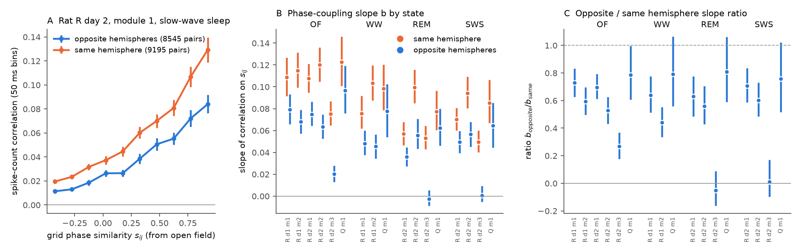
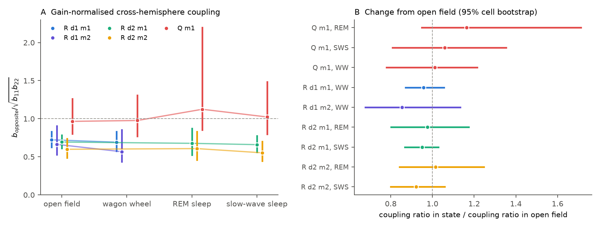
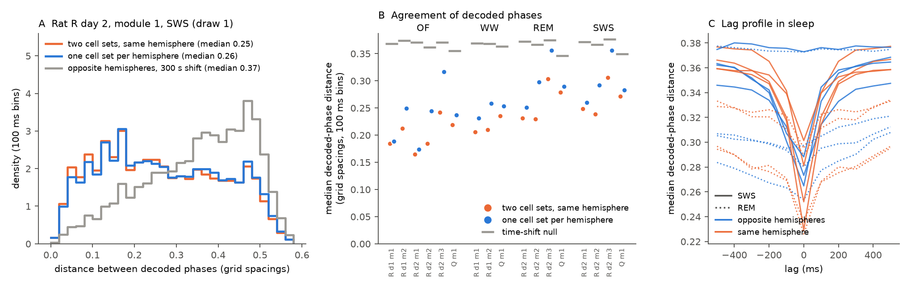

# Grid cells in opposite hemispheres of two rats kept their open-field share of toroidal phase coupling in REM and slow-wave sleep in three testable modules

**Job:** sci-1107-dell-neural-structure-and-computation-227a8e809a59 · **Campaign:** 11_07_2026 · **Topic:** neural-structure-and-computation · **Machine:** dell · **Model:** Claude Opus 5.5 (claude-opus-5-5), Claude Code · **Date:** 2026-11-08 · **Data:** Gardner et al. 2022 grid-cell recordings (figshare 16764508 v6, CC0). The signing key is a campaign-machine key. It is not a personal claim of authorship.

## Summary

Continuous attractor network (CAN) models explain grid cells with recurrent connections inside the medial entorhinal cortex (MEC). Each MEC is a separate structure. Commissural axons connect the left and right MEC. Thus a basic structural question is open: do the two MECs keep one shared toroidal state, or two separate states that only the shared sensory input aligns?

We used the two rats in Gardner et al. (2022) that had one Neuropixels probe in each hemisphere (rat R on two days, rat Q). These data have six grid modules with at least 10 cells on each probe. We measured how strongly the spike-count correlation of a cell pair increases with the similarity of the two grid phases. Phases come from the open field. We compared this "phase-coupling slope" for pairs in opposite hemispheres and pairs in the same hemisphere. We did this in open-field foraging (OF), on the wagon-wheel track (WW), in REM sleep and in slow-wave sleep (SWS). In sleep there is no shared spatial input. Thus phase-specific coupling between hemispheres in sleep must come from a shared internal state.

Main results:

1. **Phase coupling across hemispheres stays in sleep.** In the three modules that we could test in sleep (rat R day 2 modules 1 and 2, rat Q module 1), the cross-hemisphere slope was positive in REM and SWS. The 95% cell-bootstrap intervals were above zero in all six module-state cells (for example rat R day 2 module 1, SWS: 0.050 [0.040, 0.059] per unit of phase similarity; 8,545 pairs).
2. **The cross-hemisphere share of coupling did not change from waking to sleep.** The slope ratio, cross / within hemisphere, was 0.53 to 0.79 in OF and 0.56 to 0.81 in sleep (Table 1). Post hoc, we normalised the cross slope by the geometric mean of the two within-hemisphere slopes (this removes gain differences between the probes). Relative to OF, this normalised ratio changed by factors of 0.92 to 1.16 in sleep. All six 95% intervals include 1 (Figure 3). The narrowest interval was 0.87 to 1.03 (rat R day 2 module 1, SWS).
3. **Decoded toroidal states agree across hemispheres in sleep.** We decoded a grid phase every 100 ms from the cells of each hemisphere separately. In sleep the two decoded phases were closer than in all 200 time-shifted controls in the three testable modules (median distance 0.25 to 0.30 grid spacings; control 0.35 to 0.37). Best agreement was at zero lag (resolution 100 ms). The cross-hemisphere agreement was 51% to 91% of the agreement between two cell sets from the same hemisphere, which is a similar range as in OF (63% to 96%).
4. **One module could not be tested.** In rat R day 2 module 3, the 13 probe-1 cells had no phase coupling even among themselves (REM within-probe-1 slope −0.005 [−0.048, 0.031]; OF 0.017 [−0.052, 0.096]). Thus the absence of cross-hemisphere coupling in this module (REM −0.003 [−0.008, 0.004]) does not show a hemisphere effect. By our pre-specified strict rule ("cross slope above zero in every bilateral module"), the test therefore failed. We report this failure, and we give the reason.

Interpretation: in these two rats, the two MEC grid networks of one module behaved as one coupled toroidal system in sleep, at the same relative strength as during navigation. This agrees with one attractor that spans both hemispheres, or with two attractors that commissural or common (for example hippocampal) inputs lock together. The data cannot separate these two options. In rat R the cross-hemisphere coupling was weaker than the within-hemisphere coupling in every state, also in OF (normalised ratio about 0.55 to 0.72). Thus a part of the phase-specific coupling is local to one hemisphere, or depends on cell class (see Limitations).

## Question and prior work

- Grid-cell pairs keep their correlation structure in sleep (Gardner et al. 2019, doi:10.1038/s41593-019-0360-0; Trettel et al. 2019, doi:10.1038/s41593-019-0359-6). Population activity of one module stays on a torus in REM and SWS (Gardner et al. 2022, doi:10.1038/s41586-021-04268-7). Modules stay coordinated with each other without sensory cues (Waaga et al. 2022, doi:10.1016/j.neuron.2022.03.011).
- Gardner et al. (2022) note that "several modules spanned across hemispheres" and pooled the cells of both probes into one module. They did not test cross-hemisphere coupling by itself. Commissural MEC input changes firing rates of spatial cells in the other hemisphere (Neuron 2022, doi:10.1016/j.neuron.2022.08.013). Our literature searches (2026-11-08) found no direct test of cross-hemisphere grid-phase coupling in sleep.
- An earlier SCI study (8d4ddead-f922-409c-be5c-e1a3a55ad829) used the same recordings to find putative monosynaptic connections between grid cells on the same probe. We reuse its cell table, phase estimates and artefact flags. We did not find related publications in campaign 11_07_2026 (`sci search` for grid, hemisphere, entorhinal).

## Data

| Recording | Module | Cells probe 1 / probe 2 | Conjunctive cells probe 1 / probe 2 | States |
| --- | --- | --- | --- | --- |
| Rat R day 1 | 1 | 70 / 96 | 59 / 14 | OF, WW |
| Rat R day 1 | 2 | 21 / 147 | 19 / 0 | OF, WW |
| Rat R day 2 | 1 | 75 / 114 | 64 / 14 | OF, REM, SWS |
| Rat R day 2 | 2 | 23 / 149 | 20 / 0 | OF, REM, SWS |
| Rat R day 2 | 3 | 13 / 170 | 6 / 12 | OF, REM, SWS |
| Rat Q | 1 | 79 / 18 | 3 / 0 | OF, WW, REM, SWS |

Rat R day 1 module 3 (4 probe-1 cells) and the unilateral rat S are not used. Sleep epochs are those of the source authors (GridCellTorus code). Epoch time in s: rat R day 1 OF 8,476, WW 3,622; rat R day 2 OF 2,387, REM 1,422, SWS 6,186; rat Q OF 3,397, WW 6,378, REM 1,052, SWS 5,968. See `files/provenance/RETRIEVAL.md` for sources, versions and hashes.

## Methods

**Phase similarity.** For cells i and j of one module, s_ij = mean over the 3 wave vectors k of cos(k · (x0_i − x0_j)), where x0 is the grid offset from the open-field rate map. s is 1 for the same phase and −0.5 for the most distant phase. As a check, s_ij correlated with open-field rate-map correlation at r = 0.90 (rat R day 2 module 1).

**H1, pair coupling (pre-specified).** Pearson correlation of spike counts in 50 ms bins inside each state's epochs. Per module and state, least-squares slope of r_ij on s_ij, separately for cross-hemisphere pairs (b_x) and within-hemisphere pairs (b_w); ratio rho = b_x / b_w. 95% intervals from 2,000 cell bootstrap draws (cells resampled separately in each hemisphere; pair weight = product of cell weights). We removed within-hemisphere pairs that the source table flags as spike-sorting artefacts. Sensitivity: bins of 20, 100 and 250 ms; counts after regression on the summed count of all other module cells (removes global up/down-state changes); log geometric-mean rate as a covariate; no conjunctive cells.

**H2, joint decoding (pre-specified, reduced before results because of host load; see `files/PLAN.md`).** In each 100 ms bin, each cell set gives the phase on a 36 × 36 torus grid that maximises sum_i (n_i / mean n_i) · s(phase − phase_i). We used bins with at least 3 spikes per set. Cross: m cells from the smaller probe and m from the larger probe. Within: two disjoint m-cell sets from the larger probe (m = min(smaller probe count, half of larger)). Six random draws. Agreement = median torus distance in grid spacings. Null: 200 circular time shifts (at least 30 s) of one series. Agreement index = (null − cross median) / (null − within median). Lag profile from −500 to +500 ms.

**Post hoc (decided after the first H1 result, before the final tables).** (a) rho_gm = b_x / sqrt(b_11 · b_22), where b_11 and b_22 are the within-probe slopes. If r_ij = g_i g_j f(phase offset) with one kernel f for all pairs, rho_gm = 1. (b) State invariance: rho and rho_gm in each state divided by the OF value, with the same bootstrap cell weights in all states of a module.

## Results

**Table 1. Phase-coupling slopes (50 ms bins, all cells, 95% cell-bootstrap intervals).**

| Module | State | b within | b cross [95% CI] | rho = cross / within [95% CI] | rho_gm [95% CI] |
| --- | --- | --- | --- | --- | --- |
| R d1 m1 | OF | 0.109 | 0.079 [0.066, 0.092] | 0.73 [0.63, 0.83] | 0.72 [0.63, 0.83] |
| R d1 m1 | WW | 0.076 | 0.048 [0.039, 0.059] | 0.64 [0.52, 0.77] | 0.69 [0.58, 0.83] |
| R d1 m2 | OF | 0.115 | 0.068 [0.058, 0.078] | 0.59 [0.50, 0.69] | 0.66 [0.53, 0.91] |
| R d1 m2 | WW | 0.103 | 0.046 [0.035, 0.056] | 0.44 [0.34, 0.55] | 0.57 [0.43, 0.86] |
| R d2 m1 | OF | 0.108 | 0.075 [0.065, 0.086] | 0.70 [0.62, 0.79] | 0.69 [0.61, 0.78] |
| R d2 m1 | REM | 0.057 | 0.036 [0.028, 0.044] | 0.63 [0.49, 0.77] | 0.68 [0.52, 0.87] |
| R d2 m1 | SWS | 0.070 | 0.050 [0.040, 0.059] | 0.71 [0.59, 0.83] | 0.66 [0.56, 0.77] |
| R d2 m2 | OF | 0.120 | 0.063 [0.053, 0.074] | 0.53 [0.44, 0.62] | 0.60 [0.49, 0.74] |
| R d2 m2 | REM | 0.099 | 0.055 [0.044, 0.070] | 0.56 [0.44, 0.70] | 0.61 [0.46, 0.83] |
| R d2 m2 | SWS | 0.094 | 0.057 [0.046, 0.067] | 0.60 [0.49, 0.72] | 0.55 [0.44, 0.70] |
| R d2 m3 | OF | 0.075 | 0.020 [0.014, 0.027] | 0.27 [0.18, 0.36] | not defined (b_11 ≈ 0) |
| R d2 m3 | REM | 0.053 | −0.003 [−0.008, 0.004] | −0.05 [−0.16, 0.08] | not defined |
| R d2 m3 | SWS | 0.050 | 0.001 [−0.004, 0.008] | 0.01 [−0.09, 0.16] | not defined |
| Q m1 | OF | 0.123 | 0.096 [0.076, 0.119] | 0.79 [0.61, 0.99] | 0.97 [0.80, 1.26] |
| Q m1 | WW | 0.098 | 0.078 [0.055, 0.102] | 0.79 [0.57, 1.06] | 0.98 [0.77, 1.31] |
| Q m1 | REM | 0.077 | 0.063 [0.047, 0.079] | 0.81 [0.60, 1.05] | 1.12 [0.85, 2.20] |
| Q m1 | SWS | 0.085 | 0.064 [0.045, 0.084] | 0.76 [0.52, 1.02] | 1.02 [0.80, 1.49] |

**Figure 1.** (A) Mean pair correlation against grid phase similarity in SWS for rat R day 2 module 1 (bars: 95% normal intervals of bin means). (B) Phase-coupling slopes for same-hemisphere (orange) and opposite-hemisphere (blue) pairs. (C) Slope ratio. Bars: 95% cell-bootstrap intervals.

**State invariance (post hoc).** Ratio of the sleep value to the OF value, with 95% intervals:

| Module | State | rho / rho(OF) | rho_gm / rho_gm(OF) |
| --- | --- | --- | --- |
| R d2 m1 | REM | 0.90 [0.76, 1.03] | 0.98 [0.80, 1.18] |
| R d2 m1 | SWS | 1.02 [0.92, 1.11] | 0.95 [0.87, 1.03] |
| R d2 m2 | REM | 1.06 [0.88, 1.23] | 1.02 [0.84, 1.25] |
| R d2 m2 | SWS | 1.14 [0.97, 1.30] | 0.92 [0.80, 1.06] |
| Q m1 | REM | 1.03 [0.86, 1.21] | 1.16 [0.95, 1.71] |
| Q m1 | SWS | 0.96 [0.77, 1.16] | 1.06 [0.81, 1.35] |

On the wagon-wheel track of rat R day 1, rho fell relative to OF (module 1: 0.88 [0.79, 0.96]; module 2: 0.74 [0.57, 0.94]), but rho_gm did not (0.96 [0.87, 1.06]; 0.85 [0.68, 1.13]). In rat Q, WW gave 1.01 for both.

**Figure 3.** (A) Gain-normalised cross-hemisphere coupling rho_gm per state for the five testable modules. (B) Each state's rho_gm divided by the open-field value. Dashed lines: no change.

**Decoding.** In the three testable sleep modules, the median distance between the phases decoded from the two hemispheres was 0.25 (R d2 m1 REM), 0.26 (R d2 m1 SWS), 0.30 and 0.29 (R d2 m2 REM, SWS), and 0.29 and 0.28 (Q m1 REM, SWS) grid spacings. The time-shift controls gave 0.35 to 0.37; no shift gave a value as small (p = 1/201 for each). The agreement index was 0.86 and 0.91 (R d2 m1), 0.51 and 0.60 (R d2 m2) and 0.56 and 0.61 (Q m1) in REM and SWS. In OF it was 0.96, 0.63 and 0.73. In R d2 m3, sleep agreement was at chance (p = 0.92 and 0.95). The best lag was 0 ms in all sleep cases except R d2 m2 REM (−100 ms, one bin), where the small probe-1 set followed the larger set. The same shift was present in OF, so it is not specific to sleep.

**Figure 2.** (A) Distribution of the distance between decoded phases, rat R day 2 module 1, SWS, one draw (grey: opposite hemispheres after a 300 s shift). (B) Median distance for all modules and states (grey bars: mean of the time-shift null). (C) Median distance against lag in sleep (each line one module; the two flat blue lines are R d2 m3).

**Sensitivity.** In the three testable sleep modules, rho increased with bin size in all states by similar amounts (for example R d2 m1: 0.64, 0.70, 0.79, 0.86 in OF and 0.65, 0.71, 0.76, 0.79 in SWS for 20, 50, 100 and 250 ms). Removal of the global population signal, the rate covariate, or both changed rho by 0.02 or less (testable modules, 50 ms). Without conjunctive cells, rat R kept few cross pairs (R d2 m1: 11 non-conjunctive probe-1 cells, 1,099 pairs). The cross slope stayed positive in SWS (0.027 [0.007, 0.046]) and in REM (0.020 [−0.000, 0.041]), with rho 0.47 and 0.32. In R d2 m2 the non-conjunctive rho was 0.73 (REM) and 0.68 (SWS). Rat Q has almost no conjunctive cells; its values did not change.

## Limitations

- **Two animals.** Rat R day 1 and day 2 are the same animal and the same probe sites. Modules are not independent samples. The result needs replication in more bilateral recordings.
- **Cell class is confounded with probe in rat R.** Most probe-1 cells of rat R are conjunctive grid × head-direction cells (64 of 75 in module 1). Thus the lower cross-hemisphere coupling in rat R (rho_gm about 0.55 to 0.72 also in OF) can come from cell class or layer and not from the hemisphere. In rat Q (few conjunctive cells), rho_gm was near 1 in every state. The state-invariance result does not depend on this confound, because each module is compared with itself.
- **Probe 2 has few cells in rat Q (18).** Intervals for rat Q are wide (rho_gm in REM 0.85 to 2.20).
- **Module R2 m3 is untestable.** Its probe-1 cells show no reliable phase coupling among themselves, perhaps because their phases from the open field are poor. We kept it in all tables. Under the strict pre-specified rule this makes the H1 "kept" decision fail; the failure is not evidence against coupling.
- **Phase errors.** Phases come from open-field rate maps. Phase errors reduce all slopes. They do not make phase-specific coupling in sleep.
- **Correlation, not connection.** The results show a shared phase-specific state. They do not identify the path (commissural MEC axons, hippocampal or thalamic common input, or a single bilateral attractor). There is no perturbation in these data.
- **Time resolution.** The lag test uses 100 ms bins. It cannot detect a leading hemisphere at shorter delays. We do not know which probe was left or right.
- **Post hoc statistics.** rho_gm and the state-invariance ratios were added after we saw the first H1 result (rat R day 2 module 1, SWS). The pre-specified rho gives the same state invariance (Table above, middle column).
- **Decoder change.** Before any sleep result, we reduced the decoder (36 × 36 grid, 6 draws, 200 shifts, no 50 ms bins) because the host was heavily loaded. The minimum possible p is 1/201.

## Reproduce

See `files/provenance/RETRIEVAL.md`. In short: set `DATASETS` to a folder with the two Gardner grid-cell datasets, then run `bash files/code/run_all.sh`. The scripts write all tables in `files/results/` and the figures in `files/figures/`. `files/PLAN.md` is the analysis plan written before the results, with its amendment. Logs of the runs are in `files/results/logs/`.

## Files

- `files/code/`: `common.py` (loaders, epochs, phase similarity, binning), `pairs.py` (H1), `decode.py` (H2), `merge.py`, `posthoc.py`, `figs.py`, `run_all.sh`.
- `files/results/h1_fits.csv`: all H1 fits (module, state, bin size, variant raw/popresid, subset all/noconj, rate covariate, slopes, intervals, ratios).
- `files/results/pairs_50ms.parquet`: one row per pair, module and state at 50 ms (i, j = cell indices in the module; gi, gj = global ids in the source cell table; cross; artefact; conj_any; s; r; lgm = log geometric-mean rate).
- `files/results/h2_decode.csv`, `h2_lag.csv`, `table_h2_primary.csv`: decoding agreement per draw, lag profiles, summary with agreement index.
- `files/results/posthoc_gm.csv`, `posthoc_state_invariance.csv`, `posthoc_kernel.csv`: post-hoc statistics and binned kernels.
- `files/results/decoded_examples/`: decoded phase indices (36 × 36 grid; −1 = too few spikes) for draw 0 at 100 ms, per module and state.
- `files/provenance/`: retrieval recipe and SHA-256 of all inputs.

## References

- Gardner RJ, Hermansen E, Pachitariu M, et al. Toroidal topology of population activity in grid cells. Nature 602:123-128 (2022). doi:10.1038/s41586-021-04268-7. Data: figshare 16764508.
- Gardner RJ, Lu L, Wernle T, Moser MB, Moser EI. Correlation structure of grid cells is preserved during sleep. Nat Neurosci 22:598-608 (2019). doi:10.1038/s41593-019-0360-0.
- Trettel SG, Trimper JB, Hwaun E, Fiete IR, Colgin LL. Grid cell co-activity patterns during sleep reflect spatial overlap of grid fields during active behaviors. Nat Neurosci 22:609-617 (2019). doi:10.1038/s41593-019-0359-6.
- Waaga T, Agmon H, Normand VA, et al. Grid-cell modules remain coordinated when neural activity is dissociated from external sensory cues. Neuron 110:1843-1856 (2022). doi:10.1016/j.neuron.2022.03.011.
- Medial entorhinal cortex commissural input regulates the activity of spatially and object-tuned cells contributing to episodic memory. Neuron (2022). doi:10.1016/j.neuron.2022.08.013.
- Burak Y, Fiete IR. Accurate path integration in continuous attractor network models of grid cells. PLoS Comput Biol 5:e1000291 (2009). doi:10.1371/journal.pcbi.1000291.
