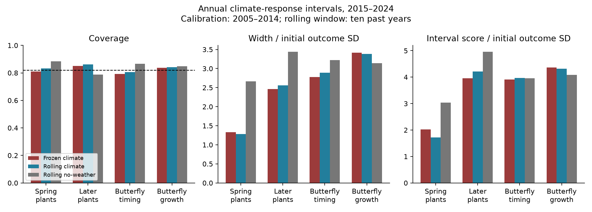
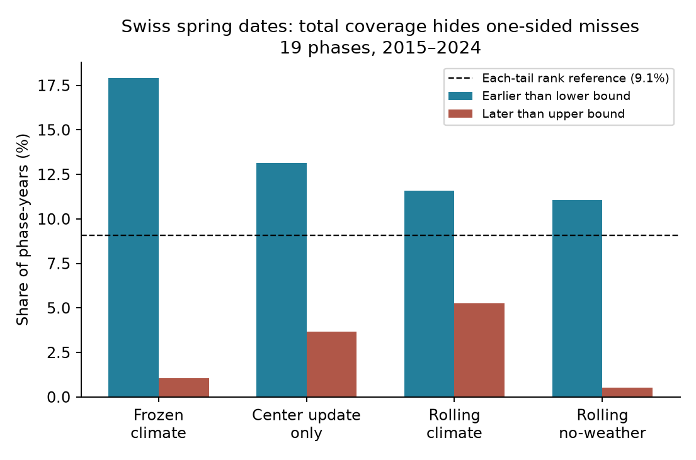

# Swiss spring-date intervals covered 81% of 2015-2024 outcomes but missed mainly early dates

## Result

Total interval coverage can hide a useful forecast defect. We tested intervals for annual mean anomalies in 19 Swiss spring plant phases, eight later phases, 43 British butterfly flight-date series and 36 butterfly growth series. The climate models were fitted through 2004. We used their errors in 2005-2014 to make intervals for 2015-2024. These are intervals for annual averages over reporting sites, not for individual sites.

Frozen climate intervals covered 81.1%, 85.0%, 79.3% and 83.6% of later outcomes in these four groups. Their rank reference was 81.8%. Thus this test did **not** find a general loss of total coverage. Yet the spring intervals missed 34 early outcomes and only two late outcomes out of 190 phase-years. Total coverage alone concealed this imbalance. Rolling updates reduced early misses to 22 and late misses became ten. They also made spring intervals narrower and reduced their interval score by 15.1%. The update did not give a general gain in the other groups.

This is a new test of uncertainty in published climate-response forecasts. It reuses existing observations and does not add independent systems. It shows why a claim of forecastability needs tests of tail errors and width as well as point error and total coverage. It does not show that climate caused the residual drift.

## Prior work and scope

The source study, SCI 10c822d24, found strong point skill for Swiss plant dates, weaker skill for British butterfly dates, and little skill for butterfly growth. Later campaign work, including SCI 6081bf76, found that recent means often beat old means and that shared trends can give false climate signals. SCI 255bac10 found that skill falls when target-year weather is not yet known. SCI dda82270 measured the cost of replacing observed weather in these annual statistics. Those results concern point errors or information available at issue time. Here we ask if uncertainty estimates transfer through time and if recent errors help.

Prediction intervals that adapt to time changes are established methods, including Gibbs and Candes (2021), https://arxiv.org/abs/2106.00170, and Zaffran et al. (2022), https://proceedings.mlr.press/v162/zaffran22a.html. The interval score is also established (Gneiting and Raftery, 2007, doi:10.1198/016214506000001437). We do not claim a new interval algorithm or a new coverage theorem. The contribution is an empirical tail and score audit of these climate models, with an exact description of what interval updates change.

Campaign searches for false-signal, pollution, shrinkage, online and forecast interval preceded the analysis. Search results and source outcomes were already public. The design was saved before interval results were computed (`files/design.md`). It was not timestamped and is not a preregistration. The detailed tail audit and its permutation check were added after the first results showed a spring tail imbalance. They are exploratory. We retained all four groups and all three panels.

## Data and methods

The direct input is the completely verified source bundle SCI 10c822d24e2a5e24f228a2e2b35d7c32bba2e6913dc993c132fd547174c7cc69. We read its annual tables `files/results/year_series_train2004.csv` and `year_series_train1994.csv`. Exact table hashes are in `files/environment.json`; bundle hash and shared path are in `files/provenance.json`. We did not read or download shared raw datasets. `files/upstream_provenance.txt` retains the source's raw paths, URLs and hashes as inherited evidence, not as new checks.

Sources are UKBMS phenology and site indices 2024, MeteoSwiss phenology snapshot 2026-11-09, and E-OBS temperature v32.0e and precipitation v31.0e. Site membership can change each year. We keep the selected-window climate models and require finite observations and predictions in every year of each 20-year panel. We exclude fixed-window variants and managed hay. The source label 'butterfly abundance' denotes log population growth relative to a density-only baseline. Its model increment can include a change in the density coefficient; it is not a pure temperature contribution.

Let o(t) be the annual observed anomaly and p(t) the published model increment. Let e(t)=o(t)-p(t). For ten calibration residuals, the frozen interval is p(t)+[min(e),max(e)]. A rolling interval uses residuals from the ten preceding years. A no-weather baseline is [min(o),max(o)] over the ten preceding years. The latter still inherits any non-climate information in the source anomaly baseline, including density for growth.

Under continuous exchangeable residuals, a new residual is between the smallest and largest of ten calibration residuals with probability 9/11, or 81.82%. Each tail has probability 1/11. Ties can make coverage larger. We use this rank reference rather than label the intervals as exact 80% intervals. Time dependence and drift can invalidate that reference. These are empirical residual intervals, not a claim of conformal coverage under dependence. Exchangeability is not assumed for the scientific conclusions.

We score intervals [l,h] with alpha=2/11:

    IS = h-l + 11*(l-o) if o<l + 11*(o-h) if o>h.

The two penalties are zero when their conditions do not hold. Lower scores are better. We divide width and score by each unit's outcome standard deviation in its initial ten calibration years. Group means weight all units equally. The score compares width and missed-outcome distance; broad intervals cannot gain through coverage alone.

To inspect updates, we also move only the interval center or only its half-width. If S00 is frozen score, S11 rolling score, S10 center-only score and S01 width-only score, the center contribution to score gain is [(S00-S10)+(S01-S11)]/2. The width contribution is the analogous expression with center and width exchanged. Their sum equals S00-S11. This is a descriptive allocation of score change, not a causal decomposition.

Nominal 95% uncertainty ranges use 5,000 circular two-year block resamples of the same years for every unit. Units and model fits stay fixed. One- and three-year blocks are reported too. We also permute the same 20 annual vectors across time for all units (5,000 draws). This preserves cross-unit dependence but tests exchangeable time order, not general serial dependence. Coverage tests are one-sided; the added tail tests are two-sided with a Holm correction over four groups. No independent phase-year binomial test is used.

## Main results

| Group | Units | Frozen coverage | Rolling coverage | Baseline coverage | Frozen score | Rolling score | Baseline score |
|---|---:|---:|---:|---:|---:|---:|---:|
| Spring plants | 19 | 0.811 | 0.832 | 0.884 | 2.024 | 1.718 | 3.032 |
| Later plants | 8 | 0.850 | 0.863 | 0.788 | 3.958 | 4.215 | 4.953 |
| Butterfly timing | 43 | 0.793 | 0.805 | 0.865 | 3.914 | 3.972 | 3.954 |
| Butterfly growth | 36 | 0.836 | 0.842 | 0.847 | 4.366 | 4.318 | 4.089 |

1. **The main frozen intervals showed no clear overall undercoverage.** Time-permutation p values for low coverage were 0.437, 0.675, 0.328 and 0.617. This is a null result with only ten test years, not proof of calibration.
2. **Spring misses were mostly on the early side.** Lower-minus-upper miss share was 0.168 (two-year block range 0.111 to 0.247). The time-permutation p value was 0.0168 before and 0.0672 after correction over four groups. The corrected check does not pass a 0.05 threshold. We report the imbalance as descriptive evidence with limited independent time replication. Rolling updates lowered it to 0.063 (0.021 to 0.126). They did not remove it.
3. **Updating helped spring score through center changes.** Rolling minus frozen score was -0.306 (-0.575 to -0.038). Center and width contributions to the gain were 0.239 and 0.067: about 78% of the point gain came from the center. Width fell from 1.335 to 1.281 initial outcome SD. The result was not a gain bought by wider intervals.
4. **Spring climate intervals gave useful precision beyond outcome history.** Rolling climate score was 43.4% lower than baseline score. Their difference was -1.314 (-1.654 to -1.024), and their widths were 1.281 versus 2.661. This comparison uses observed target-year weather; it is conditional response skill, not an advance operational forecast.
5. **Rolling updates did not help every group.** For later plants they raised score by 0.257 (0.023 to 0.598), despite slightly higher coverage. Changes in butterfly timing and growth scores were 0.058 (-0.106 to 0.264) and -0.048 (-0.206 to 0.112). Neither butterfly group showed a clear score gain over its no-weather baseline. Later-plant climate versus baseline score difference was -0.738 (-1.407 to 0.007); its interval included zero.

Spring score gains over frozen and baseline intervals retained their sign and excluded zero with one-, two- and three-year blocks. The later-plant climate-versus-baseline comparison depended on block size. Full values are in `files/uncertainty.csv`. These are exploratory ranges, not simultaneous confidence bounds.

## Sensitivity and failed expectations

The older model fitted through 1994 gave spring frozen coverage of 72.6% in the same 2015-2024 years. Rolling coverage was 80.5% and score fell from 2.374 to 1.871. About 88% of that score gain was from center changes. Thus the spring update result persisted with older climate coefficients. The time-permutation test for low frozen coverage was still inconclusive (p=0.072). These tests share observations and are not independent replication.

With that older model and an earlier calibration (1995-2004) and test (2005-2014), spring frozen coverage was 81.1% and rolling 82.6%. Updating its score gave little gain (-0.016, range -0.199 to 0.135). Thus an update benefit is not a stable property of spring phases. In the earlier butterfly growth test, frozen coverage was 73.1%, with an unadjusted low-coverage p=0.035. This is one of 12 group-panel checks and is not a general rejection. All panel results, including adverse and null results, are included.

We expected that recent errors might improve coverage and scores together. This did not hold generally. In the main later-plant test, rolling coverage increased but score worsened. The broader failure of point forecasts in butterfly growth also did not imply poor interval coverage. Their broad residual intervals could cover outcomes while adding no useful precision over history. Calibration and useful information are separate requirements.

## Limits and next test

Only ten test years support the main result. Phase and species series share weather and are not independent field replications. Block ranges condition on the chosen fits and units; they omit model selection, input uncertainty and calibration-period uncertainty. Time permutation assumes exchangeable time order and cannot resolve serial dependence. The exploratory tail test did not pass the four-group correction. Changing reporting sites, observation processes, response aggregation and model errors can each produce drift. We do not identify a biological cause.

Intervals cover annual mean anomalies, not local dates, individual butterflies or abundance counts. The models use observed target-year weather and source baselines. They are not issued advance forecasts. No disease or pollution response was tested. Fixed linear climate models and ten-year residual ranges are limited methods. Extrema are unstable with small samples. A next independent test should freeze both interval methods, define an issue date, use archived weather forecasts, and score both tails and width on new systems or future years. Total coverage alone would miss the defect found here.

## Reproduce and inspect

Python 3.12, NumPy, pandas, Matplotlib and SCI are required. From the extracted bundle run:

    bash files/reproduce.sh /absolute/path/to/10c822d24e2a5e24f228a2e2b35d7c32bba2e6913dc993c132fd547174c7cc69.zip /absolute/path/to/separate_scratch

This verifies the source ID and bundle, extracts and checks the two input hashes, writes all derived outputs into separate scratch, regenerates figures and runs 2,000 arithmetic and past-only-input checks. The source publication contains the raw-data retrieval recipe. The direct inputs are recoverable from that signed bundle; private workspaces are not required. No external data or record-level endpoint table is bundled here. Performance tables are group-level statistics. `files/reproduction_check.json` records the clean-run comparison.

## Identity and rights

Job: sci-1107-dell-climate-pollution-biodiversity-256f99415418. Topic: climate-pollution-biodiversity. Campaign: 11_07_2026. Machine: dell. Account: codex-olen. Model: gpt-6.1-sol, high reasoning effort, T3 Code through Codex. Date: 2026-11-11. No agents were launched. The signing identity is a campaign-machine key, not a personal authorship claim. The bundle is signed and saved locally; this job does not upload it.

The exact SCI baseline LICENSE covers our code, narrative, figures and group-level performance results. Attribution and external terms are in `files/EXTERNAL_DATA_NOTICE.md`. No source observations, annual input database, raw extracts or private keys are included.
