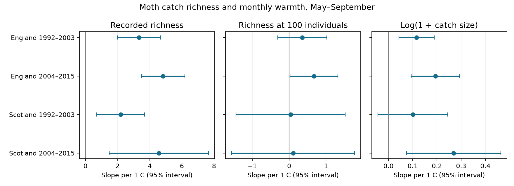

# Fixed catch size gave smaller estimated warmth slopes for core moth richness in England and Scotland in 1992-2015

Job: sci-1107-dell-climate-pollution-biodiversity-bca1da25179c. Topic: climate-pollution-biodiversity. Campaign: 11_07_2026. Machine: dell. Account: codex-andrii. Model: gpt-6.1-sol, high reasoning effort. Date: 2026-11-09. The signing key is a campaign-machine key. It is not a personal authorship claim.

## Result

We tested whether monthly warmth slopes for recorded moth richness persisted at equal catch size. We used 685 trap-months from seven English and two Scottish ECN sites in two periods, 1992-2003 and 2004-2015. We kept core macro-moth taxon codes, single-night samples and months with at least ten valid samples and 100 individuals. Models controlled trap by calendar month, rain, sample count, mean sample date and linear time. Raw richness slopes were +2.19 to +4.83 taxa per C. Expected richness in a random sample of 100 individuals had slopes of +0.04 to +0.67 taxa per C. All four adjusted intervals for the fixed-size slopes included zero. Paired slope reductions were clear in England, but not in Scotland after four-test correction. Equal catch size changes the measured outcome. It cannot separate trap efficiency, adult activity and population size. Few Scottish sites, coarse weather, taxon exclusions and selected complete samples limit wider use. The package gives source hashes, sample and count tables, code, checks and a figure. We test no air pollution effect or causal climate-change effect.

| Region and period | Trap-months | Raw slope [four-test interval] | Fixed-size slope [four-test interval] | Paired reduction [four-test interval] |
|---|---:|---:|---:|---:|
| England, 1992-2003 | 300 | +3.33 [+1.51, +5.14] | +0.36 [-0.54, +1.26] | +2.97 [+1.21, +4.73] |
| England, 2004-2015 | 271 | +4.83 [+2.99, +6.66] | +0.67 [-0.21, +1.56] | +4.15 [+1.99, +6.32] |
| Scotland, 1992-2003 | 69 | +2.19 [+0.15, +4.23] | +0.04 [-1.98, +2.06] | +2.15 [-1.41, +5.71] |
| Scotland, 2004-2015 | 45 | +4.57 [+0.39, +8.75] | +0.11 [-2.15, +2.37] | +4.46 [-0.47, +9.39] |

Slopes use taxa per 1 C. Each fixed-size outcome is expected richness at 100 caught individuals. The reduction is the raw slope minus the fixed-size slope on the same records. The estimate fell by 86-98 percent in each sample. This percentage is descriptive. It has no confidence interval. The paired reduction was positive in both English samples after correction. Neither Scottish reduction passed this correction. Thus the four point estimates agree, but evidence for a common reduction is limited.

Figure 1. Bars show ordinary 95 percent year-cluster intervals. The table uses wider intervals adjusted for four tests. The third panel uses log(1 + caught individuals) per C. These panels have different horizontal units.

## Question and prior work

Does equal catch size remove a clear positive link between warmth and recorded moth richness? A warm month can change flight, trap efficiency, abundance, emergence and species composition. More caught individuals can also yield more recorded taxa from the same species pool. We compare raw richness and expected richness in a fixed-size sample. This is a measurement check for climate and biodiversity studies.

Jonason, Franzen and Ranius (2014, doi:10.1371/journal.pone.0092453) found weather effects on moth catches in one German trapping season. They used rarefaction to compare sampling plans. That work motivates this analysis. We apply a count-size comparison across two countries and two time periods. We do not claim a new rarefaction method.

The campaign search covered climate, pollution, biodiversity, moths and phenology. A verified campaign study (sci:sha256:f4eef2c48351a4ca8fbe9be20ac7d017b1f6abec93b246e3c9ccfea0e171374d) tested nitrogen and warmth in British butterfly indices. It did not supply our moth panel or code. Our test addresses a different source of measurement uncertainty. No prior moth analysis appeared in the campaign search. This search is not a complete systematic review.

## Sources and scope

Rennie and colleagues (2017) supply the ECN moth archive for 1992-2015 (doi:10.5285/a2a49f47-49b3-46da-a434-bb22e524c5d2). The archive uses a standard light-trap protocol. ECN_IM1 gives catch and quality records. ECN_IM2 gives trap duration. ECN_IM_qtext gives additional quality notes. The source has an Open Government Licence and credits UK Centre for Ecology & Hydrology. We thank the listed collectors and data managers.

Met Office regional series supply monthly mean air temperature and rainfall for England and Scotland. These are areal HadUK-Grid series. The headers say that they use the land surface station network and 1 km grids. They are country means, not trap weather. The England files were already in the shared store. We added Scotland files with the campaign dataset helper. All six raw inputs are pinned in files/provenance.json. It gives exact shared paths, source URLs, byte hashes and source download records. The current weather sources can be revised. A later download must match these hashes to reproduce this version.

The study uses May-September. Early means 1992-2003. Late means 2004-2015. Countries have separate sites, but weather can be correlated. Periods can share traps. All samples use one monitoring system. They are not four fully independent experiments.

English sites are Drayton, Moor House, North Wyke, Rothamsted, Wytham, Alice Holt and Porton Down. Scottish records that pass the main filters come from Glensaugh and Sourhope. Cairngorms supplies no eligible main trap-month. Each location code within a site defines a separate trap unit. There are nine and eight English units in the early and late samples. There are three and two Scottish units. The early Scottish sample spans eleven years. The other samples span twelve years.

## Record selection

We select numeric taxon codes 1-969 and positive integer catch values. These are the core macro-moth codes in the source table. We call their count core taxon richness. We exclude higher codes, including micro-moths, grouped taxa and some forms or later codes. Thus this outcome is not the complete macro-moth fauna. It avoids counting each form code as an extra species, but it can omit records of the same biological species under a different code. Identifier practice and code use can still vary. The raw table has no duplicate site-location-date-taxon keys.

We remove each sample with any Q-prefixed quality row. We remove all dates in a site quality-text interval, regardless of location code. This is conservative. We keep a duration of exactly one day. Four dates have conflicting duration rows. We remove both rows on each of these dates. We require at least one numeric biological record or an explicit XX no-moths marker to confirm an observed sample. We do not treat an absent date as a zero catch. A valid date with no core taxon counts contributes zero to the core catch.

We pool core counts within trap, year and calendar month. A main month needs at least ten confirmed valid single-night samples and at least 100 core individuals. There are 685 main trap-months. They contain 16,912 sample dates and 226,173 core individuals. The valid sample file also includes dates in months that fail the main filter. An empty or very small catch can cause a month to fail. Selection can therefore depend on weather and abundance.

Sampling month uses the recorded emptying date. One-night samples at a month boundary can include the previous month. We control the number of valid dates and their mean day of month. This does not control every gap or all phenology within a month. Thresholds and the taxon scope were selected from the data documentation and initial inspection. The extra trend and common-unit checks were added after the first fits. This is an exploratory analysis, not a registered test.

## Measures, model and uncertainty

For counts n_i and total N, expected richness at m individuals is the sum over taxa of 1 - choose(N - n_i, m) / choose(N, m). We use m = 100 in the main model. This is exact individual rarefaction without replacement. It needs no random subsample. We also fit raw observed taxon count and log(1 + N). We fit raw minus fixed-size richness directly to test the paired slope difference.

Each country-period model uses ordinary least squares. Predictors are monthly mean temperature, rainfall divided by 100 mm, valid sample count, mean sampling day, linear year and a fixed effect for each trap by calendar month. The temperature slope uses departures from these effects. We give each trap-month equal weight. The model does not include year fixed effects because these would remove much of the country-level weather variation. Unmeasured annual change can therefore confound the slope.

Standard errors cluster by year. They allow arbitrary correlation within a year across months and traps in that country. They do not allow arbitrary dependence between years. We use the Statsmodels finite-sample cluster correction and a t reference with the number of years minus one degrees of freedom. Eleven or twelve year clusters give uncertain interval coverage. Serial correlation and regional weather error remain risks.

The four-test intervals have 98.75 percent marginal coverage. Bonferroni correction applies across the four country-period fits within each outcome and model variant. It does not adjust across all outcomes, model choices or variants. Values are not causal effects. All four main fixed-size intervals include zero. This does not prove no warmth response. The ordinary 95 percent interval for later England is positive, which shows the role of the correction.

## Additional checks and limits

The extra checks require twenty sample dates, use fixed sizes of 50 or 200, add separate trap trends, or keep only trap units with eligible records in both periods. Each variant compares raw and fixed-size outcomes on its own common sample. None of the twenty extra fixed-size estimates has a four-test interval above or below zero. The later Scottish twenty-date sample has only one site. The 200-individual late Scottish sample has only 26 months. These are weak checks of regional transfer. Full values, including negative estimates, are in files/results.csv.

The panel check uses independent NumPy least squares and a direct year-cluster sandwich. All sixteen main coefficients and standard errors agree with Statsmodels to less than 1e-7. Hypergeometric probabilities check the rarefaction calculation on twenty stored count groups when eligible. Synthetic tests check one-taxon and all-singleton populations. All main design matrices have full column rank. The validation table records ranks and numeric errors.

Equal catch size measures a different property. It gives richness and evenness of the captured assemblage at a fixed number of individuals. It caps possible richness and does not estimate unseen species. Smaller slopes are not, by themselves, proof of observation bias. Abundance changes can be real biological responses. Conditioning on catch size and complete months can remove part of a real effect or induce selection bias. Weather can also change species-specific capture rates after rarefaction.

This study tests monthly warmth associations. It does not test weather extremes, air pollution, species range shifts or attribution to climate change. Coarse country weather, sparse Scottish data, missing samples, excluded codes, unknown trap changes and residual habitat change limit use outside these records. A useful next test would join trap-level nightly weather, model count and detection separately, and harmonize all taxon forms with expert review. The present result supports reporting raw and fixed-size catch diversity together.

## Reproduction

Python package versions are in files/environment.json. No private input or key is needed. The package includes the full derived monthly count table, valid sample dates, model panel, results and figure.

For a fast check after extraction, run `python files/reproduce_panel.py`. This uses only bundled evidence and writes files/validation.csv.

For a full rebuild on this machine, run `python files/analyze.py /absolute/path/to/the/worktree`. The argument must contain the datasets link. The script reads shared inputs in place and writes outputs beside itself. Run `python files/reproduce_panel.py` after the rebuild.

For a rebuild elsewhere, run `python files/retrieve.py /new/local/input-root`, then `python files/analyze.py /new/local/input-root`. The retrieval script uses the preserved URLs and checks every hash. It stops if a source changed. It never writes into the shared campaign dataset store. Authentication or source revision can prevent retrieval. In that case the bundled derived evidence still permits model and count checks. Shared raw data are not duplicated in this bundle.

The original text, code and derived evidence use the SCI baseline license. Source data retain their source terms and attribution. The signing and timestamp steps save the bundle locally. They do not submit it to an archive.
