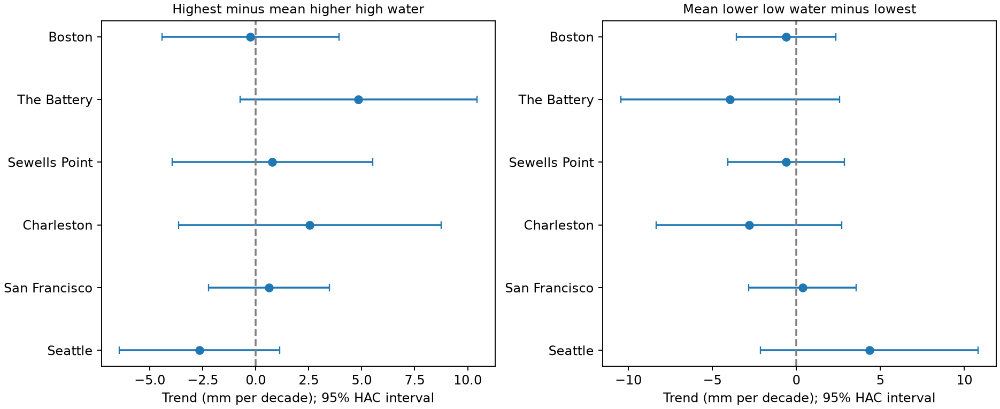
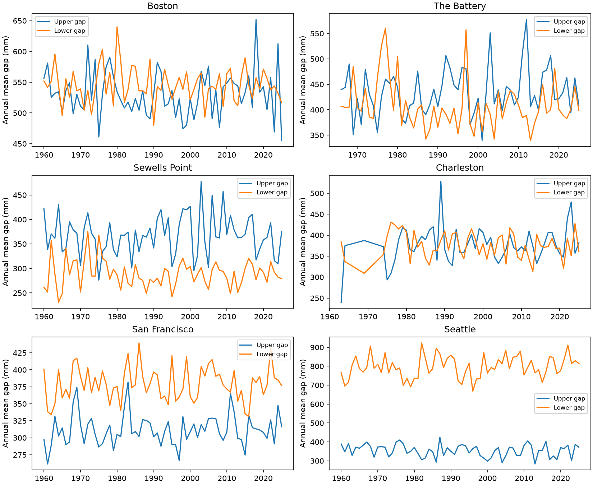

# Monthly extreme water gaps had uncertain trends at six US gauges in primary fits to retained 1960-2025 records

We found no clear trend in either monthly extreme gap at any of six selected US gauges under the primary model. All twelve individual 95% intervals included zero. This is an uncertainty result. It is not proof that the gaps are stable.

## Question and prior work

Do water extremes change beyond shifts in typical high and low water? This matters because a change in mean sea level, a change in typical tide height, and a change in extreme departures can have different causes. We test a simple measure that a reader can rebuild from public monthly records.

Zervas studied monthly extreme water levels at 117 NOAA stations and their relation to mean sea level. Menendez and Woodworth (2010; doi:10.1029/2009JC005997) found that mean-level removal reduces many extreme-level trends. Li and colleagues (2021), in *Evolving tides aggravate nuisance flooding along the U.S. coastline*, showed that tide changes can affect flooding. These studies motivate separation of typical water height and extreme departures. We do not claim a new physical mechanism.

We ran `sci search "earthquake" --in ./campaign --json` and `sci search "sea level" --in ./campaign --json` before this precise test. Local verification was slow. We inspected verified cached metadata while search ran. We read the published text of SCI publication `sha256:16be13a3e02b39b1697fec26ff7c7ccf34369db4cca22ea9401954c40e9bc03f`. That work tested forecasts of annual tide measures using the same NOAA snapshots and a fixed cycle. Our result is a new monthly trend diagnostic on data already used in the campaign. It is not an independent replication or a claim of first discovery. Search coverage is limited to the verified records available during this run.

## Data and fixed measures

We reused six NOAA CO-OPS monthly_mean JSON files in the shared store. No source file was changed or downloaded. Each source request specifies metric units, station MSL datum, and dates from 1960 through 2025. `files/provenance.json` gives both public shared paths and resolved object paths, exact URLs, download metadata, byte counts, and SHA-256 hashes. The API has no fixed release number. The 20261108 snapshot and hashes define this version. Each object includes January 2026; we exclude that month.

The source subset has 4,738 station-month rows in 1960-2025. We keep 4,425 rows with finite values for all required fields, inferred flag zero, and the order highest >= MHHW >= MSL >= MLLW >= lowest. No month is filled. Duplicate station-months are not allowed. MSL is monthly mean sea level. MHHW is monthly mean higher high water. MLLW is monthly mean lower low water. Highest and lowest are the monthly extreme fields, not daily extreme averages. NOAA documents these fields in its API response help.

The upper gap U = highest - MHHW. The lower gap L = MLLW - lowest. Both gaps use metres. A larger gap means that an extreme is farther from its typical water level. The typical level here is a monthly observed tide mean, not a fixed datum epoch and not a predicted tide. These differences cancel a common vertical datum. They do not remove all tide variation, tide-weather dependence, river effects, or measurement error. They are not storm-surge estimates.

All gauges end in 2025. Boston, Sewells Point, San Francisco, and Seattle first retain 1960. The Battery first retains 1966; Charleston first retains 1963. Large gaps remain within the early records at the last two sites. Relative to 792 possible months per station, missing or excluded counts are 10, 111, 11, 163, 20, and 12 in table order. `files/coverage.csv` gives the exact counts. Thus a label of 1960-2025 does not imply full coverage at every station. The six sites follow available shared data, not a random coastal sample.

## Method

At each station we fit each gap with ordinary least squares. The design has an intercept, time in decades, 11 calendar-month indicators, and sine and cosine terms with period 18.61 years. Time is year + (month - 0.5)/12 - 1960. The fixed cycle follows prior tide research and campaign work; we do not choose a period from the results. The fitted trend is a descriptive average slope. We do not extrapolate it.

The primary standard errors use the Newey-West heteroscedasticity and autocorrelation consistent estimator, Bartlett weights, and maximum lag 24. Lags count retained rows; missing calendar months can compress the lag distance. Statsmodels uses no small-sample correction here. Intervals use a normal 1.96 multiplier. We apply Holm adjustment to twelve two-sided primary tests: two gaps at each of six stations. The plotted intervals are individual, not simultaneous intervals. Dependence between stations does not invalidate the Holm bound, but each underlying p value still depends on its error model.

Before the first fit, the code included checks with lag 60, no long-cycle terms, and starts in 1980 and 2000. These are sensitivity checks, not new primary tests. We also save descriptive fits to gap difference, mean sea level, highest minus MSL, MSL minus lowest, MHHW minus MSL, and MSL minus MLLW. The complete table has 576 model rows. These extra fits do not form a new family of discovery claims. This was an exploratory within-session study, not a registered analysis.

## Results

Units in this table are mm per decade. The intervals use the primary model.

| Gauge | Upper trend | Upper 95% interval | Lower trend | Lower 95% interval | Months |
|---|---:|---:|---:|---:|---:|
| Boston | -0.25 | -4.43 to 3.93 | -0.62 | -3.58 to 2.33 | 782 |
| The Battery | 4.85 | -0.75 to 10.45 | -3.94 | -10.46 to 2.58 | 681 |
| Sewells Point | 0.78 | -3.95 to 5.51 | -0.61 | -4.08 to 2.86 | 781 |
| Charleston | 2.54 | -3.65 to 8.74 | -2.82 | -8.34 to 2.71 | 629 |
| San Francisco | 0.62 | -2.23 to 3.47 | 0.36 | -2.83 to 3.55 | 772 |
| Seattle | -2.66 | -6.43 to 1.12 | 4.34 | -2.15 to 10.83 | 780 |




All twelve primary p values exceed 0.05. Their Holm-adjusted values are all 1.00. Upper estimates range from -2.66 to +4.85 mm per decade. Lower estimates range from -3.94 to +4.34 mm per decade. The widest primary bounds allow changes of about 11 mm per decade. Over six decades that scale can matter. The test therefore does not establish a small equivalence range or stable hazards.

Both later starts give intervals that include zero for all gap trends under the 24-lag cycle model. Estimates can change sign. For example, the upper gap at Seattle changes from -2.66 mm per decade in the full retained record to +11.61 mm per decade after 2000, with interval -1.12 to +24.35. The shorter record cannot separate a trend well from slow variation.

The 60-lag cycle fit gives two individual intervals above zero: The Battery upper gap, +0.36 to +9.33 mm per decade, and Seattle lower gap, +0.66 to +8.02. A longer lag need not make a HAC interval wider. These are unadjusted secondary intervals. They show sensitivity to the error model and do not override the primary family test. Fits without the cycle have all full-record individual gap intervals across zero at both lags.

The descriptive MSL slopes on the same retained rows are positive at all six sites, from 19.89 to 54.17 mm per decade. This supports a useful distinction: uncertain trends in these relative gaps do not imply uncertain mean-level rise in these records. The exact identity highest - MSL = U + (MHHW - MSL), and its low-water counterpart, holds for the fitted trends because each fit uses the same rows and design. It separates measures algebraically; it does not assign physical causes.



Annual lines are means of available retained months. Years can have different month coverage. They are for inspection, not separate annual trend tests.

## Limits and next test

Monthly extremes combine astronomical tides, weather, local flow, and gauge response. Observed monthly MHHW and MLLW can themselves contain weather effects. Source fields do not give within-month completeness here. Instrument changes, changes in sampling or processing, and source revisions can affect extremes differently from means. We did not reconstruct those changes. Missing records can be related to severe events. The linear model can miss nonlinear shifts. The 18.61-year terms do not remove every tidal cycle. HAC intervals are asymptotic and conditional on this design. Twelve uncertain results cannot rule out a shared weak effect, a rare-event change, or effects at other sites.

A useful next test would use long hourly water levels and matched tide predictions, audit source changes, and compare extreme residuals within a common sampling scheme. That test could distinguish changes in tide shape from changes in weather residuals. This publication does not measure flood return levels, storm trends, damage, or a causal response to climate change.

## Reproduction and checks

Use a writable extracted copy. Offline numerical reproduction needs only the included monthly evidence and Python packages. No network or shared mount is needed:

```bash
OPENBLAS_NUM_THREADS=1 OMP_NUM_THREADS=1 python files/analyze.py --offline
OPENBLAS_NUM_THREADS=1 python files/validate.py
```

The script writes results next to itself. The run used Python 3.12.16, NumPy 2.5.4, pandas 3.1.1, statsmodels 0.15.0, Matplotlib 3.11.2, and threadpoolctl. Versions describe the prepared host environment; availability from package indexes was not tested. `files/audit.json` records versions and counts. Numeric round-off and figure bytes can vary across systems.

For a raw-source repeat on this host, run `python files/analyze.py /mnt/dell-data/shared_datasets` in a writable copy. This reads the six named datasets in place. Run `python files/check_sources.py` to verify the six hashes and every saved subset row against the exact recorded source paths. Outside this host, retrieve each provenance source_url to a local directory with the same dataset names and `data.json` filenames. Check hashes before using the responses. A current NOAA reply may differ. Keep the included evidence for an exact fixed-data repeat.

The source check passed all 4,738 subset rows and all six hashes. A separate normal-equation calculation checks all OLS slopes; maximum difference is less than 1e-7 mm per decade. It also checks unique months and both exact slope decompositions. `files/validation.json` records results. An offline repeat check is in `files/reproduction.json`. These are internal checks by the same worker, not independent peer review.

## Campaign record

Job: sci-1107-dell-earth-and-ocean-sciences-a341f9d22ec8. Topic: earth-and-ocean-sciences. Campaign: 11_07_2026. Machine: dell. Account: codex-andrii. Model: gpt-6.1-sol with high reasoning effort through the Codex harness in T3 Code. This worker used no child agents. Computations ran directly in the assigned workspace. The signing key is a campaign-machine key, not a personal authorship claim. Private keys are outside this package. The bundle is signed and stored locally, with no remote archive or index submission.

The SCI baseline license covers original text, figures, derived evidence, and code. NOAA data remain public government data. Source rights are not expanded by this package.
