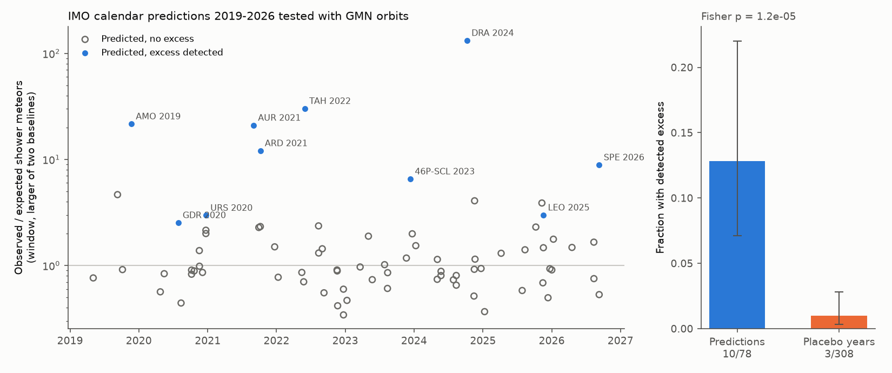
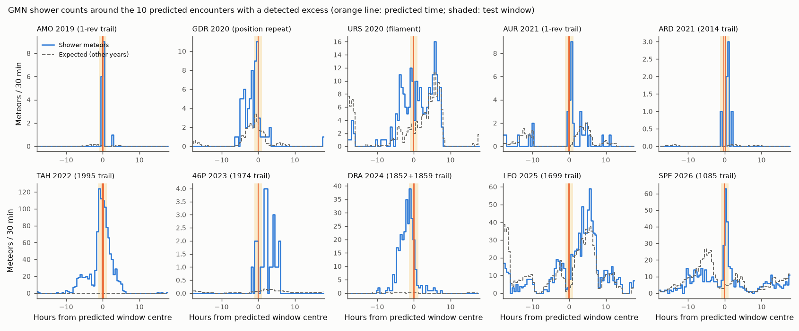
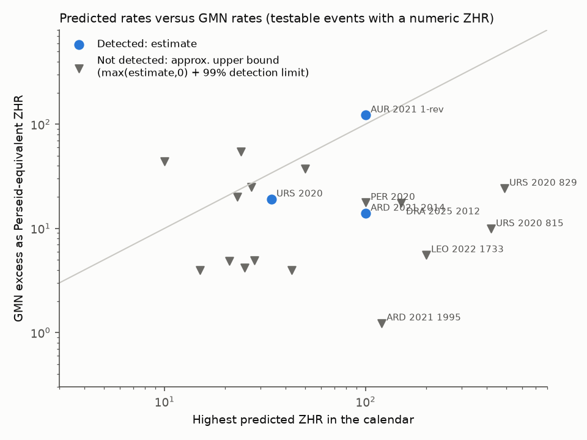

# IMO-calendar meteor outburst predictions, 2019-2026: GMN orbits show an excess for 10 of 78 testable encounters, and most detected peaks are within 1 hour of the prediction

## Summary

Meteor-shower outburst predictions come from dust-trail models (Sato, Vaubaillon, Maslov, Lyytinen, Jenniskens and others). The International Meteor Organization (IMO) publishes them each year in its Meteor Shower Calendar before the events occur. We did not find a systematic test of these predictions against one consistent instrument. This study does that test.

We took every prediction with a specific date and time from the IMO calendars for 2019 to 2026 (123 predictions, 105 distinct encounters). We tested each encounter with 3.67 million multi-station meteor orbits from the Global Meteor Network (GMN), 2019-01-01 to 2026-11-08.

Main results (main specification):

1. GMN had sufficient coverage for 78 of the 105 encounters. For 10 of these 78, GMN shows a significant excess of shower meteors in the predicted window (12.8 %, 95 % interval 7.1-22.0 %).
2. The same test at the same solar longitude in years without a prediction gives an excess in 3 of 308 windows (1.0 %, 95 % interval 0.3-2.8 %). Predictions therefore identify real activity (Fisher exact test p = 1.2e-5). Six other analysis variants give 7-11 detections and 0.4-1.1 % placebo rates.
3. For the 21 predictions in detected encounters, the median absolute difference between the predicted time and the GMN peak is 0.45 h. 16 of 21 are within 1 h. The largest differences are +1.9 h (46P/Wirtanen 1974 trail, 2023) and -1.1 h (Draconids 2024).
4. Most detected outbursts were predicted with no rate value or with "weak" or "unknown" activity: alpha-Monocerotids 2019, Arids (15P/Finlay) 2021, tau-Herculids 2022, 46P/Wirtanen meteors 2023, Draconids 2024, Leonids 2025 (1699 trail), September epsilon-Perseids 2026. 
5. Predictions with large numeric rates mostly did not occur at GMN: Ursids 2020 (listed ZHR 490 and 420; GMN upper bound about 25 Perseid-equivalent ZHR), Leonids 2022 1733 trail (ZHR 200+ and 50+; upper bound about 6), Arids 2021 1995 trail (ZHR 50-120; upper bound about 1). Of 11 Perseid and Ursid "filament" encounters, only one shows an excess.
6. A census of all 273 GMN shower codes finds 36 excess episodes. Only 7 of them coincide with a calendar prediction. The 29 others include the known Andromedid outburst of 2021-11-28 and a strong excess of the GMN shower DNO (IAU 915) on 2026-02-23 that many New Zealand stations and one Australian station recorded. We did not find a published report of this DNO event.

Limitations: the GMN network grew from about 50,000 orbits in 2019 to about 966,000 in 2025, so early years and the southern sky have little coverage. The method detects excess relative to other years and to adjacent days; it can miss broad enhancements and outbursts of very faint meteors (radar-only events). The "Perseid-equivalent ZHR" is an approximate scale; it does not correct for meteor speed or population index.

## 1. Question

Do published dust-trail predictions of meteor-shower outbursts identify real activity, and how accurate are their times and rates, when we test all of them with one large, uniform orbit database?

## 2. Data

### 2.1 Predictions (inputs/imo_predictions_2019_2026.csv)

Source: IMO Meteor Shower Calendars 2019-2026 (edited by J. Rendtel), PDF files from `https://www.imo.net/files/meteor-shower/calYYYY.pdf`. The file `files/provenance/imo_calendar_sources.txt` gives the URL, SHA-256 and size of each PDF that we used. We do not redistribute the PDFs.

We extracted the text with pypdf 7.0.0 (`scripts/pdf2txt.py`) and read every paragraph that contains "trail", "encounter", "filament", "outburst", "predict" or a predictor name. We recorded every statement that gives a specific date and time (or a time range, or a solar longitude) for possible activity. We did not include the normal annual maxima. Each row gives: the time or time range (UT), solar longitude (if given), shower code, parent body, trail (ejection year), predictor, kind, radiant and speed (if given), the predicted ZHR (if given) and a short note on the expectation.

- 123 predictions, grouped into 105 encounters (event_id). Predictions by different modellers for the same trail and the same hour are one encounter.
- Kinds: 96 trail predictions, 14 filament predictions (mean-motion resonance; mostly Jenniskens 2006, Tables 5b and 5d), 11 "position repeat" checks (the calendar asks observers to check the solar longitude of an earlier outburst: kappa-Cancrids 2015 and July gamma-Draconids 2016) and 2 resonance-year predictions (eta-Aquariids 2023 and 2024, Egal 2020).
- We excluded the Leonid and Ursid predictions for 2026-11-17 and later because they are after the end of the data.
- The PDF text lost the minus signs of some declinations. We restored them from the star names in the same sentence (for example "near pi Cet" gives -13 deg).

### 2.2 Meteor orbits

Global Meteor Network trajectory summaries, yearly files `traj_summary_yearly_YYYY.txt` for 2019-2026, from `https://globalmeteornetwork.org/data/traj_summary_data/`, downloaded 2026-11-09 (the files are regenerated daily). Shared campaign datasets: `/mnt/dell-data/shared_datasets/gmn-traj-summary-yearly-YYYY-20261109/`. The file `files/provenance/gmn_provenance.json` gives the URL, SHA-256 and size of each file. Total: 3,666,964 unique trajectories; the last trajectory is at 2026-11-08 02:12 UT.

We used these columns: unique trajectory identifier, Julian date, IAU shower number and code (GMN association), solar longitude, geocentric radiant (RA, Dec), geocentric speed, latitude and longitude of the begin point, begin height, peak absolute magnitude and number of stations.

## 3. Method (scripts/02_events.py)

### 3.1 Shower members

- If the GMN code of the shower has at least 100 members in 2019-2026, a member is a meteor with that code.
- If the calendar gives a radiant, a member is also a meteor with a geocentric radiant within 5 deg of it and with a geocentric speed within max(2.5 km/s, 15 %) of the predicted speed. We convert V_inf to V_g with V_g = sqrt(V_inf^2 - 11.2^2) when V_inf >= 12 km/s.
- For showers with no radiant in the calendar and too few coded members (Phoenicids 2019, Draconids), we used the radiant in the calendar's shower table.

### 3.2 Observing effort

The number of shower meteors depends on how many cameras observed with the radiant above the horizon. For this reason we normalize by an effort value E: the sum of sin(h) over all non-member trajectories in the window, where h is the apparent altitude of the shower radiant at the begin point of that trajectory. Only trajectories with h >= 10 deg contribute. We correct the geocentric radiant for zenith attraction with the shower speed. This correction is necessary: for example, GMN cameras in New Mexico recorded the slow (10 km/s) 15P/Finlay Arids on 2021-10-07, although the geocentric radiant (Dec -49 deg) was below their horizon.

An encounter is "testable" if at least 10 non-member trajectories contribute to E in the window.

### 3.3 Test window and controls

The window is the predicted time (or range) plus and minus 1 hour. We compare the number of members M with two expected values:

- Control A (same year): the same UT window shifted by -3, -2, -1, +1, +2 and +3 days. This control has the same station geometry. Near a normal shower maximum it gives too low an expected value.
- Control B (other years): the same solar-longitude window in all other years 2019-2026. This control includes the normal annual activity profile.

Expected value = E x (sum of control members / sum of control effort). We use an upper-tail negative-binomial test. The overdispersion factor comes from the scatter of the control windows (minimum 1). "Detected" means p < 0.01 for both controls and an excess of at least 3 meteors (for windows longer than 12 h, only Control B with p < 0.001).

### 3.4 Placebo test

For each encounter we did the same test at the same solar longitude in each other year that has no prediction for that shower within 0.5 deg of solar longitude. The prediction year is not used as a control in the placebo test. This gives the rate of false or unpredicted detections under the same procedure.

### 3.5 Timing and rate

- Peak time: maximum of the 1-hour running excess (members minus the Control B expectation) in 10-minute bins, in the window plus and minus 3 hours. The uncertainty is the 16-84 % range from 1,000 Poisson resamplings of the bin counts.
- Rate scale: we calibrated the member-to-effort ratio with the Perseid nodal maximum (solar longitude 139.96-140.04 deg, all years), with an assumed ZHR of 100. The "Perseid-equivalent ZHR" of an excess is 100 x (excess / E) / 4.59. This scale is approximate. It does not correct for speed or for the population index.

### 3.6 Census of excess episodes (scripts/03_scan.py)

For each of the 273 GMN shower codes with at least 300 members, we tested 2-hour windows in 1-hour steps through the active period of each year with the same two controls. A window is flagged when both p-values are below 1e-5, the excess is at least 5 meteors and at least twice the expected value. We merged overlapping flagged windows into episodes and compared them with the predictions of the same shower (overlap or within 12 h).

### 3.7 Sensitivity variants

We repeated the event analysis with: window padding 0.5 h and 3 h; radiant radius 3 deg and 8 deg; minimum radiant altitude 20 deg; and unweighted effort (count instead of sum of sin h).

## 4. Results

### 4.1 Detection rate (results/detection_summary_by_spec.csv)

| Variant | Testable encounters | Detected | Rate | Placebo windows | Placebo detected | Placebo rate | Fisher p |
| --- | --- | --- | --- | --- | --- | --- | --- |
| main | 78 | 10 | 0.128 | 308 | 3 | 0.010 | 1.2e-5 |
| padding 0.5 h | 69 | 7 | 0.101 | 274 | 1 | 0.004 | 6.9e-5 |
| padding 3 h | 92 | 11 | 0.120 | 375 | 3 | 0.008 | 2.2e-6 |
| radius 3 deg | 79 | 10 | 0.127 | 308 | 3 | 0.010 | 1.3e-5 |
| radius 8 deg | 78 | 10 | 0.128 | 308 | 3 | 0.010 | 1.2e-5 |
| altitude >= 20 deg | 72 | 8 | 0.111 | 283 | 3 | 0.011 | 2.0e-4 |
| unweighted effort | 78 | 10 | 0.128 | 308 | 2 | 0.006 | 3e-6 |

By kind (main): trails 8 of 56, filaments 1 of 11, position repeats 1 of 9, resonance years 0 of 2.

27 encounters were not testable. Most of them were in 2019 and 2020 (small network) or had far-southern radiants (for example C/1907 G1, beta-Hydrusids, C/1976 D1, 72P/Denning-Fujikawa in daylight).

### 4.2 Detected encounters (results/event_results_main.csv)

| Encounter | Predicted (UT) | Predictor | Members M | Expected A / B | GMN peak (UT) | Specs detecting (of 7) |
| --- | --- | --- | --- | --- | --- | --- |
| alpha-Monocerotids 2019, 1-rev trail | 2019-11-22 04:52-04:56 | Sato; Jenniskens | 15 | 0.2 / 0.2 | 05:07 | 7 |
| July gamma-Draconids 2020, 2016 position | 2020-07-28 00:30 | IMO position repeat | 24 | 3.6 / 9.2 | 23:55 (27th) | 7 |
| Ursids 2020, filament | 2020-12-22 05:27 | Jenniskens | 36 | 0.2 / 11.8 | broad, see text | 5 |
| Aurigids 2021, 1-rev trail | 2021-08-31 21:17-21:35 | Sato; Lyytinen; Vaubaillon | 17 | 0.1 / 0.3 | 22:02 | 5 |
| Arids (15P) 2021, 2014 trail | 2021-10-07 00:38-01:10 | Vaubaillon; Sato | 6 | 0.04 / 0.03 | 01:33 | 6 |
| tau-Herculids 2022, 1995 trail | 2022-05-31 04:55-05:17 | Jenniskens; Sato | 504 | 16.2 / 0.2 | 04:40 | 7 |
| 46P/Wirtanen 2023, 1974 trail | 2023-12-12 11:20 | Vaubaillon | 5 | 0.3 / 0.3 | 13:15 | 6 |
| Draconids 2024, 1852 and 1859 trails | 2024-10-08 06:23-06:53 | Jenniskens; Vaubaillon | 99 | 0.1 / 0.3 | 05:38 | 7 |
| Leonids 2025, 1699 trail (2nd segment) | 2025-11-17 22:30-22:40 | Maslov; Sato | 41 | 9.7 / 13.4 | 23:45 | 5 |
| Sept. epsilon-Perseids 2026, old trails | 2026-09-10 06:09-06:13 | Sato; Vaubaillon | 147 | 5.4 / 16.1 | 06:34 | 7 |

Notes on the detected encounters:

- tau-Herculids 2022: 504 members in 2.3 h against 0.2 expected from other years; this is the largest excess in the sample. The GMN peak (04:40) is 15-37 min before the three predictions.
- Draconids 2024: the forecasters gave no rate because the trails are old. GMN shows a clear outburst with a peak about 1 h before the predicted times. A GMN telegram (CBET 5456) reported this outburst with a peak ZHR of about 16 and linked it to a different (1900) trail.
- Ursids 2020: the excess is broad (from about 01 to 12 UT) and has no peak at the filament time; the census finds the strongest window at 10-12 UT. This is enhanced activity, but the data do not confirm the timing of any single 2020 Ursid prediction.
- Aurigids 2021: only 13 effort trajectories (the radiant was low for most GMN cameras at that time); the rate estimate is very uncertain.
- 46P/Wirtanen 2023: only 5 members in the window, but the expected value is 0.3; the members arrive about 1-6 h after the predicted time (peak +1.9 h).
- September epsilon-Perseids 2026: three independent predictions (Sato with two ejection-year assumptions, Vaubaillon) gave 06:09-06:13 UT. GMN shows a sharp peak at 06:34 UT with 147 members against 5-16 expected. Vaubaillon expected low activity because the bulk of the trail is outside the Earth's orbit.
- July gamma-Draconids 2020: this is a "position repeat" check, not a model prediction. The GDR has a sharp annual maximum near this solar longitude, so this detection can be a strong annual return.

The Leonid 1167-trail encounter of 2025 (Vaubaillon, "around 22 h UT" on 2025-11-09) is a special case. The main window (21:00-23:00) contains only 5 members, but the census finds a strong excess from about 19:45 to 21:15 UT (43 members against 3.3 expected in the best 2-hour window). The 3-hour-padding variant detects it. The outburst occurred about 1.3 h before the stated time.

### 4.3 Timing (results/timing_offsets_main.csv, figures/fig3_timing.png)

For the 21 predictions in the 10 detected encounters, the median absolute offset (GMN peak minus predicted time) is 0.45 h; 16 of 21 are within 1 h. Offsets: alpha-Monocerotids +0.2 to +0.3 h; Aurigids +0.4 to +0.8 h; Arids +0.4 h (Sato) and +0.9 h (Vaubaillon); tau-Herculids -0.2 to -0.6 h; 46P +1.9 h; Draconids 2024 -0.8 h (Vaubaillon) and -1.1 h (Jenniskens); Leonids 2025 1699 trail about +1.1 to +1.3 h (wide uncertainty); epsilon-Perseids 2026 +0.35 to +0.42 h. The Ursid 2020 offset has no physical meaning (broad excess).

### 4.4 Rates (results/numeric_zhr_predictions.csv)

19 testable encounters have a numeric ZHR in the calendar. Only 3 of them show an excess (Ursid filament 2020, Aurigids 2021, Arids 2014 trail). Six predictions of ZHR 100 or more did not occur at a level that GMN could detect:

| Encounter | Predicted ZHR | GMN result (Perseid-equivalent ZHR) |
| --- | --- | --- |
| Ursids 2020, 829 trail (Jenniskens 2006, Lyytinen) | 490 | not detected; upper bound about 24 |
| Ursids 2020, 815 trail (same source) | 420 | not detected; upper bound about 10 |
| Leonids 2022, 1733 trail (Maslov; Sato) | 200+ ; 50+ | not detected; upper bound about 6 |
| Arids 2021, 1995 trail (Maslov) | 50-120 | not detected; upper bound about 1 |
| Draconids 2025, 2012 trail (Maslov; Jenniskens) | 100-150 ; up to 50 | not detected; upper bound about 18 (poor coverage, 11 effort trajectories) |
| Perseids 2020, filament (Jenniskens) | 100 | not detected; upper bound about 18 |

The IMO reported no visual Leonid outburst in 2022 either. Sato and the predictors of the Draconids 2025 said that the meteoroids could be too small for video; our result agrees with that caveat but cannot test radar-only activity.

### 4.5 Census of excess episodes (derived/scan/episodes.csv)

The census flags 36 episodes. 7 match a calendar prediction (alpha-Monocerotids 2019, July gamma-Draconids 2020, Ursids 2020, tau-Herculids 2022, Draconids 2024, Leonids 2025 1167 trail, epsilon-Perseids 2026). The 29 unmatched episodes are:

| Code (IAU no.) | Date of best 2-h window (UT) | Members / expected | Comment |
| --- | --- | --- | --- |
| DNO (915) | 2026-02-23 16:42 | 248 / 22 | largest unpredicted excess; 280 DNO orbits that day against 26-31 per day on 2026-02-20 to 22; many NZ stations and AU001F; radiant RA 239, Dec -46, V_g 67 km/s, radiant scatter 0.64 deg against 1.70 deg on other days |
| QUA (10) | 2024-01-04 18:10; 2026-01-03 19:25 | 154 / 26; 391 / 47 | effort is very small (low radiant); can be a geometry effect near the sharp Quadrantid maximum |
| AND (18) | 2021-11-28 08:24 | 25 / 4.5 | known Andromedid outburst (mentioned in the IMO calendar 2023) |
| OCT (281) | 2024-10-05 19:51 | 56 / 25 | October Camelopardalids |
| JIP (431) | 2022-06-25 23:11; 2023-06-26 01:18 | 25 / 7; 49 / 19 | June iota-Pegasids, two years |
| JSP (829) | 2021-07-17 00:37; 2023-07-18 00:47 | 15 / 0.5; 25 / 1.2 | two years |
| EVI (11) | 2025-03-19 14:10 | 33 / 11 | eta-Virginids |
| NTA (17) | 2024-10-31 19:19; 2026-11-06 23:31 | 15 / 3.8; 46 / 20 | Northern Taurids |
| AMO (246) | 2025-11-22 16:27 | 8 / 1.0 | small |
| LEO (13) | 2022-11-12 02:23 | 12 / 2.3 | small |
| GUM, NOA, DRA 2022, PIH, DEG, ETR, XIE, CTA, DPC, OAV, SIA, EGE, NCC, JLC | - | 6-11 / 0.2-1.4 | small (5-10 excess meteors); some can be statistical or association effects |

The member orbits of all episodes and detected encounters are in `results/member_trajectories_detected_and_census.csv.gz`.

## 5. Discussion

- The predictions carry real information. The excess rate in predicted windows is about 13 times the rate in matched placebo windows. Timing is the strongest part of the models: when an outburst occurs, the peak is usually within 1 h of the predicted time.
- The rate part is weak. The detected outbursts were mostly predicted without a rate or as "weak", and the large numeric rates (ZHR 100-490) were not observed by GMN. Many of the large values come from the 2006 tables of Jenniskens (based on Lyytinen's models) and from Maslov.
- Filament (resonance) predictions for the Perseids and Ursids had a low success rate (1 of 11). For encounters near a normal shower maximum, our test needs a large excess over the normal year-to-year variation, so small filament enhancements can be missed.
- The census shows that most significant excess episodes in GMN data (29 of 36) were not in the calendars. Some of them are small and can be statistical or association effects, but the 2026-02-23 DNO event is large, well localized and recorded by many stations.

## 6. Limitations

- Coverage: GMN grew strongly from 2019 to 2025 and has few southern stations before about 2023. 27 of 105 encounters were not testable. Daylight and far-southern radiants are not testable.
- GMN shower association: we used the GMN code for established showers. Outburst meteors with a radiant far from the reference radiant can be missed by the code; for this reason we added a radiant selection when the calendar gave a radiant.
- Faint meteors: video cameras do not see radar-only outbursts (for example the expected Draconids 2025).
- Controls: Control A is biased near normal maxima; Control B includes real outbursts of other years. The negative-binomial dispersion from 6-7 control units is approximate. We report several variants to show the effect of these choices.
- Rate scale: the Perseid-equivalent ZHR is only a relative scale. Slow showers (Draconids, tau-Herculids, Arids) produce fainter meteors at the same ZHR.
- The prediction list is our reading of the calendars. Different readers could group or interpret some statements differently. The full list is in `files/inputs/` for checking.
- GMN files are regenerated daily; reprocessing can change some trajectories. The SHA-256 values identify the exact files that we used.

## 7. Reproduction

Requirements: Python 3.12 with numpy, pandas, pyarrow, scipy, matplotlib; pypdf (only for the text extraction).

Directory layout expected by the scripts: `work/scripts/*.py`, `work/inputs/`, and a `datasets` folder next to `work/` that holds `gmn-traj-summary-yearly-YYYY-20261109/traj_summary_yearly_YYYY.txt` (download from the GMN URL above; check the SHA-256 in `provenance/gmn_provenance.json`).

1. `python scripts/01_parse_gmn.py 2019 2020 2021 2022 2023 2024 2025 2026` writes `derived/gmn/gmn_YYYY.parquet` (about 5 min).
2. `python scripts/02_events.py` (main; about 1 min). Variants: `TAG=pad05 PAD_H=0.5`, `TAG=pad3 PAD_H=3`, `TAG=rad3 RAD_R=3`, `TAG=rad8 RAD_R=8`, `TAG=alt20 ALT_MIN=20`, `TAG=unweighted WEIGHT=0` as environment variables.
3. `python scripts/03_scan.py` (census; about 5 min).
4. `python scripts/04_summary.py` (tables in `results/`, figures in `figures/`).
5. `python scripts/05_export_members.py` (member orbit table).
6. Optional: `python scripts/pdf2txt.py imo/calYYYY.pdf` to re-create the calendar text that we read.

Files in this package:

- `inputs/imo_predictions_2019_2026.csv`: the curated prediction list.
- `derived/events/events_<variant>.csv`, `placebo_<variant>.csv`, `timing_<variant>.csv`, `per_calibration_<variant>.csv`: per-encounter, placebo and timing results. `series_main.json`: 30-min member and effort counts around each encounter.
- `derived/scan/flagged_windows.csv`, `episodes.csv`: census results.
- `results/`: summary tables and member orbits.
- `figures/`: PNG figures.
- `provenance/`: source URLs and SHA-256 values of the GMN files and the IMO calendars.

## 8. Provenance

- Campaign 11_07_2026; job sci-1107-dell-astronomy-4011c7174af9; topic astronomy; machine dell; model Claude Opus 5.5 (claude-opus-5-5), account claude-andrii. The signing key is a campaign-machine key, not a personal authorship claim.
- Data access date: 2026-11-09 (GMN files generated 2026-11-09 about 05:00 UTC).
- Prior campaign work: no earlier campaign publication tests meteor-shower predictions.

## References

- Rendtel J. (ed.), IMO Meteor Shower Calendars 2019-2026, https://www.imo.net/resources/calendar/
- Vida D. et al. 2021, The Global Meteor Network - Methodology and first results, MNRAS 506, 5046, doi:10.1093/mnras/stab2008
- Jenniskens P. 2006, Meteor Showers and their Parent Comets, Cambridge University Press.
- CBET 5456 (2024), Draconid outburst observed by GMN, http://www.cbat.eps.harvard.edu/iau/cbet/005400/CBET005456.txt
- IMO 2022, No 2022 Leonid outburst detected, https://www.imo.net/no-2022-leonid-outburst-detected/
- Egal A. et al. 2025, Model predictions for the 2025 October Draconid outburst, arXiv:2509.25639
