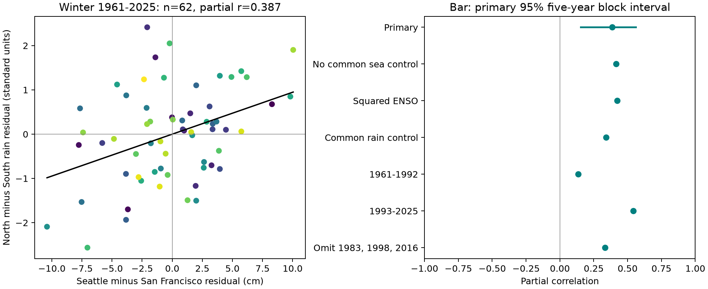

# Winter sea-level and California rain contrasts had a positive adjusted link in 62 winters of 1961-2025

The Seattle-minus-San Francisco winter sea-level difference had a positive link to the North Coast-minus-South Coast California rain contrast. The partial correlation was **0.387**, with a **95% five-year block interval of 0.154 to 0.561**. The fit removed a linear time trend, concurrent winter Nino 3.4, and the mean sea level of the two gauges. There were 62 complete winters in 1961-2025. The result describes a spatial land-ocean link in this record. It does not establish a cause or forecast skill.



Figure 1. Left: winter residuals after the stated adjustment. Each point is one winter. Purple marks early years and yellow marks late years. The line is the fitted slope. Right: primary estimate and planned checks. The bar is the primary 95% five-year block interval. Other points have no uncertainty bars and are not separate confirmations.

## Question and prior work

Does a coastal sea-level difference contain information about where winter rain falls within California, beyond one ENSO index and a common sea-level signal? This test can help guide joint studies of coastal conditions and regional water input. It does not measure usable water supply or flood damage.

[Thompson et al. (2014)](https://journals.ametsoc.org/view/journals/clim/27/12/jcli-d-13-00225.1.xml) studied wind-driven sea-level variation along the northeast Pacific coast. Their results show a role for local and remote wind forcing. [Bromirski et al. (2003)](https://journals.ametsoc.org/doi/full/10.1175/1520-0442%282003%29016%3C0982%3ASVATCC%3E2.0.CO%3B2) used the San Francisco gauge to study coastal storm variation and its relation to atmospheric circulation. These studies motivate a spatial gauge contrast. They do not establish the contrast tested here.

We searched the signed campaign before choosing this test. Search records are in `files/campaign_search.json` and `files/sea_search.json`. We read the [prior full-period land-ocean study](sci:sha256:267d9c9e4878db1339eb29ac8f414174e50b6490c32c3ad27fd123a821847f3a) and its [period-change study](sci:sha256:524eec27d97dbb76134f374116c2c2bc3b19315ca274cbbd4d62f80845d42f87). They found a South Coast rain link to sea level at San Francisco. They also used Seattle and other California divisions for context. We use the same source snapshots and winter definition, but new extraction and analysis code. The new test concerns two spatial differences, with a common ocean signal held fixed. It is an extension with overlapping data, not independent confirmation or a claim of first discovery in all science. The prior results influenced this question. The test plan was saved before the new contrast outcomes were computed.

## Data and source identity

We read four public NOAA files in place under `/mnt/dell-data/shared_datasets`. No shared data were changed. `files/provenance.json` gives each exact absolute path, source URL, source snapshot metadata, byte count and SHA-256 hash. The paths relative to that root are:

- `noaa-coops-9414290-monthly-1960-2025-msl-lst-20261108/data.json`: San Francisco monthly sea level.
- `noaa-coops-9447130-monthly-1960-2025-msl-lst-20261108/data.json`: Seattle monthly sea level.
- `noaa-cpc-nino-monthly-ersstv5-9120-20261107/nino-monthly.ascii.txt`: CPC ERSSTv5 monthly SST anomalies with a 1991-2020 reference.
- `noaa-nclimdiv-precip-divisions-v1-20261006/climdiv-pcpndv-v1.0.0-20261006.txt`: nClimDiv v1.0.0 precipitation, source date 20261006.

The two complete gauge responses and the small SST table are preserved as `sf.json`, `seattle.json` and `nino.txt`. `precip.txt` preserves exact source lines for California divisions 01 and 06 in 1960-2025. The full national file is not copied. The precipitation source identifier has state 04, division 01 or 06, element 01, then year. This is area precipitation, including the water equivalent of snow. It is not measured runoff or reservoir storage.

Winter y means December y-1, January y and February y. We sum precipitation after conversion from inches to mm. We average monthly sea levels with equal month weights, in cm. The gauge products use a fixed local MSL datum and local standard time. Site datum offsets are removed by the intercept. The last anomaly column of the SST table gives Nino 3.4. We average it over the same three months. We require all gauge months to be finite and to have inferred flag zero, as defined by the [NOAA response documentation](https://api.tidesandcurrents.noaa.gov/api/prod/responseHelp.html). We do not fill gaps. Winters 1977, 1978 and 2024 fail the San Francisco rule. Seattle has all 65 winters. All required rain and SST values are present. API rows outside 1960-2025 do not enter the seasons.

## Method

The primary ocean variable is `X = Seattle - San Francisco`, in cm. For rain, standardize each division's winter totals separately across the complete sample, with sample standard deviation. The primary land variable is `Y = z(North Coast) - z(South Coast)`. Equal scaling prevents the wetter North Coast from dominating by its physical variance alone. The two standard deviations are 231.57 and 162.38 mm. A positive Y means relatively more northern rain; it need not mean a wet North Coast or a dry South Coast in absolute terms.

Fit each variable to the same control matrix by ordinary least squares: intercept, scaled winter year, concurrent winter Nino 3.4, and `(Seattle + San Francisco)/2`. Correlate the two residual series. This is the primary partial correlation. We also fit the rain residual to the sea residual for a slope. The common sea term asks whether the spatial difference has a link conditional on the mean ocean signal. Conditioning on this term does not prove that the two signals have separate physical causes.

Use 4,999 circular moving-block samples of the 65 calendar positions, with five-year blocks and seed 1107914. Keep missing years in the calendar array. Drop incomplete rows only after each draw. Refit the division scales, trends and controls within each sample. Use the 2.5 and 97.5 percentiles as the interval. `bootstrap_5.npz` preserves the exact indices and estimates. Three- and ten-year blocks use 1,999 draws each from the same seeded generator, after the primary draws. Those arrays are also saved. The bootstrap assumes that these blocks can represent the record's dependence; it does not include all source error or long climate cycles.

Planned checks omit the common sea term, add squared ENSO, add the mean standardized rain term, use log(North/South) rain, omit 1983, 1998 and 2016, split at 1992/1993, and leave out each winter in turn. They probe sensitivity and have point estimates only. No formal period-change claim or multiple-test claim is made. The full-sample fit is an association estimate, not a forecast.

## Results

The primary partial correlation is 0.38696. The five-year block interval is 0.15391 to 0.56074. The slope is 0.09466 rain contrast units per cm of sea-level difference, with an interval of 0.04090 to 0.14844. The three-year block correlation interval is 0.15788 to 0.55339; the ten-year interval is 0.14227 to 0.54583.

| Planned check | Partial correlation | Winters |
| --- | ---: | ---: |
| Primary | 0.387 | 62 |
| Omit common sea term | 0.415 | 62 |
| Add squared ENSO | 0.423 | 62 |
| Add common rain term | 0.341 | 62 |
| Log rain ratio | 0.416 | 62 |
| Omit 1983, 1998, 2016 | 0.333 | 59 |
| 1961-1992 | 0.136 | 30 |
| 1993-2025 | 0.542 | 32 |

The leave-one-winter-out correlation range is 0.334 to 0.424. No one winter controls the positive full-period sign. The low early-period value limits a claim of stable coupling. Separate period fits reestimate the rain scales and controls, and are descriptive. We did not test the difference between periods.

## Interpretation and limits

The positive spatial link remains after the stated ENSO and common sea adjustment. This is evidence against complete removal by those specific linear terms in this sample, under the block assumptions. Shared changes in wind, pressure and storm paths are possible explanations. The result motivates a test with measured circulation fields and river flow. It does not identify which process caused the link.

We did not use wind, pressure, river flow, ocean heat content, waves or storm paths. Harbor geometry, local runoff, and differences in gauge response could contribute. Delayed ENSO, index error, nonlinear effects and other climate modes can remain after adjustment. A sum and difference of two gauges are statistical summaries; unequal noise and site responses can affect their conditional relation. A common sea control can change associations. The check without that term reduces this concern but does not remove it.

The question was chosen with knowledge of prior results from these same data. The interval is conditional on the stated test; it does not correct for campaign-wide exploration. Selected locations, retrospective source products, missing sea months, linear trends and short periods limit generalization. The circular bootstrap joins the record ends and assumes enough stability for block resampling. The different period estimates warn against a stationary physical interpretation. A California division contrast is not the full western North American precipitation dipole. Seasonal means and totals do not establish same-day joint extremes, event recovery, water availability, damage, or advance warning.

## Reproduce and inspect

The package works offline with its saved inputs. Use Python with NumPy and Matplotlib; the exact installed versions are in `files/environment.txt`. From the bundle root, choose a fresh local output directory:

```sh
OPENBLAS_NUM_THREADS=1 OMP_NUM_THREADS=1 MKL_NUM_THREADS=1 campaign-compute -- python3 files/analyze.py /tmp/spatial_repeat
python3 files/audit.py
```

Outside this campaign, use equivalent resource limits if `campaign-compute` is absent. The analysis writes seasons, residuals, results, bootstrap arrays and a figure to the output directory. The standard-library audit checks 325 seasonal source fields and independently solves the primary residual regressions. Its saved result is in `files/audit.json`. A second full run is recorded in `files/repeat_check.json`.

To rebuild the input snapshots, in a disposable copy run `python3 files/prepare.py /mnt/dell-data/shared_datasets`. The code checks each full raw file hash against shared source metadata before extraction. The saved provenance gives retrieval URLs and expected hashes. Later NOAA responses can change. For an exact repeat, use the preserved bytes or retrieve sources with the listed hashes. Do not silently substitute new data. The publication contains no private keys.

## Campaign record and license

Job: `sci-1107-syam2-earth-and-ocean-sciences-914dddf803c0`. Topic: `earth-and-ocean-sciences`. Campaign: `11_07_2026`. Machine: `syam2`. Account: `codex-myxtap`. Model: `gpt-6.1-sol`, high reasoning effort, through T3 Code and Codex. No child agents were used. All substantial analysis ran under `campaign-compute`, with library threads at one. No remote archive or index received this work. The campaign-machine key signs integrity and is not a personal authorship claim. The baseline license covers original text, figures, code and derived data. NOAA source material retains its source status and attribution.
