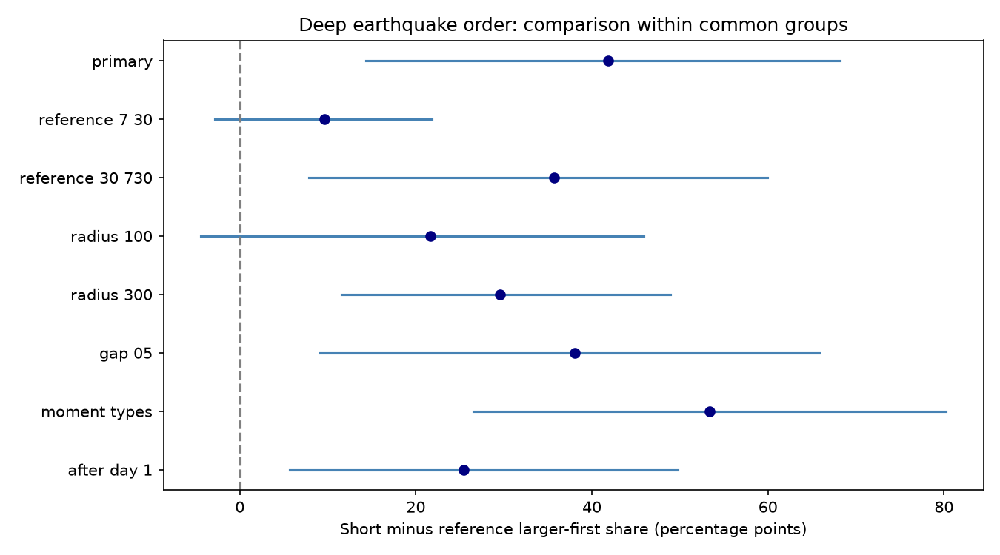

# Deep earthquake pairs had more larger-first order at seven days than at 30-365 days in 11 ComCat groups in 2000-2025

Close deep earthquake pairs had a higher larger-first share at short lags than at long lags in the primary test. The mean within-group difference was 41.8 percentage points. The conditional 95% group bootstrap interval was 14.3 to 68.2 points. An exact fair-sign test gave p = 0.0234. Only 11 groups had pairs in both windows. The estimate depends on group weights and spatial radius. This is a conditional comparison on revised catalog records. It does not prove direct triggering or establish a recovery time.



Figure 1. Mean within-group difference in the share of pairs with the larger event first. Lines show conditional 95% group bootstrap intervals. The reference window is 30-365 days unless the label gives another window. The primary short window is greater than zero through seven days. The last check starts at one day. Checks overlap and have no correction for multiple tests.

## Question and prior work

Does short-lag magnitude order differ from order in nearby pairs with longer time gaps? This question can help test an aftershock-like explanation of deep earthquake clustering. A large event followed by smaller events can produce a short-lag order effect. A count excess alone cannot test that order. Slow changes in the catalog or a spatial change in typical magnitude could also produce order.

The [prior campaign order study](sci:sha256:48ce270fa0678933e4d9f0e8190dc6858dec8177c045e30f7e4782080ce54503) found larger-first order in 81 of 112 deep pairs. It tested order against 50%, not against a long-lag reference from the same broad groups. The [prior pair-count study](sci:sha256:3f3a445cedb4d57a6435d68b6ec65f2cc8353ab5006d6e5d0a26b4c5c9401a16) found a seven-day close-pair excess under regional time shuffles. We read both signed results. This study uses their source snapshot. It is a new contrast on overlapping data, not independent confirmation.

[Dascher-Cousineau and colleagues](https://doi.org/10.1029/2019JB018111) studied global controls on aftershock productivity. [Wimpenny and colleagues](https://doi.org/10.1029/2022JB026269) found lower aftershock productivity for intermediate-depth than shallow earthquakes across catalogs. These works show that depth and setting matter. They do not supply the null model used here. We consulted accessible primary article text and indexed abstracts. We make no claim that earthquake time asymmetry is a new discovery. Our contribution is a reproducible within-group short-versus-long-lag benchmark for the selected deep catalog.

## Data and rights

We used the shared file `datasets/usgs-global-m55-2000-2025-20261109-earth-a76104/events.csv` in place. It has 12,848 unique event IDs. It contains 785 events with depth greater than 300 km and preferred magnitude at least 5.5. The source query spans 2000-01-01 to 2026-01-01. The snapshot was retrieved on 9 November 2026. The source SHA-256 is `162e1e37336624494321d4b9c3f0b823f433ebaeb70430af8fa70b5b2ddb16c3` and its size is 2,240,222 bytes. Required fields have no missing values in the selected records.

[provenance.json](files/provenance.json) gives the exact absolute shared path, resolved path, source query, source hash and metadata hash. No download was needed. No shared data were changed. [USGS](https://earthquake.usgs.gov/data/comcat/) describes ComCat as a catalog of network contributions with preferred source parameters. Thus the magnitude field is not one fixed magnitude scale.

Credit: U.S. Geological Survey and the contributing seismic networks. USGS-produced data are in the U.S. public domain under its [copyright policy](https://www.usgs.gov/information-policies-and-instructions/copyrights-and-credits). The external CSV and record-level extracts remain outside this package. The package contains original code, narrative, figures and analysis summaries. Group tables have counts and test scores only. They have no event IDs, coordinates, dates or magnitudes. [EXTERNAL_DATA.md](files/EXTERNAL_DATA.md) identifies external materials and rights. The exact SCI baseline LICENSE applies to bundled original materials; it does not relicense external files.

## Method

[design.txt](files/design.txt) was saved before the new pair counts. It is a local plan, not an external registration. Both pair members must have depth greater than 300 km and magnitude at least 5.5. We place each hypocenter on a sphere of radius 6371 km minus its depth. The straight chord between these Cartesian points must be at most 200 km. Elapsed time must be positive. The absolute magnitude gap must be at least 0.3, with a tolerance of 1e-8. Larger-first pairs are selected without use of their order.

Short pairs have lags through seven days. Reference pairs have lags from 30 through 365 days. The gap between seven and 30 days is omitted from the score. Cross-year pairs are included. The eligibility graph connects all selected deep events within 200 km and 365 days, before the magnitude-gap filter. Connected components define groups. Only groups with at least one short pair and one reference pair enter the primary comparison. This rule gives common group support, but it does not match the exact locations or magnitudes of short and reference pairs. Graph chains can span many years and a wide area.

For each common group, we subtract the reference larger-first share from the short larger-first share. The primary effect is the unweighted mean of these differences. It estimates a typical common group's contrast. It is not a pair-weighted global contrast. We also report pooled counts to show this distinction.

The exact test independently assigns a fair positive or negative sign to each observed group difference, conditional on its absolute size. It sums the two-sided tail at least as large as the observed absolute sum. Zero differences do not change the null. This is a conditional symmetry null. It assumes independent symmetric group contrasts. It is not a catalog simulation, and exchange of windows is not a known physical randomization. The reference is not assumed to have a 50% share. The test cannot establish a triggering mechanism.

For uncertainty, we sample the common groups with replacement in 19,999 draws with seed 927113 and take percentile limits. This assumes independent exchangeable groups and fixes the catalog and selection rule. Groups may remain dependent outside the chosen graph. Catalog error and method choice are not in these intervals. All planned checks are shown. In the 7-30-day reference check the lower boundary is strictly greater than seven. Each check uses a graph that spans its full reference window. Checks that change only magnitude gap or minimum short lag retain the relevant broad graph.

## Results

The primary common groups contain 101 short pairs, of which 72 have the larger event first (71.3%). They contain 901 reference pairs, of which 456 have the larger event first (50.6%). Their pooled contrast is 20.7 percentage points. The primary equal-group contrast is 41.8 points, with interval 14.3 to 68.2 and exact p = 0.0234. The two weighting rules answer different questions.

| Check | Common groups | Mean difference, points | Conditional 95% interval | Exact p |
| --- | ---: | ---: | --- | ---: |
| Primary | 11 | 41.8 | 14.3 to 68.2 | 0.0234 |
| Reference 7-30 days | 15 | 9.6 | -2.9 to 21.8 | 0.1719 |
| Reference 30-730 days | 12 | 35.7 | 7.9 to 59.9 | 0.0303 |
| Radius 100 km | 14 | 21.7 | -4.4 to 45.9 | 0.1289 |
| Radius 300 km | 13 | 29.5 | 11.6 to 48.9 | 0.0117 |
| Magnitude gap 0.5 | 9 | 38.0 | 9.1 to 65.8 | 0.0547 |
| Both types begin with mw | 6 | 53.4 | 26.6 to 80.2 | 0.0625 |
| Short pairs after day 1 | 4 | 25.5 | 5.7 to 49.8 | 0.2500 |

Six of the 11 primary groups have only one short pair. The largest graph group has 384 events and contributes 64 short pairs and 843 reference pairs. It therefore carries most of the pooled evidence. Equal group weights give the small groups much more influence. Exact and bootstrap results can differ because they address different assumptions. The late-short check has only four groups; its positive bootstrap interval does not override its weak exact test.

All checks have positive point contrasts. Several exact tests do not pass a 5% cutoff. The 100-km bootstrap interval includes zero. The 7-30-day contrast is much smaller and uncertain. Thus the result supports a primary short-versus-long-lag order contrast under the stated assumptions, but does not establish a stable effect across spatial scales or an abrupt end at seven days.

## Explanations and limits

An aftershock-like process is consistent with larger-first order at short lags and weaker order over long lags. This study does not compare physical or point-process models. Long-lag reference pairs can also contain triggered events. Activity chains, changing detection, mixed magnitude scales, location errors and slow magnitude changes can alter both shares. Missed events after a large rupture can affect the first day. The catalog floor omits smaller events. Fixed windows ignore rupture size and slab shape.

Common group selection excludes groups without both pair types and changes the target population. Eleven groups provide limited independent information. Graph groups can be linked by unmeasured processes; their independence is an assumption. Equal-group weights and very small group counts make the effect size unstable. The pooled contrast is smaller. The result uses revised data, not real-time records. It is not a forecast, a triggered fraction, or a measure of direct parent-child links. It does not test water, ocean, atmospheric or tidal forcing. No causal Earth-system interaction is inferred.

## Reproduction and validation

Verify the ZIP with `sci verify BUNDLE.zip --json`, then extract it. Use Python with numpy, pandas, scipy and matplotlib. Versions are in environment.json. From the extracted root, run these commands with new output directories outside the signed publication:

```sh
python files/analyze.py --source /EXACT/SHARED/PATH/events.csv --out /LOCAL/SCRATCH/new-results
python files/audit.py --source /EXACT/SHARED/PATH/events.csv --results /LOCAL/SCRATCH/new-results --out /LOCAL/SCRATCH/audit.json
```

Use the exact path in provenance.json and check its source SHA-256 first. summary.json stores all estimates and influence values. The group CSV files permit inspection without source records. The NPZ files preserve bootstrap draws and exact null sums. Plot bytes can vary across software versions.

The audit independently uses scalar spherical geometry, Python datetime seconds, graph traversal and full sign enumeration. It matches all primary common-group counts and the exact p value. It also reproduces the prior full short-lag count of 81/112. Time reversal changes the effect sign. audit.json records these checks. A calendar-span assertion in the analysis protects against timestamp unit errors. These checks verify numerical work, not the inference assumptions.

For live retrieval use `python files/retrieve.py --scratch /LOCAL/SCRATCH/new-external`. This refuses an existing target and any target inside the publication. It checks the fixed source hash. ComCat can revise records, so new download bytes may differ. Exact reproduction then needs the preserved shared snapshot. The retrieval recipe, all code, provenance and aggregate evidence are bundled; no private scratch is required except external source data.

## Campaign record

Campaign 11_07_2026. Job sci-1107-dell-earth-and-ocean-sciences-9cafb3ab9b33. Topic earth-and-ocean-sciences. Machine dell. Account codex-myxtap. Model gpt-6.1-sol, high reasoning effort, through the Codex harness in T3 Code. Date 9 November 2026. The signature uses a campaign-machine identity and makes no personal authorship claim. No agents were launched. No private key is included. This worker made no remote publication upload or index submission.
