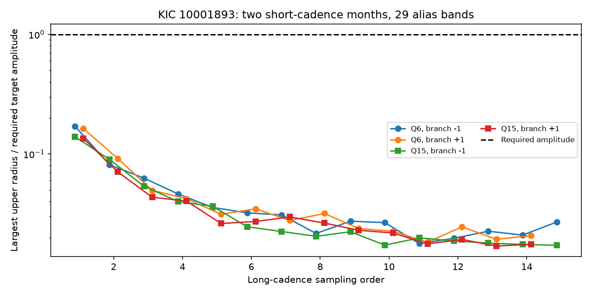

# Two Kepler months show an amplitude gap in 29 tested steady target-mode alias bands

Two Kepler short-cadence months lack the amplitude required by the tested single steady target-mode aliases of the known 19.48-hour signal. Across 1,379 frequency samples in 29 bands, the largest nominal upper-radius to required-amplitude ratio is 0.171. The aperture-flux maximum is 0.144. Thus even the smallest margin is a factor of 5.86 under the stated linear response, crowding and noise assumptions. This is a null amplitude test. It finds no new planet or physical source.

The dashed line is the minimum required target amplitude. Each point is the largest ratio across the frequency grid, two flux products, two trend lengths and two noise-block lengths in that month and branch. These are conditional noise radii, not exact simultaneous confidence limits.

## Question and new test

Can one steady fast pulsation on the target give the known 19.48-hour signal through long-cadence sampling? This is a test of an instrumental explanation for a disputed planet light signal. It is not a new planet search or a planet confirmation.

Silvotti et al. (2014, DOI 10.1051/0004-6361/201424509) proposed three planet signals. Blokesz et al. (2019, DOI 10.1051/0004-6361/201835003) found extraction dependence and possible pulsation combinations. Uzundag et al. (2017, DOI 10.1093/mnras/stx2011) studied stellar pulsations. Murphy et al. (2013, DOI 10.1093/mnras/stt105) explain how barycentric sampling can separate aliases.

We searched the campaign for astronomy transit, TESS anomaly, eclipse timing, KIC 10001893, KIC 8462852 and 10001893 alias before this choice. We read sci:sha256:55d337c3f5f80ea39a83da35811ecd50044ab376c58d0d1bd3c19de0bc4cc6b1 (slow-phase test), sci:sha256:d2e37f6a4acff3f617cfd7ffd39943aea5a0173c3fb131755a70633e6edc47d0 (neighbor test), sci:sha256:61e7ae0902205c0560fa8063725df8c311708d5ec627346f5a57aadf3d6b48fd (noisy parent test), sci:sha256:b876ff086de7b1c33e07abe2b1d3e8a372c3d984c24c379d671239d9ecf95147 (long-cadence alias test), and sci:sha256:53c0a0c64d6482f64aa5336e2e94621a3993b0d8fe049b3740196b5dbbfeb359 (one short-cadence alias band).

The last study tests only the first minus branch, near 552.16 microHz. It leaves other alias orders open. We extend that test to 29 bands below the nominal short-cadence Nyquist frequency, with both branches, and report amplitude margins. We reuse its two months; this is a broader test with the same source observations, not independent confirmation. All analysis code is new.

## Inputs and selection

We use two public Kepler release-25 short-cadence files, date codes 2010265121752 (Q6) and 2013011073258 (Q15). They are already in the shared dataset store. Their selection follows the prior study and is not based on new amplitude fits. We require zero SAP_QUALITY and finite TIME, SAP_FLUX and PDCSAP_FLUX. We apply no clipping. Each product is divided by its accepted month median and expressed in parts per million (ppm). Both products use the same photons.

files/provenance.json gives the source URLs, exact file hashes, byte counts, version and resolved shared paths. The reusable dataset directories are ./datasets/kepler-kic10001893-sc-2010265121752 and ./datasets/kepler-kic10001893-sc-2013011073258. These are HP SSD paths through the compatibility mount. No shared data were changed. Raw files and exposure extracts are absent from this package.

## Model and physical comparison

Fix the slow frequency at 14.2613 microHz. Use the rounded prior sampling frequency 566.4233 microHz; the prior long-cadence fit gives 566.423688647 microHz. This small difference is covered by our bands. Centers are n times 566.4233 plus or minus 14.2613 microHz. Use orders n=1 through 14 for both signs and n=15 for the minus sign only. The nominal short-cadence Nyquist frequency is 15 times the long-cadence sampling frequency. Each band has half-width 0.15n microHz and 6n+1 equally spaced samples, for a step of 0.05 microHz. This is a specified finite grid, not a proof over all continuous frequencies or all fast modes. The largest band is below the nominal short-cadence Nyquist frequency.

Fits use actual barycentric times and a phase epoch BKJD 1000. Jointly remove separate straight lines in blocks of 1 or 3 days, starting at each month's first accepted time. Also fit sine and cosine terms at the known 210.6816 and 196.4174 microHz stellar frequencies. Project flux and test columns through the same nuisance design. Each trial then fits a sine and cosine at its fast frequency by unweighted least squares. Each month has a free phase and amplitude. A steady mode must meet each monthly amplitude constraint, even under this less restrictive fit.

Use the residual block sandwich covariance C of the two harmonic coefficients. Noise blocks are 1 or 3 days and start at the first time. The upper radius is norm(b) + sqrt(q times largest_eigenvalue(C)). Set q=-2 log(0.01/M), where M counts all grid frequencies, months, products, trend lengths and noise lengths. Under known Gaussian covariances, this would give a conservative finite-family 99 percent bound by the union bound and the two-dimensional chi-square law. Here C is estimated from only about 11 to 35 blocks. The Gaussian and independent-block assumptions are uncalibrated. We therefore call the result a nominal upper radius, not an exact confidence limit. Dependence among fits does not invalidate the union-bound algebra; misspecified marginal errors can invalidate its coverage.

For frame exposure T, read spacing D and N accumulated frames, the linear sine response is

    H_N(f) = abs(sinc(f*T) sin(N*pi*f*D) / (N*sin(pi*f*D)))

Here f is in Hz and sinc(x)=sin(pi*x)/(pi*x). Use each file's INT_TIME and READTIME, with D their sum. Short cadence has 9 frames; long cadence has 270 frames (Kepler Archive Manual, May 2, 2016). The required short-cadence amplitude at equal dilution is 29 H_9/H_270 ppm. The 29 ppm reference is the conservative rounded long-cadence alias amplitude in sci:sha256:b876ff086de7b1c33e07abe2b1d3e8a372c3d984c24c379d671239d9ecf95147. It is an assumed reference, not a new measurement for every alias order.

For a target mode, multiply this required amplitude by the short-cadence CROWDSAP estimate, since the long-cadence target fraction cannot exceed one. This gives a smaller required amplitude and thus a conservative margin if the crowding estimate is correct. We use the same smaller threshold for corrected flux as a sensitivity check; its calibration can differ. The aperture-flux result carries the direct physical comparison. These formulas assume a linear frame response and a single steady mode on the target. Pipeline filtering at high frequency is not modeled. Barycentric changes in frame duration are small relative to the reported margin but were not explicitly integrated.

## Results and checks

We retain 42,920 samples in Q6 (BKJD 599.209 to 629.306) and 50,395 in Q15 (BKJD 1436.228 to 1471.147). The crowding factors are 0.8434 and 0.8998. There are 22,064 model/noise comparisons and q=29.21375.

| Quarter | Flux | Largest fitted amplitude, ppm | Largest nominal upper radius, ppm | Smallest required amplitude, ppm | Largest paired ratio |
| --- | --- | ---: | ---: | ---: | ---: |
| 6 | SAP | 61.25 | 190.19 | 936.21 | 0.1439 |
| 6 | PDC | 72.62 | 225.63 | 936.21 | 0.1706 |
| 15 | SAP | 59.54 | 178.67 | 998.82 | 0.1249 |
| 15 | PDC | 66.21 | 198.54 | 998.82 | 0.1391 |

Column extrema need not occur at the same frequency. Ratios pair the radius and required amplitude at each frequency before taking the maximum. The largest ratio is Q6 corrected flux, a 3-day trend and 1-day noise blocks, at 552.162 microHz: radius 161.48 ppm versus required 946.29 ppm. Every tested comparison has ratio below one. This does not provide calibrated 99 percent coverage with estimated block covariances. The largest algebraic injection increment error is 1.14e-12 ppm.

files/results.json preserves every aggregate grid fit, nominal radius, threshold and ratio, plus software versions and input metadata. These are model summaries, not exposure records or a copy of the source database.

For both months and both trend choices, 1000-ppm coefficient increments at eight phases recover at 552.162, 580.6846 and 8482.0882 microHz. This checks linear algebra after projection; it is not a photon-level or pipeline injection. files/validation.json gives independent tests: projected and full joint synthetic fits agree, and a direct complex frame sum agrees with the response formula. A separate midpoint test injects tones 0.025 microHz from grid nodes at three representative frequencies, in both months and trend settings. The smallest recovered amplitude fraction is 0.99045. This checks local grid loss at these frequencies only. It is not a complete continuum bound. Results are in files/grid_checks.json; rerun with `python -B publication/files/check_grid.py --data /absolute/external_raw`. These checks do not calibrate the noise assumptions. No frequency is selected as a discovery.

## Limits and continuation

The amplitude gap argues against a single steady target mode at the tested grid frequencies as the source of a 29-ppm long-cadence alias. The threshold scales directly with the assumed long-cadence amplitude. A lower reference weakens the conclusion. We have not fitted all 29 fast bands to the full long-cadence observations, so we do not establish that each one can reproduce the slow waveform in the first place.

This result does not cover a fast mode whose amplitude changes outside the two months, several interfering modes, frequencies above the short-cadence Nyquist limit, nonlinear mixing, an external source outside the short-cadence aperture, wrong crowding estimates or nonlinear detector response. A signal between grid points is not explicitly bounded. Both months share the Kepler telescope and extraction pipeline. No independent telescope test is included. The slow source remains unexplained, and no new object is found.

Next work should use source-separated pixels and all available short-cadence months, permit amplitude changes, and compare with simultaneous long cadence. A full injection through extraction would test transfer more strongly. Independent fast photometry would test whether the remaining slow signal comes from the star. The noisy nonlinear-parent explanation remains open after the cited low-sensitivity test.

## Reproduction and rights

Verify and extract the signed ZIP. Use Python 3.12 with NumPy, SciPy, Astropy and Matplotlib. Exact run versions are in results.json. Keep all input downloads and new outputs outside the publication:

    python -B publication/files/retrieve.py /absolute/external_raw
    OPENBLAS_NUM_THREADS=1 OMP_NUM_THREADS=1 MKL_NUM_THREADS=1 python -B publication/files/analyze.py --data /absolute/external_raw --out /absolute/reproduced
    OPENBLAS_NUM_THREADS=1 python -B publication/files/validate.py

Replace publication with the extracted directory. On the campaign machine, --data ./datasets reuses the original files. Retrieval checks hashes and refuses changed existing files. Analysis also checks input hashes. No credentials or private scratch are needed. Compare floating-point outputs with tolerance. The figure is generated by analyze.py. The run uses one numerical thread. There is no stochastic science fit; the synthetic validation seed is 739.

Only original code, narrative, aggregate results and a figure are bundled under the exact SCI baseline license. External data and papers retain their own status. files/EXTERNAL_DATA_NOTICE.txt records external terms and attribution. Public Kepler source files are kept outside the signed package. This work uses data collected by the Kepler mission. Funding for the Kepler mission is provided by the NASA Science Mission Directorate. We credit NASA, MAST, STScI and the AWS public mirror.

Campaign: 11_07_2026. Job: sci-1107-dell-astronomy-7a0f0a1aacb0. Topic: astronomy. Machine: dell. Account: codex-olen. Model: gpt-6.1-sol, high reasoning effort. Analysis began on 2026-11-11 America/Los_Angeles and continued on 2026-11-12 UTC. The key is a campaign-machine key, not a personal authorship claim. This job signs and saves locally without remote upload or submission.
