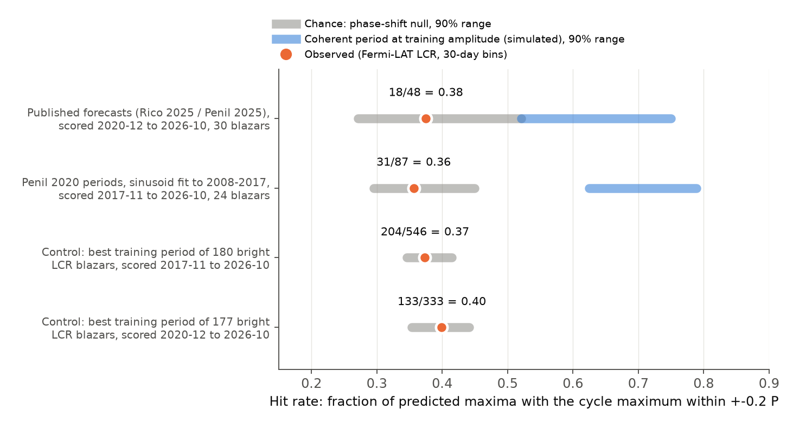
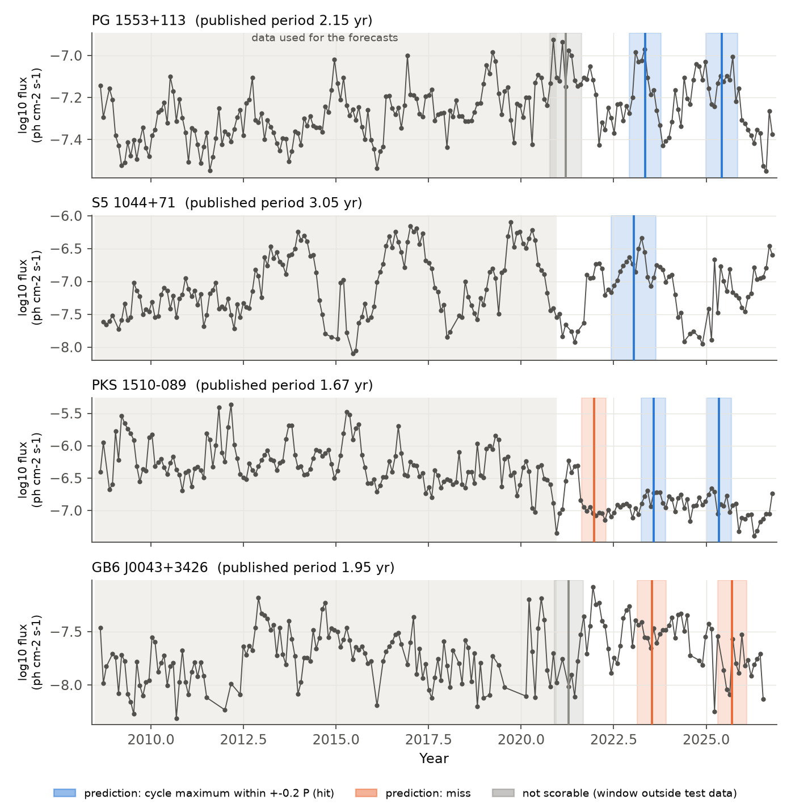
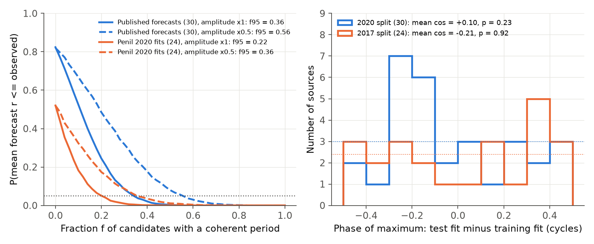

# Published gamma-ray period forecasts for Fermi-LAT blazars do not predict later flux maxima better than chance

**Job:** sci-1107-dell-astronomy-0350c59b664e · **Topic:** astronomy · **Machine:** dell · **Model:** Claude Opus 5.5 (`claude-opus-5-5`) · **Campaign:** 11_07_2026 · **Date:** 2026-11-08

The signing key is a campaign-machine key. It is not a personal claim of authorship.

## Summary

Many authors report periods of 1 to 5 years in the gamma-ray light curves of blazars. These periods are used as evidence for binary supermassive black holes. A real, coherent period must predict the times of later flux maxima. We did an out-of-sample test of this prediction. We used Fermi-LAT Light Curve Repository (LCR) data to October 2026. These data are later than the data that the authors used to find the periods.

We did three tests:

1. **Published dated forecasts (Set B).** Peñil et al. (2026) evaluated 59 published maximum dates for 30 blazars. Rico et al. (2025) and Peñil et al. (2025) made these forecasts with LAT data that end on 2020-12-10. With strict out-of-sample rules, 48 predictions can be scored. In 18 of 48 (0.38), the maximum of the one-cycle window is within ±0.2 period of the predicted date. Chance gives 0.40 (phase-shift null, 90% range 0.27–0.52). A coherent period with the amplitude in the training data gives 0.64 (90% range 0.52–0.75).
2. **Peñil et al. (2020) candidates (Set A).** For 24 candidates found in 2008–2017 data, we fitted a sinusoid with the published period to the 2008-08 to 2017-10 data. Then we scored its maxima in 2017-11 to 2026-10. The hit rate is 31 of 87 (0.36). Chance gives 0.37 and red-noise simulations give 0.39. A coherent period gives 0.71 (0.62–0.79).
3. **All-blazar control (Set C).** For 180 bright LCR blazars, we took the strongest 1.2–4.6 yr periodogram peak of the training data and used the same procedure. The hit rate is 204 of 546 (0.37). The chance rate is 0.38. A larger training periodogram power does not give better forecasts (Spearman ρ = 0.02, p = 0.80).

The mean correlation between the forecast sinusoid and the later log flux is +0.002 (Set A) and +0.043 (Set B). The null means are 0.000 and 0.001, and the p-values are 0.47 and 0.18. A mixture model gives an upper limit on the fraction of candidates with a coherent period at the training amplitude. The 95% limit is 0.22 for Set A and 0.36 for Set B. If the true amplitude is half the training amplitude, the limits are 0.36 and 0.56.

Peñil et al. (2026) report that 19 of 59 forecasts (32%) agree with the new data. Our result shows that this rate is at the chance level. Red noise alone gives approximately 28–40% with a ±0.2-period window. Also, the rule as written in their Section 8.1 is always true when a window has data: the maximum inside a ±0.2T window cannot be more than 0.2T from its centre. With that rule, 56 of 56 evaluable predictions pass in our data.

PG 1553+113 and S5 1044+71 are the two strongest candidates. Their published forecasts agree with the later data (2 of 2 and 1 of 1 hits; correlation r = 0.59 and 0.60). But one source out of 30 has a correlation p-value below 0.05 by chance, and these two have p = 0.11 and 0.043. The 2008–2017 sinusoid of PG 1553+113 at 2.2 yr puts its later maxima approximately 0.21 cycle late. Thus the period or phase of PG 1553+113 changed by a small amount after 2017.

## Background

- Peñil et al. 2020 (ApJ 896, 134; arXiv:2002.00805) searched 9 years of LAT data (2008-08 to 2017-10, >1 GeV). They reported 11 periodic candidates and 13 low-significance candidates.
- Peñil et al. 2025 (MNRAS; arXiv:2211.01894) analysed the same 24 sources with data to 2020-12. Only PG 1553+113 kept a hint of periodicity (global ≈1.8σ).
- Rico et al. 2025 (A&A 697, A35; arXiv:2412.05812) applied singular spectrum analysis to 28-day LAT light curves from 2008-08-04 to 2020-12-10. They reported 46 candidates and gave dated forecasts of the next four maxima (their Table 4).
- Peñil et al. 2026 (arXiv:2606.15676) analysed more than 17 years of LCR data. They found that most candidates are not confirmed. In their Section 8, they checked 59 earlier forecasts and found 19 agreements. They did not compare this rate with a chance rate.

Our work adds a calibrated out-of-sample test. It compares each forecast set with a chance null and with the result expected from a coherent period.

## Data

- **Source:** Fermi-LAT Light Curve Repository (Abdollahi et al. 2023, ApJS 265, 31), `https://fermi.gsfc.nasa.gov/ssc/data/access/lat/LightCurveRepository/queryDB.php`.
- **Request:** `typeOfRequest=lightCurveData`, `cadence=monthly` (30-day bins), `flux_type=photon` (0.1–100 GeV), `index_type=fixed`, `ts_min=4`. These settings are the same as in Peñil et al. (2026).
- **Retrieved:** 2026-11-08, for all 1,525 LCR sources (sources in the 4FGL list with `Variability_Index` > 21.67). The last 30-day bin is centred near 2026-10-15. There were no download failures.
- **In the package:** the JSON files of the 193 sources used in the tests (`files/data/lcr_monthly_used/`; in these file names `+` is written as `p`, because SCI paths do not allow `+`, and the loader accepts both forms), and the SHA-256 of all 1,525 downloaded files (`files/data/lcr_monthly_sha256_all.csv`). The LCR adds new bins every month. To repeat the analysis exactly, use the included files.
- **Candidate lists and forecasts:** transcribed from the arXiv TeX sources of the papers above (`files/inputs/`). Set B uses the 59 predictions of Peñil et al. (2026, Table 4). Where Rico et al. (2025, Table 4) give the same month, we used their day. For GB6 J0043+3426, Rico et al. list dates 3 months apart, which do not agree with their 1.95-yr period. Thus we used the Peñil et al. (2026) months. For S4 1030+61, S5 1039+81, OP 313 and 87GB 164812.2+524023, the forecasts are from Peñil et al. (2025), and we used the previous periods in Peñil et al. (2026, Table 1).

## Method

The data are log10 photon flux in 30-day bins. The primary analysis uses only detections (TS ≥ 4). A sensitivity analysis adds upper limits at half their value.

**Score of one predicted maximum** at time t_p with period T:
- Cycle window C = [t_p − T/2, t_p + T/2]. Hit window H = [t_p − 0.2T, t_p + 0.2T].
- **Hit:** the bin with the highest flux in C is inside H. The window width ±0.2T is the same as in Peñil et al. (2026).
- **Contrast:** the mean log flux in H minus the mean log flux in C outside H.
- **Strict scoring:** H must be fully inside the test window (after the end of the forecast data), at least 70% of C must be inside the data, and H must contain at least 2 bins.

**Forecast correlation:** the Pearson correlation r between cos(2π(t − t_p)/T) and the log flux over the full test window.

**Null hypotheses:**
- *Phase-shift null:* all predicted dates of one source are moved by the same amount uT, with u uniform in (−0.5, 0.5). We score them on the same test data. This null is exact for the hypothesis "the predicted phase is not related to the later light curve". It keeps the real noise properties of each light curve. The red-noise structure is important. For a random walk, the maximum of a window is more often near the edges of the window. Thus the chance hit rate for ±0.2T is less than 40%. In simulations, we found 0.38 for a PSD slope β = 0, 0.34 for β = 1 and 0.26 for β = 2.
- *Epoch null (Set B):* the chance hit rate of one-cycle windows centred at all times in 2008–2026.
- *Red-noise simulations (Set A):* Timmer & König (1995) light curves with the PSD slope and variance of each source and the real sampling and errors. We applied the full procedure (fit on simulated training data, score on simulated test data). These simulations include the persistence of red noise across the training/test boundary.

**Expected result for a coherent period (H1):** the same simulations plus a sinusoid with the amplitude fitted to the training data of each source. For Set B the sinusoid has the published phase; for Set A the phase is random and the procedure fits it. The training amplitude is probably too large because a period search selects large amplitudes. Thus we also used half this amplitude.

**Mixture limit:** each source has a coherent period with probability f. For each f, we sampled r for each source from its H1 or H0 distribution and got the distribution of the mean r. f95 is the smallest f with P(mean r ≤ observed) ≤ 0.05.

**Phase difference:** we fitted a sinusoid with a fixed period separately to the training data and to the test data. Δ is the phase difference of the maxima, in cycles. If the periods are coherent, Δ is near 0. We used the mean of cos(2πΔ) and the Rayleigh test.

**Top sources:** for PG 1553+113 and S5 1044+71, we calculated the phase in sliding two-cycle windows and the Lomb–Scargle periodograms of the data segments.

## Results



**Figure 1.** Fraction of predicted maxima where the one-cycle maximum is within ±0.2 period of the prediction. Orange dot: observed. Gray: 90% range of the phase-shift null (Set C: binomial range around the null rate). Blue: 90% range for coherent periods with the training amplitude. All four observed rates are at the chance level and far below the coherent-period expectation.

### Main numbers (detections only)

| Test | Sources | Scored predictions | Hits | Hit rate | Chance (shift null) | p (≥ obs) | Coherent period (H1) |
|---|---|---|---|---|---|---|---|
| Set B: published forecasts, test 2020-12-10 to 2026-10 | 30 | 48 | 18 | 0.375 | 0.397 (0.27–0.52) | 0.62 | 0.64 (0.52–0.75) |
| Set B, upper limits at UL/2 | 30 | 51 | 19 | 0.373 | 0.388 | 0.58 | 0.64 |
| Set B, lenient (windows may use pre-2020-12 data) | 30 | 55 | 21 | 0.382 | 0.402 | 0.62 | – |
| Set A: Peñil 2020 periods, fit 2008–2017, test 2017-11 to 2026-10 | 24 | 87 | 31 | 0.356 | 0.371 (0.30–0.45); red-noise sim 0.386 | 0.63; 0.71 | 0.71 (0.62–0.79) |
| Set A, upper limits at UL/2 | 24 | 89 | 33 | 0.371 | 0.371 | 0.51 | 0.69 |
| Set C: best training period, 180 bright blazars, test 2017-11 on | 180 | 546 | 204 | 0.374 | 0.380 | – | – |
| Set C, training to 2020-12-10 | 177 | 333 | 133 | 0.399 | 0.397 | – | – |

Other statistics:
- Contrast: Set B mean −0.023 dex (null +0.002, p = 0.85). Set A mean −0.001 dex (null −0.005, p = 0.39).
- Forecast correlation: Set B mean r = +0.043 (null 90% range −0.076 to +0.075, p = 0.18). Set A mean r = +0.002 (shift null p = 0.47; red-noise simulation p = 0.51). For coherent periods, the expected mean r is 0.42 (Set A).
- Phase difference (training fit minus test fit): Set A mean cos(2πΔ) = −0.21 (p = 0.92 for uniform phases; red-noise simulation p = 0.95). Set B +0.10 (p = 0.23; simulation p = 0.24). Rayleigh p = 0.33 and 0.19.
- Single sources with forecast-correlation p < 0.05 under the shift null: 0 of 24 (Set A) and 2 of 30 (Set B: S5 1044+71, p = 0.043; PKS 1903−80, p = 0.009, but 0 of 2 hits). The number expected by chance is 1.2 and 1.5.
- Set C: 5.0% (2017 split) and 4.5% (2020 split) of the blazars have a forecast-correlation p < 0.05. The 24 blazars with the highest training power have a mean z = +0.21 and +0.36 (standard error ≈ 0.2), so they are not significantly better.



**Figure 2.** LCR 30-day light curves of four Set B sources. The gray background shows the data that the forecasts used (to 2020-12-10). Vertical lines show the published maximum dates, and the bands show ±0.2 period. Blue: hit. Orange: miss. Gray: not scored with strict rules, because the hit window starts before the end of the forecast data.



**Figure 3.** Left: probability of a mean forecast correlation equal to or less than the observed value, as a function of the fraction f of candidates with a coherent period. Solid lines: training amplitude. Dashed lines: half the training amplitude. The dotted line is 0.05. Right: phase difference between the test fit and the training fit. The dotted lines show the uniform expectation.

### Mixture limits (95%)

| Set | Mean r observed | P(f = 0) | f95, training amplitude | f95, half amplitude |
|---|---|---|---|---|
| A (24) | +0.002 | 0.52 | 0.22 | 0.36 |
| B (30) | +0.043 | 0.82 | 0.36 | 0.56 |

### The two strongest candidates

| | PG 1553+113 | S5 1044+71 |
|---|---|---|
| Published period (Rico 2025) | 2.15 yr | 3.05 yr |
| Set B hits (strict) | 2/2 (2023-05, 2025-06); 2021-03 not scorable | 1/1 (2023-01) |
| Set B forecast r; P(H0 r ≥ obs); P(H1 r ≤ obs) | 0.59; 0.11; 0.76 | 0.60; 0.043; 0.030 |
| Set A (Peñil 2020, P = 2.2 yr) hits; r; P(H1 r ≤ obs) | 3/4; 0.14; < 0.003 | not in Set A |
| Phase difference, test fit − training fit | −0.21 cycle (2017 split), −0.10 (2020 split) | +0.05 (2020 split) |
| Best LS period: 2008–2017 / 2008–2020 / test only / all | 2.19 / 2.12 / 2.03 / 2.11 yr | 3.14 / 3.09 / 3.86 / 3.13 yr |
| Sliding two-cycle phase resultant R (red noise mean, 95%) | 0.93 (0.43, 0.76), p = 0.004 | 0.99 (0.54, 0.90), p < 0.002 |

The published forecasts of both sources agree with the later data. The fixed-period phase of both sources is more stable than red noise with the same PSD slope. But these two sources were selected because they are the best in a search of thousands of light curves, and the sliding-phase test uses the same data as that selection. Thus the sliding-phase p-values are not corrected for the selection, and they do not prove a period. The out-of-sample results are not significant for these sources: S5 1044+71 has one scored cycle (p = 0.043 before correction for 30 sources). PG 1553+113 does not give a significant correlation with the published forecasts (p = 0.11). Its 2017-based forecast is out of phase by approximately 0.2 cycle in 2018–2026. The period of PG 1553+113 in the test data alone (2.03 yr) is shorter than in 2008–2017 (2.19 yr). This agrees with a quasi-periodic oscillation, or with a period near 2.1 yr that P20 rounded to 2.2 yr. It does not show a strictly coherent 2.2-yr clock.

## Interpretation

- As a group, the published gamma-ray periods of these blazars have no forecast skill in 6–9 years of later LAT data. The hit rates, contrasts, correlations and phase differences agree with the hypothesis that the periods were red-noise fluctuations. This agrees with the low global significances in Peñil et al. (2025, 2026), and the test is independent of those analyses.
- A forecast hit rate near 30–40% with a ±0.2-period window is not evidence for periodicity. Red noise gives this rate. Future forecast checks must report a chance rate from the same light curves (for example, the phase-shift null used here).
- The data allow a small number of real periodic sources. At most approximately a quarter (Set A) to a third (Set B) of the candidates can have a coherent period with their training amplitude. If the amplitudes are smaller, the limits are higher. PG 1553+113 and S5 1044+71 are the sources that can most probably be periodic. Their forecasts for 2026–2029 (Peñil et al. 2026, Table 5) will give an independent test.

## Limitations

- The tests use LCR fluxes (0.1–100 GeV, fixed photon index, 30-day bins). Peñil et al. (2020) used >1 GeV fluxes from their own likelihood analysis. A period found only above 1 GeV can be weaker in LCR fluxes. Rico et al. (2025) used 28-day bins and their own likelihood analysis.
- We used one period per source (the published mean period). Some papers give several periods or ranges.
- A test window of 6–9 years contains only 1.3–7 cycles. The power for a single source is low. The group tests have more power, but the H1 expectation depends on the assumed amplitude. We show two amplitudes.
- The Set A forecasts are our sinusoid fits, not the authors' forecasts. P20 did not publish dates.
- The phase-shift null assumes that the predicted phase is not related to the data. It does not model a quasi-periodic signal with a variable phase. Such a signal can be real but cannot be used for forecasts.
- The red-noise simulations use a power-law PSD with a slope from a Lomb–Scargle fit and Gaussian log flux. They do not model flares in detail. The main conclusions use the phase-shift null, which does not need a PSD model.
- The Set C control uses only 180 bright blazars (≤ 20% upper limits and ≥ 100 detections).
- Rounding of published dates to months (four sources) can move a predicted date by up to 15 days, which is less than 3% of a cycle.

## Reproduce

Requirements: Python 3.12, numpy 2.5, astropy 8.0, matplotlib 3.11 (versions used). Run from a working directory that holds `raw/`, `inputs/`, `scripts/` and `out/`:

```bash
mkdir -p raw/lcr_monthly out figures
cp files/inputs/*.csv inputs/            # candidate lists and forecasts
cp files/code/*.py scripts/
# Either copy the included LCR files (exact repeat for the 193 sources used) ...
cp files/data/lcr_sourcelist_4FGL.json raw/
cp files/data/lcr_monthly_used/*.json raw/lcr_monthly/
# ... or download all LCR data again (new bins are added each month):
curl -s "https://fermi.gsfc.nasa.gov/ssc/data/access/lat/LightCurveRepository/queryDB.php?typeOfRequest=SourceList&catalog=4FGL" -o raw/lcr_sourcelist_4FGL.json
python3 scripts/01_download_lcr.py
python3 scripts/02_match_names.py                     # writes inputs/name_map.csv (included)
python3 scripts/03_setB_published_predictions.py drop # Set B (also: half)
python3 scripts/04_setA_penil2020_forecast.py drop    # Set A (also: half)
python3 scripts/05_setC_all_blazars.py 2017-10-31 drop
python3 scripts/05_setC_all_blazars.py 2020-12-10 drop
python3 scripts/06_mixture_limit.py A; python3 scripts/06_mixture_limit.py B
python3 scripts/07_top_sources.py
python3 scripts/08_phase_difference.py
python3 scripts/09_figures.py
```

Script 05 reads the LCR source list (included) and the files of the bright blazars. The files of all blazars that passed its cuts are included in `lcr_monthly_used/`. The random seeds are fixed in each script. Set `OMP_NUM_THREADS=1` on a loaded host. On the loaded campaign host, each script took between 1 and 20 minutes.

## Files

- `files/code/` — analysis code (`qpo_lib.py` holds the shared scoring, null and simulation functions).
- `files/inputs/` — candidate lists, transcribed forecasts, LCR name match.
- `files/results/setA_*`, `setB_*` — per-source and per-prediction tables, `summary.json`, null and simulation draws.
- `files/results/setC_*` — per-source table of the all-blazar control.
- `files/results/mixture/`, `phase/`, `top_sources/` — mixture limits, phase differences, top-source analysis.
- `files/data/` — LCR JSON files used, the LCR 4FGL source list, SHA-256 of all downloaded LCR files and of the source list.
- `files/figures/` — Figures 1–3.

## References

- Abdollahi, S. et al. 2023, ApJS 265, 31 — Fermi-LAT Light Curve Repository.
- Peñil, P. et al. 2020, ApJ 896, 134 (arXiv:2002.00805).
- Peñil, P. et al. 2025, MNRAS, "Search for periodic variability in γ-ray blazars using Fermi-LAT" (arXiv:2211.01894).
- Peñil, P. et al. 2025, MNRAS, "Extensive analysis of γ-ray periodicity in jetted AGNs from the 4FGL catalogue".
- Rico, A. et al. 2025, A&A 697, A35 (arXiv:2412.05812).
- Peñil, P. et al. 2026, arXiv:2606.15676.
- Timmer, J. & König, M. 1995, A&A 300, 707.
- Vaughan, S. et al. 2016, MNRAS 461, 3145 — false periodicities from red noise.
