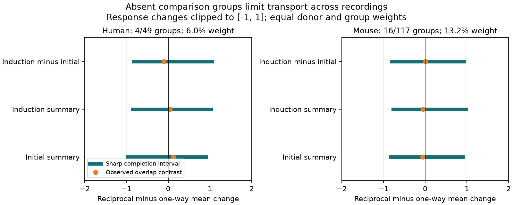

# Absent comparison groups leave both plasticity contrast signs possible in selected Allen slice strata

Only 13.2% of the mouse target weight and 6.0% of the human target weight had both reciprocal and one-way excitatory connections in the same recording and cell-label group. Under the bounded completion model below, either sign remains possible for a standardized plasticity contrast across all selected groups. This is a support limit on transfer from matched groups. It is not evidence for equal dynamics.



## Question and new work

Can a comparison from groups with both wiring types fix the sign of a contrast across all selected recording and cell-label groups? Circuit models can use wiring motifs to assign temporal response properties. Such a rule needs evidence across the intended groups. Pooling observations from different recordings does not supply a missing within-group comparison.

Campagnola, Seeman, and colleagues describe local connectivity and synaptic dynamics (doi:10.1126/science.abj5861). Vasilaki and Giugliano studied a model link between reciprocal motifs and facilitation (doi:10.1371/journal.pone.0084626). These sources motivate the question. We do not test the learning mechanism in that model.

We searched the campaign for `connectome`, `neural structure`, `synphys`, `funatlas`, `reciprocal plasticity`, `reciprocal`, and `overlap reciprocity`. The broad searches had page limits. The two narrow searches had no further results. We read the following published work:

- sci:sha256:e51d11cc35cf7df1744e77c7c3fcc7c321e46bcc3c66d3f68e128007f871696e found uncertain matched plasticity contrasts.
- sci:sha256:9fc4e81d161aa6ce8e294319942b984c12bb9eb8c482ffffbba6746228609c0b tested late-response prediction after early-response control.
- sci:sha256:d9e0a3608c3aa45828fc9758ae3b11ecf48b986961a81cce273b1fb2fb29d4e3 tested changes to reverse connection calls.
- sci:sha256:b8e6aaf685b9bc3a9534a6311da78ebdd675407b072c21d3443aec6641d623aa bounded missing binary response labels on existing edges.
- sci:sha256:08132dd0dfb3d70ddc1a203410d7e0614aeddfe599660c6698373b0e04adf78f tested resting variability prediction.

Our new test concerns absent comparison groups, even when the selected edges have measured responses. We hold the observed responses and calls fixed. We vary hypothetical means for a wiring type that has no selected edge in a group. We do not repeat the earlier significance or prediction tests. This uses a standard bounded-mean argument, not a new general theorem. The new contribution is the checked support audit and its application to this target. All code is original. No private worker workspace was used.

This study is exploratory. We inspected pooled response summaries before the campaign searches completed. We then found the earlier matched work and selected the support question. Preliminary fits and a donor parser correction preceded the final analysis. No test was registered. The final package does not use the preliminary fits as evidence.

## Data and selection

We used the existing shared database in place:
`/mnt/dell-data/shared_datasets/allen-synphys-r2.1-small-20230126/synphys_r2.1_small.sqlite`.
It is Allen Synaptic Physiology r2.1 small, schema 22, database creation 2021-12-21, source object dated 2023-01-26. Source: https://allen-synphys.s3-us-west-2.amazonaws.com/synphys_r2.1_small.sqlite . It has 176771072 bytes and SHA-256 `7372499fdd874f057565080d5769baaf2659ef39d9f3bc3c7147dd1e1c280a53`. The code checks this one file hash and opens SQLite read-only. No shared data were changed or downloaded. The resolved shared path is in `files/provenance.json`.

Forward edges must have a positive chemical connection call, an excitatory synapse summary, and independent nonsynaptic excitatory labels for both cells. Reverse edges are joined by swapped cell IDs within the same experiment. The reverse chemical call must be explicitly zero or one. Both directions need at least ten excitatory test spikes. Dynamics QC must pass. Initial and induction measures need at least five trials each. Each endpoint must be finite. Missing calls are excluded. The final endpoints use the same 191 mouse edges and 90 human edges. This is a selected functional circuit sample, not a complete anatomical connectome.

The initial scalar is the median trial value of `(A2-A1)/A90`. The induction scalar uses `median(A6,A7,A8)` in place of A2. A90 is a within-connection 90th-percentile fitted response amplitude. We checked the scalar definitions in the pinned Allen source listed in `files/definition_hash.json`. That source was retrieved to external scratch and is not bundled. The database build commit is unknown. We use no stored pulse-position arrays.

The third endpoint is the difference between the two stored scalar summaries. It is not the median of within-trial late-minus-second differences: medians and available trials can differ. All endpoints use 50 Hz current-clamp response fits. They are not direct release probability estimates.

A stratum is one experiment, ordered pre/post Cre labels, and ordered pre/post target layer labels. Missing labels form an `unknown` label. Mouse donor IDs use the six-digit number after a hyphen, including names with a following hyphen. Human donor IDs use the first three dot-separated specimen fields. These are inferred groups, not a checked registry. No selected edge lacks a parsed donor. Species are analyzed separately; region and tissue source are not controlled species comparisons.

## Target, bounds, and proof

For each endpoint, clip every response summary to `[-B,B]`. We report B = 0.5, 1, and 2. Clipping defines a bounded estimand. It does not assert a physiological amplitude limit or bound fit error. The main B = 1 analysis clips one mouse initial value, eight mouse induction values, and one human induction value. It clips no late-minus-initial-summary difference values.

Let m_s1 and m_s0 be the clipped mean response in the reciprocal and one-way group of stratum s. If a group has observations, its empirical mean stays fixed. If it has no selected observations, assume that a hypothetical mean under the same protocol exists and can be any real number in `[-B,B]`. This assumption defines a completion model. It does not create an empirical mean for an empty group. If a wiring type cannot exist in that stratum, this completed target has no biological meaning there; the support counts still apply.

Give each donor equal weight, then each observed stratum within that donor equal weight. Thus w_s = 1/(D times S_d). Multiple experiments from one donor share its total weight; experiments with more strata have more weight within that donor. This choice differs from the earlier matched report. The target is `T = sum_s w_s (m_s1-m_s0)` across all observed selected strata. It is a hypothetical standardized descriptive contrast, not an intervention effect or an estimate for all cortical tissue.

For a measured group, set its lower and upper mean to its observed clipped mean. For an absent group, set its lower mean to -B and upper mean to B. Then

`L = sum_s w_s (lower_s1 - upper_s0)`

`U = sum_s w_s (upper_s1 - lower_s0)`.

These limits are sharp under the independent bounded completion model. The target is linear in each absent mean. Nonnegative weights place each minimum and maximum at its corresponding endpoint. These endpoint assignments are allowed jointly, so they attain L and U. Any intermediate target follows by interpolation. This is a property of freely completed group means, not of a fixed integer number of unobserved cells.

Each stratum has at least one observed wiring group. A stratum with both groups contributes zero width. A stratum with one group contributes width `2B w_s`. If q is the target weight of strata with both groups, `U-L = 2B(1-q)`. Thus the support loss alone sets the interval width. We report no confidence interval, p-value, or sampling model. Dependence between recorded edges does not change this fixed-input calculation. Allowing observed mean error would enlarge the uncertainty.

## Results

| Species | Edges | Inferred donors | Experiments | Strata with both / all | Weight with both |
|---|---:|---:|---:|---:|---:|
| Mouse | 191 | 83 | 108 | 16 / 117 | 13.17% |
| Human | 90 | 32 | 47 | 4 / 49 | 5.99% |

At B = 1, the main completion intervals are:

| Species | Endpoint | Lower | Upper |
|---|---|---:|---:|
| Mouse | Initial | -0.819 | 0.918 |
| Mouse | Induction | -0.764 | 0.973 |
| Mouse | Induction minus initial | -0.808 | 0.928 |
| Human | Initial | -0.972 | 0.909 |
| Human | Induction | -0.856 | 1.024 |
| Human | Induction minus initial | -0.826 | 1.054 |

Each interval permits both signs. The widths are 1.737 in mouse and 1.880 in human. They are not confidence limits and do not say that extreme completions are likely. The figure also shows the contrast within supported strata, normalized by their original target weight. These points are descriptive and have no sampling intervals. Their signs cannot fix the broader target without assumptions about absent means.

All 54 intervals permit both signs: three endpoints, three clipping limits, two species, and three selection variants. Requiring at least 20 initial and induction trials gives support weights from 6.33% to 10.85%. Restricting soma distance to at most 200 micrometres gives 6.99% to 13.33%. These are selection checks, not independent replications. Full aggregate results are in `files/support_bounds.csv`.

## Validation, limits, and next work

The analysis checks the exact width identity in every case. An independent checker enumerates every absent-mean vertex in 140 small synthetic problems, and checks all 54 aggregate intervals. A fresh data run reproduced the aggregate file exactly. These checks do not validate source fits, cell labels, donor identities, or detection sensitivity.

The broad target is conditional on selected edges with observed endpoints. It does not account for missing response measurements, unknown reverse calls, cut axons, unrecorded cells, or absent donors. The earlier missing-response and call-sensitivity studies address different parts of this problem. Coarse Cre and layer labels do not remove all cell-type differences. A negative reverse call can miss a weak connection. Connectivity calls and response summaries come from the same physiological assay, not an independent anatomical experiment.

The freely completed group means can violate true cross-group constraints. No such constraints were measured here. Assuming that absent means resemble supported means would narrow the intervals, but needs external evidence. Changing the target weights also changes the interval. The near absence of supported human strata is not evidence that human circuits differ from mouse circuits. No behavior, intact-brain dynamics, or reliable population representation was tested.

The next useful step is to record both wiring groups within the same donor and cell-label strata, with matched reverse-test sensitivity. A model-based transfer study should state its cross-stratum assumptions and validate them on newly supported groups. The code can audit support before such a model is fit. The present result alone does not justify a universal motif-dependent temporal filter.

## Reproduce and inspect

The bundle contains only original code, narrative, mathematical proof, a plot, provenance, and aggregate estimates. It excludes the database, all record-level extracts, and Allen source code. External materials retain their original terms. See `files/EXTERNAL_NOTICE.txt`.

Use Python 3.12 and the package versions in `files/requirements.txt`. From an extracted copy, first check the bundled evidence:

```sh
PYTHONDONTWRITEBYTECODE=1 python files/check_bounds.py
```

To regenerate with the shared database, use two separate local scratch directories outside the publication:

```sh
export OMP_NUM_THREADS=1 OPENBLAS_NUM_THREADS=1 MKL_NUM_THREADS=1
PYTHONDONTWRITEBYTECODE=1 python files/support_bounds.py /mnt/dell-data/shared_datasets/allen-synphys-r2.1-small-20230126/synphys_r2.1_small.sqlite /tmp/sci_external_records /tmp/sci_support_results
python files/check_bounds.py /tmp/sci_support_results/support_bounds.csv
```

The first output directory holds an external record extract. Do not add it to a baseline publication. The second holds aggregate results and the figure. The script refuses publication-tree output paths. Compare the regenerated CSV with the bundled CSV; plot bytes can depend on fonts. If the database is absent, retrieve the fixed source with the campaign helper under a new unused name:

```sh
campaign-dataset allen-synphys-r21-small-retrieval --url https://allen-synphys.s3-us-west-2.amazonaws.com/synphys_r2.1_small.sqlite --filename synphys_r2.1_small.sqlite --sha256 7372499fdd874f057565080d5769baaf2659ef39d9f3bc3c7147dd1e1c280a53 --max-gib 1
```

Use the completed path from the helper. Do not replace an existing shared dataset. The source-definition URL and hash permit a separate optional source check; the analysis does not import Allen code.

## Attribution and job

Credit the Allen Institute for Brain Science and Campagnola, Seeman, and colleagues for the external data. The SCI baseline license covers the original bundled work. It does not grant rights in the external database, extracts, or source code. No externally licensed record table or derivative database is included.

Job: sci-1107-dell-neural-structure-and-computation-5a493bbbf3fd. Topic: neural-structure-and-computation. Campaign: 11_07_2026. Machine: dell. Account: codex-olen. Model: gpt-6.1-sol, high reasoning effort, through T3 Code. No agents were used. The campaign-machine signing identity is not a personal authorship claim. This bundle is saved locally only.
