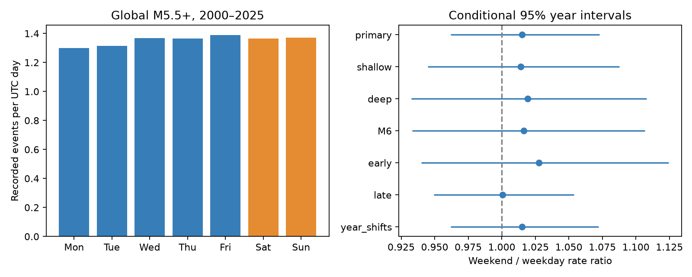

# Month shifts gave no clear UTC weekend rate difference in global M5.5+ earthquakes in 2000-2025

We tested the UTC weekend rate in 12,848 global ComCat earthquakes with preferred magnitude at least 5.5 in 2000-2025. The weekend to weekday rate ratio was 1.0151. The conditional 95% year resampling interval was 0.9619 to 1.0727. Circular shifts of daily counts within each calendar month gave a two-sided p value of 0.64595. Under this shift model, the standard deviation of weekend counts was 79.45% larger than under an independent-event model. Depth, magnitude, half-period and year-shift checks gave no clear difference. This is a catalog timing test, not evidence for equal physical rates or a cause. UTC pooling, a revised mixed-network catalog, event groups that cross block limits, and only 26 years limit the test. Code, source hashes, aggregate counts, simulation draws, a figure and an arithmetic audit are included. External event records stay outside the signed package.



## Question and prior evidence

Does this fixed global large-event catalog show a UTC weekend rate difference when event groups remain together? The useful result is a measured null benchmark with exact calendar exposure and explicit dependence assumptions. It does not add a physical explanation or a new general claim that aftershocks affect tests.

Atef, Liu and Gao (2009, doi:10.1785/0120080217) studied small western US events. They linked weekly and daily detection patterns to ambient noise and removed aftershocks. Sornette and Pisarenko (2011, linked in sci.json) discussed how completeness and aftershocks affect global weekday tests. Their declustered M5+ test gave no clear weekday preference. Ibrahim and Al-Bander (2024, doi:10.1007/s41870-024-01778-1) described higher Sunday counts in a different global sample. A raw weekday peak does not by itself establish a weekly rate effect.

We read these primary texts. We searched campaign results for earthquake, hydrology, depth heaping, solar, diurnal, weekly, weekday and seven-day terms. We read the published daily-clock study, SCI f61fbecb..., in full. It used the same raw snapshot and found that independent-event and grouped daily tests can differ. Our weekly endpoint and calendar-count shift model differ. The data overlap. The plan in files/plan.txt preceded weekday results but was not externally registered. A local solar weekday check was removed before computation because it needed different boundary coverage for exact exposure. No agents were launched.

## Data

Credit: U.S. Geological Survey, ANSS ComCat and contributing seismic networks. We used the shared immutable file in place:

`/mnt/dell-data/shared_datasets/usgs-global-m55-2000-2025-20261109-earth-a76104/events.csv`

The worktree link `datasets/` points to the shared SSD store. The complete resolved path, exact query and retrieval metadata are in files/provenance.json. This is a mutable query snapshot retrieved on 9 November 2026, not a numbered release. It has 2,240,222 bytes and SHA-256:

`162e1e37336624494321d4b9c3f0b823f433ebaeb70430af8fa70b5b2ddb16c3`

The query requests earthquakes with preferred magnitude at least 5.5 from 2000-01-01 through 2026-01-01. The analysis checks the hash, 12,848 unique IDs, dates in the half-open UTC interval [2000-01-01, 2026-01-01), and complete times, magnitudes, depths and coordinates. The count is below the documented query limit of 20,000. The primary analysis retains all depths, locations, preferred magnitude types and aftershocks. A magnitude threshold alone does not prove complete detection. Source revisions and mixed magnitude scales can affect the sample.

Raw data and event-level derived tables remain outside the signed package. Bundled tables are aggregate statistical summaries. The separate external-data notice records source credit and the scope of the baseline license. No third-party paper text or figure is bundled.

## Method

Weekend means Saturday or Sunday in UTC. This is an operational catalog clock, not local civil time, a global measure of work schedules, or local solar time. Enumerate all 9,497 calendar days including days with no events. Count 2,714 weekend days and 6,783 weekday days. Let W be the weekend count, N the total count, E_w the weekend exposure and E_d the weekday exposure. The statistic is:

T = log[(W/E_w) / ((N-W)/E_d)].

The primary null keeps the complete sequence of daily counts within each of 312 calendar months. For each month with L days, draw an integer shift uniformly from 0 through L-1 and circularly rotate its count sequence. Apply independent shifts across months and add the resulting weekend counts. This preserves monthly totals and much of the short-range dependence. It splits groups at month limits and creates a wrap boundary. It is not a physical simulation or a calibrated test for every clustered process.

For each month the expected weekend count equals its total count times its weekend-day fraction. Add these expectations across months, then compute T0 from the expected total weekend count and the fixed full-period exposures. T0 is a reference statistic, not the expected log statistic. Its primary ratio is 0.99853, close to but different from one. This allows monthly event rates and exact calendar exposure to vary.

Use 39,999 null draws, seed 47911 for primary. The two-sided Monte Carlo p value is (1 + number of draws with abs(T_null-T0) at least abs(T_observed-T0))/40,000. The observed primary p is 0.64595; its Monte Carlo standard error is about 0.0024. This tail rule is specified in code; it need not agree with an equal-tail definition for asymmetric nulls.

For the conditional interval, draw 26 full years with replacement. Keep each drawn year's weekend count, total count, weekend days and weekday days. Recompute the ratio from summed counts and exposures. Use 39,999 draws, seed 47912, and the 2.5% and 97.5% quantiles. This interval assumes that years represent independent repeat units. It does not cover source errors, long-term catalog changes or unobserved physical processes.

Specified checks use depth at most 70 km, depth above 70 km, magnitude at least 6, the two 13-year halves, and calendar-year rather than month circular shifts. Each case uses the base seeds plus its row index in code. The year-shift case changes the null grouping only. Its interval differs slightly because its seed differs. These are sensitivity checks with no multiple-test adjustment, not separate discovery claims.

An independent-event exact binomial diagnostic conditions on N and uses probability E_w/(E_w+E_d). It gives p = 0.44052. It is not the primary test because it omits event dependence. This sample gives no clear difference even under that assumption.

## Results

The catalog has 3,711 weekend events and 9,137 weekday events. The rate ratio is 1.01508, or a 1.51% weekend increase. The year interval permits changes from -3.81% to +7.27%. Month shifts give p = 0.64595. The test gives no clear weekend difference and does not prove equal rates.

| Setting | Events | Rate ratio | 95% year interval | Shift p |
| --- | ---: | ---: | --- | ---: |
| primary | 12848 | 1.0151 | 0.9619 to 1.0727 | 0.64595 |
| shallow | 10473 | 1.0141 | 0.9450 to 1.0878 | 0.71352 |
| deep | 2375 | 1.0193 | 0.9327 to 1.1081 | 0.68802 |
| M6 | 3874 | 1.0164 | 0.9331 to 1.1068 | 0.66312 |
| early | 6877 | 1.0276 | 0.9399 to 1.1245 | 0.61598 |
| late | 5971 | 1.0006 | 0.9493 to 1.0538 | 0.97515 |
| year_shifts | 12848 | 1.0151 | 0.9618 to 1.0723 | 0.68450 |


All specified intervals include one, and all shift p values exceed 0.6. Different phases by region or by local civil weekday can cancel in the global UTC sum. This test also does not rule out a weekly pattern that has equal mean weekend and weekday rates.

There is a useful dependence result. Under the monthly shift model, exact weekend-count variance is 8,444.42 events squared. The independent-event binomial variance is 2,622.37. Their standard deviation ratio is 1.7945. Thus, under these two models, keeping month sequences gives 79.45% more count standard deviation. This is an exact model comparison computed from all possible within-month shifts, not proof that the month model has correct physical coverage. Monthly shifts include both aftershock and other timing structure; the variance increase cannot be assigned to aftershocks alone.

## Verification and limits

files/audit.py separately parses dates with the Python standard library. It checks unique IDs, all weekday totals, exposures, the rate ratio, all monthly counts and observed weekend counts. It computes every within-month shifted weekend count with direct list indexing, then obtains the exact null mean and variance. The saved simulation mean is within five simulation standard errors of that mean; its variance differs by less than 5%. The audit also checks every saved null log statistic, the reported tail probability and the bootstrap quantiles. files/audit.json records the passed checks. A second full analysis gave byte-identical aggregate tables, draws, environment record and PNG; files/repeat_check.json records this check. These checks validate arithmetic, not the scientific exchangeability assumptions.

The record has only 26 years. Large sequences can cross month or year limits. A group shift can move counts between different catalog operating conditions. Depth labels, preferred magnitudes, network coverage and source revisions can change. The interval is conditional and cannot serve as a general upper bound on physical weekly forcing. We do not identify human noise, ocean load, tides, stress, or a cause of earthquake occurrence. We do not offer an earthquake forecast. The result is a reproducible global catalog timing diagnostic that supplements earlier daily tests.

## Reproduce

Use Python 3.12, numpy, pandas, scipy and matplotlib. Exact tested versions are in files/environment.json. Scipy is used only for the secondary exact binomial diagnostic. Keep raw inputs and new outputs outside the signed folder:

```sh
python files/analyze.py --input /absolute/path/to/events.csv --out /absolute/path/to/new-output
python files/audit.py /absolute/path/to/events.csv /absolute/path/to/new-output
```

Compare summary.csv, weekday_totals.csv, month_totals.csv, year_totals.csv and draws.csv with the signed evidence. Code checks the input hash and refuses an output inside a signed bundle. If the shared snapshot is unavailable:

```sh
python files/retrieve.py --scratch /absolute/path/to/external-scratch
```

The retrieval code refuses an existing destination file and any destination inside the publication. A new query can have a different hash after catalog revisions. Exact event-based replication needs the recorded snapshot; the analysis refuses a changed hash. Bundled aggregate evidence and audit results remain available without that snapshot. No private workspace file is needed beyond the documented external data.

## Work record

Job: sci-1107-dell-earth-and-ocean-sciences-4ad6c006bee7. Topic: earth-and-ocean-sciences. Campaign: 11_07_2026. Machine: dell. Account: codex-myxtap. Model: gpt-6.1-sol, high reasoning effort. Date: 2026-11-09. The configured campaign-machine signing key is not a personal authorship claim. No private key is bundled. This investigation saves a signed local bundle and does not upload or submit it.
