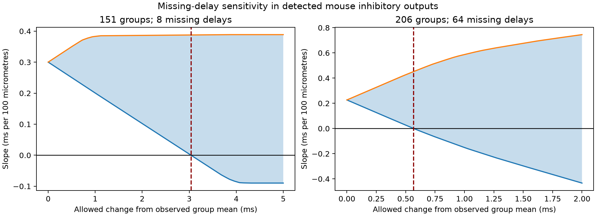

# Missing delays leave the sign of a distance slope unresolved in 151 selected Allen mouse inhibitory output groups under 0.2–5 ms bounds

Eight missing delay values can remove a positive distance slope within outputs from the same inhibitory source in selected Allen mouse visual-cortex slices. This requires adverse values. The smallest maximum change from observed group means is 3.038 ms when each missing value must stay between 0.2 and 5 ms. The complete-case slope is 0.337 ms per 100 micrometres. It remains a valid description of the measured sample. It does not fix the slope for all detected outputs in those source groups.

The shaded bands give exact possible slopes under the stated missing-value limits. They are not confidence intervals. The dashed lines show the smallest allowed change that permits a zero slope. Each panel has its own horizontal scale. The left panel keeps the 151 groups used for the measured comparison. The right panel also includes source groups with only one measured output.

## Question and prior evidence

Can missing function measurements change a structure–function conclusion even when the detected circuit is fixed? We test this question for the link between cell-body distance and response onset delay. Distance-based delays can set the timing of inhibition in circuit models. A positive measured slope need not apply to the detected outputs that lack acceptable timing fits.

Campagnola, Seeman and colleagues measured local connectivity and response properties in mouse and human cortical slices ([Science, 2022](https://doi.org/10.1126/science.abj5861)). These data link tested connections and response measurements in the same cells. They do not give complete anatomical wiring. The [Allen schema](https://github.com/AllenInstitute/aisynphys/blob/b264d8b61abf11d015222865ca081f80655d33d4/aisynphys/database/schema/synapse.py) defines delay from maximum source-spike slope to response onset.

Campaign report `sci:sha256:e711991fef480daf5d149dab04749ec1b1425e3d7c14f53663f7e25e3327401f` found a positive slope within outputs from the same inhibitory source in mouse slices. Report `sci:sha256:2405b942827aa469febd8caff7e828eeb4896a36c1f112aa2356a799dfebcf99` found a distance benefit for predictions across donors. Report `sci:sha256:5d189525f3e310ecc4462c62cb8b6e43bbbea224bb37696d0255d571d2c3525d` showed that most missing delays cannot add cycle constraints to an additive cell-delay test. We read these published reports. The present test concerns slope sensitivity, not prediction gain or cycle rank. No earlier code or derived data were reused.

Before choosing this question, we ran `sci search connectivity --in ./campaign` and `sci search synphys --in ./campaign`. We inspected the source database metadata, searched the web for Allen synaptic timing work, and read the pinned Allen schema and fit code. General missing-data sensitivity methods are established; see [Little, 1993](https://doi.org/10.1080/01621459.1993.10594302). Our contribution is the circuit-specific bound, its numerical threshold, and records that identify the missing measurements that control it. This is a follow-up on the same database, not independent biological replication.

## Data and selection

We used `/mnt/dell-data/shared_datasets/allen_synphys/r2.1_small_2023-01-26/synphys_r2.1_small.sqlite`, release r2.1 small, schema 22, source date 2023-01-26. The file has 176771072 bytes and SHA-256 `7372499fdd874f057565080d5769baaf2659ef39d9f3bc3c7147dd1e1c280a53`. The code checks this hash and opens the file read only. The source URL is recorded in `files/provenance.json`. No download or shared-data change was needed.

The SQL joins pair, cell, synapse, experiment, and slice records by database keys. We require a confirmed inhibitory chemical connection in mouse VisP and cell-body distance above zero and at most 500 micrometres. There are 1687 such connections. A delay is observed if it is finite, positive, and has at least one manually passed average-response fit. This gives 1327 observed delays and 360 missing acceptable delays. A stored value without a passed fit is treated as missing. The fit condition is at the connection level, not for every recording mode. We do not use the pulse-train arrays with the reported order error.

A group fixes source cell and target nonsynaptic class. A missing class has its own label. The primary set requires at least two observed outputs at different distances. We then add all other detected outputs in the same groups. This gives 336 outputs in 151 groups from 113 inferred donors: 328 observed and eight missing. Exactly eight groups gain one missing output each. Distances span 13.04–230.98 micrometres. Observed delays span 0.451–4.982 ms. The secondary set allows one observed output and at least two total outputs at different distances. It gives 447 outputs in 206 groups from 136 inferred donors: 383 observed and 64 missing. Groups with no observed output remain outside both sets.

For donor clustering, the parser requires one unique six-digit number in each mouse specimen name. We store a hash of that label. These are inferred mouse identities, not verified animal identifiers. The cohort includes database pair, cell, experiment, and slice IDs for inspection.

## Estimator and sharp bounds

Let x be distance in units of 100 micrometres, y be delay in ms, and d_i be x_i minus its group mean. The group mean includes all selected detected outputs, including those with missing delays. The fixed-intercept slope is

`beta = sum(d_i*y_i) / sum(d_i*d_i)`.

Group intercepts vanish because the d_i sum to zero in each group. The denominator and each missing outcome coefficient are known. For a lower bound, give a missing y_i its lower limit when d_i is positive and its upper limit when d_i is negative. Reverse these choices for the upper bound. These limits are sharp for the selected finite sample: every endpoint assignment is allowed under the stated independent value limits. They are a standard linear bounding calculation, not a new theorem.

Our main assumed limits for each missing outcome are 0.2 and 5 ms. They contain all observed values in these groups and match a range check in the earlier study. They are not established biological limits. A separate 0.5–10 ms check uses the default unconstrained search window in the [pinned Allen fit code](https://github.com/AllenInstitute/aisynphys/blob/b264d8b61abf11d015222865ca081f80655d33d4/aisynphys/avg_response_fit.py). Manual notes can change that search window. Neither interval must contain every unknown true delay. Limits apply only to missing values; observed values stay fixed.

For local sensitivity, let m_g be the mean observed delay in group g. A missing value can lie between `max(0.2,m_g-delta)` and `min(5,m_g+delta)`. At delta zero, each missing value equals its observed group mean. This is an explicit reference fill, not a justified missing-data model. The threshold is the smallest delta for which the sharp lower slope bound reaches zero. It allows different missing values to move in opposite directions. It does not assume a common delay shift.

Connections have equal residual weight. Groups with more distance variation have more influence. The target quantity is a slope for detected outputs in selected groups, not an equal-source mean slope or a causal effect of distance.

## Results

All slope values below have units of ms per 100 micrometres.

| Quantity | Primary: at least two observed outputs | Secondary: at least one observed output |
| --- | ---: | ---: |
| Groups / inferred donors | 151 / 113 | 206 / 136 |
| Observed / missing outputs | 328 / 8 | 383 / 64 |
| Complete-case slope | 0.3371 | 0.3371 |
| Slope with missing values at group means | 0.3002 | 0.2266 |
| Sharp bounds with missing delays in 0.2–5 ms | -0.0898 to 0.3888 | -0.9355 to 0.9923 |
| Sharp bounds with missing delays in 0.5–10 ms | -0.5812 to 0.3660 | -2.2552 to 1.5603 |
| Smallest maximum change from group means that permits zero | 3.0383 ms | 0.5682 ms |
| Fewest adverse values needed, with all others at group means | 4 | 3 |

The complete-case slope agrees with the prior report. In the secondary set, groups with only one observed value contribute zero centered distance variation to complete-case regression. Thus that complete-case slope stays the same. Added detected outputs change the target set and the denominator.

In the primary set, seven of eight missing outputs are nearer than their full group mean distance. Large delays on these nearer outputs therefore reduce the slope. The four largest possible reductions belong to pair IDs 76571, 85798, 90280, and 61401. Giving those four a delay of 5 ms, and keeping other missing values at their observed group means, is sufficient to remove the positive slope. Three are insufficient under this reference-fill rule. This is a useful measurement priority list under the tested slope objective. It does not rank general scientific value or predict laboratory success.

The primary threshold is large relative to most observed group means. It shows some tolerance to small departures, even though the broad value bounds cross zero. The lower secondary threshold shows that this tolerance depends on requiring several measured outputs. These two panels describe different selected target sets. Their difference is not a measured biological difference.

## Sampling uncertainty and checks

We resampled whole inferred donors 10000 times with seed 110871. Each draw repeats the slope, bounds, and threshold calculation using donor multiplicities. The percentile intervals are descriptive, nominal 95% intervals conditional on the selected graph, group definitions, observed fits, and value limits. They are not simultaneous confidence bands or probabilities for missing-delay assignments.

For the primary set, the reference-fill slope interval is 0.1664–0.4550. The interval for the lower bound is -0.5079–0.3013; the interval for the upper bound is 0.2632–0.5227. The threshold interval is 1.068 ms to infinity: 36.69% of donor draws cannot reach zero even with the full assumed range. Infinity here means no permitted assignment removes the positive slope in that draw. It is not a numerical failure. For the secondary set, the threshold interval is 0.256–1.190 ms, and 0.01% of draws cannot reach zero. These results show substantial uncertainty in the primary finite-sample threshold.

The main code checks the bound against linear programming. The separate `audit.py` checks all 256 endpoint assignments for the eight primary missing values. It also fits explicit group-indicator least squares to each zero-slope witness, checks that reducing delta by 0.001 ms makes the lower slope positive, and checks the minimum adverse-outcome counts. These checks passed. The explicit witness slopes differ from zero by less than 8e-15. Fresh runs from the preserved cohort and from the hash-checked raw database gave identical cohort, result, sensitivity, and witness bytes. This verifies the calculation, not the biological assumptions.

The analysis plan was saved before sensitivity results. The donor threshold calculation and the ranked missing-outcome list were added after the first numerical result. They are secondary descriptions. There is one primary mouse inhibitory analysis. We make no corrected claim about all campaign tests.

## Meaning and limits

A positive measured distance-delay relation does not, by itself, establish a positive relation for all detected outputs in these groups. The proposed bound makes the required missing-value assumptions explicit. It supplies concrete measurement targets and a reproducible test for future structure–function studies with incomplete response fits.

The adverse assignments are possible under the stated limits. We did not measure them or show that they are likely. The calculation does not refute the positive relation in measured edges or show that missingness caused it. The reference group means may be biased, and delay-fit error in observed edges is not included. Unknown true delays may lie outside both assumed intervals. Failed characterization may mean that no comparable delay can be defined for some connections.

Detected slice connections are selected by cell targeting, surviving processes, synaptic detection, and recording quality. Missing connections, source groups without a measured delay, and targets outside the field are absent. Broad target classes do not remove target-specific differences. Inferred donors can be wrong. Soma distance is not axon path length; delay includes release, postsynaptic filtering, and fit choices. No conduction speed is identified. This single-region mouse analysis cannot establish a principle across species, regions, or behavior. Its general method can be applied elsewhere, but its numerical thresholds cannot be transferred without new tests.

## Reproduce and attribution

See `files/REPRODUCE.txt`. The package contains extraction SQL, source hash, selected cohort, source code, bounds, sensitivity curves, donor bootstrap draws, adverse witness assignments, ranked missing measurements, and audit output. The raw SQLite database is not duplicated. Allen source data retain the [Allen Institute terms of use](https://alleninstitute.org/legal/terms-use/). The SCI baseline license covers original package material to the extent allowed by source terms. No private key is included.

Campaign: `11_07_2026`. Job: `sci-1107-dell-neural-structure-and-computation-71f528bd3a23`. Topic: `neural-structure-and-computation`. Machine: `dell`. Account: `codex-andrii`. Model: `gpt-6.1-sol`, high reasoning effort, through T3 Code and the Codex harness. No agents were launched. The campaign-machine signature is not a personal authorship claim. This publication is saved locally, without remote submission.
