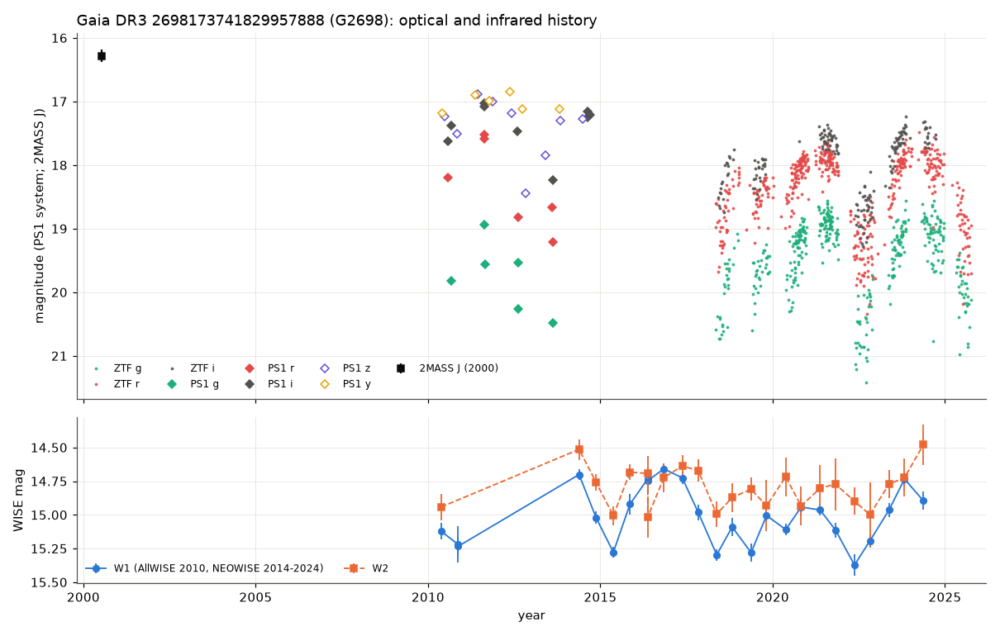
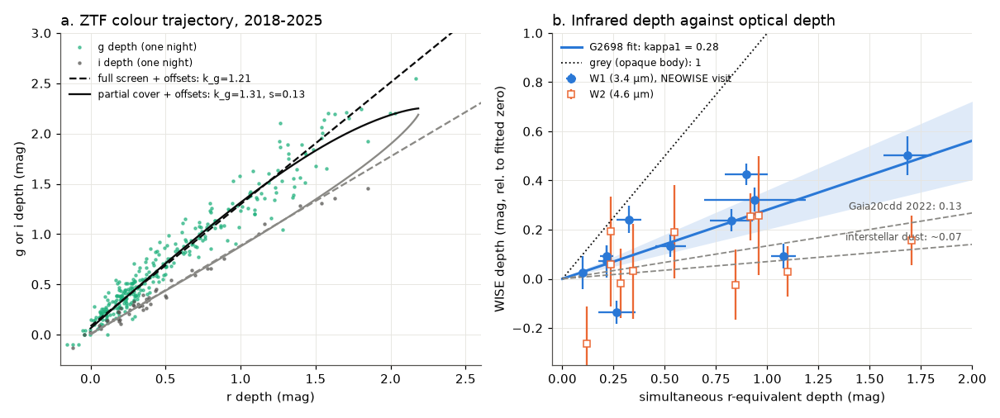
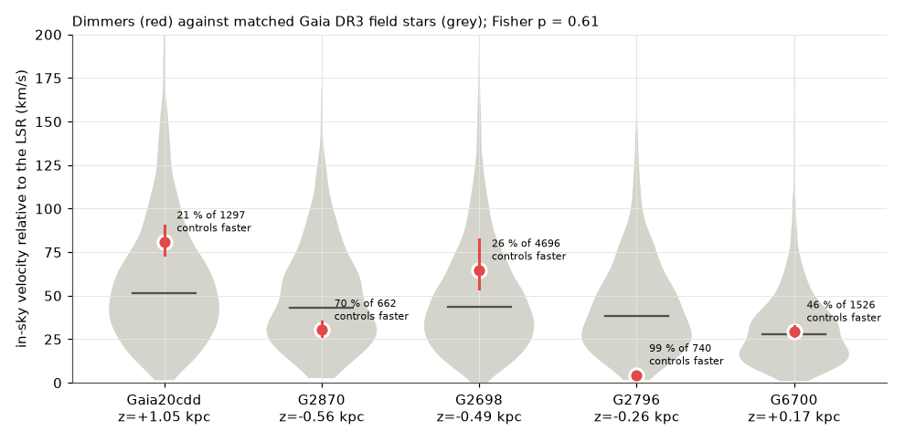

# The M0 dwarf Gaia DR3 2698173741829957888 has dimmed aperiodically since 2010 and needs grains near 1 µm; five dwarf dimmers move like matched field stars, so their old ages reflect the search volume

**Job:** sci-1107-dell-astronomy-cc2e6ef49715 · **Topic:** astronomy · **Machine:** dell · **Model:** Claude Opus 5.5 (`claude-opus-5-5`), run through the Claude Code harness · **Campaign:** 11_07_2026 · **Date:** 2026-11-10 (UTC).
The signing key is a campaign-machine key. It is not a personal authorship claim.

## Summary

Prior campaign studies found deep, irregular dimming of old field dwarfs. Gaia20cdd (a K dwarf at 1.5 kpc) and Gaia DR3 2870538750879109504 (here **G2870**) dim by 3-4 mag. Small dust grains cause the dips, and both hosts are kinematically old ([c8d37a69](#citations), [3b1873fb](#citations), [e10c5778](#citations), [41a8213f](#citations), [f2fc68a1](#citations)). A blind Gaia DR3 + ZTF search found four more aperiodic dimmers ([9c3193da](#citations)). No study examined three of them. The deepest of the three is **Gaia DR3 2698173741829957888** (here **G2698**). The search gave only "slow 2-3 mag fades over months" for it.

We asked three questions:

1. What is G2698, how long has it dimmed, and what blocks its light?
2. Is its dimming periodic? A period would give an orbit.
3. Prior studies said that the dimming class occurs on **old** stars. Are the dimmers older than other field stars at the same place? Or does the search location (high Galactic latitude, about 1 kpc) make every star there old?

Main results:

1. **G2698 is an M0/K7 dwarf with no infrared excess.** Its corrected Gaia DR3 parallax is 1.053 ± 0.127 mas (distance 0.95 kpc). It is 0.49 kpc below the Galactic plane. Gaia DR3 GSP-Phot gives T_eff = 4100 K and log g = 4.76. The Gaia XP H-alpha pseudo-equivalent width (-0.33 ± 0.21 nm) agrees with its photospheric model value (-0.22 nm), so the XP spectrum shows no H-alpha emission. AllWISE does not detect it at 12 and 22 µm. Its CatWISE2020 W1-W2 is only 0.09 mag redder than in 1,436 matched field stars (5 % of the field stars are as red). The dimming itself causes this offset (result 4), so no warm dust is necessary.
2. **G2698 has dimmed deeply since at least 2010, and possibly since 2000** (Figure 1). In ZTF (2018-2025) the star is more than 0.3 mag below its bright level on 47 % of nights and more than 1 mag below it on 20 % of nights. These values are 4 times those of Gaia20cdd (11 % and 4.5 %). The deepest drops are 2.6 mag in r and 2.8 mag in g. Pan-STARRS1 shows deep states in 2010 and 2012-2013: r changes from 17.52 (2011) to 19.22 (2013), and z from 16.88 to 18.44 (2012 November). It also shows a g-band change of 0.63 mag in 4 days (2011). AllWISE shows W1 0.5 mag below the 2016 level in 2010. In 2000 July the 2MASS J-H colour is 0.28 mag redder than in matched field stars (2.6 % of the field stars with the same J error are as red). This colour is only a weak hint of dimming in 2000, because H-K is not reddened.
3. **The occulter does not cover all of the light, and it is not grey.** On 303 ZTF nights with g and r data, a fully covering dust screen gives a straight colour line with k_g = τ(g)/τ(r) = 1.21. A screen that leaves part of the light uncovered fits better (Δ2lnL = 31.6 for one more parameter, with free zero-point offsets). The fit gives k_g = 1.31, k_i = 0.85 and an uncovered fraction s = 0.13 (0.10-0.16) (Figure 2a). The interstellar values are about 1.40 and 0.74.
4. **At 3.4 µm the dips are 0.28 times as deep as in r** (Figure 2b). Eleven NEOWISE visits (2018-2024) have ZTF data within 6 days. They give κ1 = ΔW1/Δr = 0.28 (68 % bootstrap interval 0.20-0.36) and κ2 = ΔW2/Δr = 0.11 (0.03-0.20). These ratios are 4 times the interstellar value (about 0.07) and 2 times the Gaia20cdd value (0.13). They are far below the value for an opaque body (1). W1 drops more than W2. Thus the time-averaged W1-W2 colour becomes redder by about (0.28 - 0.11) × 0.6 mag ≈ 0.10 mag, which agrees with the CatWISE offset in result 1.
5. **The extinction ratios need grains near 1 µm** (Figure 3). We fitted Mie models of Draine astrosilicate and graphite spheres with n(a) ∝ a^-q to the four ratios (k_g, k_i, κ1, κ2). For q = 3.5, a fit within Δχ² = 4 of the best fit needs a maximum radius a_max = 0.97-3.6 µm (astrosilicate) or 0.44-2.4 µm (graphite). Interstellar-like grains (a_max = 0.25 µm) are excluded (χ² = 91 for astrosilicate, 11 for graphite; the limit is 5.3). One other solution also fits: a population of only very small silicate grains (a_max < 0.025 µm) that absorb in the Rayleigh limit. Such a population without larger grains is unlikely. Thus the dust of G2698 is larger than that of Gaia20cdd (a_max 0.3-0.74 µm) and of G2870 (0.10-0.23 µm) ([41a8213f](#citations)). The three deep dimmers have three different dust populations.
6. **The dimming of G2698 is not periodic within these data** (Figure 4). The ZTF periodogram has its highest peak at 1156 d (power 0.50). A damped-random-walk (DRW) noise model with its best-fit damping time (15 d) never gives such a peak (false-alarm probability below 0.001). But DRW models with damping times of 100, 300 and 1000 d give a peak this high with probability 0.14, 0.49 and 0.67. The 1156-d sinusoid also does not predict the 2010-2017 data: the correlation is 0.32, and 8 % of random phases do as well. For WISE W1 alone the correlation is -0.26. A strict orbit with a period near 3.2 yr is therefore not supported.
7. **The dwarf dimmers are not kinematically older than their neighbours** (Figure 5). For each of five dimmers (Gaia20cdd, G2870, G2698 and the shallower dimmers G2796 and G6700), we selected Gaia DR3 field stars within 4° with the same G (±0.6 mag), BP-RP (±0.15 mag) and parallax (±25 %), 662-4,696 stars per dimmer. We compared their velocity on the sky relative to the local standard of rest (v_sky). This velocity does not need a radial velocity. The fraction of field stars faster than the dimmer is 21 % (Gaia20cdd), 70 % (G2870), 26 % (G2698), 99 % (G2796) and 46 % (G6700). Fisher's combined test gives p = 0.61, and the mean fraction is 0.52 (0.50 is expected). The field stars also have the same height above the plane, and the height gives most of the "old age" probability. Thus the data agree with the old ages of Gaia20cdd and G2870. But they do not show that this dimming is a property of old stars. The searches looked at high latitude and at 0.4-1.5 kpc, where most stars are old.

Main limitations: no spectra and no radial velocities. ZTF data contain detections only, so the deepest g nights can be missing. The NEOWISE κ uses 11 visits with an intrinsic scatter of 0.10 mag. The grain models use homogeneous spheres, two materials, one size slope per fit and Q_ext without forward scattering. The kinematic test has five stars, so it can only find a large difference. We did not measure search completeness.

*Figure 1. G2698 from 2000 to 2025. Top: ZTF nightly medians (g, r, i; on the PS1 system), Pan-STARRS1 detections (g, r, i, z, y) and 2MASS J. Bottom: WISE W1 and W2 visit medians (AllWISE 2010, NEOWISE 2014-2024).*

## Question and scope

Main question: What is the deepest unexamined dimmer of the blind search ([9c3193da](#citations)), and does it belong to the same class as Gaia20cdd and G2870? Second question: Are the dwarf dimmers as a group older than matched field stars?

Scope and assumptions:

- One star in depth (G2698). Uniform metrics for five dwarf dimmers. A kinematic comparison of five dwarf dimmers with matched field stars.
- The "bright level" of each band is the 2nd percentile of the ZTF nightly magnitudes (2018-2025, main ZTF field). For G2698, Pan-STARRS1 (2011) and WISE (2016) show brighter states than any ZTF night. Thus the ZTF depths are lower limits on the full depth. Depth ratios do not depend on this choice for a screen; the partial-cover fit includes free zero-point offsets.
- The colour slopes describe the dust only if the depths come from extinction of the starlight. Scattered light and an uncovered part of the star give the grey part s.
- κ1 and κ2 are linear slopes in magnitudes. For partial cover they are exact only at small depth.
- Kinematics: MWPotential2014-like potential, Schönrich et al. (2010) solar motion, and Lindegren et al. (2021) parallax zero points. The isothermal-disc age model is the same as in [e10c5778](#citations).

## Data and provenance

All retrievals were on 2026-11-10 (UTC). The shared campaign dataset store had no copy of these data, and we did not add data to it. The SHA-256 hashes of all 54 input files are in `files/data/input_sha256.txt` (paths relative to the scratch `raw/` folder). Raw third-party records are not in this bundle (see `files/NOTICE-external-data.md`). `files/code/fetch_all.sh` gets them again into a separate scratch folder.

| Data | Source and version | Use |
|---|---|---|
| ZTF DR24 PSF light curves (good points) | SNAD mirror, `https://db.ztf.snad.space/api/v3/data/dr24/circle/full/json`, 2" cone | optical light curves 2018-2025 of 5 dimmers |
| Pan-STARRS1 DR2 detections and mean photometry | MAST catalogs API `panstarrs/dr2/detection.csv`, `mean.csv`, 2" cone | 2010-2014 light curve |
| NEOWISE-R single exposures, AllWISE multi-epoch and source catalogue, CatWISE2020 | IRSA TAP (`neowiser_p1bs_psd`, `allwise_p3as_mep`, `allwise_p3as_psd`, `catwise_2020`) | 3.4 and 4.6 µm light curves, colours, field control |
| 2MASS Point Source Catalog | IRSA TAP `fp_psc` (with `jdate`) | 2000 colours of G2698 and its field |
| Gaia DR3 `gaia_source`, `astrophysical_parameters` | AIP Gaia mirror (sync and async TAP, `https://gaia.aip.de/tap`); the ESA archive rejected sync jobs (server overloaded) | astrometry, GSP-Phot, XP H-alpha, matched field controls |
| Optical constants | B. T. Draine, `callindex.out_silD03` (SHA-256 `31072857...6afb6b`), `callindex.out_CpeD03_0.10`, `callindex.out_CpaD03_0.10` | Mie models |
| Filter curves | SVO Filter Profile Service: Palomar/ZTF.g, .r, .i; WISE/WISE.W1, .W2 | band-averaged cross sections |
| Prior campaign bundles | [9c3193da](#citations) (target list), [41a8213f](#citations) (Mie code, grain-size ranges), [e10c5778](#citations) (potential and age model code) | inputs and comparison |

## Method

All code is in `files/code/`. `fetch_all.sh` gets the inputs. `run_all.sh` runs the analysis.

1. **Light curve** (`lc_g2698.py`). ZTF points become nightly medians per field and band. We put them on the PS1 system with the published colour coefficient (m_PS1 = m_ZTF + clrcoeff × (g-r)), with the nightly g-r where it exists. WISE visit medians use exposures with `qual_frame > 0`, `saa_sep > 5` and `cc_flags` 00. PS1 detections use `psfQfPerfect > 0.9`.
2. **Colour trajectory** (`traj_g2698.py`). For each night the model depth in band b is -2.5 log10(s + (1 - s) exp(-k_b τ)), with k_r = 1. The optical depth τ is free for each night. The noise is the error plus a free jitter. Models: full screen (s = 0) or partial cover (s free), each with and without free zero-point offsets for g and i. The model follows `trajectory_fit.py` of [41a8213f](#citations).
3. **Infrared depth ratio** (`kappa_g2698.py`). At each NEOWISE visit, we interpolated the r-equivalent ZTF depth (r, or g/1.29, or i/0.85) between the two nearest nights if both are within 6 d. We fitted W = W_ref + κ × d_r with a free intrinsic scatter and bootstrapped the visits (2,000 times).
4. **Grain models** (`grain_library.py`, `mie.py`, `mie2.py` from [41a8213f](#citations), unchanged; `grain_fit.py`). Band-averaged Q_ext over the filter curve × a 4000 K blackbody (photon weighting). We fitted the four ratios with errors (k_g = 1.26 ± 0.07, which covers both trajectory models; k_i = 0.86 ± 0.03; κ1 = 0.28 ± 0.08; κ2 = 0.11 ± 0.09; `g2698_obs_ratios.json`).
5. **Periodicity** (`period_g2698.py`). Lomb-Scargle on the ZTF r-equivalent nightly depths (706 nights) for 300-2500 d. Null models: DRW (Ornstein-Uhlenbeck) processes with the maximum-likelihood parameters (exact Kalman likelihood) and with fixed damping times of 100, 300 and 1000 d, sampled at the real epochs with the real errors (1,000 or 500 simulations). Out-of-sample test: the best ZTF sinusoid predicts the 2010-2017 PS1 depths (g, r, i, scaled to r) and WISE W1 depths (scaled by 1/κ1).
6. **Kinematics** (`kinematics.py`). Corrected parallax (package `gaiadr3-zeropoint` 0.1.0), height z, minimum mid-plane vertical speed and v_sky. Controls are as in result 7. We gave each control star the zero point of its dimmer. Statistic: the fraction of controls with v_sky at least as large as the dimmer, combined with Fisher's method.
7. **Field colour controls** (`twomass.py`, `ir_control_g2698.py`). Gaia controls of G2698 matched within 1.5" to 2MASS (quality A or B in J and H, no contamination flags) and to CatWISE2020 (`ab_flags` 00, one blend component).
8. **Uniform metrics** (`compare_dimmers.py`) for the five dimmers. Same reference rule, duty cycle, colour slope dg/dr by orthogonal regression on nights deeper than 0.3 mag in r, CatWISE W1-W2 and NEOWISE W1 range.

## Results

### Table 1. The five dwarf dimmers with the same metrics

ZTF metrics use the main ZTF field of each star (2018.2-2025.8). Depths are below the 2nd-percentile level. dg/dr is a simple orthogonal fit with a free intercept, so it is not the same quantity as k_g in result 3. v_sky = velocity on the sky relative to the LSR. "Controls faster" = fraction of matched Gaia DR3 field stars with a larger v_sky.

| Star | d (kpc) | z (kpc) | max depth r / g (mag) | nights > 0.3 mag / > 1 mag | dg/dr (16-84 %) | CatWISE W1-W2 | NEOWISE W1 range (mag) | κ1 | v_sky (km/s) | controls faster |
|---|---|---|---|---|---|---|---|---|---|---|
| Gaia20cdd | 1.54 | +1.05 | 3.44 / 3.70 | 10.7 % / 4.5 % | 1.04 (1.03-1.05) | 0.12 ± 0.02 (excess, [3b1873fb](#citations)) | 0.45 | 0.13 ([3b1873fb](#citations)) | 81 | 21 % of 1,297 |
| G2870 | 1.21 | -0.56 | 2.53 / 4.31 | 6.6 % / 0.2 % | 1.66 (1.46-1.70) | -0.07 ± 0.02 | 0.11 | ≈ 0 at 0.18 mag ([41a8213f](#citations)) | 30 | 70 % of 662 |
| **G2698** | 0.95 | -0.49 | 2.62 / 2.78 | **47.5 % / 19.8 %** | 1.23 (1.19-1.27) | 0.00 ± 0.03 | 0.71 | **0.28 (0.20-0.36)** | 65 | 26 % of 4,696 |
| G2796 | 0.41 | -0.26 | 1.06 / 1.10 | 15.5 % / 0.4 % | 1.27 (1.19-1.37) | 0.04 ± 0.02 | 0.23 | not measured | 5 | 99 % of 740 |
| G6700 | 0.39 | +0.17 | 1.10 / 1.29 | 19.5 % / 0.8 % | 1.47 (1.31-1.76) | 0.11 ± 0.02 | 0.17 | not measured | 29 | 46 % of 1,526 |

The numbers are in `files/data/compare_dimmers.json` and `files/data/kinematics.json`. G2796 is very slow (5 km/s relative to the LSR). Thus it can be a young star. It also has the shallowest and shortest dips. The deep dimmers (Gaia20cdd, G2870, G2698) are all 0.5-1.1 kpc from the plane.

*Figure 2. (a) Same-night ZTF g and i depths against r depth for G2698 (303 nights), with the full-screen and partial-cover fits (both with free zero-point offsets). (b) NEOWISE W1 and W2 depths against the simultaneous r-equivalent ZTF depth (11 visits), with the fitted slope κ1 = 0.28 and its 68 % bootstrap band. Grey lines: opaque body, Gaia20cdd in 2022 and interstellar dust.*

### G2698 colour fits

| Model (303 nights; 49 with i) | k_g | k_i | uncovered s | -lnL | Δ2lnL |
|---|---|---|---|---|---|
| full screen | 1.35 | 0.88 | 0 | -1495.3 | reference |
| partial cover | 1.49 | 0.85 | 0.16 | -1550.8 | 111.0 against full screen |
| full screen + offsets (o_g = 0.084, o_i = 0.002 mag) | 1.21 | 0.89 | 0 | -1562.6 | 134.5 against full screen |
| partial cover + offsets (o_g = 0.063 mag) | 1.31 | 0.85 | 0.13 | -1578.3 | 31.6 against full screen + offsets |

The g offset is expected: the 2nd-percentile reference of the noisier g band is biased bright. With s = 0.13 the maximum depth would be 2.2 mag. Some 2022 nights reach 2.6 mag in r. Thus s probably changes between episodes, as for Gaia20cdd ([41a8213f](#citations)). The profile likelihood of s (offsets free) is within 2.2 of the best value for s = 0.10, and worse by 12-16 for s ≤ 0.05 and by 35 for s = 0.20.

### Grain sizes

*Figure 3. χ² of Mie models (n(a) ∝ a^-3.5, a_min = 0.005 µm) against a_max for the four G2698 ratios. Black bars: the grain sizes of Gaia20cdd and G2870 from [41a8213f](#citations). Grey band: interstellar MRN a_max.*

| Material, size slope q | acceptable a_max, large-grain solution (µm) | acceptable a_min (µm) | tiny-grain solution |
|---|---|---|---|
| astrosilicate, 3.5 | 0.97-3.6 | ≤ 0.10 | a_max ≤ 0.021 |
| astrosilicate, 4.0 | ≥ 1.4 | ≤ 0.13 | a_max ≤ 0.024 |
| astrosilicate, 3.0 | none | - | a_max ≤ 0.019 |
| graphite, 3.5 | 0.44-2.4 | ≤ 0.05 | none |
| graphite, 4.0 | ≥ 0.65 | ≤ 0.06 | none |
| graphite, 3.0 | none | - | none |

"Acceptable" means χ² ≤ χ²_min + 4 = 5.25 (best fit: graphite, q = 4, χ² = 1.25 for 4 ratios). The full grid is in `files/data/g2698_grain_fit.json`.

### Periodicity

*Figure 4. (a) Lomb-Scargle periodogram of the ZTF r-equivalent depths of G2698, with the 99 % level of the best-fit DRW model and the 95 % levels of DRW models with long damping times. (b) Out-of-sample test: PS1 and WISE W1 depths of 2010-2017 and the prediction of the best ZTF sinusoid.*

| Null model | damping time | ΔlnL against best DRW | 95 % max power | P(power ≥ 0.50) |
|---|---|---|---|---|
| DRW, maximum likelihood | 15 d | 0 | 0.21 | < 0.001 |
| DRW, fixed | 100 d | 24.7 | 0.58 | 0.14 |
| DRW, fixed | 300 d | 32.8 | 0.77 | 0.49 |
| DRW, fixed | 1000 d | 36.3 | 0.86 | 0.67 |

The best single DRW describes the fast night-to-night changes. The slow changes need a longer time scale, and a slow red-noise process makes peaks like the observed one. A two-component noise model would be the correct null. It needs longer data, so we report the most conservative values.

### Kinematics against matched field stars

*Figure 5. Velocity on the sky relative to the LSR of the five dimmers (red, with the range for ±2σ parallax) and of their matched Gaia DR3 field stars (grey violins; line = median).*

Further numbers for G2698: minimum mid-plane vertical speed 32 km/s (26-41 km/s for ±2σ parallax). A population with σ_W = 20 km/s reaches this speed with probability 0.11. The isothermal model gives a thick-disc probability of 0.41 and P(thin-disc age < 1 Gyr) = 3 × 10⁻⁵. These numbers describe the position of the star. 61 % of its field stars have a larger minimum vertical speed.

## Discussion

**What G2698 adds.** G2698 is the third dwarf with dimming deeper than 2 mag on a quiet photosphere. It is the most persistently dimmed: in half of the ZTF nights it is more than 0.3 mag faint. Its dust differs from that of the two other deep dimmers. Its W1 depth ratio and its colours need grains of about 0.5-3 µm (or a population of only very small silicate grains). Gaia20cdd needs 0.05-0.74 µm grains and G2870 needs 0.10-0.23 µm grains ([41a8213f](#citations)). G2698 has L ≈ 0.1 L_sun, so radiation pressure is 3-5 times weaker than for Gaia20cdd (L ≈ 0.3-0.5 L_sun). Astrosilicate grains of all sizes have β < 0.5 already for Gaia20cdd ([9c3193da](#citations), [f2fc68a1](#citations)). Thus grains of about 1 µm stay bound around G2698. Large grains and a long-lived structure agree with the 15-year duration of the dimming.

**What G2698 does not show.** It has no 4.6 µm excess, unlike Gaia20cdd. Its dips are not strictly periodic in these data. Thus we cannot give an orbit. The near-grey optical colours (k_g = 1.21-1.31) and the 13 % uncovered light agree with an occulter that is smaller than the star or patchy. A circumstellar or circumbinary disc that is seen nearly edge-on and that changes with time is one option. Clumps of debris from collisions are another option. The present data cannot separate the two options.

**The "old star" claim.** Prior studies showed with z and v_sky that Gaia20cdd and G2870 are old. Our matched-control test agrees with that. But the dimmers are not kinematically older than other stars at the same place. The blind searches required |b| > 10-20° and found stars at 0.4-1.5 kpc. There most stars are old, so the old ages of the deep dimmers come from where the searches looked. The test with five stars can only find a large difference. A real link between age and dimming needs a search that also includes low latitudes and nearby stars, or spectroscopic ages.

**Tests that can fail.** (1) A spectrum of G2698 must show an M0 dwarf without strong accretion emission. A low-resolution spectrum in a deep state must show the near-grey extinction (k_g ≈ 1.2-1.3). (2) Simultaneous optical and 3-5 µm photometry in a future deep state must give κ1 ≈ 0.2-0.4. (3) If a long-period orbit exists, the depth must repeat. The DRW tests show that 2018-2025 data are too short to prove this.

## Limitations

- No spectra and no radial velocities for any of the stars.
- ZTF light curves contain detections only. The deepest g nights can be missing, and k_g can be biased toward grey near the limit (g ≈ 21.3).
- κ1 comes from 11 visits with an intrinsic scatter of 0.10 mag in W1. The scatter can come from unequal sampling (optical changes of 0.6 mag in 4 days occur), from W1 systematics or from real infrared variability.
- The bright level is not the unocculted level. The 2011 PS1 r and the 2016 W1 are brighter than any ZTF night.
- Grain models: homogeneous spheres, two materials, a single power law per fit, extinction (Q_ext) without forward scattering or thermal emission.
- The kinematic test has five stars, without radial velocities, and the controls use the zero point of their dimmer.
- The 2MASS evidence for dimming in 2000 is weak (one epoch, 2.6 % of controls as red in J-H, H-K not red).
- We did not measure the completeness of the searches, so the space density of the class is not known.

## Reproduction

1. `bash files/code/fetch_all.sh /path/to/scratch/raw` (network; about 15 min). Compare the new hash list with `files/data/input_sha256.txt`. ZTF and NEOWISE files can change when the archives add data.
2. `pip install gaiadr3-zeropoint==0.1.0` into a private environment, and give its site-packages folder (or a folder that holds the `zero_point` package) as the 4th argument.
3. `bash files/code/run_all.sh /path/to/scratch/raw /path/to/scratch/out /path/to/scratch/figs /path/to/zero_point_dir` (about 20 min on one CPU).

We ran step 3 a second time from the same raw files into a new folder. The key numbers were the same (see `files/data/reproduction_check.txt`). Random seeds are fixed in the code.

Python 3.12 with numpy, pandas, scipy, astropy and matplotlib.

## Files

- `files/code/`: all code. `mie.py`, `mie2.py` and `grain_library.py` are unchanged copies (MIT) from [41a8213f](#citations). `kinematics_age_e10c.py` is an unchanged copy (MIT) from [e10c5778](#citations); `kinematics.py` reuses its potential and age model.
- `files/data/`: derived results. `g2698_ztf_nights.csv` (ZTF nightly medians), `g2698_ps1_epochs.csv`, `g2698_wise_visits.csv`, `g2698_wise_optical_pairs.csv`, `g2698_traj_nights.csv`, JSON results of each step, `g2698_periodogram.csv`, `g2698_drw_sims.csv`, `g2698_oos.csv`, `g2698_grain_fit.json`, `input_sha256.txt`.
- `files/figures/`: Figures 1-5.
- `files/NOTICE-external-data.md`: sources, terms and required credit lines for the external data.

## Citations

- [c8d37a69] sci:sha256:c8d37a696bf74dc1e6f47a8079ff078175951c1fffc365baf3a2350b8674eadd. Gaia Science Alerts screen, discovery of Gaia20cdd as an unexplained dimmer.
- [3b1873fb] sci:sha256:3b1873fb6e59a7e75db94c629abc34466d17bcd5354b157a3334dfe8483f24fe. NEOWISE grain-size test and 4.6 µm excess of Gaia20cdd.
- [ed03c8a2] sci:sha256:ed03c8a2090cba6bac5bab674ca7a558491a635ff4cf0cbc696bae1714e68c38. NEOWISE κ of the Gaia-alert dimmers.
- [e10c5778] sci:sha256:e10c5778e2cdc5e8ba2b7d63d16467bd56481193238d828095553e8e7e21af5d. Kinematic age of Gaia20cdd; discovery of G2870.
- [9c3193da] sci:sha256:9c3193da712c17cc811cf30f5c5879067b885ea8a63664095fe091d7f09a934f. Blind search that found G2698, G2796 and G6700.
- [41a8213f] sci:sha256:41a8213f7514d7980fb9db6e69cfdbfd4bc14c296d1a2d7bc06922fd1052429c. Colour trajectories and grain sizes of Gaia20cdd and G2870.
- [f2fc68a1] sci:sha256:f2fc68a12d3e79ed680a91926fde216aebec38718c293a0f0a429bb795b5f5ab. Dust physics of Gaia20cdd.
- [842147d0], [cc955b57]: related campaign work on white-dwarf dimming and Hipparcos-to-Gaia fades (context only).
- External: Gaia Collaboration 2023 (Gaia DR3, A&A 674, A1); Lindegren et al. 2021 (A&A 649, A4); Bellm et al. 2019 and Masci et al. 2019 (ZTF); Chambers et al. 2016 (Pan-STARRS1, arXiv:1612.05560); Mainzer et al. 2014 (NEOWISE-R); Wright et al. 2010 (WISE); Marocco et al. 2021 (CatWISE2020); Skrutskie et al. 2006 (2MASS); Draine 2003 (ApJ 598, 1017); Bohren & Huffman 1983; Kelly et al. 2009 (DRW, ApJ 698, 895); Schönrich et al. 2010; Bovy 2015 (MWPotential2014).
