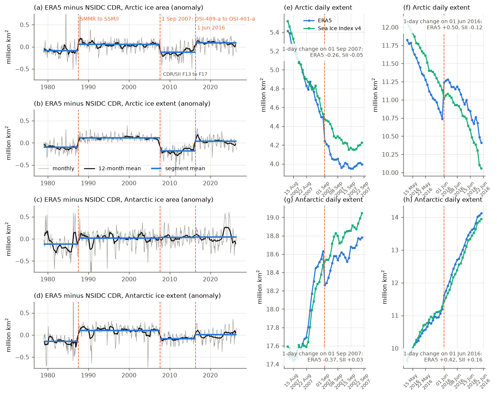
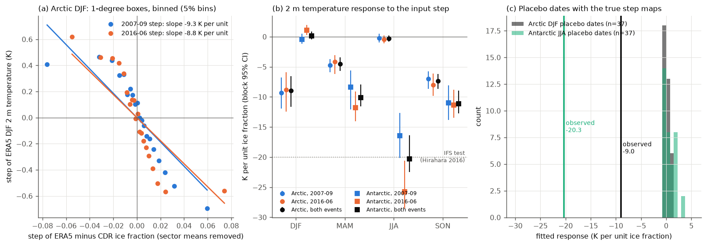
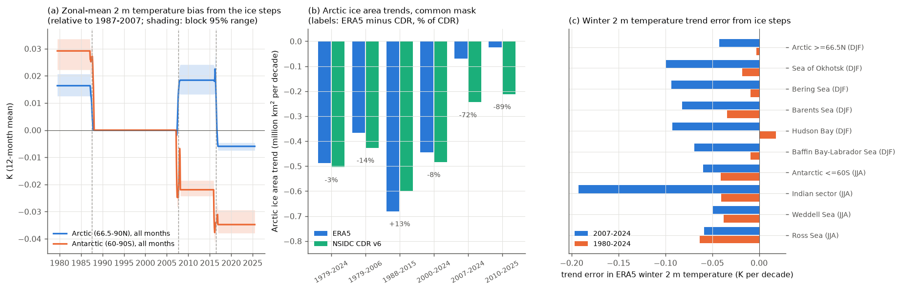

# ERA5 sea-ice input steps on 1 September 2007 and 1 June 2016 cause local polar winter 2 m temperature steps but change 1979-2024 Arctic-mean warming by less than 1% (NSIDC CDR reference)

## Summary

ERA5 is the reanalysis that most people use for polar temperature and sea-ice statistics. Its sea-ice lower boundary changed on 1 September 2007, from the reprocessed OSI SAF product (OSI-409-a) to the operational OSI SAF product (OSI-401-a, through OSTIA) (Hirahara et al. 2016, p. 7 and p. 22). ECMWF staff confirmed this change in 2024, but we found no measured size for the step and no estimate of its effect on ERA5 air temperature.

We read ERA5 sea-ice concentration (SIC) for every day of 1979-01-01 to 2026-06-30 and ERA5 2 m temperature (T2m) for every third day, from the public ARCO-ERA5 store. We compared the SIC with the NOAA/NSIDC Climate Data Record v6 (CDR) on its 25 km grids, on one common mask. We dated the steps with the daily NSIDC Sea Ice Index v4. We then used the input steps as natural experiments: they are external to the weather, so the T2m change at each grid box that follows the artificial ice change gives the causal T2m response.

Main results:

1. **There are two ERA5 sea-ice steps, not one.** On 1 September 2007, ERA5 Arctic extent fell by 0.26 million km2 in one day (the Sea Ice Index fell by 0.05). On 1 June 2016, ERA5 Arctic extent rose by 0.50 million km2 in one day (the Sea Ice Index fell by 0.12). We did not find documentation for the 2016 step. A blind change-point search on ERA5-minus-CDR Arctic extent puts its largest break exactly at 2007-09-01. The 2007 step in ERA5-minus-CDR Arctic ice area is -0.24 million km2 (95% CI -0.29 to -0.18; about -0.4 in January-March). The 2007 Antarctic extent step is -0.21 million km2.
2. **ERA5 sea-ice trends are wrong in sub-periods.** Over 1979-2024, ERA5 and CDR Arctic area trends agree (-0.49 and -0.50 million km2 per decade). Over 2007-2024, ERA5 shows 72% less Arctic area loss than the CDR (-0.07 against -0.24). Over 2010-2025 it shows 89% less (-0.02 against -0.21). Over 1988-2015 it shows 13% more loss.
3. **ERA5 T2m follows the artificial ice change.** In Arctic winter (DJF), T2m changes by -9.0 K per unit ice fraction (block-bootstrap 95% CI -11.6 to -6.6). The two events give the same value independently (-9.3 for 2007 and -8.8 for 2016). At 37 placebo dates with the same step maps, the fitted values have mean 0.0 and SD 0.55. The response is -4.5 K in MAM, -7.3 K in SON and near zero in JJA (melting surface). In Antarctic winter (JJA) it is -20.3 K (-22.5 to -16.4). An IFS experiment in Hirahara et al. (2016) gives about -20 K per unit locally, which is similar in size.
4. **The area-mean effect is small.** The ice errors are mostly at the ice edge and in coastal seas, so the 66.5-90N mean T2m bias is only +0.019 K in 2007-2016 (block range +0.014 to +0.025) and -0.006 K after 2016. The 1979-2024 Arctic warming trend changes from 0.692 to 0.695 K per decade, and the Arctic amplification ratio changes from 3.36 to 3.37 (less than 1%). The effect is larger in shorter periods and in regions. For 2007-2024 winter (DJF) trends, ERA5 is too low by 0.04 K per decade over 66.5-90N (24% of 0.18), and by 0.07-0.10 K per decade in the Sea of Okhotsk, Bering Sea, Barents Sea, Hudson Bay and Baffin Bay-Labrador Sea. In the Antarctic sea-ice zone (60-90S), the steps make the 1979-2024 annual trend 13-22% too low, and they change the 1980-2024 winter (JJA) trend from +0.001 to +0.03-0.04 K per decade.

Thus the 2007 input change is a real, measurable and causal error source in ERA5 polar T2m. But it does not explain the high Arctic amplification in ERA5, and it does not change Arctic-mean warming rates over 1979-2024. The largest practical risk is for users of ERA5 sea ice after 2007 and of regional winter T2m trends that start or end between 2007 and 2016.

**Figure 1.** (a-d) Monthly ERA5-minus-CDR sea-ice area and extent anomalies (calendar-month means removed), 1979-2026, with segment means. Orange dashed lines: SMMR-to-SSM/I sensor change (1987-08), ERA5 input change (2007-09-01) and the 2016-06-01 step. Grey dotted line: F13-to-F17 change in the CDR and Sea Ice Index (2008-01). (e-h) Daily ERA5 and Sea Ice Index extent around the two ERA5 step dates.

## 1. Question and context

Campaign 11_07_2026 found many step artifacts in boundary datasets. Examples are the DOISST SST steps, the ERA5 SST variance step at the same 2007 HadISST2-to-OSTIA change (sci:sha256:5d9b238d), the NCEP input steps in the AMIP sea-ice forcing (sci:sha256:af4b53c1) and the NCEP R1/R2 ocean temperature steps (sci:sha256:6258279f). The ERA5 sea-ice boundary was not tested. This matters because many studies use ERA5 T2m for Arctic amplification (for example the "nearly four times" result), and many use ERA5 SIC directly. Our questions were:

1. Does ERA5 SIC have steps at its input changes, and how large are they?
2. Does ERA5 T2m respond to these steps, and by how much per unit SIC?
3. How much do the steps change ERA5 polar temperature trends and the Arctic amplification ratio?

## 2. Data

- **ERA5** (C3S, CC BY 4.0): `sea_ice_cover` at 12 UTC on every day 1979-01-01 to 2026-06-30 (17,348 chunks), `2m_temperature` at 12 UTC on every third day (5,783 chunks), and `land_sea_mask`, from the ARCO-ERA5 Zarr store (store attribute `last_updated` 2026-11-11). The SHA-256 of every raw chunk is in `files/provenance/`.
- **NOAA/NSIDC CDR v6** (G02202, monthly, 25 km polar stereographic, 1978-11 to 2026-10, doi:10.7265/b18j-z797), from the campaign shared dataset store. We recomputed the SHA-256 of the four files; all agree with the store records. The CDR v6 is made from SMMR and SSM/I-SSMIS only; it has a sensor change at 2008-01 (F13 to F17) and none in 2015-2016.
- **NSIDC Sea Ice Index v4** (G02135) daily extent, downloaded on 2026-11-11. It uses F13 until 2007-12-31 and F17 from 2008-01-01, so the 2007-09-01 date falls in a single-sensor period.
- **Documentation**: Hirahara et al. (2016), ERA Report Series 26, pages 7-9 (SIC products: OSI-409-a reprocessed, OSI-401-a operational) and pages 21-22 (switch on 1 September 2007); the ECMWF forum thread of July 2024.

## 3. Methods

All code is in `files/code/`. Step numbers refer to the scripts.

- **Reduction (01).** For each ERA5 chunk we kept hemispheric ice area and extent (15% threshold) on the ERA5 grid, zonal means, and monthly mean fields poleward of 30N/39S (SIC) and 50N/50S (T2m).
- **Common-mask comparison (03).** We put the monthly ERA5 SIC on the CDR grids (nearest 0.25-degree point) and kept CDR ocean cells where both products are valid. We removed every sensor pole hole (north of 84.5N). We calculated area and extent for the hemisphere and for five sectors.
- **Daily dating (04).** We used the one-day change of ERA5 extent on the step day and compared it with all August-September days in other years. We also used the change of the daily ERA5-minus-Sea-Ice-Index difference.
- **Monthly steps (05).** Model D(t) = a_m + s_m H(t - t0) + b t + e for ERA5-minus-CDR monthly values in windows of 4-10 years around t0, with one step s_m per calendar month. Intervals come from a moving-block bootstrap (12-month blocks). We also ran the same fit at every September of 1985-2019 that is far from 2007 (placebo), and a blind binary-segmentation search for mean shifts on the full series.
- **T2m response (06, 07).** On a 1-degree grid, for each event (2007-09-01 and 2016-06-01), window W = 5 years, calendar month and box, we calculated the after-minus-before change of T2m (dT), of the artificial ice error A = ERA5 SIC - CDR SIC (dA), and of the CDR SIC (dC, the real change). We fitted dT = FE + bA dA + bC dC over ice-influenced boxes (valid fraction 0.5 or more; ice 15% or more in that month in the window), weighted by cos(latitude). The fixed effects are event x month x sector (45 degrees of longitude x 10 degrees of latitude), so large-scale weather changes do not enter bA. dC is a control: real ice change and weather are coupled, but the input step is not. Intervals: cluster bootstrap over 10 x 5 degree blocks (200 draws). Null: the same fit at 37 placebo dates (June and September of 1984-2002) whose windows contain no event, with the true event dA maps. Sensitivity: 90-degree sectors only, and month only.
- **Bias and trends (07, 08, 09).** We replaced A by its segment mean (per box and calendar month) in the segments 1979-01 to 1987-07, 1987-08 to 2007-08, 2007-09 to 2016-05 and 2016-06 to 2026-06. The bias is bA(season) x (segment A - A of 1987-2007). We took 1987-2007 as the reference because it is the long OSI-409-a SSM/I period. Variant "noS0" sets the 1979-1987 term to zero, because that step coincides with the SMMR-to-SSM/I change in both products and we cannot assign it to ERA5. Zone means count land and ice-free boxes as zero bias. Trends are OLS on annual (or winter) means.

## 4. Results

### 4.1 Sea-ice steps

| Quantity (million km2) | Arctic area | Arctic extent | Antarctic area | Antarctic extent |
|---|---|---|---|---|
| 2007-09-01 step, W = 6 years (95% CI) | -0.239 (-0.294, -0.182) | -0.280 (-0.343, -0.218) | +0.044 (-0.064, +0.152) | -0.212 (-0.306, -0.117) |
| same, W = 4 / 8 years | -0.268 / -0.265 | -0.267 / -0.316 | +0.027 / +0.022 | -0.262 / -0.200 |
| placebo SD (same fit, other Septembers) | 0.084 | 0.075 | 0.117 | 0.093 |
| 2016-06-01 step, W = 3 / 4 / 5 years | +0.21 / +0.16 / +0.13 | +0.37 / +0.28 / +0.23 | +0.04 / +0.02 / +0.00 | +0.20 / +0.16 / +0.13 |
| one-day ERA5 change on 2007-09-01 (Sea Ice Index) | | -0.257 (-0.053) | | -0.370 (+0.03) |
| one-day ERA5 change on 2016-06-01 (Sea Ice Index) | | +0.501 (-0.117) | | +0.42 (+0.16) |

- The one-day ERA5 changes on 2007-09-01 rank 11th (Arctic) and 6th (Antarctic) in absolute size among 2,806 August-September days of other years (SD 0.067 and 0.074 million km2).
- The Arctic 2007 step is largest in winter: the area step by calendar month (W = 6) is -0.40, -0.39, -0.39 in January-March and +0.04 in September. In extent it is largest in June-August (-0.42 to -0.53).
- By sector, the Arctic 2007 area step is in the marginal seas (Atlantic sector -0.08, Canada/Hudson -0.08, Pacific -0.04, Siberian -0.04); the central Arctic north of 80N has no step (-0.001; 95% CI -0.019 to +0.018) (Figure 2a).
- The blind search on Arctic extent finds 2007-09-01 (first), 1987-07 (SMMR to SSM/I) and 2015-10. On Arctic area it finds 2016-05, 2007-11, 1987-07 and 2013-07.
- After 2016, ERA5-minus-CDR Arctic area returns to about the 1987-2007 level (segment means relative to 1987-2007: -0.18 in 2007-2016 and +0.03 after 2016).

**Figure 2.** (a, b, e, f) Change of the ERA5-minus-CDR ice fraction between segments (Arctic JFM, Antarctic JAS). (c, d, g, h) Winter T2m bias (response x ice error) for 2007-2016 and 2016-2026 relative to 1987-2007.

### 4.2 Sea-ice trends (`results/ice_trends.json`)

| Arctic area trend (million km2 per decade) | ERA5 | CDR | ERA5 minus CDR |
|---|---|---|---|
| 1979-2024 | -0.487 | -0.504 | -3% |
| 1979-2006 | -0.368 | -0.426 | -14% |
| 1988-2015 | -0.680 | -0.600 | +13% |
| 2000-2024 | -0.445 | -0.483 | -8% |
| 2007-2024 | -0.068 | -0.244 | -72% |
| 2010-2025 | -0.024 | -0.212 | -89% |

For the Antarctic, the 1979-2024 area trend is -0.013 in ERA5 against -0.053 in the CDR. Later periods agree within 4-13%.

### 4.3 T2m response to the input steps (`results/t2m_response_summary.json`)

| bA (K per unit ice fraction), W = 5 | 2007 event | 2016 event | both events (block 95% CI) | placebo mean / SD (n = 37) |
|---|---|---|---|---|
| Arctic DJF | -9.3 | -8.8 | -9.0 (-11.6, -6.6) | 0.04 / 0.55 |
| Arctic MAM | -4.8 | -4.2 | -4.5 (-5.7, -3.5) | 0.05 / 0.45 |
| Arctic JJA | -0.2 | -0.5 | -0.3 (-0.8, +0.2) | -0.01 / 0.13 |
| Arctic SON | -7.0 | -8.0 | -7.3 (-8.7, -6.2) | -0.10 / 0.58 |
| Antarctic DJF | -0.4 | +1.1 | +0.2 (-0.4, +0.9) | 0.04 / 0.33 |
| Antarctic MAM | -8.4 | -11.8 | -10.1 (-11.6, -7.9) | 0.11 / 0.57 |
| Antarctic JJA | -16.5 | -25.8 | -20.3 (-22.5, -16.4) | 0.60 / 1.05 |
| Antarctic SON | -11.0 | -11.3 | -11.1 (-12.8, -8.9) | 0.04 / 1.00 |

- In every season with a clear response, no placebo value is as large as the observed value, so the placebo p-value is 1/38 = 0.026 (the smallest possible with 37 placebos).
- With coarser fixed effects the response is 0-30% larger: Arctic DJF -9.4 (90-degree sectors) and -11.1 (month only); Antarctic JJA -24.0 and -28.0 (`results/t2m_response_summary_FE_*.json`). Part of this increase can be real non-local response, and part can be weather that the coarse fixed effects do not remove.
- The control coefficient bC (real ice change) is similar in the Arctic (-9.3 K in DJF), as expected if ERA5 T2m responds to its own SIC regardless of the cause of the change.

**Figure 3.** (a) Binned partial-regression plot of the Arctic DJF T2m step against the ERA5-minus-CDR ice step for the two events. (b) Response by season, hemisphere and event. (c) Placebo distributions and observed values.

### 4.4 Consequences for ERA5 temperature trends

| Zone and period | Published ERA5 trend (K per decade) | Trend error from ice steps | Corrected |
|---|---|---|---|
| 66.5-90N, annual, 1979-2021 | 0.717 | -0.002 (noS0 +0.002) | 0.715-0.718 |
| 66.5-90N, annual, 1979-2024 | 0.692 | -0.002 (noS0 +0.001) | 0.691-0.695 |
| Arctic amplification, 1979-2024 | 3.36 | | 3.36-3.37 |
| 66.5-90N, annual, 2007-2024 | 0.394 | -0.018 | 0.412 |
| 66.5-90N, DJF, 2007-2024 | 0.176 | -0.043 | 0.218 |
| 60-90S, annual, 1979-2024 | 0.068 | -0.015 (noS0 -0.009) | 0.077-0.083 |
| 60-90S, JJA, 1980-2024 | 0.001 | -0.041 (noS0 -0.026) | 0.027-0.042 |

Regional winter trend errors for 2007-2024 (K per decade): Sea of Okhotsk -0.10, Bering Sea -0.09, Barents Sea -0.08, Hudson Bay -0.09, Baffin Bay-Labrador Sea -0.07, Kara Sea -0.06, central Arctic 80-84.5N -0.03; Antarctic Indian sector -0.19, Weddell Sea -0.05, Ross Sea -0.06 (`results/regional_bias_summary.json`). The zone-mean T2m bias in the 2007-2016 segment is +0.019 K (Arctic, all months) and +0.049 K (Arctic DJF); after 2016 it is -0.006 K and -0.013 K.

**Figure 4.** (a) 12-month mean zonal-mean T2m bias from the ice steps (shading: block 95% range of the response). (b) Arctic ice area trends, ERA5 and CDR, on the common mask. (c) Winter T2m trend errors for zones and regions.

## 5. Discussion

The 2007 change was planned to be consistent, because both products come from OSI SAF. Hirahara et al. (2016) found the two products "almost identical" in July 2007, with the reprocessed ice edge "slightly expanded towards the shore". Our comparison over 2002-2012 shows that the difference is systematic, with about 0.24 million km2 less Arctic ice area after the change, mostly in the marginal seas in winter and at the summer ice edge. A second step on 1 June 2016 reverses most of it. We do not know its cause. It can be an update of the operational OSI SAF algorithm or of the OSTIA processing. The CDR v6 and the Sea Ice Index have no sensor change on that date, and the ERA5 change happens within one day.

The response coefficients are a useful general result. They give the ERA5 T2m change that any SIC error causes: about -0.09 K per percentage point of SIC in Arctic winter, -0.2 K in Antarctic winter, and nearly zero in summer. Other boundary errors can use the same numbers, for example the NCEP-based AMIP sea-ice forcing steps (sci:sha256:af4b53c1).

The steps do not explain the high Arctic amplification in ERA5. The ice errors are at the ice edge and near the coast, where ice fraction changes affect small areas, and the response is local. Thus the zone-mean effect is about 0.02 K, much smaller than the 3 K of Arctic warming since 1979. But for users of ERA5 SIC itself, the steps are large: in ERA5, Arctic ice area loss almost stops after 2007-2010, which the CDR does not show.

## 6. Limitations

- The CDR is the reference. It has its own errors and its own algorithm (the larger of NASA Team and Bootstrap), so only the changes of ERA5-minus-CDR are meaningful, not the level. The 1987 step is in both products' sensor change and we cannot assign it. We give results with and without it ("noS0").
- North of 84.5N there is no CDR comparison, so the bias there is set to zero. The central Arctic north of 80N shows no 2007 step, so this omission is probably small.
- The response is a local, box-scale estimate with sector fixed effects. Non-local responses (advection of warmer air downstream) are partly removed by the fixed effects; coarser fixed effects give 0-30% larger values. The zone-mean bias with the coarsest choice is still only 0.025 K (Arctic, 2007-2016).
- The bias model uses segment means. It does not correct year-to-year ERA5-minus-CDR differences, which include CDR noise. Example: in Antarctic winter 2023-2024 ERA5 has 0.45 million km2 more area than the CDR, but only 0.05 more extent relative to the Sea Ice Index; we could not decide which product causes this.
- The 2007 change also changed the ERA5 SST (HadISST2 to OSTIA). Polar SST changes that follow the ice change are inside the bA estimate; SST changes away from the ice are not tested here.
- T2m is at 12 UTC on every third day; ERA5 SIC is at 12 UTC daily. Monthly means from these samples can differ slightly from the published monthly means.
- We could not test ERA5 T2m against independent air temperatures over sea ice for 2007. IABP Level 1 buoy files do not contain air temperature before about 2010.
- ARCO-ERA5 is a copy of ERA5 maintained by a third party; the chunk hashes in `files/provenance/` let a user check that the values did not change.

## 7. Files

- `files/code/`: `01_fetch_era5.py` (ARCO-ERA5 reader and reducer), `03_era5_vs_cdr.py`, `04_daily_step.py`, `05_monthly_step.py`, `06_build_1deg.py`, `07_t2m_response.py`, `08_regional_bias.py`, `09_ice_trends.py`, `10_figures.py`, `fetch_sii.sh`, `run_all.sh`.
- `files/results/`: step, response, bias and trend summaries (JSON); monthly ERA5 and CDR area/extent on the common mask (`cdr_compare_*.csv`); ERA5 daily hemispheric area/extent; daily step series (`daily/`); zonal-mean T2m series; T2m bias series; regional series; maps of step fields and segment errors (`maps/*.npz`, 1-degree and 25 km grids).
- `files/figures/`: Figures 1-4.
- `files/provenance/`: data provenance (URLs, versions, shared dataset paths and SHA-256), ERA5 chunk hashes, Sea Ice Index hashes.
- `files/NOTICE.md`: attribution and terms of the external data.

## 8. Reproduction

Python 3.12 with numpy, scipy, pandas, netCDF4, matplotlib, requests and numcodecs. Run `bash files/code/run_all.sh <datasets dir> <work dir>`. The datasets directory must contain the four NSIDC G02202 v6 files (paths and hashes in `files/provenance/data_provenance.json`). The ERA5 step transfers about 21 GB over anonymous HTTPS and keeps about 1.5 GB; it is resumable. On the campaign machine the transfer took about 2 hours (network-limited), and the analysis about 15 minutes. All downloads go into the work directory, not into the bundle.

## 9. Provenance

- Campaign 11_07_2026; job sci-1107-dell-earth-and-ocean-sciences-8d6d0f7cf83c; topic earth-and-ocean-sciences; machine dell; model claude-opus-5-5 (Claude Code agent). Analysis date 2026-11-11.
- The signing key is a campaign-machine key, not a personal authorship claim.

## References

- Hersbach, H. et al. (2020). The ERA5 global reanalysis. Q. J. R. Meteorol. Soc. 146, 1999-2049. doi:10.1002/qj.3803
- Hirahara, S., Balmaseda, M. A., de Boisseson, E., Hersbach, H. (2016). Sea surface temperature and sea ice concentration for ERA5. ERA Report Series 26, ECMWF.
- NOAA/NSIDC Climate Data Record of Passive Microwave Sea Ice Concentration, Version 6 (G02202). doi:10.7265/b18j-z797
- NSIDC Sea Ice Index, Version 4 (G02135). https://nsidc.org/data/g02135/versions/4
- Rantanen, M. et al. (2022). The Arctic has warmed nearly four times faster than the globe since 1979. Communications Earth & Environment 3, 168. doi:10.1038/s43247-022-00498-3
- Carver, R. W., Merose, A. (2023). ARCO-ERA5: An analysis-ready cloud-optimized reanalysis dataset. AMS Conference on AI for Environmental Science.
- Campaign publications: sci:sha256:5d9b238d (ERA5 SST variance step), sci:sha256:af4b53c1 (AMIP sea-ice forcing steps), sci:sha256:6258279f (NCEP R1/R2 ocean temperature steps), sci:sha256:d9bdf1f8 (joint SST homogenisation).
